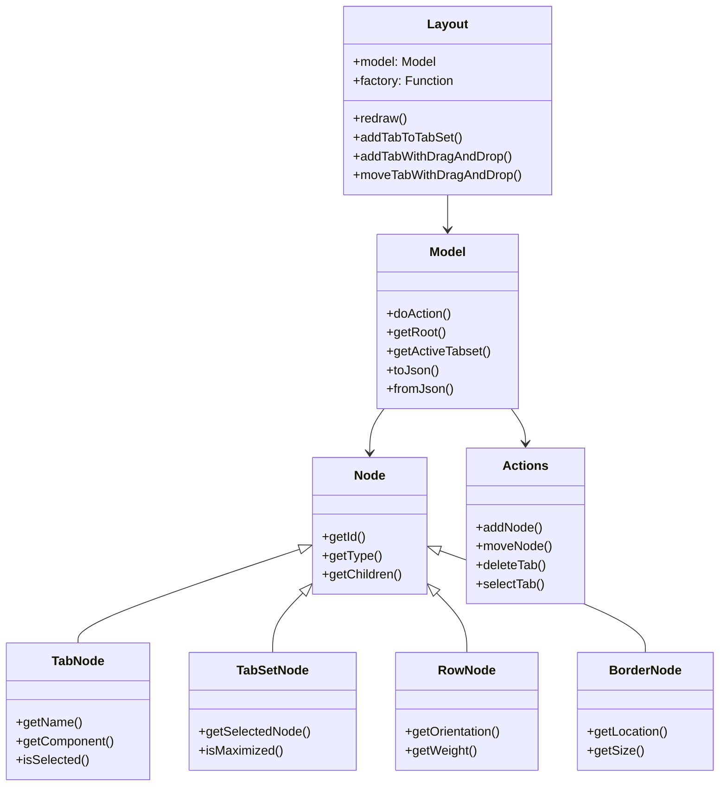
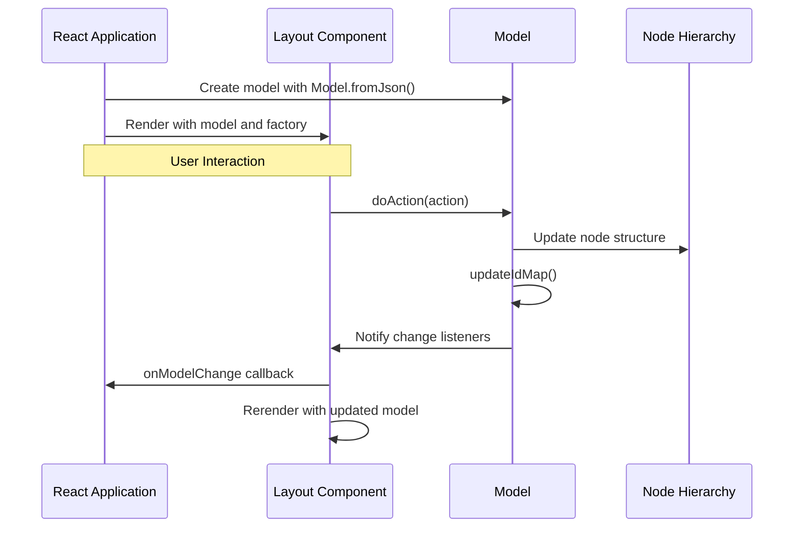
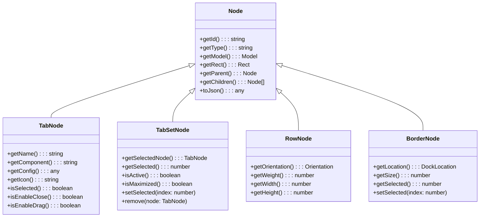

# API Reference

> **Relevant source files**
> * [README.md](https://github.com/caplin/FlexLayout/blob/40753f37/README.md?plain=1)
> * [src/model/BorderNode.ts](https://github.com/caplin/FlexLayout/blob/40753f37/src/model/BorderNode.ts)
> * [src/model/BorderSet.ts](https://github.com/caplin/FlexLayout/blob/40753f37/src/model/BorderSet.ts)
> * [src/model/IJsonModel.ts](https://github.com/caplin/FlexLayout/blob/40753f37/src/model/IJsonModel.ts)
> * [src/model/Model.ts](https://github.com/caplin/FlexLayout/blob/40753f37/src/model/Model.ts)
> * [src/model/Node.ts](https://github.com/caplin/FlexLayout/blob/40753f37/src/model/Node.ts)
> * [src/model/RowNode.ts](https://github.com/caplin/FlexLayout/blob/40753f37/src/model/RowNode.ts)
> * [src/model/TabNode.ts](https://github.com/caplin/FlexLayout/blob/40753f37/src/model/TabNode.ts)
> * [src/model/TabSetNode.ts](https://github.com/caplin/FlexLayout/blob/40753f37/src/model/TabSetNode.ts)
> * [src/view/Layout.tsx](https://github.com/caplin/FlexLayout/blob/40753f37/src/view/Layout.tsx)
> * [src/view/Tab.tsx](https://github.com/caplin/FlexLayout/blob/40753f37/src/view/Tab.tsx)

This document provides a comprehensive reference to the FlexLayout API, including core components, model structure, node types, and methods for programmatic control. FlexLayout is a flexible layout manager for React applications that enables complex UI layouts with docking, tabs, and drag-and-drop capabilities.

For general usage and examples, see [Overview](/caplin/FlexLayout/1-overview) and [Getting Started](/caplin/FlexLayout/1.1-getting-started). For architectural concepts, see [Architecture](/caplin/FlexLayout/2-architecture).

## Core Components

FlexLayout consists of several key components that work together to create flexible layouts:

### Component Hierarchy



Sources: [src/view/Layout.tsx L32-L166](https://github.com/caplin/FlexLayout/blob/40753f37/src/view/Layout.tsx#L32-L166)

 [src/model/Model.ts L28-L703](https://github.com/caplin/FlexLayout/blob/40753f37/src/model/Model.ts#L28-L703)

 [src/model/TabNode.ts L11-L424](https://github.com/caplin/FlexLayout/blob/40753f37/src/model/TabNode.ts#L11-L424)

### Data Flow



Sources: [src/view/Layout.tsx L729-L737](https://github.com/caplin/FlexLayout/blob/40753f37/src/view/Layout.tsx#L729-L737)

 [src/model/Model.ts L71-L301](https://github.com/caplin/FlexLayout/blob/40753f37/src/model/Model.ts#L71-L301)

## Layout Component API

The `Layout` component is the main React component that renders the FlexLayout interface.

### Props

| Prop | Type | Description |
| --- | --- | --- |
| `model` | `Model` | The model for this layout |
| `factory` | `(node: TabNode) => React.ReactNode` | Factory function for creating tab components |
| `popoutClassName` | `string?` | Class name for popout windows |
| `icons` | `IIcons?` | Custom icons for UI elements |
| `onAction` | `(action: Action) => Action \| undefined` | Intercept actions before they're dispatched |
| `onRenderTab` | `(node: TabNode, renderValues: ITabRenderValues) => void` | Customize tab rendering |
| `onRenderTabSet` | `(tabSetNode: TabSetNode \| BorderNode, renderValues: ITabSetRenderValues) => void` | Customize tabset rendering |
| `onModelChange` | `(model: Model, action: Action) => void` | Called when model changes |
| `onExternalDrag` | `(event: React.DragEvent) => { json: any, onDrop?: Function } \| undefined` | Handle external drag operations |
| `classNameMapper` | `(defaultClassName: string) => string` | Map CSS class names |
| `i18nMapper` | `(id: I18nLabel, param?: string) => string \| undefined` | User translation function |
| `supportsPopout` | `boolean?` | Whether popout windows are supported |
| `popoutURL` | `string?` | URL for popout windows |
| `realtimeResize` | `boolean?` | Whether to resize tabs as splitters are dragged |
| `onContextMenu` | `NodeMouseEvent` | Handle context menu events |
| `popoutWindowName` | `string?` | Name for popout windows |

Sources: [src/view/Layout.tsx L32-L82](https://github.com/caplin/FlexLayout/blob/40753f37/src/view/Layout.tsx#L32-L82)

### Methods

| Method | Description |
| --- | --- |
| `redraw()` | Re-renders the layout |
| `addTabToTabSet(tabsetId: string, json: IJsonTabNode)` | Adds a new tab to the specified tabset |
| `addTabToActiveTabSet(json: IJsonTabNode)` | Adds a new tab to the currently active tabset |
| `addTabWithDragAndDrop(event: DragEvent, json: IJsonTabNode, onDrop?: Function)` | Adds a tab using drag and drop |
| `moveTabWithDragAndDrop(event: DragEvent, node: TabNode \| TabSetNode)` | Moves a tab using drag and drop |
| `setDragComponent(event: DragEvent, component: React.ReactNode, x: number, y: number)` | Sets the drag image for a drag operation |
| `getRootDiv()` | Returns the root div element of the layout |

Sources: [src/view/Layout.tsx L100-L165](https://github.com/caplin/FlexLayout/blob/40753f37/src/view/Layout.tsx#L100-L165)

## Model API

The `Model` class contains the node tree that represents the layout structure.

### Creation

```javascript
// Create a model from JSONconst model = Model.fromJson(jsonObject);
```

### Key Methods

| Method | Description |
| --- | --- |
| `doAction(action: Action)` | Updates the node tree by performing the given action |
| `getActiveTabset(windowId?: string)` | Gets the currently active tabset |
| `getMaximizedTabset(windowId?: string)` | Gets the currently maximized tabset |
| `getRoot(windowId?: string)` | Gets the root node of the model |
| `getBorderSet()` | Gets the BorderSet containing border nodes |
| `visitNodes(fn: (node: Node, level: number) => void)` | Visits all nodes and calls the function for each |
| `getNodeById(id: string)` | Gets a node by its ID |
| `toJson()` | Converts the model to a JSON object |
| `setOnAllowDrop(onAllowDrop: Function)` | Sets a function to control drop operations |
| `setOnCreateTabSet(onCreateTabSet: Function)` | Sets a callback for new tabset creation |
| `addChangeListener(listener: Function)` | Adds a listener for model changes |
| `removeChangeListener(listener: Function)` | Removes a listener for model changes |

Sources: [src/model/Model.ts L70-L491](https://github.com/caplin/FlexLayout/blob/40753f37/src/model/Model.ts#L70-L491)

## Actions API

The `Actions` class provides static methods to create action objects for modifying the model.

### Common Actions

| Action | Description |
| --- | --- |
| `addNode(json, toNodeId, location, index, select?)` | Adds a new node |
| `moveNode(fromNodeId, toNodeId, location, index, select?)` | Moves a node |
| `deleteTab(tabNodeId)` | Deletes a tab |
| `deleteTabset(tabsetNodeId)` | Deletes a tabset |
| `selectTab(tabNodeId)` | Selects a tab |
| `setActiveTabset(tabsetNodeId?)` | Sets the active tabset |
| `maximizeToggle(tabsetNodeId)` | Toggles maximized state of a tabset |
| `updateNodeAttributes(nodeId, attributes)` | Updates attributes of a node |
| `renameTab(tabNodeId, name)` | Renames a tab |

Actions are dispatched to the model using the `doAction` method:

```javascript
// Example: Add a new tabconst newTabJson = { type: "tab", name: "New Tab", component: "myComponent" };model.doAction(Actions.addNode(newTabJson, tabsetId, DockLocation.CENTER, -1, true));
```

Sources: [src/model/Model.ts L71-L301](https://github.com/caplin/FlexLayout/blob/40753f37/src/model/Model.ts#L71-L301)

## Node API

FlexLayout uses a hierarchical node structure to represent the layout.

### Node Hierarchy



Sources: [src/model/TabNode.ts L11-L424](https://github.com/caplin/FlexLayout/blob/40753f37/src/model/TabNode.ts#L11-L424)

 [src/model/Model.ts L356-L370](https://github.com/caplin/FlexLayout/blob/40753f37/src/model/Model.ts#L356-L370)

### TabNode API

The `TabNode` class represents a tab in the layout.

| Method | Description |
| --- | --- |
| `getName()` | Gets the name of the tab |
| `getComponent()` | Gets the component identifier |
| `getConfig()` | Gets the config object |
| `getExtraData()` | Gets the transient data object |
| `isSelected()` | Checks if this tab is selected |
| `getIcon()` | Gets the tab icon |
| `isEnableClose()` | Checks if this tab can be closed |
| `isEnableDrag()` | Checks if this tab can be dragged |
| `isEnableRename()` | Checks if this tab can be renamed |
| `getClassName()` | Gets the CSS class name |
| `getContentClassName()` | Gets the content CSS class name |

Sources: [src/model/TabNode.ts L55-L175](https://github.com/caplin/FlexLayout/blob/40753f37/src/model/TabNode.ts#L55-L175)

### TabSetNode API

The `TabSetNode` class represents a set of tabs.

| Method | Description |
| --- | --- |
| `getSelectedNode()` | Gets the selected tab node |
| `getSelected()` | Gets the index of the selected tab |
| `isActive()` | Checks if this tabset is active |
| `isMaximized()` | Checks if this tabset is maximized |
| `setSelected(index)` | Sets the selected tab |
| `remove(node)` | Removes a tab from this tabset |
| `drop(node, location, index)` | Drops a node into this tabset |

## JSON Model Structure

FlexLayout uses JSON objects to define layout structures. Here's an overview of the key interfaces:

### IJsonModel

```
interface IJsonModel {    global?: IGlobalAttributes;      // Global configuration    borders?: IJsonBorderNode[];     // Border regions    layout: IJsonRowNode;            // Main layout definition    popouts?: Record<string, IJsonPopout>; // Popout windows}
```

Sources: [src/model/IJsonModel.ts L5-L10](https://github.com/caplin/FlexLayout/blob/40753f37/src/model/IJsonModel.ts#L5-L10)

### Node JSON Structures

| Interface | Description |
| --- | --- |
| `IJsonTabNode` | Defines a tab |
| `IJsonTabSetNode` | Defines a tabset |
| `IJsonRowNode` | Defines a row |
| `IJsonBorderNode` | Defines a border |

Example JSON structure:

```json
{  "global": {    "tabEnableClose": true,    "tabEnableRename": true  },  "layout": {    "type": "row",    "weight": 100,    "children": [      {        "type": "tabset",        "weight": 50,        "children": [          {            "type": "tab",            "name": "Tab 1",            "component": "component1"          }        ]      }    ]  }}
```

Sources: [src/model/IJsonModel.ts L24-L45](https://github.com/caplin/FlexLayout/blob/40753f37/src/model/IJsonModel.ts#L24-L45)

## Attributes System

FlexLayout uses a hierarchical attributes system where global defaults can be overridden at the node level.

### Global Attributes

Defined in the `global` section of the JSON model, they provide default values for all nodes.

Key global attributes:

| Attribute | Type | Default | Description |
| --- | --- | --- | --- |
| `tabEnableClose` | `boolean` | `true` | Allow tabs to be closed |
| `tabEnableDrag` | `boolean` | `true` | Allow tabs to be dragged |
| `tabEnableRename` | `boolean` | `true` | Allow tabs to be renamed |
| `tabSetEnableMaximize` | `boolean` | `true` | Allow tabsets to be maximized |
| `enableEdgeDock` | `boolean` | `true` | Enable docking to edges |
| `splitterSize` | `number` | `8` | Width of splitters |

Sources: [src/model/IJsonModel.ts L49-L495](https://github.com/caplin/FlexLayout/blob/40753f37/src/model/IJsonModel.ts#L49-L495)

### Node-Specific Attributes

Each node type has its own set of attributes:

* **TabNode**: `name`, `component`, `icon`, `enableClose`, etc.
* **TabSetNode**: `selected`, `enableMaximize`, `enableTabStrip`, etc.
* **RowNode**: `weight`, etc.
* **BorderNode**: `size`, `show`, `enableDrop`, etc.

Sources: [src/model/TabNode.ts L338-L423](https://github.com/caplin/FlexLayout/blob/40753f37/src/model/TabNode.ts#L338-L423)

 [src/model/IJsonModel.ts L497-L967](https://github.com/caplin/FlexLayout/blob/40753f37/src/model/IJsonModel.ts#L497-L967)

## Example Usage

```javascript
import { Layout, Model, Actions } from 'flexlayout-react'; // Create model from JSONconst json = {  global: { tabEnableClose: false },  layout: {    type: 'row',    weight: 100,    children: [      {        type: 'tabset',        weight: 50,        children: [          {            type: 'tab',            name: 'Tab 1',            component: 'component1'          }        ]      }    ]  }}; const model = Model.fromJson(json); // Component factoryconst factory = (node) => {  const component = node.getComponent();  if (component === 'component1') {    return <Component1 />;  }  return null;}; // Using the Layout componentfunction MyLayout() {  return (    <Layout      model={model}      factory={factory}      onAction={(action) => {        console.log('Action performed:', action);        return action; // Allow the action      }}    />  );}
```

For more detailed information about props and configuration options, see [Component Props](/caplin/FlexLayout/7.1-component-props), [Model API](/caplin/FlexLayout/7.2-model-api), and [Interfaces and Types](/caplin/FlexLayout/7.3-interfaces-and-types).