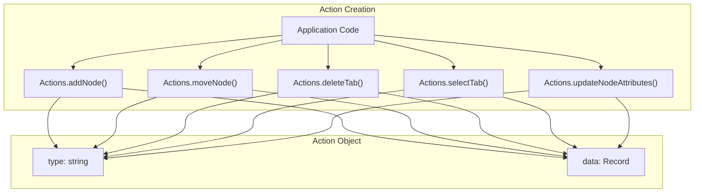
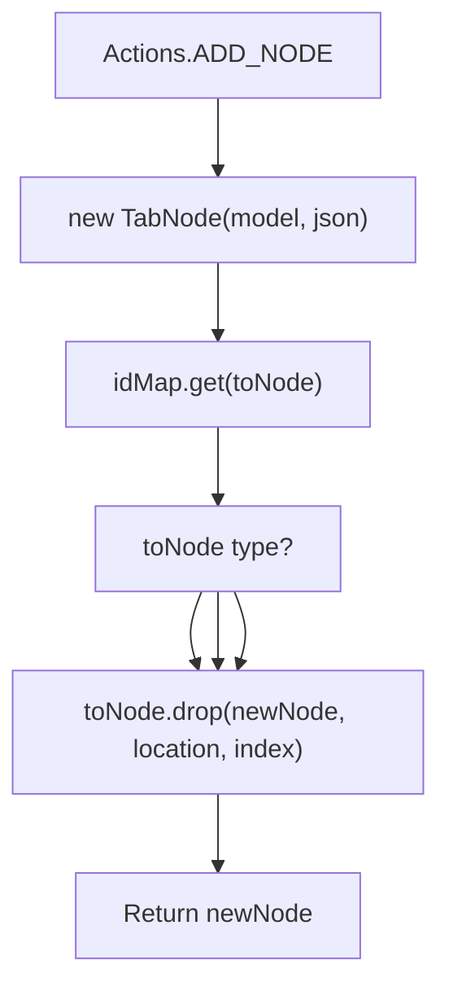
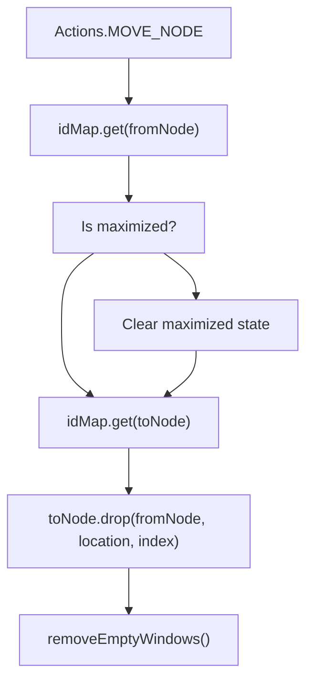
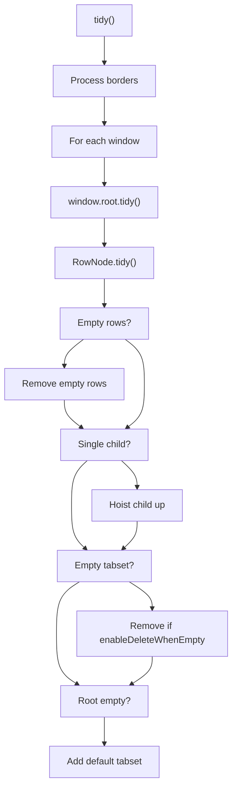
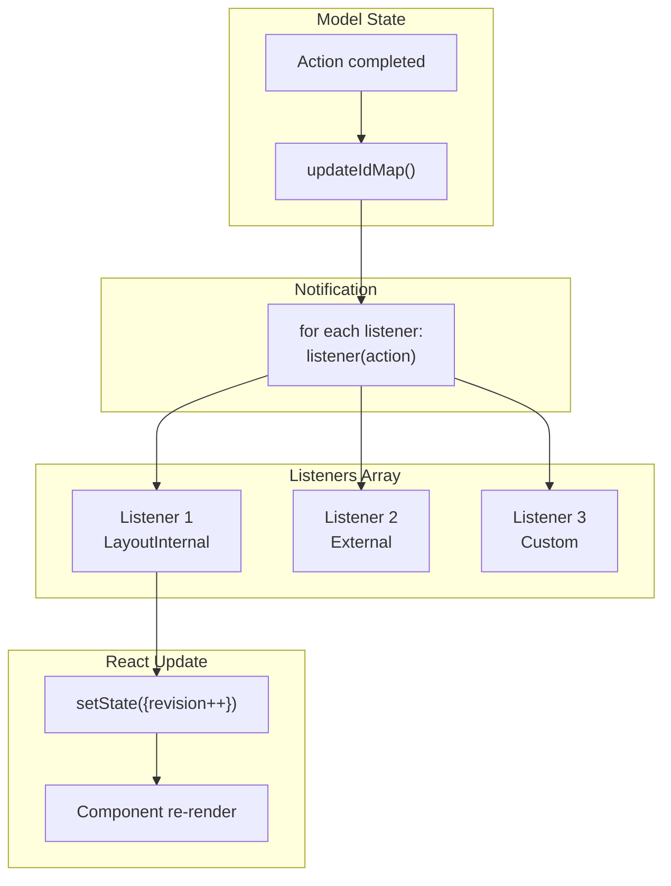
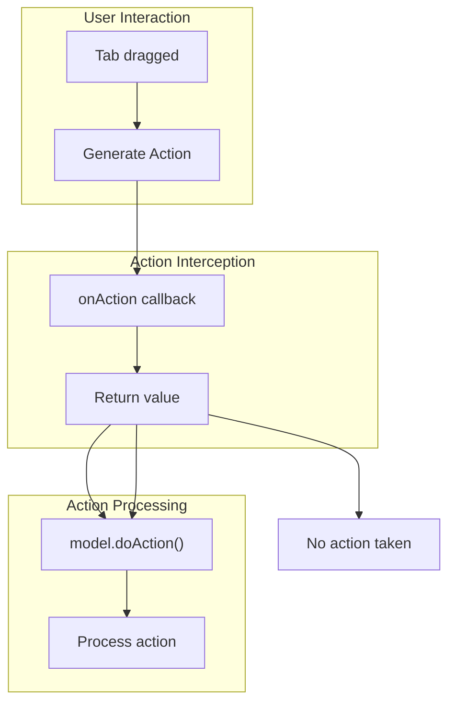
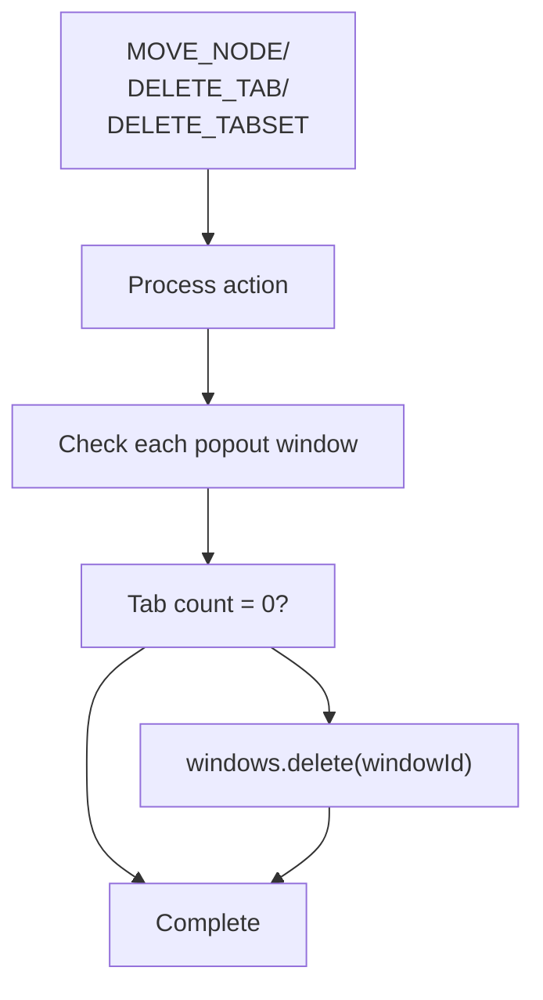

# Actions and State Management

> **Relevant source files**
> * [README.md](https://github.com/caplin/FlexLayout/blob/40753f37/README.md?plain=1)
> * [src/model/Actions.ts](https://github.com/caplin/FlexLayout/blob/40753f37/src/model/Actions.ts)
> * [src/model/BorderNode.ts](https://github.com/caplin/FlexLayout/blob/40753f37/src/model/BorderNode.ts)
> * [src/model/BorderSet.ts](https://github.com/caplin/FlexLayout/blob/40753f37/src/model/BorderSet.ts)
> * [src/model/IJsonModel.ts](https://github.com/caplin/FlexLayout/blob/40753f37/src/model/IJsonModel.ts)
> * [src/model/Model.ts](https://github.com/caplin/FlexLayout/blob/40753f37/src/model/Model.ts)
> * [src/model/Node.ts](https://github.com/caplin/FlexLayout/blob/40753f37/src/model/Node.ts)
> * [src/model/RowNode.ts](https://github.com/caplin/FlexLayout/blob/40753f37/src/model/RowNode.ts)
> * [src/model/TabNode.ts](https://github.com/caplin/FlexLayout/blob/40753f37/src/model/TabNode.ts)
> * [src/model/TabSetNode.ts](https://github.com/caplin/FlexLayout/blob/40753f37/src/model/TabSetNode.ts)
> * [src/model/Utils.ts](https://github.com/caplin/FlexLayout/blob/40753f37/src/model/Utils.ts)
> * [src/view/Tab.tsx](https://github.com/caplin/FlexLayout/blob/40753f37/src/view/Tab.tsx)

This page documents the Actions API and the state management flow in FlexLayout. It explains how state changes are initiated, processed, and propagated through the system.

For details about the Model class itself, see [Model Class](/caplin/FlexLayout/4.1-model-class). For information about the node tree structure, see [Node Hierarchy](/caplin/FlexLayout/4.2-node-hierarchy).

## Overview

FlexLayout uses a unidirectional data flow pattern where all state changes occur through Actions. User interactions and programmatic modifications generate Action objects that are dispatched to the Model. The Model processes these actions, updates its internal state, and notifies registered listeners, triggering React re-renders.

This pattern provides:

* **Centralized state management**: All mutations go through a single `doAction()` method
* **Action logging/undo capability**: Actions can be intercepted, logged, or modified
* **Predictable updates**: State changes follow a consistent path
* **External control points**: Applications can intercept actions before they're applied

Sources: [src/model/Model.ts L1-L703](https://github.com/caplin/FlexLayout/blob/40753f37/src/model/Model.ts#L1-L703)

 [src/model/Actions.ts L1-L189](https://github.com/caplin/FlexLayout/blob/40753f37/src/model/Actions.ts#L1-L189)

 [README.md L297-L334](https://github.com/caplin/FlexLayout/blob/40753f37/README.md?plain=1#L297-L334)

## Action Types

FlexLayout defines 15 action types as static constants on the `Actions` class. Each action type corresponds to a specific state mutation.

### Core Action Types

| Action Type | Purpose | Key Parameters |
| --- | --- | --- |
| `ADD_NODE` | Add a new tab to the layout | `json`, `toNodeId`, `location`, `index`, `select` |
| `MOVE_NODE` | Move a tab or tabset between locations | `fromNodeId`, `toNodeId`, `location`, `index`, `select` |
| `DELETE_TAB` | Remove a tab from the layout | `tabNodeId` |
| `DELETE_TABSET` | Remove a tabset and its tabs | `tabsetNodeId` |
| `RENAME_TAB` | Change a tab's name | `tabNodeId`, `text` |
| `SELECT_TAB` | Select a specific tab | `tabNodeId` |
| `SET_ACTIVE_TABSET` | Set the active tabset | `tabsetNodeId`, `windowId` |
| `MAXIMIZE_TOGGLE` | Maximize/restore a tabset | `tabsetNodeId`, `windowId` |

### Layout Adjustment Actions

| Action Type | Purpose | Key Parameters |
| --- | --- | --- |
| `ADJUST_WEIGHTS` | Update row child weights (splitter move) | `nodeId`, `weights[]` |
| `ADJUST_BORDER_SPLIT` | Adjust border size | `nodeId`, `pos` |
| `UPDATE_MODEL_ATTRIBUTES` | Update global model attributes | `attributes` |
| `UPDATE_NODE_ATTRIBUTES` | Update specific node attributes | `nodeId`, `attributes` |

### Window Management Actions

| Action Type | Purpose | Key Parameters |
| --- | --- | --- |
| `POPOUT_TAB` | Pop out a tab to new window | `nodeId` |
| `POPOUT_TABSET` | Pop out a tabset to new window | `nodeId` |
| `CLOSE_WINDOW` | Close a popout window | `windowId` |
| `CREATE_WINDOW` | Create a new popout window | `layout`, `rect` |

Sources: [src/model/Actions.ts L9-L24](https://github.com/caplin/FlexLayout/blob/40753f37/src/model/Actions.ts#L9-L24)

## Action Creation

Actions are created using static factory methods on the `Actions` class. Each method returns an `Action` object with a `type` and `data` payload.



### Example: Adding a Tab

```javascript
const action = Actions.addNode(    {type: "tab", component: "grid", name: "New Grid"},    "tabset-1",           // target tabset id    DockLocation.CENTER,  // dock location    -1,                   // index (-1 = end)    true                  // select the new tab); model.doAction(action);
```

### Example: Moving a Tab

```javascript
const action = Actions.moveNode(    "tab-source-id",      // tab to move    "tabset-target-id",   // destination tabset    DockLocation.CENTER,  // dock location    2,                    // insert at index 2    true                  // select after move); model.doAction(action);
```

### Example: Updating Attributes

```javascript
// Update a single nodeconst action = Actions.updateNodeAttributes(    "tab-id",    {name: "Updated Name", config: {color: "blue"}}); // Update global model attributesconst action = Actions.updateModelAttributes(    {splitterSize: 12, tabSetEnableClose: true});
```

Sources: [src/model/Actions.ts L26-L188](https://github.com/caplin/FlexLayout/blob/40753f37/src/model/Actions.ts#L26-L188)

 [README.md L310-L330](https://github.com/caplin/FlexLayout/blob/40753f37/README.md?plain=1#L310-L330)

## Action Dispatch Flow

```mermaid
sequenceDiagram
  participant Application
  participant Actions API
  participant Layout Component
  participant Model.doAction()
  participant Action Switch
  participant Node Tree
  participant Change Listeners
  participant React Re-render

  Application->>Actions API: Actions.moveNode(from, to, location)
  Actions API-->>Application: Action object
  loop [Via onAction callback]
    Application->>Layout Component: onAction(action)
    Layout Component-->>Application: modified/cancelled action
  end
  Application->>Model.doAction(): model.doAction(action)
  Model.doAction()->>Action Switch: switch(action.type)
  Action Switch->>Node Tree: Update node tree
  note over Node Tree: Add/move/delete nodes
  Action Switch->>Model.doAction(): updateIdMap()
  note over Model.doAction(): Rebuild id->node mapping
  Action Switch->>Model.doAction(): tidy()
  note over Model.doAction(): Clean up empty nodes
  Model.doAction()->>Change Listeners: Notify all listeners(action)
  Change Listeners->>React Re-render: setState/forceUpdate
  React Re-render->>React Re-render: Component re-render
```

The dispatch flow follows these steps:

1. **Action Creation**: Application code calls an `Actions` static method
2. **Optional Interception**: The `onAction` callback (if provided) can modify or cancel the action
3. **Action Processing**: `Model.doAction()` processes the action in a switch statement
4. **Tree Mutation**: The node tree is updated based on the action type
5. **ID Map Update**: `updateIdMap()` rebuilds the id-to-node mapping
6. **Tree Cleanup**: `tidy()` normalizes the tree structure
7. **Listener Notification**: All registered change listeners are called
8. **Re-render**: React components update based on the new model state

Sources: [src/model/Model.ts L71-L301](https://github.com/caplin/FlexLayout/blob/40753f37/src/model/Model.ts#L71-L301)

 [src/model/Model.ts L545-L555](https://github.com/caplin/FlexLayout/blob/40753f37/src/model/Model.ts#L545-L555)

 [src/model/Model.ts L577-L583](https://github.com/caplin/FlexLayout/blob/40753f37/src/model/Model.ts#L577-L583)

## Action Processing

The `Model.doAction()` method contains a large switch statement that handles each action type. Here's how key actions are processed:

### ADD_NODE Processing



The `ADD_NODE` action:

1. Creates a new `TabNode` from the provided JSON
2. Retrieves the target node (tabset, border, or row)
3. Calls the target's `drop()` method to add the tab
4. Returns the newly created node

Sources: [src/model/Model.ts L75-L82](https://github.com/caplin/FlexLayout/blob/40753f37/src/model/Model.ts#L75-L82)

### MOVE_NODE Processing



The `MOVE_NODE` action:

1. Retrieves the source node (tab or tabset)
2. Clears maximized state if the node is maximized
3. Retrieves the target node
4. Calls the target's `drop()` method
5. Removes any empty popout windows

Sources: [src/model/Model.ts L84-L98](https://github.com/caplin/FlexLayout/blob/40753f37/src/model/Model.ts#L84-L98)

### SELECT_TAB Processing

The `SELECT_TAB` action updates which tab is selected in its parent container:

1. Retrieves the tab node and its parent
2. Calculates the tab's index in the parent's children
3. For `BorderNode`: toggles selection (select/deselect)
4. For `TabSetNode`: sets the selected index and marks as active tabset

Sources: [src/model/Model.ts L213-L234](https://github.com/caplin/FlexLayout/blob/40753f37/src/model/Model.ts#L213-L234)

### UPDATE_NODE_ATTRIBUTES Processing

This action updates a node's attributes:

1. Retrieves the target node from `idMap`
2. Calls `node.updateAttrs(json)` to merge new attributes
3. The node's `AttributeDefinitions` handle the merge

Sources: [src/model/Model.ts L285-L289](https://github.com/caplin/FlexLayout/blob/40753f37/src/model/Model.ts#L285-L289)

 [src/model/TabSetNode.ts L497-L499](https://github.com/caplin/FlexLayout/blob/40753f37/src/model/TabSetNode.ts#L497-L499)

 [src/model/TabNode.ts L311-L313](https://github.com/caplin/FlexLayout/blob/40753f37/src/model/TabNode.ts#L311-L313)

## State Update Mechanism

After processing an action, the Model performs cleanup and updates:

### ID Map Regeneration

```mermaid
flowchart TD

Clear["idMap.clear()"]
Visit["visitNodes(fn)"]
AddToMap["idMap.set(id, node)"]

subgraph updateIdMap() ["updateIdMap()"]
    Clear
    Visit
    AddToMap
    Clear --> Visit
    Visit --> AddToMap
end
```

The `updateIdMap()` method:

* Clears the existing id-to-node mapping
* Traverses all nodes via `visitNodes()`
* Rebuilds the `idMap` with current nodes

This ensures the map stays synchronized after structural changes.

Sources: [src/model/Model.ts L545-L555](https://github.com/caplin/FlexLayout/blob/40753f37/src/model/Model.ts#L545-L555)

### Tree Tidying

The `tidy()` method normalizes the tree structure:



The `tidy()` operations:

* Remove empty row nodes
* Hoist single-child rows up one level
* Remove empty tabsets (if `enableDeleteWhenEmpty` is true)
* Add a default tabset if the root becomes empty

Sources: [src/model/Model.ts L577-L583](https://github.com/caplin/FlexLayout/blob/40753f37/src/model/Model.ts#L577-L583)

 [src/model/RowNode.ts L311-L368](https://github.com/caplin/FlexLayout/blob/40753f37/src/model/RowNode.ts#L311-L368)

## Change Notification System



### Listener Management

The Model maintains an array of change listeners that are notified after each action:

**Adding a Listener:**

```javascript
model.addChangeListener((action: Action) => {    console.log("Action:", action.type);    // React to changes});
```

**Removing a Listener:**

```javascript
const listener = (action) => { /* ... */ };model.addChangeListener(listener);// Later:model.removeChangeListener(listener);
```

**LayoutInternal Registration:**

The `Layout` component automatically registers a change listener in `useEffect`:

```javascript
useEffect(() => {    model.addChangeListener(onModelChange);    return () => model.removeChangeListener(onModelChange);}, []);
```

The `onModelChange` callback increments a revision counter, triggering a re-render.

Sources: [src/model/Model.ts L482-L491](https://github.com/caplin/FlexLayout/blob/40753f37/src/model/Model.ts#L482-L491)

 [src/model/Model.ts L296-L298](https://github.com/caplin/FlexLayout/blob/40753f37/src/model/Model.ts#L296-L298)

## Action Interception

FlexLayout supports action interception via the `onAction` callback prop on the `Layout` component. This allows applications to:

* Log actions for debugging or undo/redo
* Modify actions before they're applied
* Cancel actions by returning `undefined`
* Implement custom validation logic



### Example: Logging Actions

```javascript
<Layout    model={model}    factory={factory}    onAction={(action) => {        console.log("Action:", action.type, action.data);        return action; // Allow action to proceed    }}/>
```

### Example: Preventing Certain Actions

```javascript
<Layout    model={model}    factory={factory}    onAction={(action) => {        if (action.type === Actions.DELETE_TAB) {            const tabNode = model.getNodeById(action.data.node);            if (tabNode.getName() === "Important Tab") {                return undefined; // Cancel deletion            }        }        return action;    }}/>
```

### Example: Modifying Actions

```typescript
<Layout    model={model}    factory={factory}    onAction={(action) => {        if (action.type === Actions.ADD_NODE) {            // Always add a timestamp config            action.data.json.config = {                ...action.data.json.config,                createdAt: Date.now()            };        }        return action;    }}/>
```

Sources: [README.md L332-L334](https://github.com/caplin/FlexLayout/blob/40753f37/README.md?plain=1#L332-L334)

## Common Action Patterns

### Pattern: Adding Tabs to Active Tabset

```javascript
const activeTabset = model.getActiveTabset();if (activeTabset) {    model.doAction(Actions.addNode(        {type: "tab", component: "myComponent", name: "New Tab"},        activeTabset.getId(),        DockLocation.CENTER,        -1,  // Add to end        true // Select new tab    ));}
```

### Pattern: Adding Tabs by Tabset ID

```sql
model.doAction(Actions.addNode(    {type: "tab", component: "grid", name: "Data Grid"},    "NAVIGATION",  // Known tabset id    DockLocation.CENTER,    0,    // Add at start    false // Don't select));
```

### Pattern: Moving Multiple Tabs

```javascript
const sourceTabs = sourceTabset.getChildren();sourceTabs.forEach(tab => {    model.doAction(Actions.moveNode(        tab.getId(),        targetTabset.getId(),        DockLocation.CENTER,        -1    ));});
```

### Pattern: Batch Updates

```javascript
// Multiple actions trigger multiple re-rendersmodel.doAction(Actions.updateNodeAttributes(id1, {name: "Tab 1"}));model.doAction(Actions.updateNodeAttributes(id2, {name: "Tab 2"}));model.doAction(Actions.updateNodeAttributes(id3, {name: "Tab 3"})); // Better: Use a single action when possible// Or wrap in React batch updateReactDOM.unstable_batchedUpdates(() => {    model.doAction(Actions.updateNodeAttributes(id1, {name: "Tab 1"}));    model.doAction(Actions.updateNodeAttributes(id2, {name: "Tab 2"}));    model.doAction(Actions.updateNodeAttributes(id3, {name: "Tab 3"}));});
```

### Pattern: Programmatic Layout Changes

```sql
// Maximize a tabsetmodel.doAction(Actions.maximizeToggle(tabsetId)); // Select a specific tabmodel.doAction(Actions.selectTab(tabId)); // Set active tabsetmodel.doAction(Actions.setActiveTabset(tabsetId));
```

Sources: [README.md L310-L330](https://github.com/caplin/FlexLayout/blob/40753f37/README.md?plain=1#L310-L330)

 [README.md L376-L388](https://github.com/caplin/FlexLayout/blob/40753f37/README.md?plain=1#L376-L388)

## Action Side Effects

Certain actions trigger automatic cleanup and side effects:

### Empty Window Removal

After `MOVE_NODE`, `DELETE_TAB`, and `DELETE_TABSET` actions, the Model checks for empty popout windows and removes them via `removeEmptyWindows()`.



Sources: [src/model/Model.ts L97-L98](https://github.com/caplin/FlexLayout/blob/40753f37/src/model/Model.ts#L97-L98)

 [src/model/Model.ts L105-L106](https://github.com/caplin/FlexLayout/blob/40753f37/src/model/Model.ts#L105-L106)

 [src/model/Model.ts L126-L127](https://github.com/caplin/FlexLayout/blob/40753f37/src/model/Model.ts#L126-L127)

 [src/model/Model.ts L500-L519](https://github.com/caplin/FlexLayout/blob/40753f37/src/model/Model.ts#L500-L519)

### Selected Index Adjustment

When tabs are removed, the selected index in their parent tabset/border is automatically adjusted:

* If the removed tab was selected and tabs remain: select the next tab (or last if removed was last)
* If the removed tab was before the selected tab: decrement selected index
* If all tabs removed: set selected to -1

This logic is handled by the `adjustSelectedIndex()` utility function.

Sources: [src/model/Utils.ts L22-L43](https://github.com/caplin/FlexLayout/blob/40753f37/src/model/Utils.ts#L22-L43)

 [src/model/TabSetNode.ts L379-L383](https://github.com/caplin/FlexLayout/blob/40753f37/src/model/TabSetNode.ts#L379-L383)

### Maximized State Clearing

When moving a maximized tabset or closing its window, the maximized state is automatically cleared:

```javascript
if (fromNode === this.getMaximizedTabset(fromNode.getWindowId())) {    const fromWindow = this.windows.get(fromNode.getWindowId())!;    fromWindow.maximizedTabSet = undefined;}
```

Sources: [src/model/Model.ts L88-L91](https://github.com/caplin/FlexLayout/blob/40753f37/src/model/Model.ts#L88-L91)

## State Persistence

While actions modify runtime state, the Model can be serialized to/from JSON for persistence:

```javascript
// Save stateconst json = model.toJson();localStorage.setItem('layout', JSON.stringify(json)); // Restore stateconst json = JSON.parse(localStorage.getItem('layout'));const model = Model.fromJson(json);
```

The `toJson()` method:

1. Serializes global attributes
2. Fires "save" events on all nodes (allowing components to save state)
3. Serializes the border set
4. Serializes the root layout
5. Serializes all popout windows

Sources: [src/model/Model.ts L424-L446](https://github.com/caplin/FlexLayout/blob/40753f37/src/model/Model.ts#L424-L446)

 [README.md L93-L94](https://github.com/caplin/FlexLayout/blob/40753f37/README.md?plain=1#L93-L94)

## Performance Considerations

### Single Action vs Multiple Actions

Each action triggers:

* ID map regeneration
* Tree tidying (if structural change)
* Listener notifications
* React re-renders

For bulk operations, consider:

* Using compound actions when possible
* Batching updates with `ReactDOM.unstable_batchedUpdates()`
* Temporarily removing change listeners for large migrations

### Selective Re-rendering

The change listener receives the action object, allowing components to implement selective re-rendering:

```javascript
model.addChangeListener((action) => {    if (action.type === Actions.UPDATE_NODE_ATTRIBUTES) {        // Only re-render if this specific node changed        if (action.data.node === myNodeId) {            forceUpdate();        }    } else {        // Structural changes require full re-render        forceUpdate();    }});
```

However, the main `LayoutInternal` component always re-renders on any action, as most actions affect layout structure.

Sources: [src/model/Model.ts L296-L298](https://github.com/caplin/FlexLayout/blob/40753f37/src/model/Model.ts#L296-L298)