# Advanced Features

> **Relevant source files**
> * [src/model/BorderNode.ts](https://github.com/caplin/FlexLayout/blob/40753f37/src/model/BorderNode.ts)
> * [src/model/BorderSet.ts](https://github.com/caplin/FlexLayout/blob/40753f37/src/model/BorderSet.ts)
> * [src/model/IJsonModel.ts](https://github.com/caplin/FlexLayout/blob/40753f37/src/model/IJsonModel.ts)
> * [src/model/Model.ts](https://github.com/caplin/FlexLayout/blob/40753f37/src/model/Model.ts)
> * [src/model/Node.ts](https://github.com/caplin/FlexLayout/blob/40753f37/src/model/Node.ts)
> * [src/model/RowNode.ts](https://github.com/caplin/FlexLayout/blob/40753f37/src/model/RowNode.ts)
> * [src/model/TabNode.ts](https://github.com/caplin/FlexLayout/blob/40753f37/src/model/TabNode.ts)
> * [src/model/TabSetNode.ts](https://github.com/caplin/FlexLayout/blob/40753f37/src/model/TabSetNode.ts)
> * [src/view/Layout.tsx](https://github.com/caplin/FlexLayout/blob/40753f37/src/view/Layout.tsx)
> * [src/view/Tab.tsx](https://github.com/caplin/FlexLayout/blob/40753f37/src/view/Tab.tsx)

This page provides an overview of FlexLayout's advanced capabilities that extend beyond basic layout management. These features enable sophisticated interactions including drag-and-drop across windows, multi-window support with popouts, flexible docking mechanisms, and a powerful attribute configuration system.

For detailed information about specific components, see [Core Components](/caplin/FlexLayout/3-core-components). For data model architecture, see [Data Model](/caplin/FlexLayout/4-data-model).

---

## Overview of Advanced Capabilities

FlexLayout implements four major advanced feature systems:

| Feature | Primary Purpose | Key Components |
| --- | --- | --- |
| **Drag-and-Drop** | Enable intuitive tab and tabset repositioning with cross-window support | `LayoutInternal.dragState`, `DragContainer`, drag event handlers |
| **Docking System** | Determine valid drop locations and handle tab/tabset placement | `DockLocation`, `DropInfo`, `canDrop()` methods |
| **Popout Windows** | Support multi-window layouts with detachable tabs | `PopoutWindow`, `LayoutWindow`, window management in `Model` |
| **Attributes System** | Configure behavior through inherited and node-specific properties | `AttributeDefinitions`, `addInherited()`, attribute resolution |

---

## Drag-and-Drop Architecture

The drag-and-drop system uses a centralized coordination mechanism to support dragging tabs and tabsets within a window and across multiple windows.

### Global Drag State

FlexLayout maintains a single static `dragState` object shared across all `LayoutInternal` instances. This enables coordinated dragging between the main window and any popout windows.

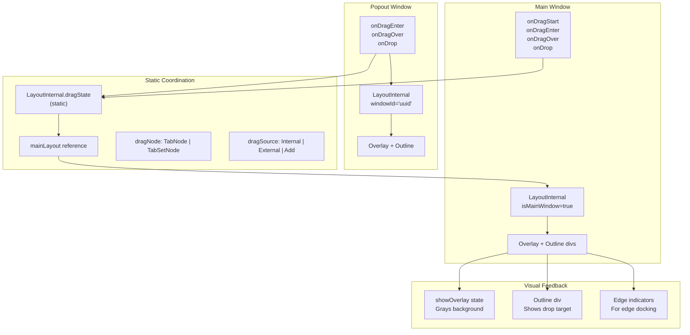

**Sources:** [src/view/Layout.tsx L192](https://github.com/caplin/FlexLayout/blob/40753f37/src/view/Layout.tsx#L192-L192)

 [src/view/Layout.tsx L1334-L1542](https://github.com/caplin/FlexLayout/blob/40753f37/src/view/Layout.tsx#L1334-L1542)

### Drag Event Flow

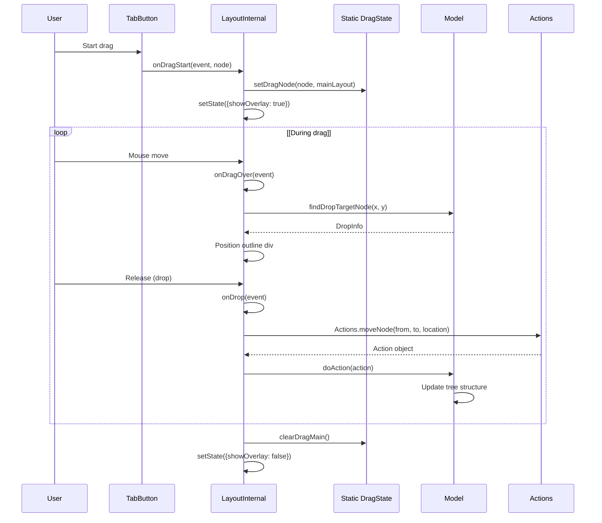

**Sources:** [src/view/Layout.tsx L1334-L1542](https://github.com/caplin/FlexLayout/blob/40753f37/src/view/Layout.tsx#L1334-L1542)

 [src/view/TabButton.tsx L150-L250](https://github.com/caplin/FlexLayout/blob/40753f37/src/view/TabButton.tsx#L150-L250)

### Drag Enter Count Mechanism

The `dragEnterCount` mechanism handles nested drag events correctly when dragging over nested elements:

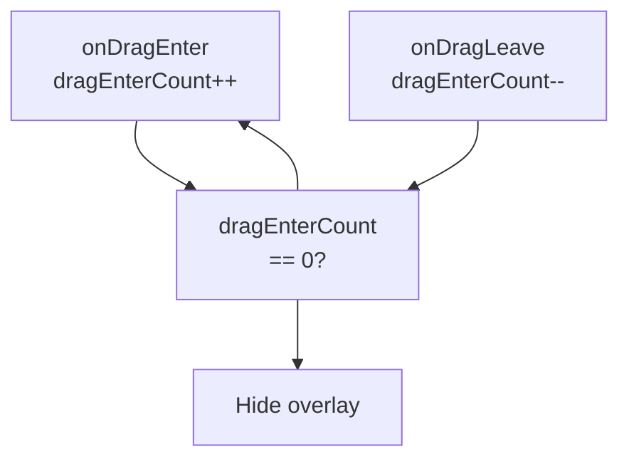

**Sources:** [src/view/Layout.tsx L211](https://github.com/caplin/FlexLayout/blob/40753f37/src/view/Layout.tsx#L211-L211)

 [src/view/Layout.tsx L1439-L1465](https://github.com/caplin/FlexLayout/blob/40753f37/src/view/Layout.tsx#L1439-L1465)

---

## Multi-Window Management

FlexLayout supports creating and managing multiple windows, allowing tabs and tabsets to be popped out into separate browser windows.

### Window Data Structures

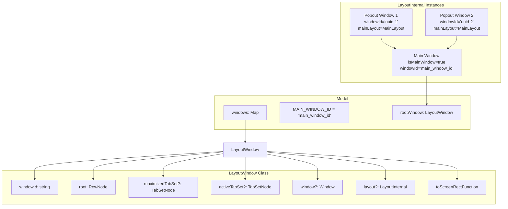

**Sources:** [src/model/Model.ts L47-L62](https://github.com/caplin/FlexLayout/blob/40753f37/src/model/Model.ts#L47-L62)

 [src/model/LayoutWindow.ts](https://github.com/caplin/FlexLayout/blob/40753f37/src/model/LayoutWindow.ts)

 [src/view/Layout.tsx L213-L216](https://github.com/caplin/FlexLayout/blob/40753f37/src/view/Layout.tsx#L213-L216)

### Popout Actions

The model handles several window-related actions:

| Action | Description | Handler Location |
| --- | --- | --- |
| `POPOUT_TABSET` | Pop out entire tabset to new window | [src/model/Model.ts L129-L150](https://github.com/caplin/FlexLayout/blob/40753f37/src/model/Model.ts#L129-L150) |
| `POPOUT_TAB` | Pop out single tab to new window | [src/model/Model.ts L152-L179](https://github.com/caplin/FlexLayout/blob/40753f37/src/model/Model.ts#L152-L179) |
| `CLOSE_WINDOW` | Close popout window and return content to main | [src/model/Model.ts L181-L195](https://github.com/caplin/FlexLayout/blob/40753f37/src/model/Model.ts#L181-L195) |
| `CREATE_WINDOW` | Create empty popout window | [src/model/Model.ts L197-L204](https://github.com/caplin/FlexLayout/blob/40753f37/src/model/Model.ts#L197-L204) |

### Window Lifecycle

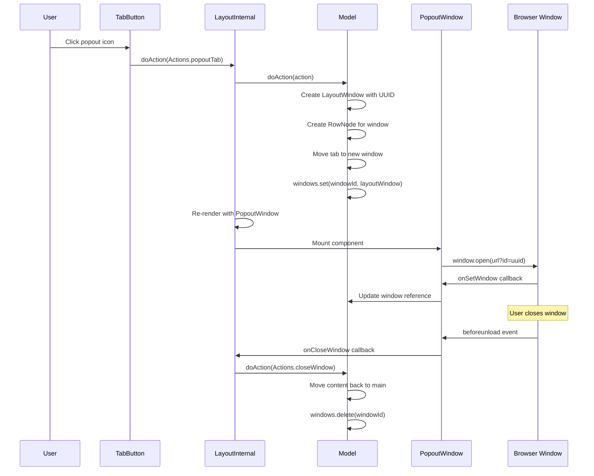

**Sources:** [src/view/Layout.tsx L531-L559](https://github.com/caplin/FlexLayout/blob/40753f37/src/view/Layout.tsx#L531-L559)

 [src/view/PopoutWindow.tsx](https://github.com/caplin/FlexLayout/blob/40753f37/src/view/PopoutWindow.tsx)

 [src/model/Model.ts L152-L195](https://github.com/caplin/FlexLayout/blob/40753f37/src/model/Model.ts#L152-L195)

### Window Rendering Pattern

Each window has its own `LayoutInternal` instance, but only the main window listens to model changes:

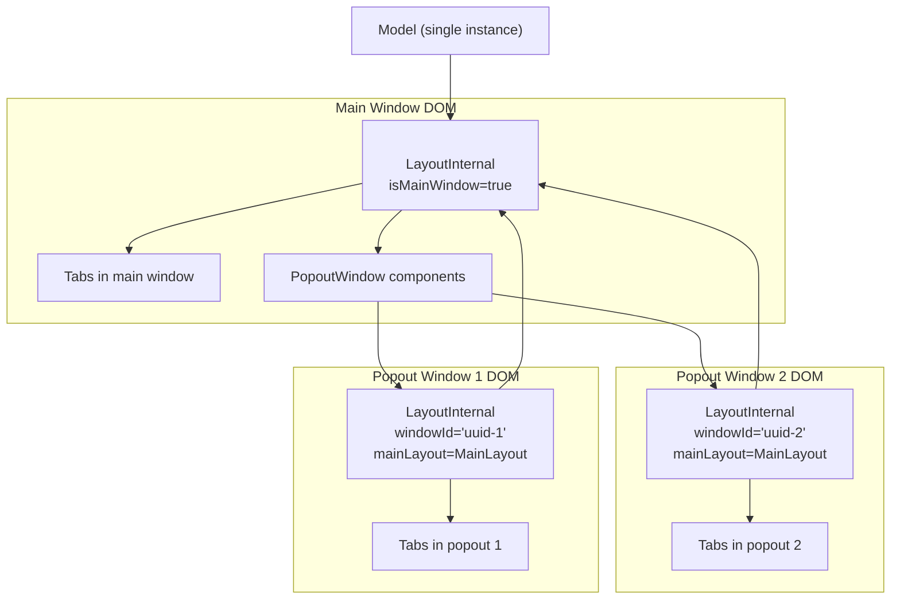

**Sources:** [src/view/Layout.tsx L531-L559](https://github.com/caplin/FlexLayout/blob/40753f37/src/view/Layout.tsx#L531-L559)

 [src/view/Layout.tsx L275-L298](https://github.com/caplin/FlexLayout/blob/40753f37/src/view/Layout.tsx#L275-L298)

---

## Docking and Drop Validation

The docking system determines where and how tabs and tabsets can be dropped within the layout.

### DockLocation Enumeration

`DockLocation` defines the possible drop positions:

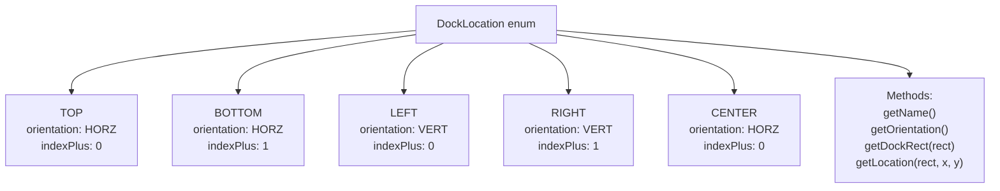

**Sources:** [src/DockLocation.ts](https://github.com/caplin/FlexLayout/blob/40753f37/src/DockLocation.ts)

### DropInfo Structure

`DropInfo` encapsulates information about a potential drop target:

| Property | Type | Description |
| --- | --- | --- |
| `node` | `Node & IDropTarget` | Target node where drop would occur |
| `rect` | `Rect` | Visual rectangle for drop outline |
| `location` | `DockLocation` | Where relative to target (CENTER, TOP, etc.) |
| `index` | `number` | Index position within tabset (-1 for append) |
| `className` | `string` | CSS class for visual feedback |

**Sources:** [src/DropInfo.ts](https://github.com/caplin/FlexLayout/blob/40753f37/src/DropInfo.ts)

### Drop Validation Flow

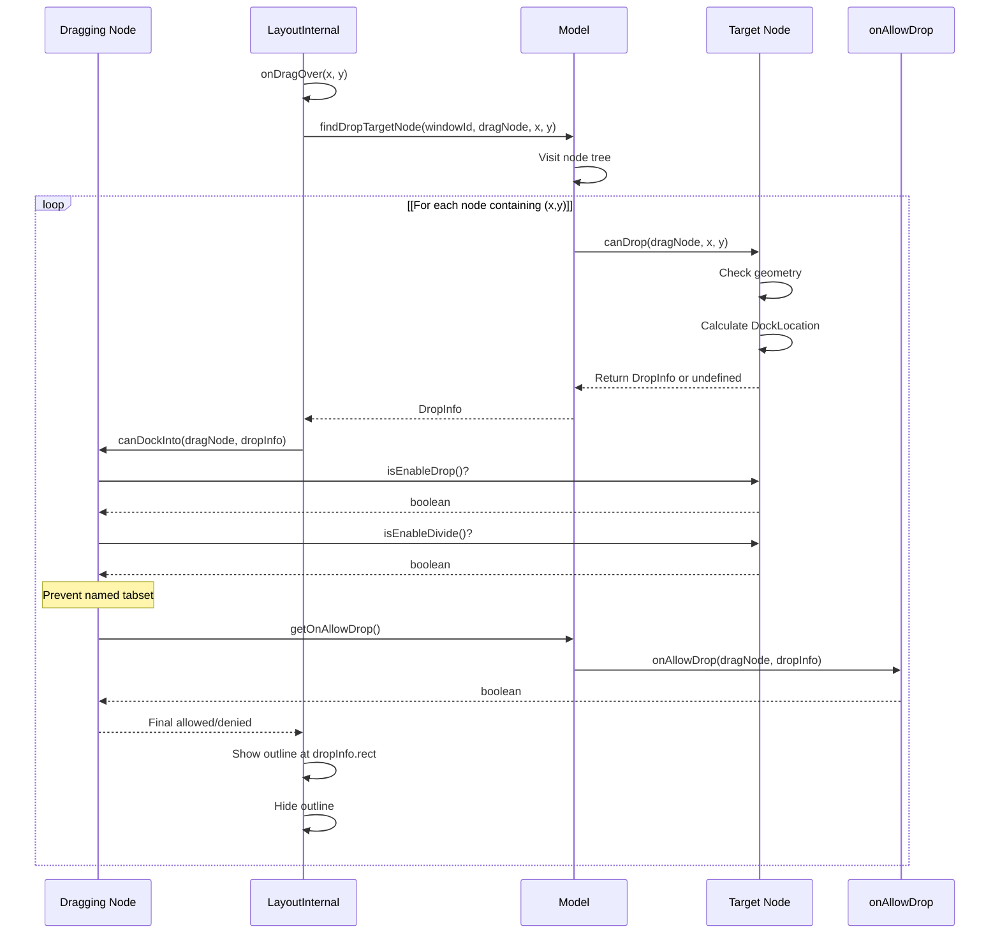

**Sources:** [src/view/Layout.tsx L1482-L1523](https://github.com/caplin/FlexLayout/blob/40753f37/src/view/Layout.tsx#L1482-L1523)

 [src/model/Model.ts L568-L574](https://github.com/caplin/FlexLayout/blob/40753f37/src/model/Model.ts#L568-L574)

 [src/model/Node.ts L204-L225](https://github.com/caplin/FlexLayout/blob/40753f37/src/model/Node.ts#L204-L225)

### Node-Specific Drop Handling

Different node types implement `canDrop()` differently:

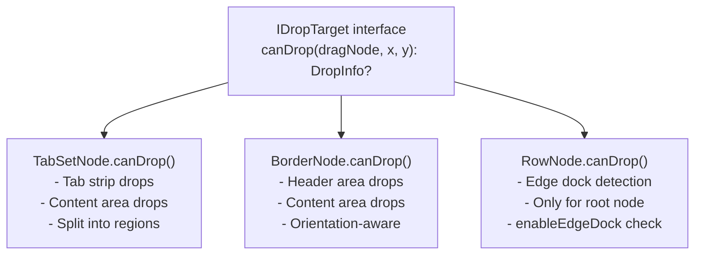

**Sources:** [src/model/TabSetNode.ts L305-L370](https://github.com/caplin/FlexLayout/blob/40753f37/src/model/TabSetNode.ts#L305-L370)

 [src/model/BorderNode.ts L233-L312](https://github.com/caplin/FlexLayout/blob/40753f37/src/model/BorderNode.ts#L233-L312)

 [src/model/RowNode.ts L371-L417](https://github.com/caplin/FlexLayout/blob/40753f37/src/model/RowNode.ts#L371-L417)

---

## Attribute Configuration System

FlexLayout uses a sophisticated attribute system that supports inheritance from global defaults, allowing fine-grained control over behavior at multiple levels.

### Attribute Hierarchy

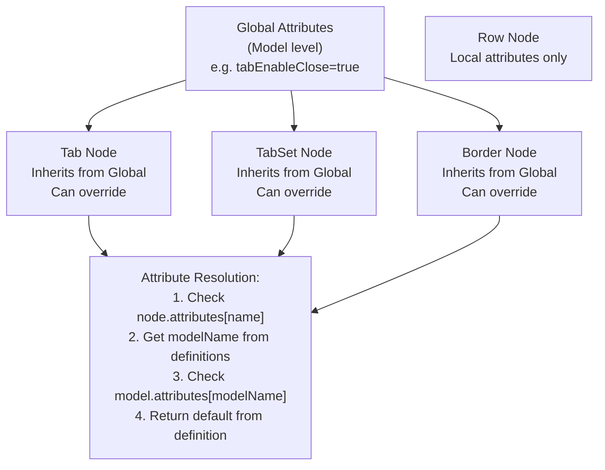

**Sources:** [src/model/Model.ts L626-L702](https://github.com/caplin/FlexLayout/blob/40753f37/src/model/Model.ts#L626-L702)

 [src/model/Node.ts L105-L117](https://github.com/caplin/FlexLayout/blob/40753f37/src/model/Node.ts#L105-L117)

### AttributeDefinitions Class

The `AttributeDefinitions` class manages attribute metadata:

```python
// Example usage pattern from TabSetNodeattributeDefinitions.add("selected", 0)    .setType(Attribute.NUMBER)    .setDescription("index of selected/visible tab in tabset"); attributeDefinitions.addInherited("enableDrop", "tabSetEnableDrop")    .setDescription("allow user to drag tabs into this tabset");
```

| Method | Purpose |
| --- | --- |
| `add(name, defaultValue)` | Define local attribute with default |
| `addInherited(localName, globalName)` | Define attribute that inherits from global |
| `fromJson(json, attributes)` | Populate attributes from JSON |
| `toJson(json, attributes)` | Serialize attributes to JSON |
| `update(json, attributes)` | Update existing attributes |
| `getModelName(name)` | Get global name for inherited attribute |

**Sources:** [src/AttributeDefinitions.ts](https://github.com/caplin/FlexLayout/blob/40753f37/src/AttributeDefinitions.ts)

 [src/model/TabSetNode.ts L512-L588](https://github.com/caplin/FlexLayout/blob/40753f37/src/model/TabSetNode.ts#L512-L588)

### Attribute Resolution Example

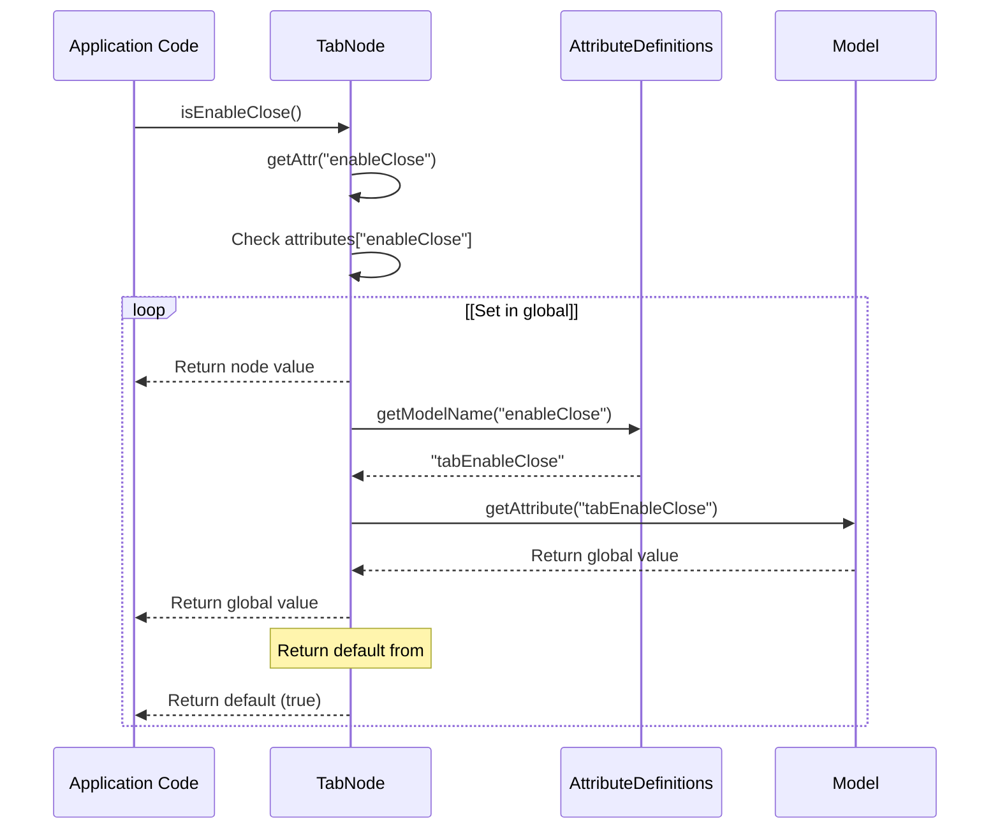

**Sources:** [src/model/Node.ts L105-L117](https://github.com/caplin/FlexLayout/blob/40753f37/src/model/Node.ts#L105-L117)

 [src/model/TabNode.ts L339-L423](https://github.com/caplin/FlexLayout/blob/40753f37/src/model/TabNode.ts#L339-L423)

### Runtime Attribute Updates

Attributes can be updated at runtime using actions:

```sql
// Update model-level (global) attributesmodel.doAction(Actions.updateModelAttributes({    tabEnableClose: false,    tabSetEnableMaximize: false})); // Update node-specific attributesmodel.doAction(Actions.updateNodeAttributes(nodeId, {    enableClose: true,  // Override global for this node    config: { customData: "value" }}));
```

**Sources:** [src/model/Model.ts L280-L289](https://github.com/caplin/FlexLayout/blob/40753f37/src/model/Model.ts#L280-L289)

 [src/model/Actions.ts](https://github.com/caplin/FlexLayout/blob/40753f37/src/model/Actions.ts)

### Inherited Attribute Examples

Common inherited attributes by node type:

**TabNode inherited attributes:**

* `enableClose` ← `tabEnableClose`
* `enableDrag` ← `tabEnableDrag`
* `enablePopout` ← `tabEnablePopout`
* `className` ← `tabClassName`
* `icon` ← `tabIcon`

**TabSetNode inherited attributes:**

* `enableDrop` ← `tabSetEnableDrop`
* `enableMaximize` ← `tabSetEnableMaximize`
* `autoSelectTab` ← `tabSetAutoSelectTab`
* `enableTabStrip` ← `tabSetEnableTabStrip`

**BorderNode inherited attributes:**

* `enableDrop` ← `borderEnableDrop`
* `size` ← `borderSize`
* `autoSelectTabWhenOpen` ← `borderAutoSelectTabWhenOpen`

**Sources:** [src/model/TabNode.ts L368-L420](https://github.com/caplin/FlexLayout/blob/40753f37/src/model/TabNode.ts#L368-L420)

 [src/model/TabSetNode.ts L529-L586](https://github.com/caplin/FlexLayout/blob/40753f37/src/model/TabSetNode.ts#L529-L586)

 [src/model/BorderNode.ts L417-L443](https://github.com/caplin/FlexLayout/blob/40753f37/src/model/BorderNode.ts#L417-L443)

---

## Integration of Advanced Features

These advanced features work together to provide a cohesive experience:

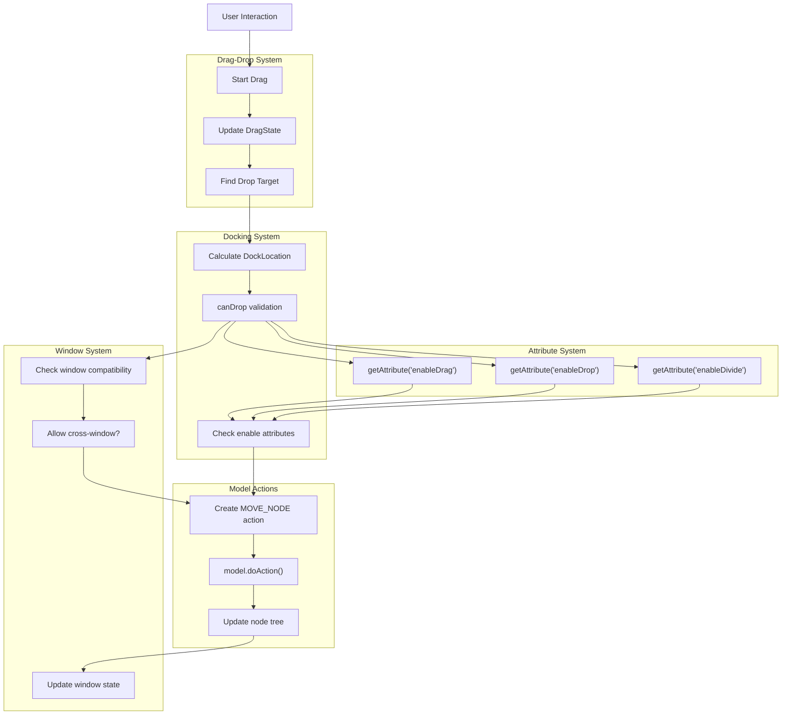

**Sources:** [src/view/Layout.tsx L1482-L1542](https://github.com/caplin/FlexLayout/blob/40753f37/src/view/Layout.tsx#L1482-L1542)

 [src/model/Model.ts L71-L301](https://github.com/caplin/FlexLayout/blob/40753f37/src/model/Model.ts#L71-L301)

 [src/model/Node.ts L204-L225](https://github.com/caplin/FlexLayout/blob/40753f37/src/model/Node.ts#L204-L225)

---

## Summary

FlexLayout's advanced features enable sophisticated layout manipulation:

1. **Drag-and-Drop**: Global state coordination allows seamless dragging across windows with visual feedback
2. **Multi-Window**: Independent window instances with shared model enable complex multi-monitor setups
3. **Docking**: Flexible validation system with geometry-based and policy-based checks
4. **Attributes**: Hierarchical configuration with global defaults and node-level overrides

For implementation details of each feature, see the dedicated child pages: [Drag and Drop](/caplin/FlexLayout/6.1-drag-and-drop), [Docking System](/caplin/FlexLayout/6.2-docking-system), [Popout Windows](/caplin/FlexLayout/6.3-popout-windows), and [Attributes System](/caplin/FlexLayout/6.4-attributes-system).