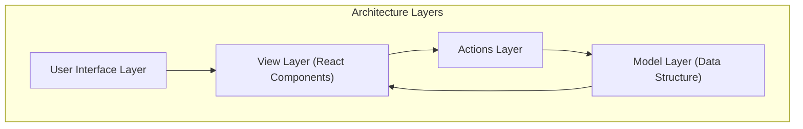
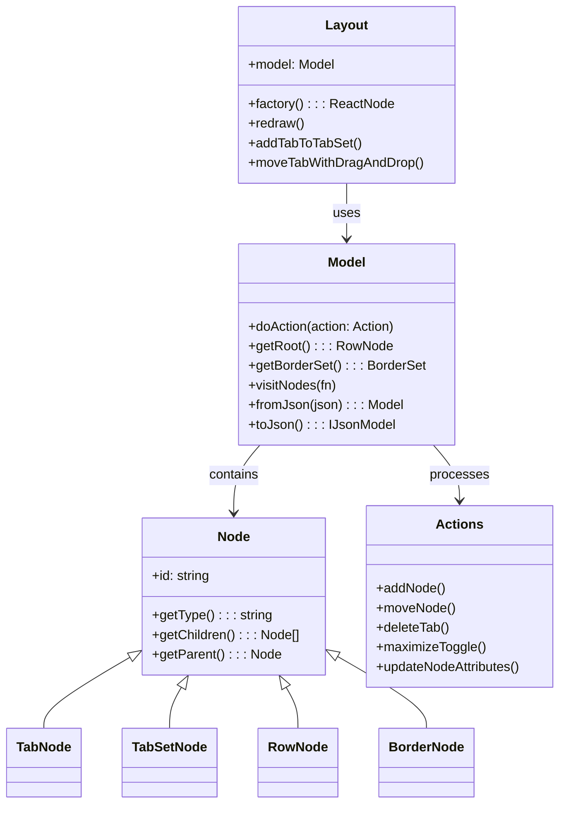
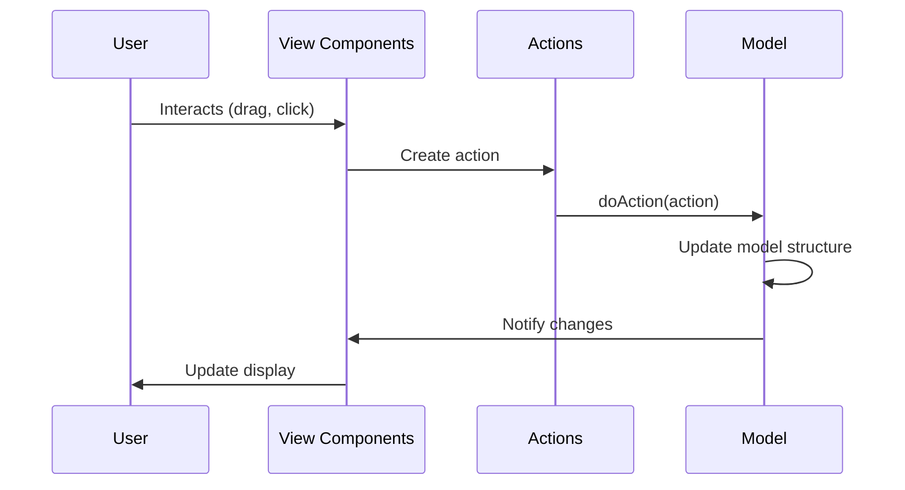
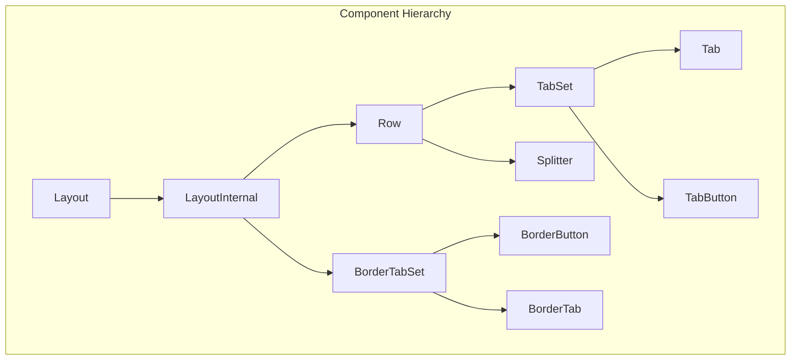
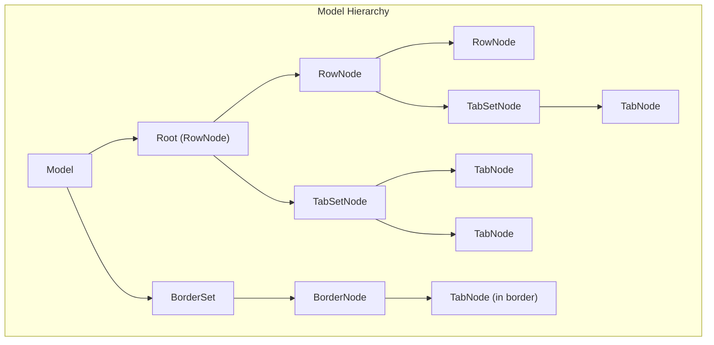
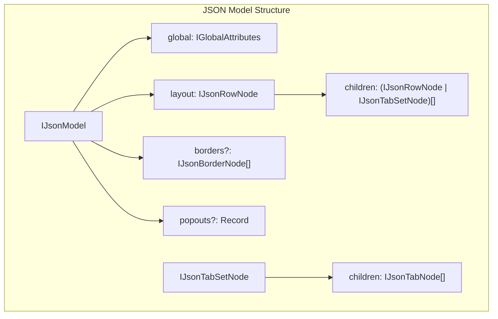
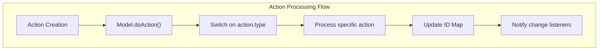
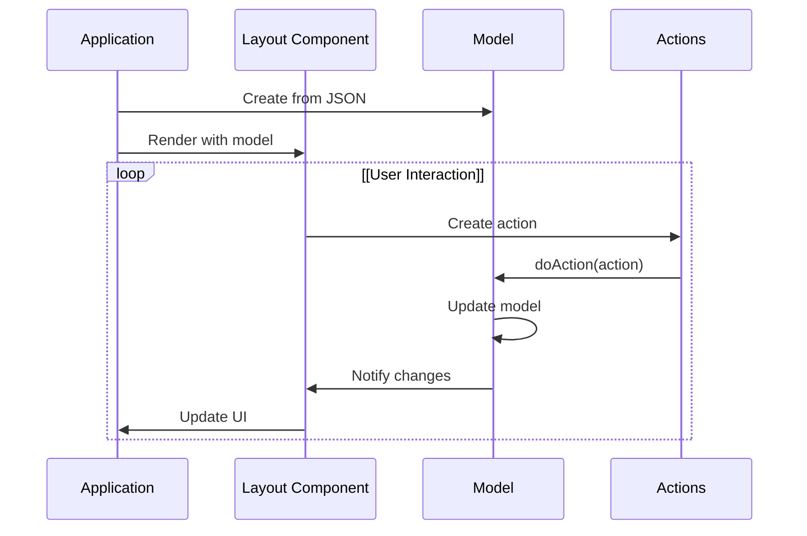
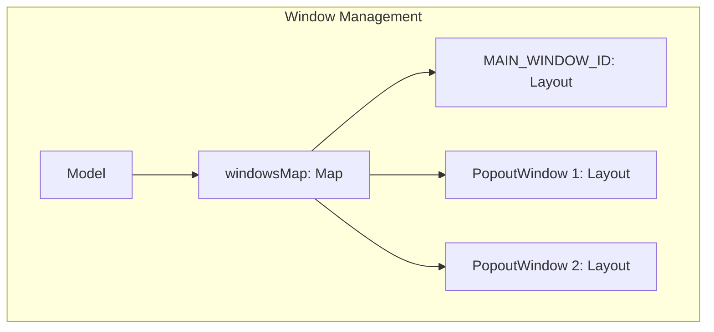

# Architecture

> **Relevant source files**
> * [package.json](https://github.com/caplin/FlexLayout/blob/40753f37/package.json)
> * [src/model/BorderNode.ts](https://github.com/caplin/FlexLayout/blob/40753f37/src/model/BorderNode.ts)
> * [src/model/BorderSet.ts](https://github.com/caplin/FlexLayout/blob/40753f37/src/model/BorderSet.ts)
> * [src/model/IJsonModel.ts](https://github.com/caplin/FlexLayout/blob/40753f37/src/model/IJsonModel.ts)
> * [src/model/Model.ts](https://github.com/caplin/FlexLayout/blob/40753f37/src/model/Model.ts)
> * [src/model/Node.ts](https://github.com/caplin/FlexLayout/blob/40753f37/src/model/Node.ts)
> * [src/model/RowNode.ts](https://github.com/caplin/FlexLayout/blob/40753f37/src/model/RowNode.ts)
> * [src/model/TabNode.ts](https://github.com/caplin/FlexLayout/blob/40753f37/src/model/TabNode.ts)
> * [src/model/TabSetNode.ts](https://github.com/caplin/FlexLayout/blob/40753f37/src/model/TabSetNode.ts)
> * [src/view/Layout.tsx](https://github.com/caplin/FlexLayout/blob/40753f37/src/view/Layout.tsx)
> * [src/view/Tab.tsx](https://github.com/caplin/FlexLayout/blob/40753f37/src/view/Tab.tsx)

This document outlines the architectural design and structure of FlexLayout, a flexible layout manager for React applications. It explains the core architectural patterns, component structure, and data flow that enable FlexLayout's functionality. For information about using specific components, see [Core Components](/caplin/FlexLayout/3-core-components) and for details about the data model implementation, see [Data Model](/caplin/FlexLayout/4-data-model).

## Architectural Overview

FlexLayout follows a model-view architecture pattern with a clear separation between the layout model (data structure) and its visual representation (React components). All changes to the layout happen through a well-defined action system, enabling predictable state management.

Sources: [src/view/Layout.tsx L1-L166](https://github.com/caplin/FlexLayout/blob/40753f37/src/view/Layout.tsx#L1-L166)

 [src/model/Model.ts L1-L100](https://github.com/caplin/FlexLayout/blob/40753f37/src/model/Model.ts#L1-L100)

## Key Components

The FlexLayout architecture consists of four main layers:

1. **User Interface Layer**: The visible UI elements users interact with
2. **View Layer**: React components that render the model
3. **Model Layer**: Data structures that represent the layout
4. **Actions Layer**: Action creators and processors for changing model state

Sources: [src/view/Layout.tsx L32-L162](https://github.com/caplin/FlexLayout/blob/40753f37/src/view/Layout.tsx#L32-L162)

 [src/model/Model.ts L28-L704](https://github.com/caplin/FlexLayout/blob/40753f37/src/model/Model.ts#L28-L704)

 [src/model/TabNode.ts L11-L424](https://github.com/caplin/FlexLayout/blob/40753f37/src/model/TabNode.ts#L11-L424)

## Design Patterns

FlexLayout uses several key design patterns to maintain a clean architecture:

1. **Model-View Pattern**: Separates data (model) from presentation (view)
2. **Component-Based Design**: Builds UIs from reusable components
3. **Action-Based State Management**: All changes go through actions
4. **Tree Structure**: Represents layouts as a hierarchical tree
5. **Factory Pattern**: Uses factory functions to create tab content

### Model-View Pattern

Sources: [src/view/Layout.tsx L85-L159](https://github.com/caplin/FlexLayout/blob/40753f37/src/view/Layout.tsx#L85-L159)

 [src/model/Model.ts L70-L301](https://github.com/caplin/FlexLayout/blob/40753f37/src/model/Model.ts#L70-L301)

## Component Structure

The component hierarchy follows a well-defined structure that maps to the model's node hierarchy.

Sources: [src/view/Layout.tsx L32-L166](https://github.com/caplin/FlexLayout/blob/40753f37/src/view/Layout.tsx#L32-L166)

 [src/view/Layout.tsx L485-L493](https://github.com/caplin/FlexLayout/blob/40753f37/src/view/Layout.tsx#L485-L493)

## Model Hierarchy

The model represents the layout as a hierarchical tree of nodes, with each node type serving a specific purpose.

Sources: [src/model/Model.ts L25-L100](https://github.com/caplin/FlexLayout/blob/40753f37/src/model/Model.ts#L25-L100)

 [src/model/TabNode.ts L11-L100](https://github.com/caplin/FlexLayout/blob/40753f37/src/model/TabNode.ts#L11-L100)

## Data Model Details

The Model class is the central manager for all layout nodes. It maintains:

1. A map of nodes indexed by their IDs
2. The root node (typically a RowNode)
3. Border settings
4. Window information (for popouts)

### Node Types

| Node Type | Purpose | Key Properties |
| --- | --- | --- |
| TabNode | Individual content panels | name, component, enableClose, enableDrag |
| TabSetNode | Container for multiple tabs | selected, enableTabStrip, enableMaximize |
| RowNode | Organizational container for layout | orientation, weight |
| BorderNode | Special edge region container | location, size, selected |

Sources: [src/model/Model.ts L28-L100](https://github.com/caplin/FlexLayout/blob/40753f37/src/model/Model.ts#L28-L100)

 [src/model/TabNode.ts L11-L424](https://github.com/caplin/FlexLayout/blob/40753f37/src/model/TabNode.ts#L11-L424)

## JSON Model Structure

The layout model can be serialized to and deserialized from JSON, with a well-defined structure:

Sources: [src/model/IJsonModel.ts L5-L42](https://github.com/caplin/FlexLayout/blob/40753f37/src/model/IJsonModel.ts#L5-L42)

 [src/model/Model.ts L395-L446](https://github.com/caplin/FlexLayout/blob/40753f37/src/model/Model.ts#L395-L446)

## Action System

Actions are the primary mechanism for modifying the layout structure. All changes to the model happen through actions processed by the `doAction` method.

Sources: [src/model/Model.ts L70-L301](https://github.com/caplin/FlexLayout/blob/40753f37/src/model/Model.ts#L70-L301)

Common actions include:

* `addNode`: Add a new tab
* `moveNode`: Move a tab or tabset
* `deleteTab`: Remove a tab
* `maximizeToggle`: Toggle maximized state of a tabset
* `updateNodeAttributes`: Update node properties

## Lifecycle and Data Flow

The lifecycle of a FlexLayout instance follows these general stages:

1. **Initialization**: Model is created from JSON or programmatically
2. **Rendering**: Layout component renders the model
3. **User Interaction**: User actions trigger state changes
4. **Action Dispatch**: Actions are created and dispatched
5. **Model Update**: Model changes based on actions
6. **Re-rendering**: Components re-render to reflect changes

Sources: [src/view/Layout.tsx L85-L166](https://github.com/caplin/FlexLayout/blob/40753f37/src/view/Layout.tsx#L85-L166)

 [src/model/Model.ts L70-L301](https://github.com/caplin/FlexLayout/blob/40753f37/src/model/Model.ts#L70-L301)

## Window Management

FlexLayout supports popout windows through a dedicated window management system:

Sources: [src/model/Model.ts L45-L49](https://github.com/caplin/FlexLayout/blob/40753f37/src/model/Model.ts#L45-L49)

 [src/view/Layout.tsx L530-L557](https://github.com/caplin/FlexLayout/blob/40753f37/src/view/Layout.tsx#L530-L557)

The window management system enables:

* Creating new windows via popout
* Synchronizing state between windows
* Moving tabs between windows
* Cleaning up empty windows

## Conclusion

FlexLayout's architecture is built around a clear separation of concerns, with the model handling data structure and logic while React components handle rendering. The action-based state management system ensures predictable changes to the layout, while the hierarchical node structure provides flexibility for complex layouts.

For more information on specific components, refer to [Core Components](/caplin/FlexLayout/3-core-components), and for details on the data model implementation, see [Data Model](/caplin/FlexLayout/4-data-model).