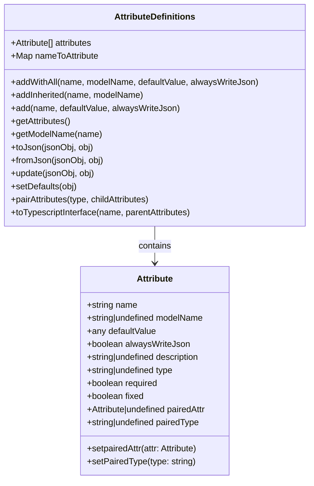
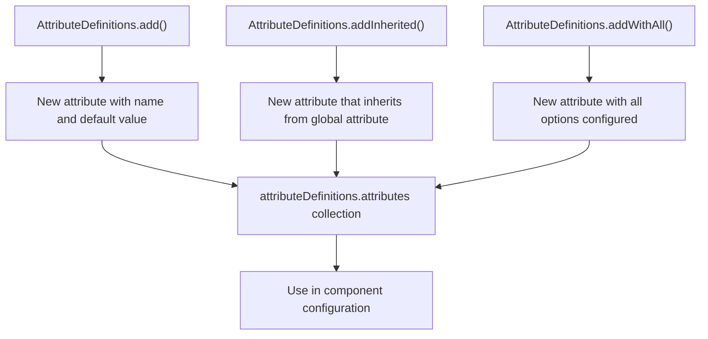
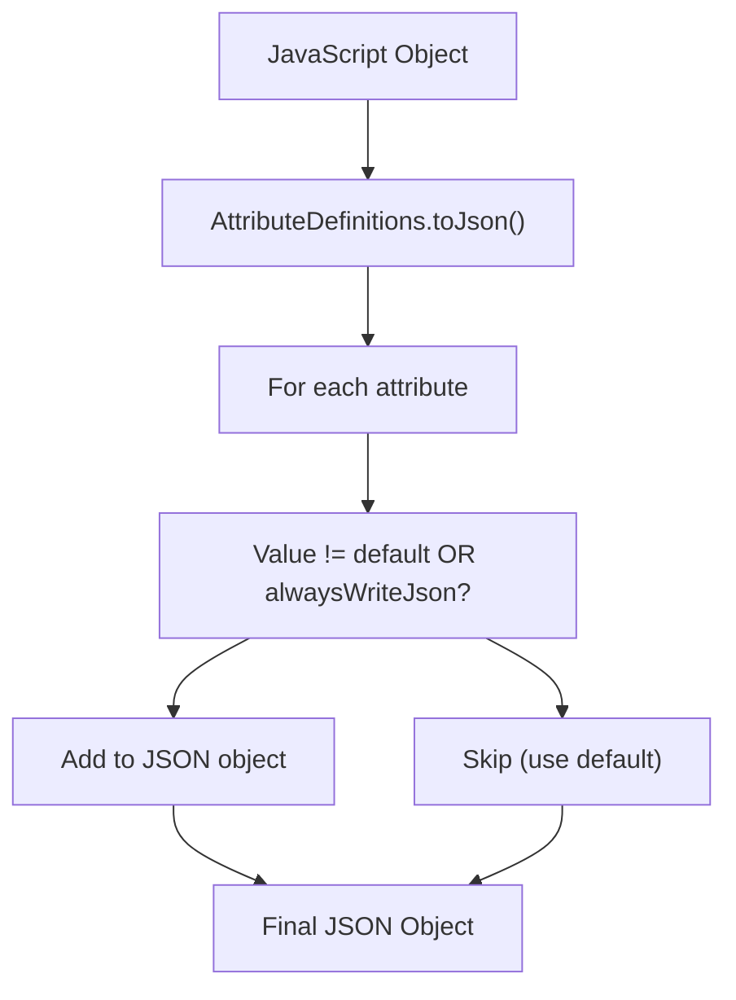
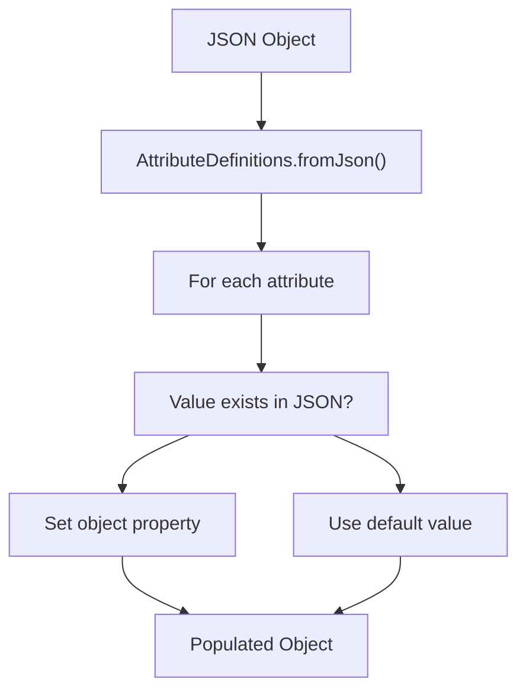
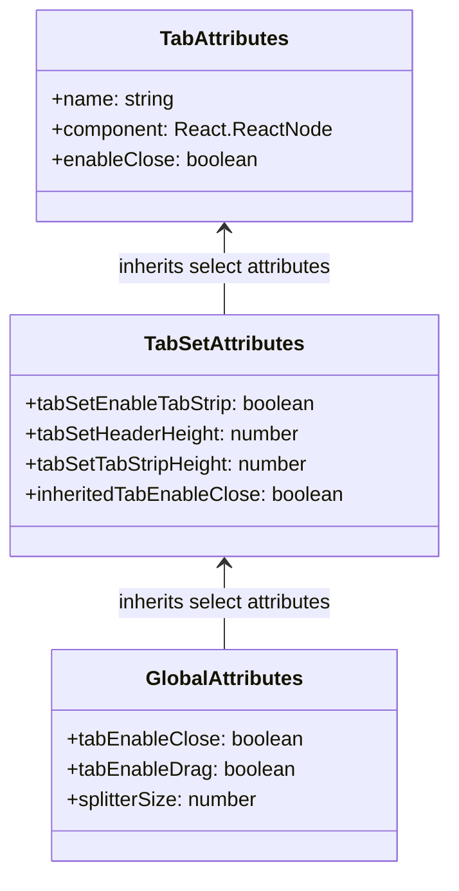
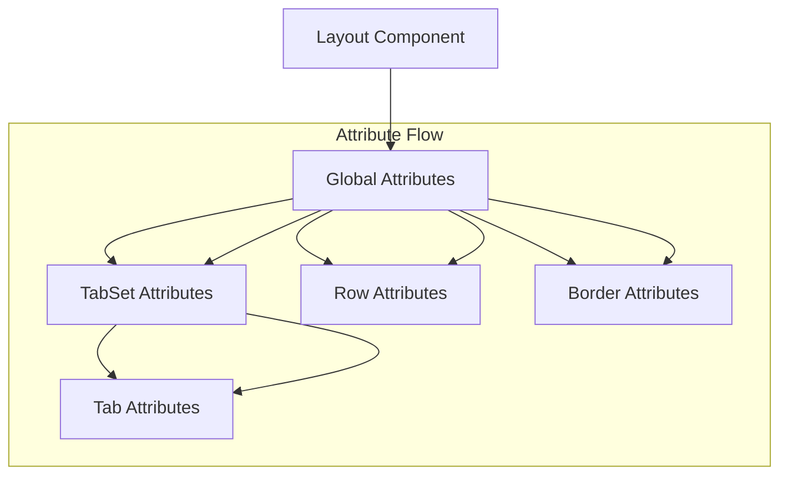
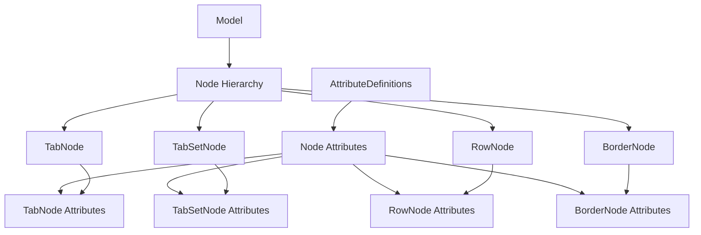

# Attributes System

> **Relevant source files**
> * [src/AttributeDefinitions.ts](https://github.com/caplin/FlexLayout/blob/40753f37/src/AttributeDefinitions.ts)
> * [src/Rect.ts](https://github.com/caplin/FlexLayout/blob/40753f37/src/Rect.ts)
> * [src/model/BorderNode.ts](https://github.com/caplin/FlexLayout/blob/40753f37/src/model/BorderNode.ts)
> * [src/model/BorderSet.ts](https://github.com/caplin/FlexLayout/blob/40753f37/src/model/BorderSet.ts)
> * [src/model/IJsonModel.ts](https://github.com/caplin/FlexLayout/blob/40753f37/src/model/IJsonModel.ts)
> * [src/model/Model.ts](https://github.com/caplin/FlexLayout/blob/40753f37/src/model/Model.ts)
> * [src/model/Node.ts](https://github.com/caplin/FlexLayout/blob/40753f37/src/model/Node.ts)
> * [src/model/RowNode.ts](https://github.com/caplin/FlexLayout/blob/40753f37/src/model/RowNode.ts)
> * [src/model/TabNode.ts](https://github.com/caplin/FlexLayout/blob/40753f37/src/model/TabNode.ts)
> * [src/model/TabSetNode.ts](https://github.com/caplin/FlexLayout/blob/40753f37/src/model/TabSetNode.ts)
> * [src/view/Tab.tsx](https://github.com/caplin/FlexLayout/blob/40753f37/src/view/Tab.tsx)

## Overview

The Attributes System in FlexLayout provides a structured way to define, manage, and inherit configuration properties across the component hierarchy. This system handles attribute definitions, default values, serialization to/from JSON, and inheritance between parent and child components.

For information about the overall Model structure, see [Data Model](/caplin/FlexLayout/4-data-model) and [Model Class](/caplin/FlexLayout/4.1-model-class).

Sources: [src/AttributeDefinitions.ts L1-L144](https://github.com/caplin/FlexLayout/blob/40753f37/src/AttributeDefinitions.ts#L1-L144)

## Core Components

The Attributes System consists of two main components:



1. **Attribute**: Represents a single configurable property with its name, default value, and related metadata.
2. **AttributeDefinitions**: Manages a collection of attributes for a component, handling serialization, deserialization, and inheritance.

Sources: [src/AttributeDefinitions.ts L4-L144](https://github.com/caplin/FlexLayout/blob/40753f37/src/AttributeDefinitions.ts#L4-L144)

 [src/AttributeDefinitions.ts L1](https://github.com/caplin/FlexLayout/blob/40753f37/src/AttributeDefinitions.ts#L1-L1)

## Attribute Definition and Management

The system provides several methods for defining attributes with different characteristics:



### Adding Attributes

AttributeDefinitions provides three methods for adding attributes:

1. **add**: Creates a basic attribute with a name and default value ``` add(name: string, defaultValue: any, alwaysWriteJson?: boolean) ```
2. **addInherited**: Creates an attribute that inherits its value from a model attribute ``` addInherited(name: string, modelName: string) ```
3. **addWithAll**: Creates an attribute with all configuration options ``` addWithAll(name: string, modelName: string | undefined, defaultValue: any, alwaysWriteJson?: boolean) ```

Sources: [src/AttributeDefinitions.ts L13-L26](https://github.com/caplin/FlexLayout/blob/40753f37/src/AttributeDefinitions.ts#L13-L26)

## JSON Serialization and Deserialization

The Attributes System provides methods to convert attributes between JavaScript objects and JSON:

### To JSON

The `toJson` method converts an object's attributes to a JSON object, omitting attributes that match their default values unless `alwaysWriteJson` is true.



### From JSON

The `fromJson` method populates an object with values from a JSON object, using default values when properties are not present in the JSON.



Sources: [src/AttributeDefinitions.ts L40-L61](https://github.com/caplin/FlexLayout/blob/40753f37/src/AttributeDefinitions.ts#L40-L61)

## Attribute Inheritance

A key feature of the Attributes System is the ability to inherit attributes from parent components or global configurations:



Inheritance is managed through the `modelName` property of an attribute, which links it to an attribute in a parent component. The `pairAttributes` method establishes these inheritance relationships between parent and child attribute sets.

Sources: [src/AttributeDefinitions.ts L82-L91](https://github.com/caplin/FlexLayout/blob/40753f37/src/AttributeDefinitions.ts#L82-L91)

## Typescript Interface Generation

The system can generate TypeScript interfaces for attributes, which is useful for documentation and type checking:

```
toTypescriptInterface(name: string, parentAttributes: AttributeDefinitions | undefined)
```

This method creates interface definitions that include:

* Property names and types
* Documentation comments
* Information about default values
* Inheritance relationships

Sources: [src/AttributeDefinitions.ts L93-L143](https://github.com/caplin/FlexLayout/blob/40753f37/src/AttributeDefinitions.ts#L93-L143)

## Usage in the FlexLayout Component Hierarchy



### Typical Attribute Usage Pattern

1. Define global attributes at the Layout level
2. Define component-specific attributes for each component type
3. Establish inheritance relationships between parent and child components
4. Apply default values when components are created
5. Override values through props or configuration

Sources: [src/AttributeDefinitions.ts L1-L144](https://github.com/caplin/FlexLayout/blob/40753f37/src/AttributeDefinitions.ts#L1-L144)

## Working with the Attributes System

### Setting Defaults

The `setDefaults` method initializes an object with the default values for all attributes:

```
setDefaults(obj: any)
```

### Updating Attributes

The `update` method updates an object's attributes from a JSON object:

```sql
update(jsonObj: any, obj: any)
```

This is useful for applying partial updates to an existing component's configuration.

### Attribute Resolution Process

When resolving an attribute value, the system follows this process:

1. Check if the attribute is explicitly set on the component
2. If not set and the attribute is inherited, check the parent/global value
3. If still not found, use the default value defined for the attribute

Sources: [src/AttributeDefinitions.ts L63-L80](https://github.com/caplin/FlexLayout/blob/40753f37/src/AttributeDefinitions.ts#L63-L80)

## Integration with Node Hierarchy

The Attributes System works closely with the node hierarchy (see [Node Hierarchy](/caplin/FlexLayout/4.2-node-hierarchy)) to provide configuration for the different types of nodes in the layout:



Each node type has its own set of attributes that control its appearance and behavior.

Sources: [src/AttributeDefinitions.ts L1-L144](https://github.com/caplin/FlexLayout/blob/40753f37/src/AttributeDefinitions.ts#L1-L144)

## Conclusion

The Attributes System provides a robust mechanism for defining, inheriting, and managing configuration properties throughout the FlexLayout component hierarchy. It enables flexible customization while maintaining reasonable defaults and facilitates serialization and deserialization of layouts to and from JSON.