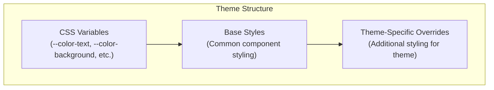
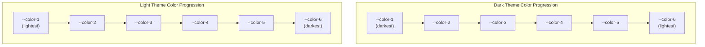
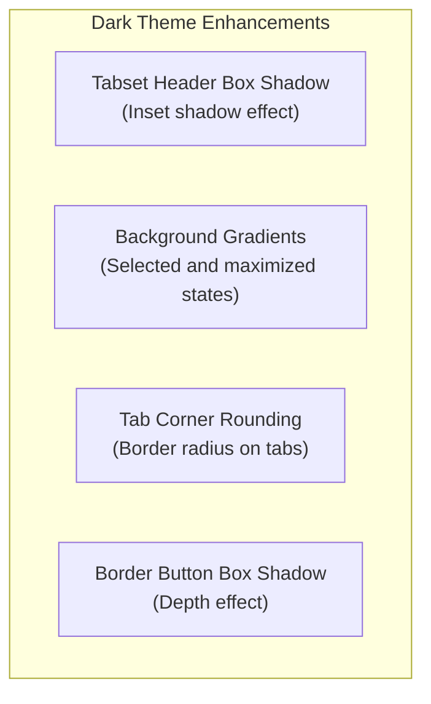
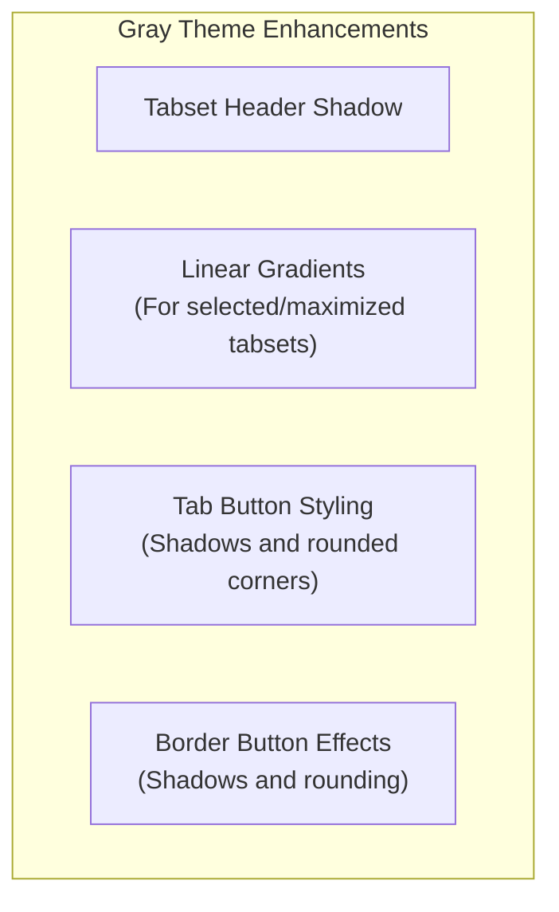
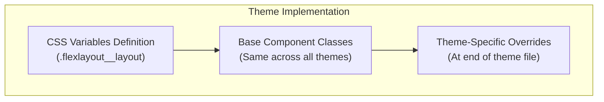

# Available Themes

> **Relevant source files**
> * [style/_base.scss](https://github.com/caplin/FlexLayout/blob/40753f37/style/_base.scss)
> * [style/dark.css](https://github.com/caplin/FlexLayout/blob/40753f37/style/dark.css)
> * [style/dark.scss](https://github.com/caplin/FlexLayout/blob/40753f37/style/dark.scss)
> * [style/gray.css](https://github.com/caplin/FlexLayout/blob/40753f37/style/gray.css)
> * [style/gray.scss](https://github.com/caplin/FlexLayout/blob/40753f37/style/gray.scss)
> * [style/light.css](https://github.com/caplin/FlexLayout/blob/40753f37/style/light.css)
> * [style/light.scss](https://github.com/caplin/FlexLayout/blob/40753f37/style/light.scss)
> * [style/underline.css](https://github.com/caplin/FlexLayout/blob/40753f37/style/underline.css)
> * [style/underline.scss](https://github.com/caplin/FlexLayout/blob/40753f37/style/underline.scss)

This page documents the built-in themes available in FlexLayout and explains how they're structured. For information on customizing existing themes or creating new ones, see [Customizing Themes](/caplin/FlexLayout/5.3-customizing-themes).

## Overview of FlexLayout Themes

FlexLayout provides several pre-built themes that control the visual appearance of all layout components. These themes are implemented using CSS variables and class definitions, making it easy to achieve consistent styling across your application.

The library comes with four built-in themes:

* Light Theme (default)
* Dark Theme
* Gray Theme
* Underline Theme

Each theme provides a complete styling package including colors for tabs, borders, splitters, and other UI elements that make up the FlexLayout interface.

Sources: [style/light.css L1-L56](https://github.com/caplin/FlexLayout/blob/40753f37/style/light.css#L1-L56)

 [style/dark.css L1-L56](https://github.com/caplin/FlexLayout/blob/40753f37/style/dark.css#L1-L56)

 [style/gray.css L1-L56](https://github.com/caplin/FlexLayout/blob/40753f37/style/gray.css#L1-L56)

## Theme Structure

### CSS Variables System

All FlexLayout themes use CSS variables to define colors and other styling properties. These variables are then referenced throughout the component styles to maintain consistency.



Sources: [style/light.css L1-L56](https://github.com/caplin/FlexLayout/blob/40753f37/style/light.css#L1-L56)

 [style/_base.scss L1-L765](https://github.com/caplin/FlexLayout/blob/40753f37/style/_base.scss#L1-L765)

Each theme defines approximately 50 CSS variables that control everything from basic colors to specific component states. The most important variables include:

| Variable Category | Example Variables | Purpose |
| --- | --- | --- |
| Base Colors | `--color-text`, `--color-background`, `--color-base` | Core colors for text and backgrounds |
| Shade Variations | `--color-1` through `--color-6` | Graduated shades used throughout the UI |
| Component Colors | `--color-tabset-background`, `--color-tab-selected` | Colors for specific components and states |
| Interaction Colors | `--color-drag1`, `--color-splitter-hover` | Colors for user interactions |
| Typography | `--font-size`, `--font-family` | Text styling properties |

Sources: [style/light.css L1-L56](https://github.com/caplin/FlexLayout/blob/40753f37/style/light.css#L1-L56)

 [style/dark.css L1-L56](https://github.com/caplin/FlexLayout/blob/40753f37/style/dark.css#L1-L56)

 [style/gray.css L1-L56](https://github.com/caplin/FlexLayout/blob/40753f37/style/gray.css#L1-L56)

### Color Palette System

Each theme defines a range of color shades (--color-1 through --color-6) that are used throughout the UI to create visual hierarchy and differentiation between elements.



Sources: [style/light.css L2-L10](https://github.com/caplin/FlexLayout/blob/40753f37/style/light.css#L2-L10)

 [style/dark.css L2-L10](https://github.com/caplin/FlexLayout/blob/40753f37/style/dark.css#L2-L10)

 [style/gray.css L2-L10](https://github.com/caplin/FlexLayout/blob/40753f37/style/gray.css#L2-L10)

## Built-in Themes

### Light Theme

The Light theme is the default theme with a clean, bright appearance suitable for most applications.

Key characteristics:

* White background (`--color-background: white`)
* Black text (`--color-text: black`)
* Light gray shades for UI elements
* Minimal use of shadows and effects

The Light theme provides high contrast and readability, making it a good choice for applications used in bright environments.

Sources: [style/light.css L1-L56](https://github.com/caplin/FlexLayout/blob/40753f37/style/light.css#L1-L56)

 [style/light.css L684-L688](https://github.com/caplin/FlexLayout/blob/40753f37/style/light.css#L684-L688)

### Dark Theme

The Dark theme provides a low-light interface that's easier on the eyes in dimly lit environments.

Key characteristics:

* Black background (`--color-background: black`)
* Light gray text (`--color-text: #eeeeee`)
* Dark gray shades for UI elements
* Additional shadow effects and gradients
* Box shadows in tab headers for depth

The Dark theme includes additional visual enhancements beyond just color changes:



Sources: [style/dark.css L1-L56](https://github.com/caplin/FlexLayout/blob/40753f37/style/dark.css#L1-L56)

 [style/dark.css L687-L709](https://github.com/caplin/FlexLayout/blob/40753f37/style/dark.css#L687-L709)

### Gray Theme

The Gray theme offers a middle ground between Light and Dark themes, with a clean, professional appearance.

Key characteristics:

* White background with prominent gray elements
* Black text
* Medium gray accents
* Gradient effects for selected elements
* Subtle shadows for depth

Like the Dark theme, Gray includes additional styling overrides:



Sources: [style/gray.css L1-L56](https://github.com/caplin/FlexLayout/blob/40753f37/style/gray.css#L1-L56)

 [style/gray.css L687-L712](https://github.com/caplin/FlexLayout/blob/40753f37/style/gray.css#L687-L712)

### Theme CSS Class Structure

All themes follow the same CSS class structure, using the `.flexlayout__` prefix for all components.

```

```

Sources: [style/light.css L61-L681](https://github.com/caplin/FlexLayout/blob/40753f37/style/light.css#L61-L681)

 [style/_base.scss L16-L763](https://github.com/caplin/FlexLayout/blob/40753f37/style/_base.scss#L16-L763)

## Using Themes in Your Application

To use one of the built-in themes, you need to import the corresponding CSS file in your application:

For Light theme (default):

```javascript
import "flexlayout-react/style/light.css";
```

For Dark theme:

```javascript
import "flexlayout-react/style/dark.css";
```

For Gray theme:

```javascript
import "flexlayout-react/style/gray.css";
```

Note that you should only import one theme at a time in your application, as they each provide a complete set of styles for FlexLayout components.

Sources: [style/light.css](https://github.com/caplin/FlexLayout/blob/40753f37/style/light.css)

 [style/dark.css](https://github.com/caplin/FlexLayout/blob/40753f37/style/dark.css)

 [style/gray.css](https://github.com/caplin/FlexLayout/blob/40753f37/style/gray.css)

## Theme Implementation Details

The theme system consists of three key parts:

1. **CSS Variables Declaration**: Each theme defines variables at the `.flexlayout__layout` selector level
2. **Base Styles**: Common styles that apply across all themes, using the CSS variables
3. **Theme-Specific Overrides**: Additional styles that only apply to a specific theme

This structure makes it easy to create new themes by simply redefining the CSS variables and adding any necessary overrides.



Sources: [style/_base.scss L1-L765](https://github.com/caplin/FlexLayout/blob/40753f37/style/_base.scss#L1-L765)

 [style/dark.css L687-L709](https://github.com/caplin/FlexLayout/blob/40753f37/style/dark.css#L687-L709)

 [style/gray.css L687-L712](https://github.com/caplin/FlexLayout/blob/40753f37/style/gray.css#L687-L712)

 [style/light.css L684-L688](https://github.com/caplin/FlexLayout/blob/40753f37/style/light.css#L684-L688)

## Component-Specific Styling

Each theme provides styling for all FlexLayout components, with specific attention to different states:

| Component | Styled States | CSS Variables |
| --- | --- | --- |
| TabSet | Normal, Selected, Maximized | `--color-tabset-background`, `--color-tabset-background-selected`, `--color-tabset-background-maximized` |
| Tab | Selected, Unselected | `--color-tab-selected`, `--color-tab-unselected`, `--color-tab-selected-background`, `--color-tab-unselected-background` |
| Border | Normal, Selected | `--color-border-background`, `--color-border-tab-selected-background` |
| Splitter | Normal, Hover, Dragging | `--color-splitter`, `--color-splitter-hover`, `--color-splitter-drag` |

Sources: [style/light.css L19-L55](https://github.com/caplin/FlexLayout/blob/40753f37/style/light.css#L19-L55)

 [style/dark.css L19-L55](https://github.com/caplin/FlexLayout/blob/40753f37/style/dark.css#L19-L55)

 [style/gray.css L19-L55](https://github.com/caplin/FlexLayout/blob/40753f37/style/gray.css#L19-L55)

## Summary

FlexLayout provides four comprehensive built-in themes that offer different visual styles for your application. These themes leverage CSS variables for consistent styling and can be easily switched by importing the relevant CSS file. Each theme includes styling for all components and interactive states within the layout system.

For details on how to customize these themes or create your own, refer to the [Customizing Themes](/caplin/FlexLayout/5.3-customizing-themes) documentation.