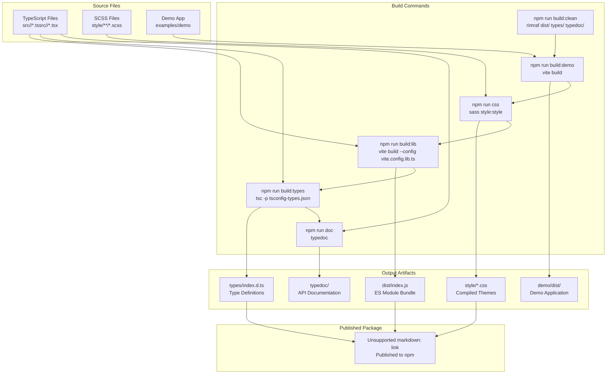
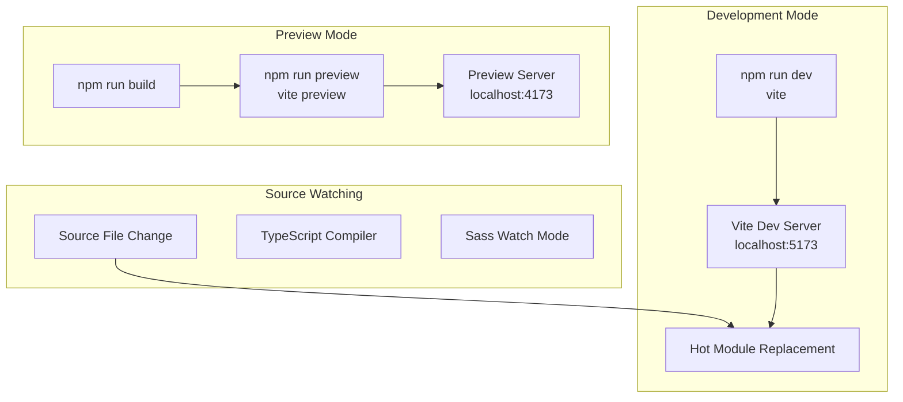
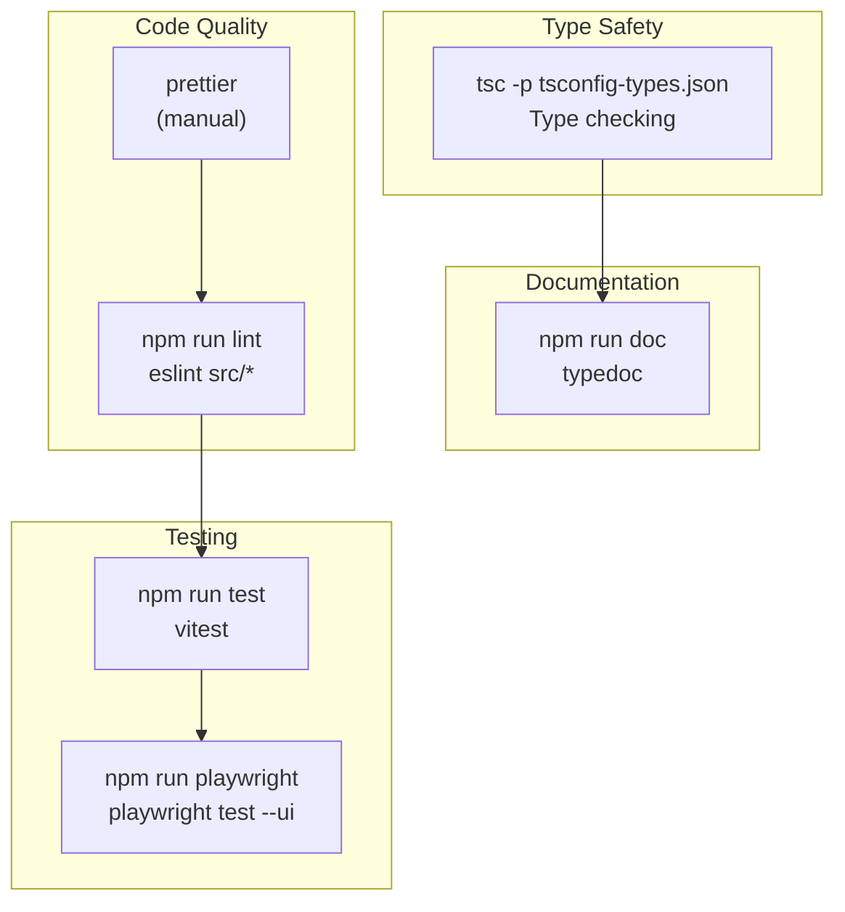
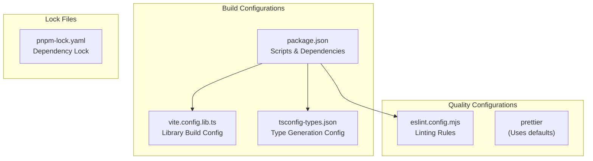

# Build System

> **Relevant source files**
> * [eslint.config.mjs](https://github.com/caplin/FlexLayout/blob/40753f37/eslint.config.mjs)
> * [package.json](https://github.com/caplin/FlexLayout/blob/40753f37/package.json)
> * [pnpm-lock.yaml](https://github.com/caplin/FlexLayout/blob/40753f37/pnpm-lock.yaml)

This document describes the build pipeline, tooling configuration, and development workflow for FlexLayout. It covers how source files are compiled, bundled, and prepared for distribution as an npm package.

For information about testing infrastructure, see [Testing](/caplin/FlexLayout/9.2-testing). For contribution guidelines including code style, see [Contributing Guidelines](/caplin/FlexLayout/9.3-contributing-guidelines).

---

## Overview

FlexLayout uses a modern JavaScript build toolchain centered around **Vite** for bundling, **TypeScript** for type generation, **Sass** for CSS compilation, and **npm scripts** for orchestration. The build system produces:

1. **ES module bundle** (`dist/index.js`)
2. **TypeScript type definitions** (`types/index.d.ts`)
3. **Compiled CSS themes** (`style/*.css`)
4. **Demo application** (`demo/dist/`)
5. **API documentation** (`typedoc/`)

The published package (`flexlayout-react@0.8.17`) includes only essential artifacts: `dist/`, `types/`, and `style/` directories.

**Sources:** [package.json L1-L101](https://github.com/caplin/FlexLayout/blob/40753f37/package.json#L1-L101)

---

## Build Tools Stack

### Core Build Tools

| Tool | Version | Purpose |
| --- | --- | --- |
| **Vite** | 6.3.0 | Library bundler and dev server |
| **TypeScript** | 5.8.3 | Type checking and definition generation |
| **Sass** | 1.86.3 | CSS preprocessing and theme compilation |
| **rimraf** | 6.0.1 | Cross-platform directory cleanup |

### Quality and Documentation Tools

| Tool | Version | Purpose |
| --- | --- | --- |
| **Vitest** | 3.1.1 | Unit testing framework |
| **Playwright** | 1.51.1 | End-to-end testing |
| **ESLint** | 9.24.0 | Code linting |
| **Prettier** | 3.5.3 | Code formatting |
| **TypeDoc** | 0.28.2 | API documentation generation |

**Sources:** [package.json L67-L99](https://github.com/caplin/FlexLayout/blob/40753f37/package.json#L67-L99)

---

## Build Pipeline



**Build Script Execution Order**

The main `build` script executes steps sequentially:

```
npm run build
  └─> build:clean    (removes old artifacts)
  └─> build:demo     (builds demo app)
  └─> css            (compiles SCSS to CSS)
  └─> build:lib      (bundles library with Vite)
  └─> build:types    (generates .d.ts files)
  └─> doc            (generates API docs)
```

**Sources:** [package.json L49-L58](https://github.com/caplin/FlexLayout/blob/40753f37/package.json#L49-L58)

---

## Build Script Reference

### Primary Build Scripts

```json
{  "build": "npm run build:clean && npm run build:demo && npm run css && npm run build:lib && npm run build:types && npm run doc",  "build:clean": "rimraf demo/dist dist/ types/ typedoc/",  "build:demo": "vite build",  "build:lib": "vite build --config vite.config.lib.ts",  "build:types": "tsc -p tsconfig-types.json",  "css": "sass style:style"}
```

#### build:clean

Removes all build artifacts using `rimraf` for cross-platform compatibility. Clears:

* `demo/dist/` - Demo application output
* `dist/` - Library bundle output
* `types/` - TypeScript definitions
* `typedoc/` - Generated documentation

#### build:demo

Uses Vite's default configuration to build the demo application from `examples/demo`. Produces static HTML/JS/CSS in `demo/dist/`. This demo is NOT included in the published package.

#### build:lib

Uses a separate Vite configuration (`vite.config.lib.ts`) to bundle the library specifically for npm distribution. Produces `dist/index.js` as an ES module.

#### build:types

Runs TypeScript compiler with `tsconfig-types.json` configuration. Generates `.d.ts` type definition files in the `types/` directory without emitting JavaScript.

#### css

Compiles SCSS sources from `style/` directory to CSS. Uses Sass's directory-to-directory compilation mode (`style:style`). Produces:

* `style/dark.css`
* `style/light.css`
* `style/gray.css`
* `style/underline.css`
* `style/combined.css`

**Sources:** [package.json L49-L58](https://github.com/caplin/FlexLayout/blob/40753f37/package.json#L49-L58)

---

## Development Workflow



### Development Server

```
npm run dev
```

Starts Vite development server with:

* Hot Module Replacement (HMR) for instant updates
* TypeScript transpilation on-the-fly
* CSS processing
* React Fast Refresh
* Typically runs on `http://localhost:5173`

### Preview Production Build

```
npm run preview
```

Builds and previews the production bundle locally. Useful for testing the actual build output before publishing.

**Sources:** [package.json L47-L48](https://github.com/caplin/FlexLayout/blob/40753f37/package.json#L47-L48)

---

## Package Configuration

### Module System

```json
{  "type": "module",  "main": "./dist/index.js",  "module": "./dist/index.js",  "types": "./types/index.d.ts"}
```

The package is configured as an **ES module** (`"type": "module"`). Both `main` and `module` point to the same ES module bundle for maximum compatibility with modern bundlers.

### Exports Map

```json
{  "exports": {    ".": {      "import": "./dist/index.js",      "types": "./types/index.d.ts"    },    "./style/*": "./style/*"  }}
```

The `exports` field provides:

* **Default export** (`.`): The main library module with type definitions
* **Style exports** (`./style/*`): Direct access to compiled CSS files

Consumers can import:

```javascript
import { Layout, Model } from 'flexlayout-react';import 'flexlayout-react/style/dark.css';
```

### Published Files

```json
{  "files": [    "dist/",    "types/",    "style/"  ]}
```

Only three directories are included in the published package:

* `dist/` - Bundled library code
* `types/` - TypeScript type definitions
* `style/` - Compiled CSS themes

Source files, tests, demo code, and build configuration are excluded from the package.

**Sources:** [package.json L11-L26](https://github.com/caplin/FlexLayout/blob/40753f37/package.json#L11-L26)

---

## Quality Gates



### Linting

```
npm run lint
```

Runs ESLint on source files with configuration from `eslint.config.mjs`. Uses:

* TypeScript ESLint parser and rules
* React plugin for JSX linting
* Recommended configurations from `@eslint/js`

Key rule overrides:

* `@typescript-eslint/no-explicit-any`: off
* `@typescript-eslint/no-unused-vars`: off
* `react/react-in-jsx-scope`: off (React 17+ automatic runtime)
* `react/display-name`: off

**Sources:** [package.json L56](https://github.com/caplin/FlexLayout/blob/40753f37/package.json#L56-L56)

 [eslint.config.mjs L1-L30](https://github.com/caplin/FlexLayout/blob/40753f37/eslint.config.mjs#L1-L30)

### Testing

Unit tests run with Vitest:

```
npm run test
```

End-to-end tests run with Playwright:

```
npm run playwright
```

For detailed testing documentation, see [Testing](/caplin/FlexLayout/9.2-testing).

### Documentation Generation

```
npm run doc
```

Generates API documentation using TypeDoc:

* Excludes demo files (`**/demo/**/*.tsx`)
* Excludes internal/private/protected members
* Outputs to `typedoc/` directory
* Does not include README in docs

**Sources:** [package.json L54-L57](https://github.com/caplin/FlexLayout/blob/40753f37/package.json#L54-L57)

---

## Build Outputs

### Directory Structure

```markdown
flexlayout-react/
├── dist/
│   └── index.js              # ES module bundle
├── types/
│   ├── index.d.ts            # Main type definitions
│   └── ...                   # Additional .d.ts files
├── style/
│   ├── dark.css              # Dark theme
│   ├── light.css             # Light theme
│   ├── gray.css              # Gray theme
│   ├── underline.css         # Underline theme
│   └── combined.css          # All themes combined
├── demo/dist/                # Demo app (not published)
└── typedoc/                  # API docs (not published)
```

### Bundle Characteristics

The `dist/index.js` bundle is:

* **ES Module format** - Uses `import`/`export` syntax
* **Tree-shakeable** - Dead code elimination by bundlers
* **Single file** - No code splitting in library mode
* **React as peer dependency** - React is NOT bundled

TypeScript definitions in `types/` provide:

* Full type coverage for all public APIs
* JSDoc comments preserved
* Generic type parameters
* Enum and const exports

CSS files in `style/` are:

* **Standalone** - Can be imported individually
* **Pre-compiled** - No Sass runtime needed
* **Theme-specific** - Or use `combined.css` for all themes

**Sources:** [package.json L12-L14](https://github.com/caplin/FlexLayout/blob/40753f37/package.json#L12-L14)

 [package.json L22-L26](https://github.com/caplin/FlexLayout/blob/40753f37/package.json#L22-L26)

---

## Configuration Files



### eslint.config.mjs

Modern flat config format using ESLint 9.x:

```javascript
export default defineConfig([  { files: ["**/*.{js,mjs,cjs,ts,jsx,tsx}"], ... },  tseslint.configs.recommended,  pluginReact.configs.flat.recommended,  {    files: ["**/*.{ts,tsx}"],    rules: {      '@typescript-eslint/no-explicit-any': 'off',      // ... other overrides    }  }]);
```

Applies to all `.ts`, `.tsx`, `.js`, `.jsx` files with:

* TypeScript recommended rules
* React recommended rules
* Custom overrides for project needs

**Sources:** [eslint.config.mjs L1-L30](https://github.com/caplin/FlexLayout/blob/40753f37/eslint.config.mjs#L1-L30)

### package.json - Peer Dependencies

```json
{  "peerDependencies": {    "react": "^18.0.0 || ^19.0.0",    "react-dom": "^18.0.0 || ^19.0.0"  }}
```

React is a **peer dependency**, not bundled with the library. Consumers must provide React 18.x or 19.x.

**Sources:** [package.json L63-L66](https://github.com/caplin/FlexLayout/blob/40753f37/package.json#L63-L66)

---

## Build Process Internals

### Vite Library Mode

The `vite.config.lib.ts` configuration (referenced but not provided in sources) configures Vite for library bundling:

* **Entry point**: `src/index.ts` or `src/index.tsx`
* **Format**: ES module
* **External dependencies**: React, React-DOM marked as external
* **Output**: Single file bundle to `dist/index.js`

Vite uses Rollup internally for the production build, applying optimizations like:

* Tree shaking
* Minification
* Code splitting (if configured)

### TypeScript Compilation

The `tsconfig-types.json` configuration (referenced but not provided) configures TypeScript for declaration generation:

* **emitDeclarationOnly**: true - Only generate `.d.ts` files
* **outDir**: `types/` - Output directory for definitions
* **declarationMap**: Likely enabled for source map support

### Sass Compilation

The command `sass style:style` uses Sass CLI with:

* **Input directory**: `style/`
* **Output directory**: `style/`
* **Compile mode**: Directory-to-directory

Each `.scss` file in `style/` compiles to a corresponding `.css` file:

* `style/dark.scss` → `style/dark.css`
* `style/light.scss` → `style/light.css`
* etc.

**Sources:** [package.json L49-L58](https://github.com/caplin/FlexLayout/blob/40753f37/package.json#L49-L58)

---

## Development Dependencies vs Runtime

The library has **zero runtime dependencies**. All packages in `devDependencies` are build-time only:

```
{  "devDependencies": {    "vite": "^6.3.0",    "typescript": "^5.8.3",    "react": "^19.1.0",    // ... 30+ more dev dependencies  }}
```

Consumers installing `flexlayout-react` only need to provide peer dependencies (React). They do NOT install:

* Build tools (Vite, TypeScript, Sass)
* Testing tools (Vitest, Playwright)
* Quality tools (ESLint, Prettier)
* Demo dependencies (Material-UI, ag-Grid, etc.)

This keeps the installation size minimal and avoids dependency conflicts.

**Sources:** [package.json L67-L100](https://github.com/caplin/FlexLayout/blob/40753f37/package.json#L67-L100)

---

## Summary

The FlexLayout build system is a modern, Vite-based pipeline that:

1. **Compiles** TypeScript to JavaScript ES modules
2. **Bundles** library code with Rollup (via Vite)
3. **Generates** TypeScript type definitions
4. **Compiles** Sass themes to CSS
5. **Validates** code with ESLint
6. **Tests** with Vitest and Playwright
7. **Documents** API with TypeDoc

The published package is minimal, containing only:

* Compiled JavaScript bundle (`dist/`)
* Type definitions (`types/`)
* CSS themes (`style/`)

Development workflow supports both hot-reloading dev mode and production preview mode, with comprehensive quality gates ensuring code consistency and correctness.

**Sources:** [package.json L1-L101](https://github.com/caplin/FlexLayout/blob/40753f37/package.json#L1-L101)

 [eslint.config.mjs L1-L30](https://github.com/caplin/FlexLayout/blob/40753f37/eslint.config.mjs#L1-L30)