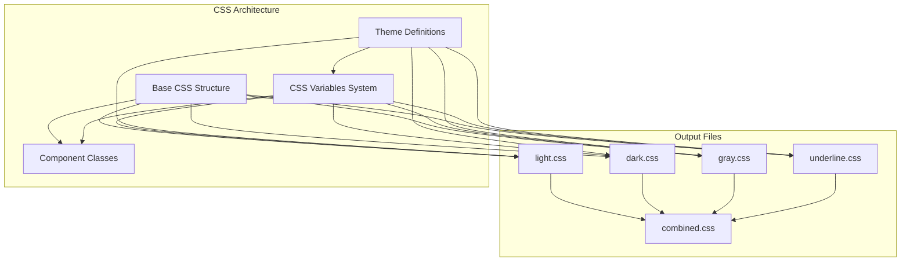
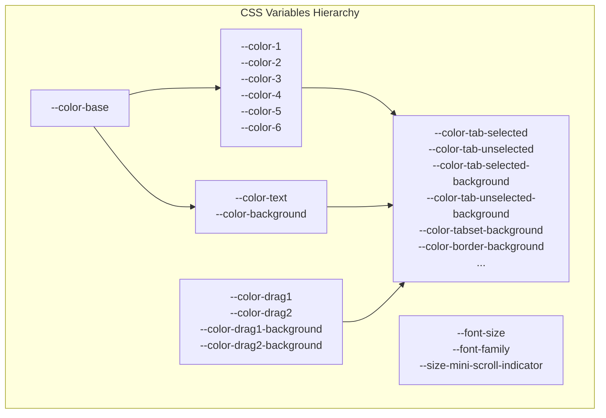
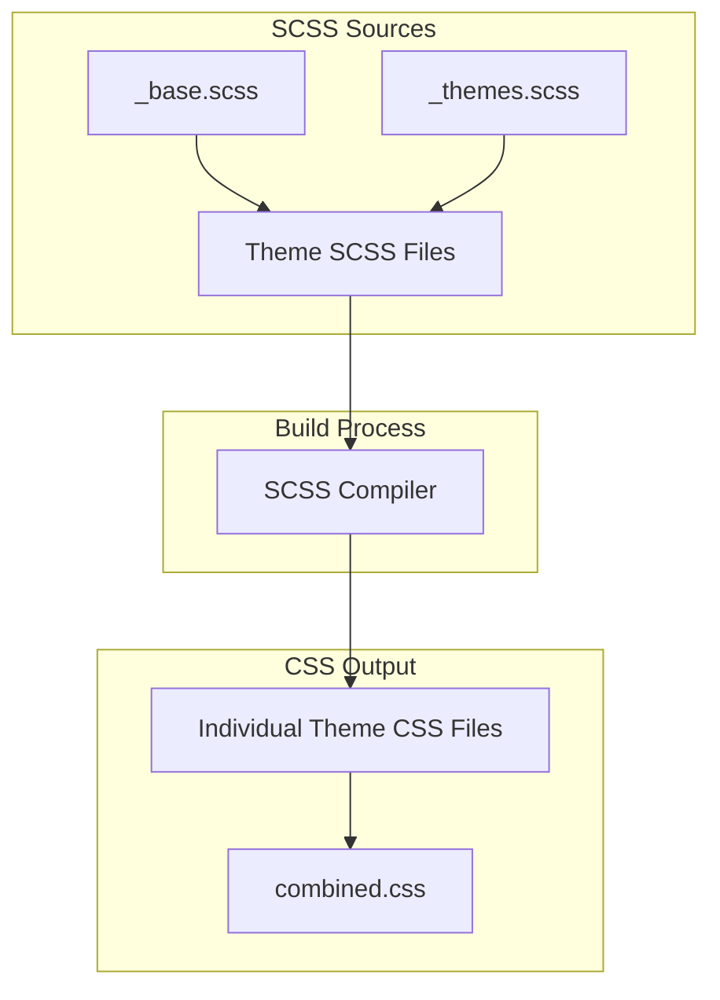

# CSS Structure

> **Relevant source files**
> * [src/Types.ts](https://github.com/caplin/FlexLayout/blob/40753f37/src/Types.ts)
> * [style/_base.scss](https://github.com/caplin/FlexLayout/blob/40753f37/style/_base.scss)
> * [style/dark.css](https://github.com/caplin/FlexLayout/blob/40753f37/style/dark.css)
> * [style/gray.css](https://github.com/caplin/FlexLayout/blob/40753f37/style/gray.css)
> * [style/light.css](https://github.com/caplin/FlexLayout/blob/40753f37/style/light.css)

This document explains the CSS structure of FlexLayout, including its organization, naming conventions, and CSS variables system. For information about the available themes and their specific styling, see [Available Themes](/caplin/FlexLayout/5.2-available-themes). For guidance on customizing and creating themes, see [Customizing Themes](/caplin/FlexLayout/5.3-customizing-themes).

## Overview

FlexLayout uses a well-organized CSS architecture that relies heavily on CSS variables (custom properties) to enable theming and customization. The styling system consists of:

1. Base CSS styles that define the core layout and component appearance
2. A robust CSS variables system for theming
3. Several pre-built themes with their specific variable values
4. A consistent naming convention to prevent style conflicts



Sources: [style/_base.scss](https://github.com/caplin/FlexLayout/blob/40753f37/style/_base.scss)

 [style/_themes.scss](https://github.com/caplin/FlexLayout/blob/40753f37/style/_themes.scss)

 [style/light.css](https://github.com/caplin/FlexLayout/blob/40753f37/style/light.css)

 [style/dark.css](https://github.com/caplin/FlexLayout/blob/40753f37/style/dark.css)

 [style/gray.css](https://github.com/caplin/FlexLayout/blob/40753f37/style/gray.css)

 [style/combined.css](https://github.com/caplin/FlexLayout/blob/40753f37/style/combined.css)

## Source File Organization

The FlexLayout styling system is built from several key source files:

| File | Purpose |
| --- | --- |
| `_base.scss` | Contains the core CSS classes and structure used by all themes |
| `_themes.scss` | Defines theme mixins and CSS variable values for each theme |
| `light.scss` | Imports base and applies light theme variables |
| `dark.scss` | Imports base and applies dark theme variables |
| `gray.scss` | Imports base and applies gray theme variables |
| `underline.scss` | Imports base and applies underline theme variables |
| `combined.css` | All themes combined in a single file with theme classes |

Each individual theme file is compiled to a corresponding CSS file that contains both the base styles and the theme-specific variable values.

Sources: [style/_base.scss](https://github.com/caplin/FlexLayout/blob/40753f37/style/_base.scss)

 [style/_themes.scss](https://github.com/caplin/FlexLayout/blob/40753f37/style/_themes.scss)

 [style/combined.css](https://github.com/caplin/FlexLayout/blob/40753f37/style/combined.css)

## CSS Variables System

At the core of FlexLayout's styling system is an extensive set of CSS variables that control all visual aspects of the components. These variables are defined at the root level in the `.flexlayout__layout` class and are used throughout the component styles.



The key categories of CSS variables include:

1. **Base Colors**: * `--color-base`: The starting point for color derivation * `--color-1` through `--color-6`: Progressively lighter/darker variations * `--color-text`: Main text color * `--color-background`: Base background color
2. **Component-Specific Colors**: * Tab related: `--color-tab-selected`, `--color-tab-unselected`, etc. * Tabset related: `--color-tabset-background`, `--color-tabset-divider-line`, etc. * Border related: `--color-border-background`, `--color-border-divider-line`, etc. * Splitter related: `--color-splitter`, `--color-splitter-hover`, etc.
3. **Drag and Drop Colors**: * `--color-drag1`, `--color-drag2`: Colors for drag indicators * `--color-drag-rect-border`, `--color-drag-rect-background`: Colors for drag rectangles
4. **Typography and Sizing**: * `--font-size`, `--font-family`: Text styling * `--size-mini-scroll-indicator`: Size for scroll indicators

Here's an example of CSS variable definitions from the light theme:

```
--color-text: black;
--color-background: white;
--color-base: white;
--color-1: rgb(247.35, 247.35, 247.35);
--color-2: rgb(239.7, 239.7, 239.7);
--color-3: rgb(232.05, 232.05, 232.05);
--color-4: rgb(224.4, 224.4, 224.4);
--color-5: rgb(216.75, 216.75, 216.75);
--color-6: rgb(209.1, 209.1, 209.1);
```

Sources: [style/light.css L1-L56](https://github.com/caplin/FlexLayout/blob/40753f37/style/light.css#L1-L56)

 [style/dark.css L1-L56](https://github.com/caplin/FlexLayout/blob/40753f37/style/dark.css#L1-L56)

 [style/_themes.scss L1-L92](https://github.com/caplin/FlexLayout/blob/40753f37/style/_themes.scss#L1-L92)

## CSS Class Naming Convention

FlexLayout uses a consistent naming convention for CSS classes to prevent conflicts with other libraries and make the structure easy to understand:

```

```

1. **Namespace Prefix**: All classes start with `flexlayout__` to prevent collisions with other libraries
2. **Component Names**: Follow the prefix (e.g., `tabset`, `tab`, `splitter`)
3. **Element Separators**: Underscore `_` separates component from its elements
4. **Modifiers**: Double dash `--` indicates state or variation

Examples:

* `flexlayout__layout`: The main layout container
* `flexlayout__tabset`: A tabset component
* `flexlayout__tabset_header`: The header part of a tabset
* `flexlayout__tab_button--selected`: A tab button in selected state

Sources: [style/light.css L61-L683](https://github.com/caplin/FlexLayout/blob/40753f37/style/light.css#L61-L683)

 [style/_base.scss L20-L764](https://github.com/caplin/FlexLayout/blob/40753f37/style/_base.scss#L20-L764)

## Component Styling Structure

FlexLayout organizes component styles into logical groups that reflect the component hierarchy:

| Component Group | Classes | Purpose |
| --- | --- | --- |
| Layout | `flexlayout__layout`, `flexlayout__layout_main` | Main container and layout structure |
| Splitters | `flexlayout__splitter`, `flexlayout__splitter_handle` | Resizable dividers between panels |
| Tabsets | `flexlayout__tabset`, `flexlayout__tabset_header`, `flexlayout__tabset_content` | Tab containers with headers and content areas |
| Tabs | `flexlayout__tab`, `flexlayout__tab_button`, `flexlayout__tab_button--selected` | Individual tabs and their buttons |
| Borders | `flexlayout__border`, `flexlayout__border_button`, `flexlayout__border_tab_contents` | Border panels and their components |
| Drag & Drop | `flexlayout__outline_rect`, `flexlayout__drag_rect`, `flexlayout__edge_rect` | Visual elements for drag and drop operations |
| Popups | `flexlayout__popup_menu`, `flexlayout__popup_menu_item` | Popup menus for tab selection |

Each component's style is defined in the base CSS and can be modified by theme-specific overrides.

Sources: [style/_base.scss L20-L764](https://github.com/caplin/FlexLayout/blob/40753f37/style/_base.scss#L20-L764)

 [style/light.css L61-L683](https://github.com/caplin/FlexLayout/blob/40753f37/style/light.css#L61-L683)

## SCSS Source Structure

The styling system uses SCSS (Sass) for better organization and maintenance. The key features of the SCSS source include:

1. **Mixins**: Reusable style blocks * `@mixin absoluteFill`: Positions an element to fill its container * `@mixin flexFix`: Sets up proper flexbox behavior * `@mixin baseMixin`: Contains all base styles * Theme mixins: `@mixin light_theme`, `@mixin dark_theme`, etc.
2. **Nesting**: Uses SCSS nesting for better organization ``` .flexlayout {    &__layout {        // layout styles                &_overlay {            // overlay styles        }    }} ```
3. **Variable calculations**: Uses SASS functions to calculate related colors ``` $color_1: color.adjust($color_base, $lightness: -3%);$color_2: color.adjust($color_1, $lightness: -3%); ```

Sources: [style/_base.scss L1-L19](https://github.com/caplin/FlexLayout/blob/40753f37/style/_base.scss#L1-L19)

 [style/_themes.scss L1-L92](https://github.com/caplin/FlexLayout/blob/40753f37/style/_themes.scss#L1-L92)

## Theme Implementation

Themes are implemented through a combination of:

1. **Base CSS Variables**: Each theme defines its own set of base variables
2. **Component Variable References**: Component styles reference these variables
3. **Theme-Specific Overrides**: Additional styles that only apply to specific themes

When using the combined CSS file, themes are applied using theme classes:

```html
<!-- Light theme --><div class="flexlayout__theme_light">    <div class="flexlayout__layout">...</div></div> <!-- Dark theme --><div class="flexlayout__theme_dark">    <div class="flexlayout__layout">...</div></div>
```

When using individual theme files, the theme is built into the CSS file directly.

Sources: [style/combined.css L1-L1058](https://github.com/caplin/FlexLayout/blob/40753f37/style/combined.css#L1-L1058)

 [style/_themes.scss L93-L646](https://github.com/caplin/FlexLayout/blob/40753f37/style/_themes.scss#L93-L646)

## Media Queries and Responsive Behavior

FlexLayout includes media queries to handle different interaction modes:

```css
@media (hover: hover) {  .flexlayout__splitter:hover {    background-color: var(--color-splitter-hover);    transition: background-color ease-in 0.1s;  }}
```

These queries ensure appropriate behavior across devices:

* `(hover: hover)`: Styles only applied to devices with hover capabilities (mice/trackpads)
* `(pointer: coarse)`: Styles for touch devices

Sources: [style/light.css L123-L130](https://github.com/caplin/FlexLayout/blob/40753f37/style/light.css#L123-L130)

 [style/_base.scss L73-L80](https://github.com/caplin/FlexLayout/blob/40753f37/style/_base.scss#L73-L80)

## Component-Specific CSS Examples

Here are a few examples of how CSS is applied to specific components:

### Tabs and TabButtons

Tab buttons use CSS variables for colors and have different states (selected/unselected):

```css
.flexlayout__tab_button--selected {  background-color: var(--color-tab-selected-background);  color: var(--color-tab-selected);} .flexlayout__tab_button--unselected {  background-color: var(--color-tab-unselected-background);  color: var(--color-tab-unselected);}
```

### Splitters

Splitters have base, hover, and drag states:

```css
.flexlayout__splitter {  background-color: var(--color-splitter);} .flexlayout__splitter:hover {  background-color: var(--color-splitter-hover);} .flexlayout__splitter_drag {  background-color: var(--color-splitter-drag);}
```

### Popup Menus

Popup menus are styled with consistent theming:

```css
.flexlayout__popup_menu_container {  box-shadow: inset 0 0 5px rgba(0, 0, 0, 0.15);  border: 1px solid var(--color-popup-border);  color: var(--color-popup-unselected);  background: var(--color-popup-unselected-background);}
```

Sources: [style/light.css L354-L366](https://github.com/caplin/FlexLayout/blob/40753f37/style/light.css#L354-L366)

 [style/light.css L115-L139](https://github.com/caplin/FlexLayout/blob/40753f37/style/light.css#L115-L139)

 [style/light.css L612-L624](https://github.com/caplin/FlexLayout/blob/40753f37/style/light.css#L612-L624)

 [src/view/PopupMenu.tsx L1-L156](https://github.com/caplin/FlexLayout/blob/40753f37/src/view/PopupMenu.tsx#L1-L156)

## CSS Compilation Process

The FlexLayout CSS is generated from SCSS source files using the following process:



1. Each theme's SCSS file imports the base and theme mixins
2. The SCSS compiler processes these files and outputs individual theme CSS files
3. These can be used separately or combined into a single CSS file with theme classes

Sources: [style/_base.scss](https://github.com/caplin/FlexLayout/blob/40753f37/style/_base.scss)

 [style/_themes.scss](https://github.com/caplin/FlexLayout/blob/40753f37/style/_themes.scss)

 [style/combined.css](https://github.com/caplin/FlexLayout/blob/40753f37/style/combined.css)

## Summary

FlexLayout's CSS structure provides a flexible and maintainable way to style the layout components:

1. The CSS variables system allows for easy theming and customization
2. Consistent naming conventions prevent conflicts and improve readability
3. SCSS source files organize the styles in a maintainable way
4. Multiple themes are available through either separate CSS files or theme classes
5. Media queries ensure appropriate behavior across different devices

For more details on the available themes, see [Available Themes](/caplin/FlexLayout/5.2-available-themes). For guidance on customizing and creating themes, see [Customizing Themes](/caplin/FlexLayout/5.3-customizing-themes).