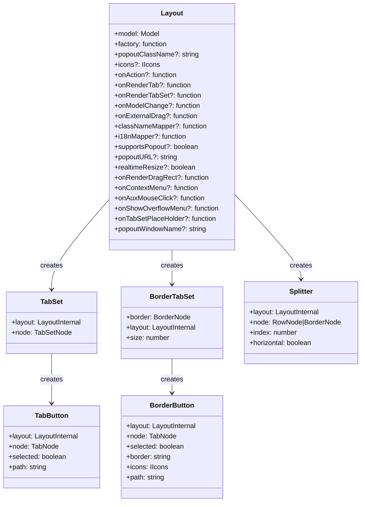
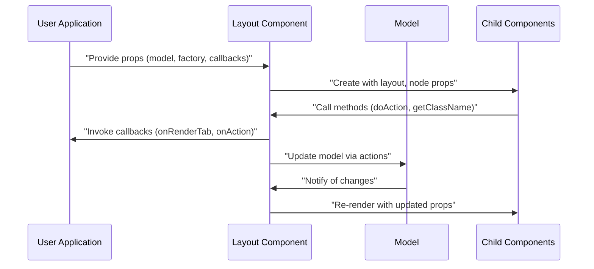

# Component Props

> **Relevant source files**
> * [README.md](https://github.com/caplin/FlexLayout/blob/40753f37/README.md?plain=1)
> * [src/view/BorderTabSet.tsx](https://github.com/caplin/FlexLayout/blob/40753f37/src/view/BorderTabSet.tsx)
> * [src/view/Layout.tsx](https://github.com/caplin/FlexLayout/blob/40753f37/src/view/Layout.tsx)
> * [src/view/TabSet.tsx](https://github.com/caplin/FlexLayout/blob/40753f37/src/view/TabSet.tsx)

This document provides a comprehensive reference of the props available for all components in the FlexLayout library. These props allow you to customize the behavior, appearance, and interaction patterns of your layout system. For information about the Model API, see [Model API](/caplin/FlexLayout/7.2-model-api).

## Layout Component

The `Layout` component is the main entry point for the FlexLayout system. It accepts a comprehensive set of props to configure your layout.

### Core Props

| Prop | Type | Required | Description |
| --- | --- | --- | --- |
| `model` | `Model` | Yes | The model instance that defines your layout structure |
| `factory` | `(node: TabNode) => React.ReactNode` | Yes | Factory function for creating tab components |

### Customization Props

| Prop | Type | Required | Description |
| --- | --- | --- | --- |
| `popoutClassName` | `string` | No | Class name for popout windows |
| `icons` | `IIcons` | No | Custom icons for close, maximize, restore, etc. |
| `classNameMapper` | `(defaultClassName: string) => string` | No | Maps default class names to custom ones |
| `realtimeResize` | `boolean` | No | Resize tabs as splitters are dragged |
| `popoutURL` | `string` | No | URL for popout windows, defaults to "popout.html" |
| `popoutWindowName` | `string` | No | Name for popout windows, defaults to "Popout Window" |

### Event Handling Props

| Prop | Type | Required | Description |
| --- | --- | --- | --- |
| `onAction` | `(action: Action) => Action \| undefined` | No | Called when an action is about to be performed |
| `onModelChange` | `(model: Model, action: Action) => void` | No | Called when the model has changed |
| `onExternalDrag` | `(event: React.DragEvent) => undefined \| { json: any, onDrop?: Function }` | No | Handles external drags onto the layout |
| `onContextMenu` | `NodeMouseEvent` | No | Handles context menu events |
| `onAuxMouseClick` | `NodeMouseEvent` | No | Handles auxiliary mouse clicks |

### Rendering Customization Props

| Prop | Type | Required | Description |
| --- | --- | --- | --- |
| `onRenderTab` | `(node: TabNode, renderValues: ITabRenderValues) => void` | No | Customizes tab rendering |
| `onRenderTabSet` | `(node: TabSetNode \| BorderNode, renderValues: ITabSetRenderValues) => void` | No | Customizes tabset rendering |
| `onRenderDragRect` | `DragRectRenderCallback` | No | Customizes drag rectangle rendering |
| `onShowOverflowMenu` | `ShowOverflowMenuCallback` | No | Customizes tab overflow menu |
| `onTabSetPlaceHolder` | `TabSetPlaceHolderCallback` | No | Renders placeholder for empty tabsets |

### Internationalization Props

| Prop | Type | Required | Description |
| --- | --- | --- | --- |
| `i18nMapper` | `(id: I18nLabel, param?: string) => string \| undefined` | No | Provides translations for UI elements |
| `supportsPopout` | `boolean` | No | Whether browser supports popout windows |

Sources: [src/view/Layout.tsx L32-L82](https://github.com/caplin/FlexLayout/blob/40753f37/src/view/Layout.tsx#L32-L82)

## Layout Component Methods

The `Layout` component also provides several methods for programmatic control:

| Method | Description |
| --- | --- |
| `redraw()` | Re-renders the layout |
| `addTabToTabSet(tabsetId, json)` | Adds a new tab to a specific tabset |
| `addTabToActiveTabSet(json)` | Adds a new tab to the active tabset |
| `addTabWithDragAndDrop(event, json, onDrop)` | Adds a tab using drag and drop |
| `moveTabWithDragAndDrop(event, node)` | Moves a tab using drag and drop |
| `setDragComponent(event, component, x, y)` | Sets the drag image for a drag event |
| `getRootDiv()` | Gets the root div element of the layout |

Sources: [src/view/Layout.tsx L100-L160](https://github.com/caplin/FlexLayout/blob/40753f37/src/view/Layout.tsx#L100-L160)

## Component Hierarchy

The following diagram shows the hierarchy of components in the FlexLayout system and the props they accept:



Sources: [src/view/Layout.tsx](https://github.com/caplin/FlexLayout/blob/40753f37/src/view/Layout.tsx)

 [src/view/TabSet.tsx](https://github.com/caplin/FlexLayout/blob/40753f37/src/view/TabSet.tsx)

 [src/view/BorderTabSet.tsx](https://github.com/caplin/FlexLayout/blob/40753f37/src/view/BorderTabSet.tsx)

 [src/view/TabButton.tsx](https://github.com/caplin/FlexLayout/blob/40753f37/src/view/TabButton.tsx)

 [src/view/BorderButton.tsx](https://github.com/caplin/FlexLayout/blob/40753f37/src/view/BorderButton.tsx)

 [src/view/Splitter.tsx](https://github.com/caplin/FlexLayout/blob/40753f37/src/view/Splitter.tsx)

## Props Data Flow

The following diagram illustrates how props flow through the component hierarchy:

```

```

Sources: [src/view/Layout.tsx L87-L166](https://github.com/caplin/FlexLayout/blob/40753f37/src/view/Layout.tsx#L87-L166)

 [src/view/TabSet.tsx L22-L485](https://github.com/caplin/FlexLayout/blob/40753f37/src/view/TabSet.tsx#L22-L485)

 [src/view/BorderTabSet.tsx L16-L272](https://github.com/caplin/FlexLayout/blob/40753f37/src/view/BorderTabSet.tsx#L16-L272)

 [src/view/TabButton.tsx L12-L200](https://github.com/caplin/FlexLayout/blob/40753f37/src/view/TabButton.tsx#L12-L200)

 [src/view/BorderButton.tsx L11-L201](https://github.com/caplin/FlexLayout/blob/40753f37/src/view/BorderButton.tsx#L11-L201)

 [src/view/Splitter.tsx L12-L262](https://github.com/caplin/FlexLayout/blob/40753f37/src/view/Splitter.tsx#L12-L262)

## TabSet Component Props

The `TabSet` component represents a container for tabs and is created by the Layout component.

| Prop | Type | Description |
| --- | --- | --- |
| `layout` | `LayoutInternal` | Reference to the internal layout implementation |
| `node` | `TabSetNode` | The TabSetNode model being rendered |

Sources: [src/view/TabSet.tsx L17-L20](https://github.com/caplin/FlexLayout/blob/40753f37/src/view/TabSet.tsx#L17-L20)

## BorderTabSet Component Props

The `BorderTabSet` component represents a tabset in a border region.

| Prop | Type | Description |
| --- | --- | --- |
| `border` | `BorderNode` | The BorderNode model being rendered |
| `layout` | `LayoutInternal` | Reference to the internal layout implementation |
| `size` | `number` | The size of the border |

Sources: [src/view/BorderTabSet.tsx L16-L20](https://github.com/caplin/FlexLayout/blob/40753f37/src/view/BorderTabSet.tsx#L16-L20)

## TabButton Component Props

The `TabButton` component represents a button in a tabset's tab bar.

| Prop | Type | Description |
| --- | --- | --- |
| `layout` | `LayoutInternal` | Reference to the internal layout implementation |
| `node` | `TabNode` | The TabNode model being rendered |
| `selected` | `boolean` | Whether the tab is selected |
| `path` | `string` | The path to the tab within the layout |

Sources: [src/view/TabButton.tsx L12-L17](https://github.com/caplin/FlexLayout/blob/40753f37/src/view/TabButton.tsx#L12-L17)

## BorderButton Component Props

The `BorderButton` component represents a button in a border tabset.

| Prop | Type | Description |
| --- | --- | --- |
| `layout` | `LayoutInternal` | Reference to the internal layout implementation |
| `node` | `TabNode` | The TabNode model being rendered |
| `selected` | `boolean` | Whether the tab is selected |
| `border` | `string` | The border name (e.g., "left", "right", "top", "bottom") |
| `icons` | `IIcons` | Icons object for rendering various button states |
| `path` | `string` | The path to the tab within the layout |

Sources: [src/view/BorderButton.tsx L11-L18](https://github.com/caplin/FlexLayout/blob/40753f37/src/view/BorderButton.tsx#L11-L18)

## Splitter Component Props

The `Splitter` component allows users to resize panels.

| Prop | Type | Description |
| --- | --- | --- |
| `layout` | `LayoutInternal` | Reference to the internal layout implementation |
| `node` | `RowNode \| BorderNode` | The node being split |
| `index` | `number` | The index of the splitter |
| `horizontal` | `boolean` | Whether the splitter is horizontal |

Sources: [src/view/Splitter.tsx L12-L17](https://github.com/caplin/FlexLayout/blob/40753f37/src/view/Splitter.tsx#L12-L17)

## Common Prop Patterns

Several props follow common patterns across the component hierarchy:

### Layout Reference

All components receive a reference to the `layout` (specifically `LayoutInternal`), which provides:

* Access to the model
* Methods for performing actions
* Access to style and class name mappers
* Access to internationalization functions

### Node Reference

Most components receive a `node` prop that provides the model data they need to render:

* `TabNode` for tab-related components
* `TabSetNode` for tabsets
* `BorderNode` for border components
* `RowNode` for layout rows

### Customization Callbacks

The `Layout` component accepts several callback props that allow customization of rendering:

* `onRenderTab` for customizing tab appearance
* `onRenderTabSet` for customizing tabset appearance
* `onAction` for intercepting actions
* `onContextMenu` and `onAuxMouseClick` for custom mouse handling



Sources: [src/view/Layout.tsx L32-L82](https://github.com/caplin/FlexLayout/blob/40753f37/src/view/Layout.tsx#L32-L82)

 [src/view/Layout.tsx L749-L759](https://github.com/caplin/FlexLayout/blob/40753f37/src/view/Layout.tsx#L749-L759)

 [src/view/Layout.tsx L802-L807](https://github.com/caplin/FlexLayout/blob/40753f37/src/view/Layout.tsx#L802-L807)

## IIcons Interface

The `icons` prop accepts an object that implements the `IIcons` interface, allowing customization of icons used throughout the layout:

| Property | Type | Description |
| --- | --- | --- |
| `close` | `React.ReactNode \| (node: TabNode) => React.ReactNode` | Icon for closing a tab |
| `closeTabset` | `React.ReactNode \| (node: TabSetNode) => React.ReactNode` | Icon for closing a tabset |
| `maximize` | `React.ReactNode \| (node: TabSetNode) => React.ReactNode` | Icon for maximizing a tabset |
| `restore` | `React.ReactNode \| (node: TabSetNode) => React.ReactNode` | Icon for restoring a maximized tabset |
| `more` | `React.ReactNode \| (node: TabSetNode, items) => React.ReactNode` | Icon for the overflow menu |
| `popout` | `React.ReactNode \| (node: TabNode) => React.ReactNode` | Icon for popping out a tab |
| `edgeArrow` | `React.ReactNode` | Icon for edge indicators |
| `activeTabset` | `React.ReactNode \| (node: TabSetNode) => React.ReactNode` | Icon for active tabset |

Each icon can be either a React node or a function that returns a React node, allowing for dynamic icons based on the node state.

Sources: [src/view/Layout.tsx L40](https://github.com/caplin/FlexLayout/blob/40753f37/src/view/Layout.tsx#L40-L40)

## Event Callback Interfaces

Several props accept callback functions with specific interfaces:

### onRenderTab

```javascript
(node: TabNode, renderValues: ITabRenderValues) => void
```

This callback allows you to customize various aspects of a tab's appearance by modifying the `renderValues` object:

* `leading`: Content to display at the start of the tab
* `content`: Main content of the tab
* `buttons`: Array of buttons to display
* `name`: Name used in the overflow menu

### onRenderTabSet

```javascript
(tabSetNode: TabSetNode | BorderNode, renderValues: ITabSetRenderValues) => void
```

This callback allows you to customize a tabset's appearance by modifying the `renderValues` object:

* `leading`: Content to display at the start of the tabset
* `buttons`: Array of buttons to display
* `stickyButtons`: Array of buttons that remain visible when tabs overflow
* `overflowPosition`: Position at which to insert the overflow button

Sources: [src/view/Layout.tsx L44-L52](https://github.com/caplin/FlexLayout/blob/40753f37/src/view/Layout.tsx#L44-L52)

## Best Practices for Using Component Props

1. **Model as Single Source of Truth**: Always update the layout through actions rather than manipulating component props directly.
2. **Factory Function**: Keep your factory function simple and efficient since it will be called frequently.
3. **Custom Rendering**: Use the `onRenderTab` and `onRenderTabSet` callbacks to customize appearance rather than trying to style components directly.
4. **Action Interception**: Use the `onAction` callback to add confirmations or validation before actions are performed.
5. **Class Name Mapping**: Use the `classNameMapper` prop for integration with CSS modules or other styling systems.
6. **Event Handling**: Implement `onContextMenu` and `onAuxMouseClick` for right-click and middle-click behaviors.
7. **Internationalization**: Provide an `i18nMapper` function to support multiple languages in your UI.