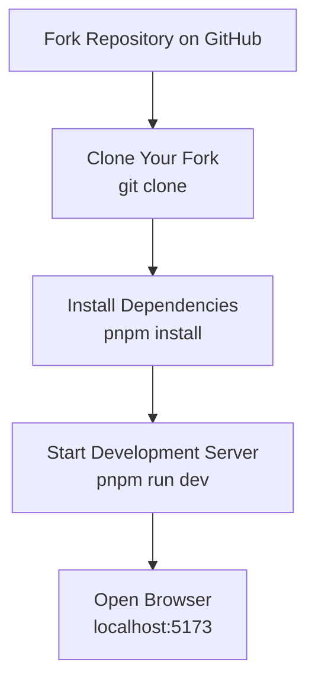
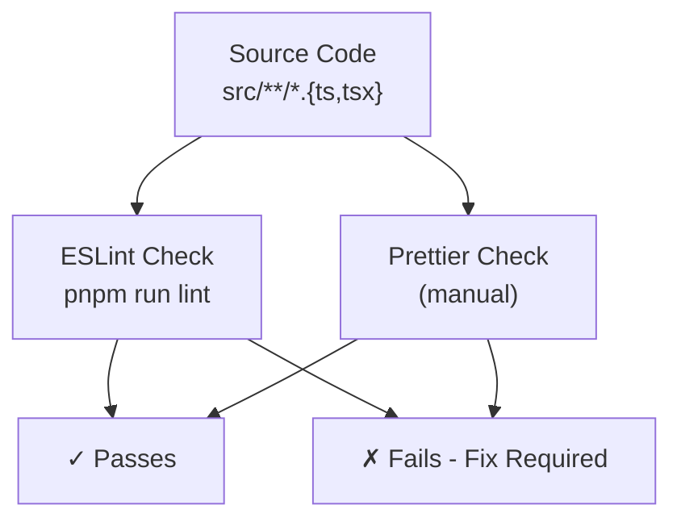
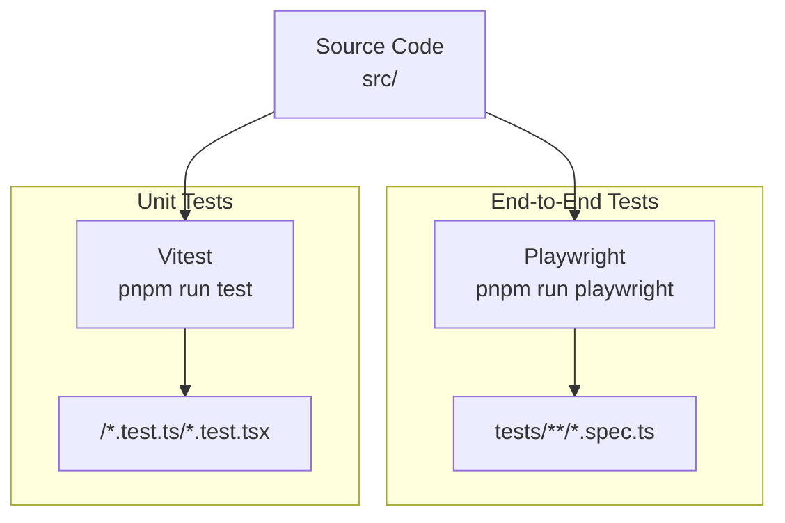
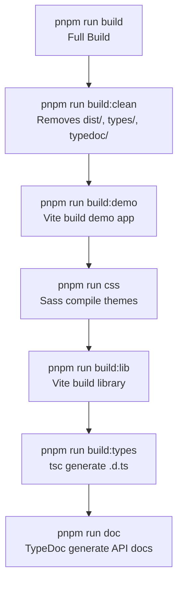
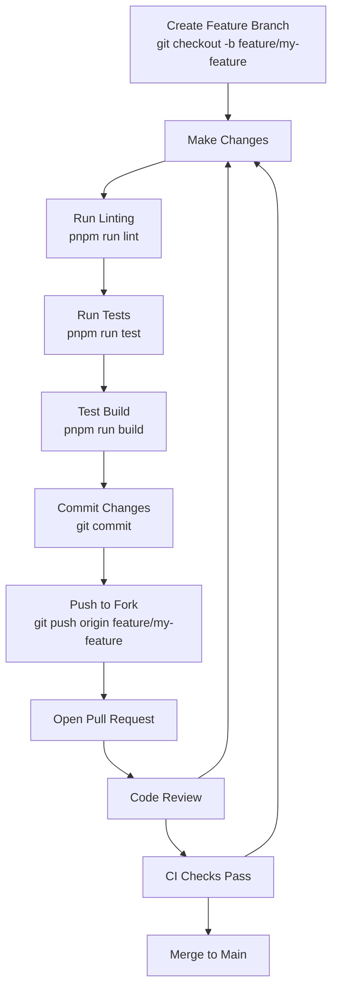
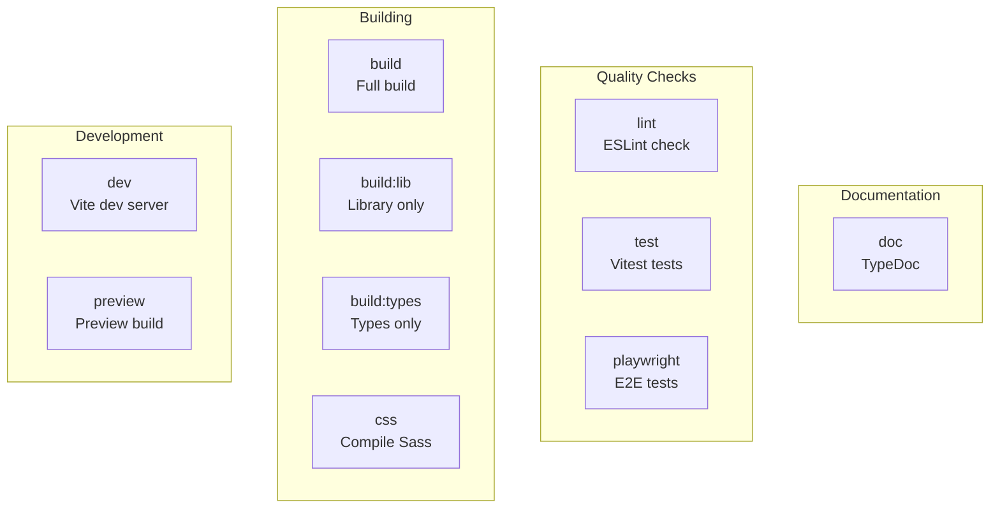

# Contributing Guidelines

> **Relevant source files**
> * [eslint.config.mjs](https://github.com/caplin/FlexLayout/blob/40753f37/eslint.config.mjs)
> * [package.json](https://github.com/caplin/FlexLayout/blob/40753f37/package.json)
> * [pnpm-lock.yaml](https://github.com/caplin/FlexLayout/blob/40753f37/pnpm-lock.yaml)

This document provides guidelines for developers who wish to contribute code, documentation, or bug reports to the FlexLayout project. It covers development environment setup, code standards, testing requirements, and the contribution workflow.

For information about the build system architecture itself, see [Build System](/caplin/FlexLayout/9.1-build-system). For testing infrastructure details, see [Testing](/caplin/FlexLayout/9.2-testing).

---

## Prerequisites

Before contributing to FlexLayout, ensure you have the following installed:

| Tool | Minimum Version | Purpose |
| --- | --- | --- |
| Node.js | >=18.0.0 | Runtime environment |
| pnpm | Latest | Package manager |
| Git | Latest | Version control |

The project uses `pnpm` as its package manager. While `npm` may work, `pnpm` is recommended for consistency with the lockfile.

**Sources:** [package.json L63-L66](https://github.com/caplin/FlexLayout/blob/40753f37/package.json#L63-L66)

 [pnpm-lock.yaml L1-L4](https://github.com/caplin/FlexLayout/blob/40753f37/pnpm-lock.yaml#L1-L4)

---

## Development Environment Setup

### Initial Setup Workflow



**Sources:** [package.json L47](https://github.com/caplin/FlexLayout/blob/40753f37/package.json#L47-L47)

### Installation Steps

1. **Fork and clone the repository:** ``` git clone https://github.com/YOUR_USERNAME/FlexLayout.gitcd FlexLayout ```
2. **Install dependencies:** ``` pnpm install ```
3. **Start the development server:** ``` pnpm run dev ``` This starts Vite's development server with the demo application at `http://localhost:5173`.
4. **Verify installation:** * The demo application should load in your browser * Hot module replacement (HMR) should work when you edit files

**Sources:** [package.json L47](https://github.com/caplin/FlexLayout/blob/40753f37/package.json#L47-L47)

---

## Code Standards

### Linting and Formatting

FlexLayout enforces code quality through ESLint and Prettier. All contributions must pass linting checks.



**Sources:** [package.json L56](https://github.com/caplin/FlexLayout/blob/40753f37/package.json#L56-L56)

 [eslint.config.mjs L1-L29](https://github.com/caplin/FlexLayout/blob/40753f37/eslint.config.mjs#L1-L29)

### ESLint Configuration

The project uses ESLint with the following configuration:

| Rule Category | Configuration |
| --- | --- |
| Base | `@eslint/js` recommended |
| TypeScript | `typescript-eslint` recommended |
| React | `eslint-plugin-react` flat config |
| Disabled Rules | `@typescript-eslint/no-explicit-any`, `no-unused-vars`, `@typescript-eslint/no-unused-vars`, `react/react-in-jsx-scope`, `react/display-name` |

**Key disabled rules explained:**

* **`@typescript-eslint/no-explicit-any`**: `any` type is allowed where necessary
* **`no-unused-vars`**: TypeScript compiler handles this
* **`react/react-in-jsx-scope`**: Not needed with React 17+ JSX transform
* **`react/display-name`**: Component display names not enforced

**Sources:** [eslint.config.mjs L7-L28](https://github.com/caplin/FlexLayout/blob/40753f37/eslint.config.mjs#L7-L28)

### Running Lint Checks

```markdown
# Check for linting errorspnpm run lint # ESLint can auto-fix many issuesnpx eslint src --fix
```

**Sources:** [package.json L56](https://github.com/caplin/FlexLayout/blob/40753f37/package.json#L56-L56)

### Code Style Guidelines

1. **TypeScript:** All source files must be TypeScript (`.ts` or `.tsx`)
2. **Imports:** Use ES6 module syntax
3. **React:** Functional components with hooks are preferred
4. **Naming:** * Classes: `PascalCase` * Functions/methods: `camelCase` * Constants: `UPPER_SNAKE_CASE` or `camelCase` * Files: `PascalCase` for components, `camelCase` for utilities
5. **Comments:** * Use JSDoc comments for public APIs * Include type annotations where TypeScript inference is insufficient * Document complex logic with inline comments

**Sources:** [eslint.config.mjs L1-L29](https://github.com/caplin/FlexLayout/blob/40753f37/eslint.config.mjs#L1-L29)

---

## Testing Requirements

All contributions must include appropriate tests. FlexLayout uses two testing frameworks:

### Testing Stack



**Sources:** [package.json L54-L55](https://github.com/caplin/FlexLayout/blob/40753f37/package.json#L54-L55)

### Unit Tests with Vitest

Unit tests are written using Vitest and should be placed alongside the code they test.

**Running unit tests:**

```markdown
# Run all unit testspnpm run test # Run tests in watch modepnpm run test -- --watch # Run tests with coveragepnpm run test -- --coverage
```

**Test file naming:**

* `*.test.ts` for TypeScript tests
* `*.test.tsx` for React component tests

**Unit test guidelines:**

1. Test public APIs and interfaces
2. Mock external dependencies
3. Test edge cases and error conditions
4. Aim for meaningful coverage, not just high percentages

**Sources:** [package.json L54](https://github.com/caplin/FlexLayout/blob/40753f37/package.json#L54-L54)

### End-to-End Tests with Playwright

E2E tests verify the entire application flow using Playwright.

**Running E2E tests:**

```markdown
# Run Playwright tests with UIpnpm run playwright
```

**E2E test guidelines:**

1. Test critical user workflows
2. Test cross-browser compatibility
3. Test drag-and-drop interactions
4. Test multi-window scenarios (popouts)

**Sources:** [package.json L55](https://github.com/caplin/FlexLayout/blob/40753f37/package.json#L55-L55)

### Test Requirements for Pull Requests

| Change Type | Test Requirement |
| --- | --- |
| New feature | Unit tests + E2E tests if user-facing |
| Bug fix | Test demonstrating the fix |
| Refactoring | Maintain existing test coverage |
| Documentation | Not applicable |

**Sources:** [package.json L54-L55](https://github.com/caplin/FlexLayout/blob/40753f37/package.json#L54-L55)

---

## Build Process

### Build Scripts

FlexLayout provides several build scripts for different purposes:



**Sources:** [package.json L49-L58](https://github.com/caplin/FlexLayout/blob/40753f37/package.json#L49-L58)

### Build Targets

| Script | Output | Purpose |
| --- | --- | --- |
| `build:clean` | Removes build artifacts | Clean slate for fresh build |
| `build:demo` | `demo/dist/` | Demo application for GitHub Pages |
| `css` | `style/*.css` | Compiled theme CSS files |
| `build:lib` | `dist/index.js` | ES module library bundle |
| `build:types` | `types/*.d.ts` | TypeScript type definitions |
| `doc` | `typedoc/` | API documentation HTML |

**Sources:** [package.json L49-L58](https://github.com/caplin/FlexLayout/blob/40753f37/package.json#L49-L58)

### Building Locally

```markdown
# Full production buildpnpm run build # Build only the library (for testing)pnpm run build:lib # Build and watch for changespnpm run dev
```

**Sources:** [package.json L49](https://github.com/caplin/FlexLayout/blob/40753f37/package.json#L49-L49)

### Build Configuration Files

| File | Purpose |
| --- | --- |
| `vite.config.ts` | Main Vite config for demo app |
| `vite.config.lib.ts` | Vite config for library build |
| `tsconfig.json` | TypeScript config for source |
| `tsconfig-types.json` | TypeScript config for type generation |

**Sources:** [package.json L51-L53](https://github.com/caplin/FlexLayout/blob/40753f37/package.json#L51-L53)

---

## Pull Request Process

### Pull Request Workflow



**Sources:** [package.json L46-L58](https://github.com/caplin/FlexLayout/blob/40753f37/package.json#L46-L58)

### Before Submitting a Pull Request

**1. Create a feature branch:**

```markdown
git checkout -b feature/descriptive-name# orgit checkout -b fix/issue-number
```

**2. Run all checks locally:**

```markdown
# Lint checkpnpm run lint # Unit testspnpm run test # Build checkpnpm run build
```

**3. Commit with clear messages:**

```markdown
git commit -m "feat: add new docking behavior"# orgit commit -m "fix: resolve tab overflow issue (#123)"
```

**4. Push to your fork:**

```
git push origin feature/descriptive-name
```

**Sources:** [package.json L54-L56](https://github.com/caplin/FlexLayout/blob/40753f37/package.json#L54-L56)

### Pull Request Checklist

* Code follows the project's code style
* ESLint passes without errors
* Unit tests are included and passing
* E2E tests are added for user-facing changes
* Build completes successfully
* Documentation is updated if needed
* Commit messages are clear and descriptive
* PR description explains the changes

### Pull Request Description Template

```sql
## DescriptionBrief description of what this PR does. ## Type of Change- [ ] Bug fix (non-breaking change which fixes an issue)- [ ] New feature (non-breaking change which adds functionality)- [ ] Breaking change (fix or feature that would cause existing functionality to change)- [ ] Documentation update ## Related IssuesCloses #(issue number) ## TestingDescribe the testing you've done. ## Screenshots (if applicable)Add screenshots to help explain your changes.
```

---

## Issue Reporting

### Reporting Bugs

When reporting a bug, include:

1. **Description:** Clear description of the issue
2. **Steps to Reproduce:** Numbered steps to reproduce the behavior
3. **Expected Behavior:** What you expected to happen
4. **Actual Behavior:** What actually happened
5. **Environment:** * FlexLayout version (from `package.json`) * React version * Browser and version * Operating system
6. **Code Sample:** Minimal reproducible example
7. **Screenshots:** If applicable

### Requesting Features

When requesting a feature, include:

1. **Use Case:** Describe the problem you're trying to solve
2. **Proposed Solution:** How you envision the feature working
3. **Alternatives Considered:** Other approaches you've thought about
4. **Additional Context:** Any other relevant information

**Sources:** [package.json L2-L3](https://github.com/caplin/FlexLayout/blob/40753f37/package.json#L2-L3)

---

## Documentation

### Documentation Requirements

All public APIs must be documented:

1. **TypeDoc Comments:** Add JSDoc comments to public classes, methods, and interfaces
2. **README Updates:** Update README.md for user-facing changes
3. **Wiki Updates:** Propose wiki page updates for significant features
4. **Example Code:** Add examples to the demo app when appropriate

### Generating Documentation

```markdown
# Generate API documentationpnpm run doc # Output is in typedoc/ directory
```

The documentation is generated using TypeDoc from inline comments in the source code.

**Sources:** [package.json L57](https://github.com/caplin/FlexLayout/blob/40753f37/package.json#L57-L57)

### Documentation Style

**Class documentation example:**

```javascript
/** * Manages the layout model tree structure. *  * The Model class represents the entire layout configuration, * including all tabs, tabsets, and borders. *  * @see {@link Node} for the base node class * @see {@link Actions} for available state mutations */export class Model {  // ...}
```

**Method documentation example:**

```markdown
/** * Adds a new tab to the layout. *  * @param json - The tab configuration * @returns The created TabNode instance * @throws {Error} If the target location is invalid *  * @example * ```typescript * model.doAction(Actions.addNode({ *   type: "tab", *   component: "text", *   name: "New Tab" * })); * ``` */public addNode(json: ITabNode): TabNode {  // ...}
```

**Sources:** [package.json L57](https://github.com/caplin/FlexLayout/blob/40753f37/package.json#L57-L57)

---

## Package Publishing

Package publishing is restricted to maintainers. Contributors should focus on submitting pull requests rather than publishing.

### Published Package Structure

| Export | File | Purpose |
| --- | --- | --- |
| Main module | `dist/index.js` | ES module library |
| Type definitions | `types/index.d.ts` | TypeScript types |
| Styles | `style/*.css` | Theme CSS files |

**Sources:** [package.json L12-L25](https://github.com/caplin/FlexLayout/blob/40753f37/package.json#L12-L25)

### Version Compatibility

The package declares peer dependencies:

| Dependency | Version Range |
| --- | --- |
| React | `^18.0.0 \|\| ^19.0.0` |
| React DOM | `^18.0.0 \|\| ^19.0.0` |

Contributors should ensure changes are compatible with both React 18 and React 19.

**Sources:** [package.json L63-L66](https://github.com/caplin/FlexLayout/blob/40753f37/package.json#L63-L66)

---

## Development Tools and Scripts Reference

### Complete Script Reference



**Sources:** [package.json L46-L58](https://github.com/caplin/FlexLayout/blob/40753f37/package.json#L46-L58)

### Quick Command Reference

```markdown
# Developmentpnpm run dev              # Start dev serverpnpm run preview          # Preview production build # Buildingpnpm run build            # Full production buildpnpm run build:lib        # Build library onlypnpm run build:types      # Generate types onlypnpm run css              # Compile Sass to CSS # Qualitypnpm run lint             # Run ESLintpnpm run test             # Run unit testspnpm run playwright       # Run E2E tests # Documentationpnpm run doc              # Generate API docs
```

**Sources:** [package.json L46-L58](https://github.com/caplin/FlexLayout/blob/40753f37/package.json#L46-L58)

---

## Getting Help

If you have questions about contributing:

1. **Check existing issues:** Your question may already be answered
2. **Read the wiki:** Comprehensive documentation of the codebase
3. **Open a discussion:** Use GitHub Discussions for questions
4. **Join the community:** Check the repository for community links

**Repository:** [https://github.com/caplin/FlexLayout](https://github.com/caplin/FlexLayout)

**Sources:** [package.json L6-L9](https://github.com/caplin/FlexLayout/blob/40753f37/package.json#L6-L9)