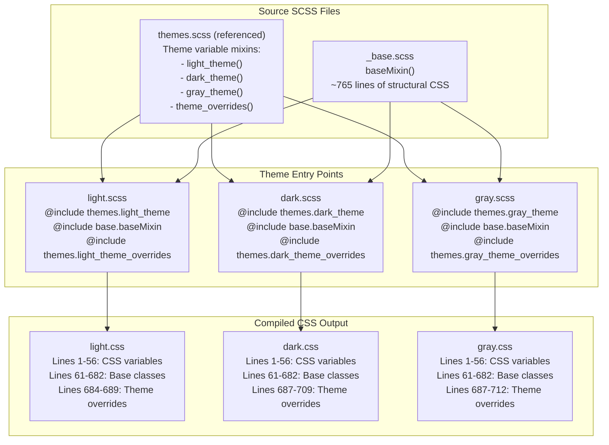
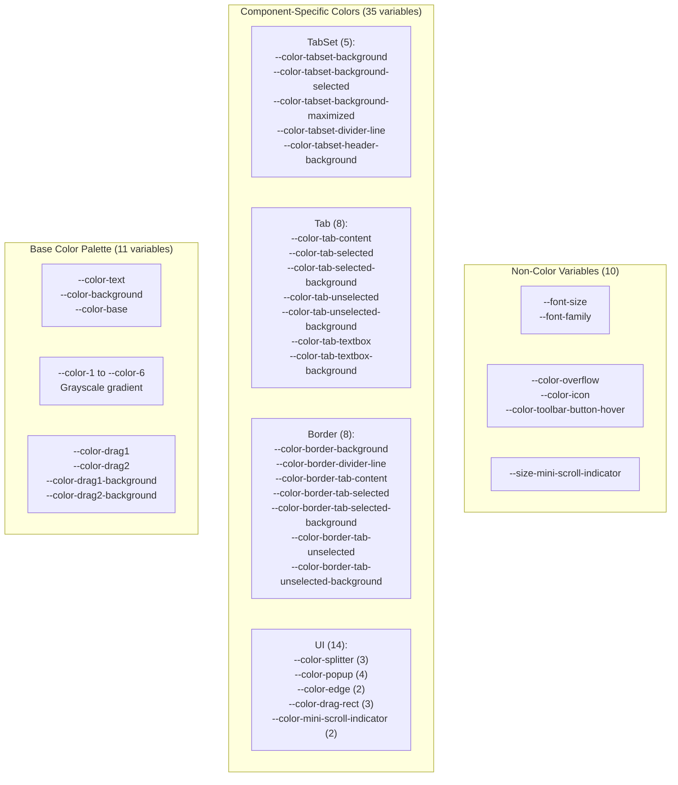
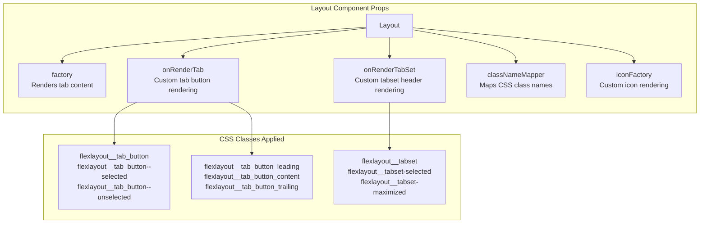
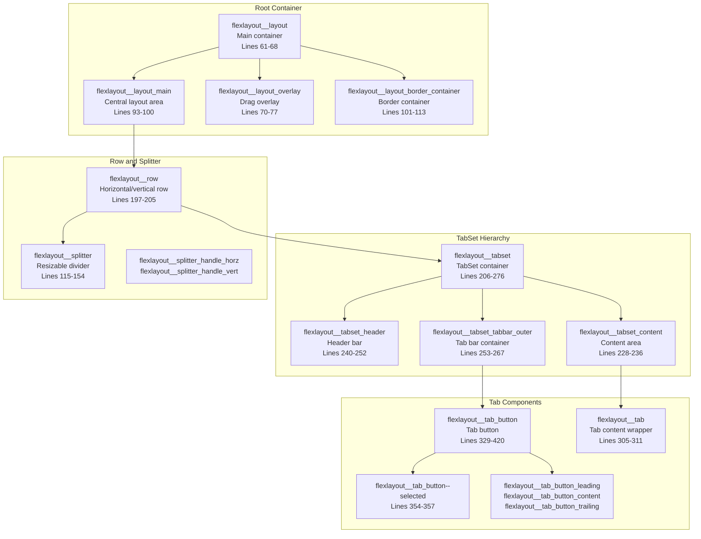

# Customizing Themes

> **Relevant source files**
> * [style/_base.scss](https://github.com/caplin/FlexLayout/blob/40753f37/style/_base.scss)
> * [style/dark.css](https://github.com/caplin/FlexLayout/blob/40753f37/style/dark.css)
> * [style/dark.scss](https://github.com/caplin/FlexLayout/blob/40753f37/style/dark.scss)
> * [style/gray.css](https://github.com/caplin/FlexLayout/blob/40753f37/style/gray.css)
> * [style/gray.scss](https://github.com/caplin/FlexLayout/blob/40753f37/style/gray.scss)
> * [style/light.css](https://github.com/caplin/FlexLayout/blob/40753f37/style/light.css)
> * [style/light.scss](https://github.com/caplin/FlexLayout/blob/40753f37/style/light.scss)

This page explains how to customize FlexLayout appearance through CSS variables, SCSS modification, or creating custom themes. For built-in themes, see page 5.2.

## Theme System Overview

FlexLayout uses a layered SCSS architecture that compiles to CSS with CSS custom properties. The system separates structural styles from theme-specific color and appearance definitions.

### SCSS Compilation Architecture



Sources: [style/_base.scss L1-L766](https://github.com/caplin/FlexLayout/blob/40753f37/style/_base.scss#L1-L766)

 [style/light.scss L1-L7](https://github.com/caplin/FlexLayout/blob/40753f37/style/light.scss#L1-L7)

 [style/dark.scss L1-L6](https://github.com/caplin/FlexLayout/blob/40753f37/style/dark.scss#L1-L6)

 [style/gray.scss L1-L6](https://github.com/caplin/FlexLayout/blob/40753f37/style/gray.scss#L1-L6)

 [style/light.css L1-L689](https://github.com/caplin/FlexLayout/blob/40753f37/style/light.css#L1-L689)

 [style/dark.css L1-L712](https://github.com/caplin/FlexLayout/blob/40753f37/style/dark.css#L1-L712)

 [style/gray.css L1-L715](https://github.com/caplin/FlexLayout/blob/40753f37/style/gray.css#L1-L715)

## CSS Variable Reference

FlexLayout defines 56 CSS custom properties on the `.flexlayout__layout` selector. These variables control all themeable aspects of the layout.

### Variable Categories



### Complete Variable List

| Category | Variable | Example Value (light) | Example Value (dark) |
| --- | --- | --- | --- |
| Base | `--color-text` | `black` | `#eeeeee` |
| Base | `--color-background` | `white` | `black` |
| Base | `--color-base` | `white` | `black` |
| Palette | `--color-1` to `--color-6` | `rgb(247,247,247)` to `rgb(209,209,209)` | `rgb(17,17,17)` to `rgb(76,76,76)` |
| TabSet | `--color-tabset-background` | `var(--color-background)` | `var(--color-1)` |
| TabSet | `--color-tabset-background-selected` | `var(--color-1)` | `var(--color-1)` |
| TabSet | `--color-tabset-divider-line` | `var(--color-4)` | `var(--color-4)` |
| Tab | `--color-tab-selected` | `var(--color-text)` | `var(--color-text)` |
| Tab | `--color-tab-selected-background` | `var(--color-4)` | `var(--color-4)` |
| Tab | `--color-tab-unselected` | `gray` | `gray` |
| Border | `--color-border-tab-selected-background` | `var(--color-4)` | `var(--color-4)` |
| Splitter | `--color-splitter` | `var(--color-1)` | `var(--color-2)` |
| Splitter | `--color-splitter-hover` | `var(--color-4)` | `var(--color-4)` |
| Typography | `--font-size` | `medium` | `medium` |
| Typography | `--font-family` | `Roboto, Arial, sans-serif` | `Roboto, Arial, sans-serif` |

Sources: [style/light.css L1-L56](https://github.com/caplin/FlexLayout/blob/40753f37/style/light.css#L1-L56)

 [style/dark.css L1-L56](https://github.com/caplin/FlexLayout/blob/40753f37/style/dark.css#L1-L56)

 [style/gray.css L1-L56](https://github.com/caplin/FlexLayout/blob/40753f37/style/gray.css#L1-L56)

## Customization Methods

### Method 1: CSS Variable Override

Override CSS variables after importing a base theme CSS file. This is the simplest approach for minor modifications.

```javascript
/* Import compiled theme */@import 'flexlayout-react/style/light.css'; /* Override variables */.flexlayout__layout {    --color-tab-selected-background: #4a90e2;    --color-tab-selected: white;    --font-family: 'Inter', sans-serif;    --color-splitter-hover: #2196f3;}
```

This approach only modifies the specified variables while inheriting all base styles and other variables from the imported theme.

Sources: [style/light.css L1-L56](https://github.com/caplin/FlexLayout/blob/40753f37/style/light.css#L1-L56)

### Method 2: Custom CSS Theme File

Create a standalone CSS file defining all 56 CSS variables. Copy the structure from an existing theme and modify values.

**Minimum Required Variables:**

| Category | Count | Key Variables |
| --- | --- | --- |
| Base colors | 11 | `--color-text`, `--color-background`, `--color-1` through `--color-6`, drag colors |
| TabSet | 5 | `--color-tabset-background`, `--color-tabset-background-selected`, divider, header |
| Tab | 8 | Selected/unselected colors and backgrounds, textbox colors |
| Border | 8 | Border tab selected/unselected colors, backgrounds, dividers |
| Splitter | 3 | Base, hover, drag colors |
| Popups | 4 | Border, selected/unselected colors |
| Other UI | 7 | Edge markers, drag rect, overflow, icons, toolbar |
| Typography | 2 | `--font-size`, `--font-family` |
| Scrollbar | 3 | Indicator colors and size |

After defining variables, either:

1. Load the base classes separately, or
2. Include them in your custom theme file

Sources: [style/light.css L1-L56](https://github.com/caplin/FlexLayout/blob/40753f37/style/light.css#L1-L56)

 [style/dark.css L1-L56](https://github.com/caplin/FlexLayout/blob/40753f37/style/dark.css#L1-L56)

### Method 3: SCSS Theme Creation

For full control, create a custom SCSS theme that compiles with the base mixins. This method matches the built-in theme structure.

**File Structure:**

```sql
// custom-theme.scss@use "base";@use "themes";  // If modifying existing theme mixins // Define variables (or create custom mixin).flexlayout__layout {    // Define all 56 CSS variables    --color-text: #000;    // ... 55 more variables} // Include base structural styles@include base.baseMixin; // Optional: Add theme-specific overrides.flexlayout__tabset-selected {    background-image: linear-gradient(to bottom, #e0e0e0, #ffffff);}
```

The `baseMixin()` in `_base.scss` contains approximately 765 lines of structural CSS that should be included in every theme.

Sources: [style/_base.scss L16-L766](https://github.com/caplin/FlexLayout/blob/40753f37/style/_base.scss#L16-L766)

 [style/dark.scss L1-L6](https://github.com/caplin/FlexLayout/blob/40753f37/style/dark.scss#L1-L6)

 [style/light.scss L1-L7](https://github.com/caplin/FlexLayout/blob/40753f37/style/light.scss#L1-L7)

### Method 4: Theme-Specific Style Overrides

Add CSS rules beyond variable definitions to customize specific components. The dark and gray themes demonstrate this pattern.

**Dark Theme Overrides:**

```
/* After base classes, add overrides */.flexlayout__tabset_header {    box-shadow: inset 0 0 3px 0 rgba(136, 136, 136, 0.54);} .flexlayout__tabset-selected {    background-image: linear-gradient(var(--color-background), var(--color-4));} .flexlayout__tab_top {    box-shadow: inset -2px 0px 5px rgba(0, 0, 0, 0.1);    border-top-left-radius: 3px;    border-top-right-radius: 3px;}
```

These overrides appear after the base classes (line 683+) in compiled themes.

Sources: [style/dark.css L687-L709](https://github.com/caplin/FlexLayout/blob/40753f37/style/dark.css#L687-L709)

 [style/gray.css L687-L712](https://github.com/caplin/FlexLayout/blob/40753f37/style/gray.css#L687-L712)

### Method 5: Runtime className Customization

Use the `classNameMapper` prop on the `Layout` component to map default class names to custom ones, allowing complete CSS override without modifying FlexLayout styles.

```javascript
<Layout     model={model}    classNameMapper={(defaultClassName) => {        // Map flexlayout classes to your custom classes        const customMap = {            'flexlayout__tab_button--selected': 'my-custom-selected-tab',            'flexlayout__tabset': 'my-custom-tabset'        };        return customMap[defaultClassName] || defaultClassName;    }}/>
```

Sources: [style/light.css L329-L402](https://github.com/caplin/FlexLayout/blob/40753f37/style/light.css#L329-L402)

## Theme Application

### Loading a Theme

Import a compiled theme CSS file before rendering the `Layout` component:

```javascript
// Standard themeimport 'flexlayout-react/style/dark.css'; // Custom themeimport './themes/custom-theme.css'; function App() {    return <Layout model={model} factory={factory} />;}
```

The imported CSS file must be loaded in the document before the `Layout` component renders. The `.flexlayout__layout` selector at the root will apply all theme variables to descendants.

Sources: [style/light.css L61-L68](https://github.com/caplin/FlexLayout/blob/40753f37/style/light.css#L61-L68)

### Dynamic Theme Switching

To switch themes at runtime, use CSS class-based theme selection:

```javascript
// Load combined.css containing all themesimport 'flexlayout-react/style/combined.css'; function App() {    const [theme, setTheme] = useState('light');        return (        <div className={`flexlayout__theme_${theme}`}>            <Layout model={model} factory={factory} />        </div>    );}
```

This requires a combined CSS file that scopes each theme under a specific class name.

### Component Rendering Customization

The `Layout` component provides props for custom rendering:



**Example: Custom Tab Rendering**

```javascript
<Layout    model={model}    factory={factory}    onRenderTab={(node, renderValues) => {        // Customize tab button appearance        renderValues.content = (            <div className="my-custom-tab">                <Icon name={node.getIcon()} />                <span>{node.getName()}</span>            </div>        );    }}/>
```

Sources: [style/light.css L329-L420](https://github.com/caplin/FlexLayout/blob/40753f37/style/light.css#L329-L420)

 [style/light.css L240-L276](https://github.com/caplin/FlexLayout/blob/40753f37/style/light.css#L240-L276)

## CSS Class Hierarchy

FlexLayout uses BEM-style naming with the `flexlayout__` prefix. All classes are defined in the `baseMixin()` in `_base.scss`.

### Layout Structure Classes



### Complete Class Reference

| Component | Base Class | State Modifiers | Sub-elements |
| --- | --- | --- | --- |
| Layout | `flexlayout__layout` | - | `_main`, `_overlay`, `_border_container`, `_tab_stamps`, `_moveables` |
| Row | `flexlayout__row` | - | - |
| Splitter | `flexlayout__splitter` | `_drag` | `_handle`, `_handle_horz`, `_handle_vert`, `_extra` |
| TabSet | `flexlayout__tabset` | `-selected`, `-maximized` | `_container`, `_header`, `_tabbar_outer`, `_tabbar_inner`, `_content`, `_leading` |
| Tab Button | `flexlayout__tab_button` | `--selected`, `--unselected` | `_leading`, `_content`, `_trailing`, `_textbox`, `_overflow`, `_top`, `_bottom` |
| Tab | `flexlayout__tab` | - | `_moveable`, `_overlay`, `_toolbar` |
| Border | `flexlayout__border` | `_top`, `_bottom`, `_left`, `_right` | `_button`, `_inner`, `_tab_container`, `_toolbar`, `_tab_contents` |
| Border Button | `flexlayout__border_button` | `--selected`, `--unselected` | `_leading`, `_content`, `_trailing` |
| Popup | `flexlayout__popup_menu` | - | `_container`, `_item`, `_item--selected` |
| Drag | `flexlayout__drag_rect` | - | - |
| Outline | `flexlayout__outline_rect` | `_edge` | - |
| Edge | `flexlayout__edge_rect` | - | - |
| Scrollbar | `flexlayout__mini_scrollbar` | - | `_container` |

**Line Number References in light.css:**

* Layout: 61-113
* Splitter: 115-154
* Drag/Drop visuals: 156-196
* Row: 197-205
* TabSet: 206-276
* Tab Button: 329-420
* Tab Content: 305-328
* Tab Toolbar: 413-447
* Border: 448-659
* Popup Menu: 592-624
* Scrollbar: 656-681

Sources: [style/light.css L61-L681](https://github.com/caplin/FlexLayout/blob/40753f37/style/light.css#L61-L681)

 [style/_base.scss L20-L762](https://github.com/caplin/FlexLayout/blob/40753f37/style/_base.scss#L20-L762)

## Best Practices

### Variable Organization

When creating custom themes, maintain the same variable structure as built-in themes:

1. **Base colors first** (lines 1-18 in theme CSS) * `--color-text`, `--color-background`, `--color-base` * `--color-1` through `--color-6` (grayscale gradient) * Drag colors and backgrounds
2. **Component-specific colors** (lines 19-51) * TabSet colors (5 variables) * Tab colors (8 variables) * Border colors (8 variables) * Splitter colors (3 variables) * Other UI colors (14 variables)
3. **Non-color properties** (lines 52-56) * Typography (`--font-size`, `--font-family`) * Icon and overflow colors * Scrollbar size

Sources: [style/light.css L1-L56](https://github.com/caplin/FlexLayout/blob/40753f37/style/light.css#L1-L56)

### Testing Requirements

Test themes with all component states:

| Component | States to Test | CSS Classes |
| --- | --- | --- |
| TabSet | Normal, selected, maximized | `flexlayout__tabset`, `flexlayout__tabset-selected`, `flexlayout__tabset-maximized` |
| Tab Button | Selected, unselected, hover | `flexlayout__tab_button--selected`, `flexlayout__tab_button--unselected` |
| Border Button | Selected, unselected, hover | `flexlayout__border_button--selected`, `flexlayout__border_button--unselected` |
| Splitter | Normal, hover, drag | `flexlayout__splitter`, `flexlayout__splitter_drag` |
| Tab Toolbar | Normal, hover | `flexlayout__tab_toolbar_button` |

Sources: [style/light.css L292-L296](https://github.com/caplin/FlexLayout/blob/40753f37/style/light.css#L292-L296)

 [style/light.css L354-L366](https://github.com/caplin/FlexLayout/blob/40753f37/style/light.css#L354-L366)

 [style/light.css L524-L536](https://github.com/caplin/FlexLayout/blob/40753f37/style/light.css#L524-L536)

### Color Contrast Requirements

Ensure sufficient contrast ratios for accessibility:

* **Selected tab text vs background**: Minimum 4.5:1 contrast ratio
* **Unselected tab text vs background**: Minimum 3:1 contrast ratio
* **Border text vs background**: Minimum 4.5:1 contrast ratio

The light theme uses `black` text on `rgb(224,224,224)` selected backgrounds (8.26:1 contrast).
The dark theme uses `#eeeeee` text on `#333333` selected backgrounds (7.63:1 contrast).

Sources: [style/light.css L2-L30](https://github.com/caplin/FlexLayout/blob/40753f37/style/light.css#L2-L30)

 [style/dark.css L2-L30](https://github.com/caplin/FlexLayout/blob/40753f37/style/dark.css#L2-L30)

### Performance Considerations

1. **Use CSS variables for runtime theming**: Changing CSS variable values is more performant than swapping entire stylesheets.
2. **Avoid inline styles**: Use CSS classes and variables instead of React inline styles for better performance.
3. **Minimize theme file size**: If using Method 2 (custom CSS file), only include the base classes once. Don't duplicate them across multiple theme files.
4. **Leverage browser caching**: Serve theme CSS files with appropriate cache headers.

### SCSS Development Workflow

When modifying SCSS source files:

1. **Edit theme variables**: Modify or create theme mixins in `themes.scss`
2. **Modify structure**: Edit `_base.scss` only for structural changes (affects all themes)
3. **Add overrides**: Place theme-specific CSS after base classes in theme entry files
4. **Compile**: Run the build system to generate CSS from SCSS
5. **Test**: Verify compiled CSS in browser DevTools

Sources: [style/_base.scss L16-L766](https://github.com/caplin/FlexLayout/blob/40753f37/style/_base.scss#L16-L766)

 [style/dark.scss L1-L6](https://github.com/caplin/FlexLayout/blob/40753f37/style/dark.scss#L1-L6)

 [style/light.scss L1-L7](https://github.com/caplin/FlexLayout/blob/40753f37/style/light.scss#L1-L7)

## Advanced Customizations

For more complex customizations that can't be achieved with CSS variables alone, you can:

1. Create component-specific style overrides using the class structure
2. Use the `onRenderTab` and `onRenderTabSet` props to completely customize the rendering of tabs and tabsets
3. Use the `classNameMapper` prop to map the default class names to your custom ones

Example of component-specific overrides:

```css
/* Custom styling for selected tabs */.flexlayout__tab_button--selected {    border-top: 2px solid #4a90e2;    background-image: linear-gradient(to bottom, #e6f0fa, #ffffff);} /* Custom styling for tab close buttons */.flexlayout__tab_button_trailing:hover {    background-color: rgba(255, 0, 0, 0.1);    border-radius: 3px;}
```

Sources: [style/dark.css L687-L709](https://github.com/caplin/FlexLayout/blob/40753f37/style/dark.css#L687-L709)

 [style/gray.css L687-L712](https://github.com/caplin/FlexLayout/blob/40753f37/style/gray.css#L687-L712)