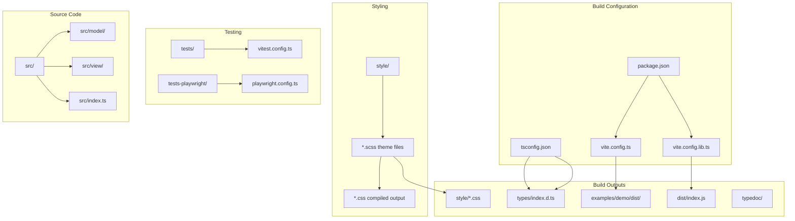
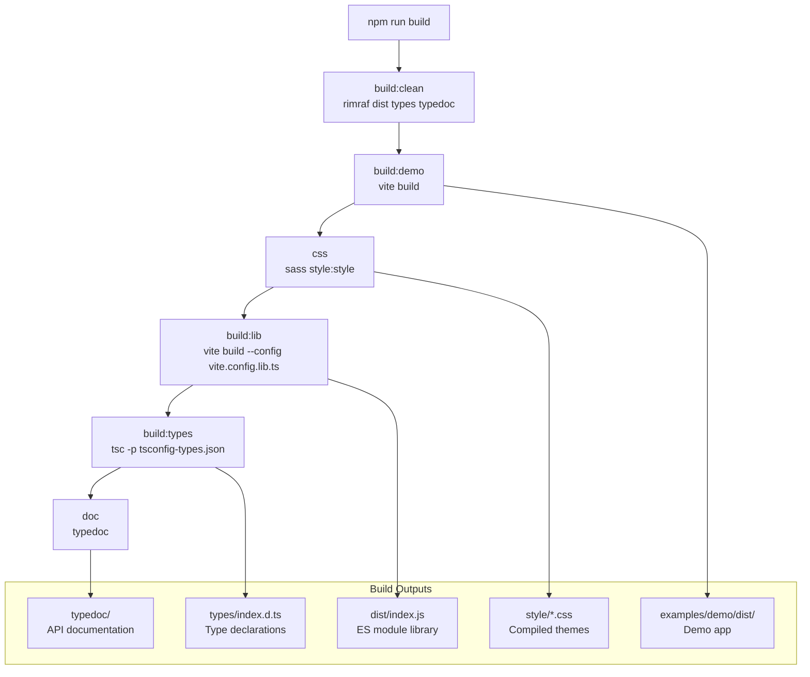
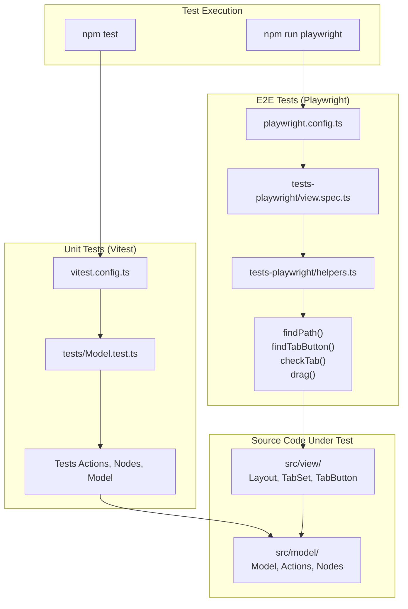
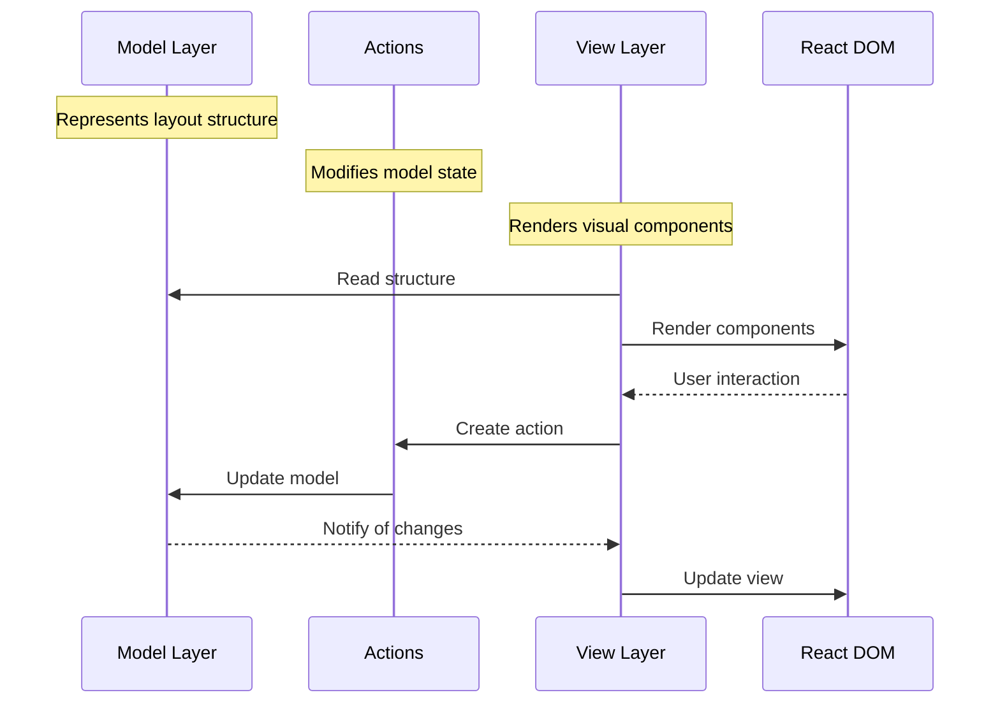
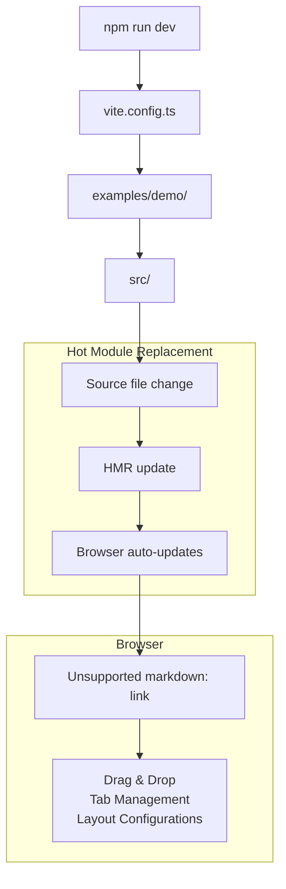

# Development and Contribution

> **Relevant source files**
> * [eslint.config.mjs](https://github.com/caplin/FlexLayout/blob/40753f37/eslint.config.mjs)
> * [package.json](https://github.com/caplin/FlexLayout/blob/40753f37/package.json)
> * [pnpm-lock.yaml](https://github.com/caplin/FlexLayout/blob/40753f37/pnpm-lock.yaml)

This page provides comprehensive information for developers who want to contribute to the FlexLayout library. It covers setting up the development environment, building and testing the codebase, and guidelines for contributing. For information about using FlexLayout in your own applications, see [Overview](/caplin/FlexLayout/1-overview) and [Getting Started](/caplin/FlexLayout/1.1-getting-started).

## Setting Up the Development Environment

FlexLayout is a React-based layout manager written in TypeScript. The project uses modern JavaScript tooling including Vite for bundling, Vitest for unit testing, Playwright for end-to-end testing, and TypeDoc for documentation generation.

### Prerequisites

Based on [package.json L63-L66](https://github.com/caplin/FlexLayout/blob/40753f37/package.json#L63-L66)

 FlexLayout requires:

* **Node.js**: Version 14.0.0 or higher (18+ recommended)
* **React**: Version 18.0.0 or 19.0.0 (peer dependency)
* **React DOM**: Version 18.0.0 or 19.0.0 (peer dependency)
* **Package Manager**: npm or pnpm

### Getting the Code

Clone the repository and install dependencies:

```markdown
git clone https://github.com/caplin/FlexLayout.gitcd FlexLayoutnpm install# orpnpm install
```

The project uses a lockfile at [pnpm-lock.yaml L1-L10](https://github.com/caplin/FlexLayout/blob/40753f37/pnpm-lock.yaml#L1-L10)

 which ensures consistent dependency versions across environments.

### Project Structure

The repository follows a standard TypeScript library structure:

| Directory/File | Purpose |
| --- | --- |
| `src/` | Main source code (TypeScript + React) |
| `src/model/` | Data model classes (Model, Node hierarchy, Actions) |
| `src/view/` | React components (Layout, TabSet, BorderTabSet, etc.) |
| `style/` | SCSS theme files |
| `examples/demo/` | Demo application showcasing FlexLayout features |
| `tests/` | Vitest unit tests for model logic |
| `tests-playwright/` | Playwright end-to-end tests for UI interactions |
| `dist/` | Build output (ES modules) |
| `types/` | Generated TypeScript declaration files |
| `typedoc/` | Generated API documentation |

**Key Configuration Files:**

| File | Purpose |
| --- | --- |
| [package.json L1-L101](https://github.com/caplin/FlexLayout/blob/40753f37/package.json#L1-L101) | Package metadata, scripts, dependencies |
| [tsconfig.json](https://github.com/caplin/FlexLayout/blob/40753f37/tsconfig.json) | TypeScript compiler configuration |
| [tsconfig-types.json](https://github.com/caplin/FlexLayout/blob/40753f37/tsconfig-types.json) | TypeScript configuration for type generation |
| [vite.config.ts](https://github.com/caplin/FlexLayout/blob/40753f37/vite.config.ts) | Vite configuration for demo app |
| [vite.config.lib.ts](https://github.com/caplin/FlexLayout/blob/40753f37/vite.config.lib.ts) | Vite configuration for library build |
| [vitest.config.ts](https://github.com/caplin/FlexLayout/blob/40753f37/vitest.config.ts) | Vitest test configuration |
| [playwright.config.ts](https://github.com/caplin/FlexLayout/blob/40753f37/playwright.config.ts) | Playwright E2E test configuration |
| [eslint.config.mjs L1-L30](https://github.com/caplin/FlexLayout/blob/40753f37/eslint.config.mjs#L1-L30) | ESLint code quality rules |

**Project Structure Diagram:**



Sources: [package.json L1-L101](https://github.com/caplin/FlexLayout/blob/40753f37/package.json#L1-L101)

 [eslint.config.mjs L1-L30](https://github.com/caplin/FlexLayout/blob/40753f37/eslint.config.mjs#L1-L30)

## Build System

FlexLayout uses Vite as its primary build tool, with separate configurations for the library and demo application. The complete build pipeline is orchestrated through npm scripts defined in [package.json L46-L59](https://github.com/caplin/FlexLayout/blob/40753f37/package.json#L46-L59)

### Build Scripts Reference

**Build Script Hierarchy from [package.json L46-L59](https://github.com/caplin/FlexLayout/blob/40753f37/package.json#L46-L59)

:**

| Script | Command | Purpose |
| --- | --- | --- |
| `dev` | `vite` | Start Vite dev server for demo app at [http://localhost:5173/demo](http://localhost:5173/demo) |
| `preview` | `vite preview` | Preview production build of demo app |
| `build` | (composite) | Run complete build pipeline (see below) |
| `build:clean` | `rimraf demo/dist dist/ types/ typedoc/` | Remove all build output directories |
| `build:demo` | `vite build` | Build demo app using [vite.config.ts](https://github.com/caplin/FlexLayout/blob/40753f37/vite.config.ts) |
| `build:types` | `tsc -p tsconfig-types.json` | Generate TypeScript declarations to `types/` |
| `build:lib` | `vite build --config vite.config.lib.ts` | Build library to `dist/index.js` |
| `css` | `sass style:style` | Compile SCSS themes to CSS |
| `doc` | `typedoc --out typedoc ...` | Generate API docs from TypeScript |

### Complete Build Pipeline

The `npm run build` command executes a sequential build pipeline:

```markdown
npm run build# Executes: build:clean && build:demo && css && build:lib && build:types && doc
```

**Build Pipeline Diagram:**



### Build Configuration Files

**Library Build ([vite.config.lib.ts](https://github.com/caplin/FlexLayout/blob/40753f37/vite.config.lib.ts)

):**

* Bundles `src/index.ts` to ES module format
* Output: `dist/index.js`
* Excludes React and ReactDOM (peer dependencies)

**Demo Build ([vite.config.ts](https://github.com/caplin/FlexLayout/blob/40753f37/vite.config.ts)

):**

* Builds demo application from `examples/demo/`
* Includes React, Material-UI, and other demo dependencies
* Output: `examples/demo/dist/`

**TypeScript Type Generation ([tsconfig-types.json](https://github.com/caplin/FlexLayout/blob/40753f37/tsconfig-types.json)

):**

* Generates `.d.ts` files from source TypeScript
* Output: `types/` directory
* Entry point: `types/index.d.ts`

**CSS Compilation:**

* Input: `style/*.scss` theme files
* Tool: Sass compiler
* Output: `style/*.css` compiled stylesheets

### Development Dependencies

The build system relies on these key development dependencies from [package.json L67-L100](https://github.com/caplin/FlexLayout/blob/40753f37/package.json#L67-L100)

:

| Package | Version | Purpose |
| --- | --- | --- |
| `vite` | ^6.3.0 | Build tool and dev server |
| `@vitejs/plugin-react` | ^4.4.0 | Vite React plugin |
| `typescript` | ^5.8.3 | TypeScript compiler |
| `sass` | ^1.86.3 | SCSS to CSS compilation |
| `typedoc` | ^0.28.2 | API documentation generation |
| `rimraf` | ^6.0.1 | Cross-platform file cleanup |

### Building for Production

To build the library for production:

```markdown
# Full buildnpm run build # Individual stepsnpm run build:clean      # Clean old buildsnpm run build:lib        # Build library onlynpm run build:types      # Generate types onlynpm run css              # Compile CSS only
```

The library artifacts are defined in [package.json L12-L25](https://github.com/caplin/FlexLayout/blob/40753f37/package.json#L12-L25)

:

* Main entry: `dist/index.js` (ES module)
* Type definitions: `types/index.d.ts`
* Published files: `dist/`, `types/`, `style/`

Sources: [package.json L46-L59](https://github.com/caplin/FlexLayout/blob/40753f37/package.json#L46-L59)

 [package.json L12-L25](https://github.com/caplin/FlexLayout/blob/40753f37/package.json#L12-L25)

 [package.json L67-L100](https://github.com/caplin/FlexLayout/blob/40753f37/package.json#L67-L100)

## Testing Infrastructure

FlexLayout maintains comprehensive test coverage using two complementary testing frameworks:

1. **Unit Tests**: Vitest for model logic and actions
2. **End-to-End Tests**: Playwright for UI interactions and component behavior

### Test Execution Commands

From [package.json L54-L56](https://github.com/caplin/FlexLayout/blob/40753f37/package.json#L54-L56)

:

| Command | Tool | Purpose |
| --- | --- | --- |
| `npm test` | Vitest | Run unit tests in watch mode |
| `npm run playwright` | Playwright | Run E2E tests with interactive UI |
| `npm run lint` | ESLint | Check code quality and style |

### Unit Testing with Vitest

**Configuration:** [vitest.config.ts](https://github.com/caplin/FlexLayout/blob/40753f37/vitest.config.ts)

**Test Location:** `tests/` directory

Unit tests focus on the Model layer, testing:

* Node creation and manipulation
* Action execution and validation
* Model serialization/deserialization
* Attribute inheritance
* Layout state management

**Example Test Structure:**

Tests use a path-based notation to describe layout structure. For example:

* `/ts0/t0[One]` = TabSet 0, Tab 0 with name "One"
* `/ts0/t1*` = Active tab in TabSet 0
* `/border_left/bt0[File Browser]` = Border tab on left side

The testing utilities provide a domain-specific language for layout operations:

* `tab(path)` - Get tab node by path
* `tabset(path)` - Get tabset node by path
* `doAction(action)` - Execute an action and update layout
* `expect(tabs).equal(expected)` - Assert layout structure matches expected

**Running Unit Tests:**

```markdown
# Watch mode (default)npm test # Run oncenpm test -- --run # Coverage reportnpm test -- --coverage
```

### End-to-End Testing with Playwright

**Configuration:** [playwright.config.ts](https://github.com/caplin/FlexLayout/blob/40753f37/playwright.config.ts)

**Test Location:** `tests-playwright/` directory

E2E tests validate user interactions including:

* Drag and drop operations
* Tab creation and deletion
* Layout resizing
* Border tab behavior
* Multi-window scenarios
* Tab overflow handling

**Test Helper Functions:**

The [tests-playwright/helpers.ts](https://github.com/caplin/FlexLayout/blob/40753f37/tests-playwright/helpers.ts)

 file provides utilities:

| Function | Purpose |
| --- | --- |
| `findPath(page, path)` | Locate element by layout path |
| `findTabButton(page, tsPath, index)` | Find tab button in tabset |
| `findAllTabSets(page)` | Get all tabset elements |
| `checkTab(page, tsPath, index, selected, name)` | Verify tab state |
| `drag(page, from, to, location)` | Simulate drag-and-drop |
| `checkSplitterPositions(page, expected)` | Verify splitter positions |

**Running E2E Tests:**

```markdown
# Interactive UI modenpm run playwright # Headless modenpx playwright test # Debug modenpx playwright test --debug # Specific browsernpx playwright test --project=chromium
```

**Test Architecture Diagram:**



### Code Quality Tools

**ESLint Configuration:** [eslint.config.mjs L1-L30](https://github.com/caplin/FlexLayout/blob/40753f37/eslint.config.mjs#L1-L30)

The project uses ESLint with TypeScript support to enforce code quality:

```python
// Key rules from eslint.config.mjs{  '@typescript-eslint/no-explicit-any': 'off',  'no-unused-vars': 'off',  '@typescript-eslint/no-unused-vars': 'off',  'react/react-in-jsx-scope': 'off',  'react/display-name': 'off'}
```

**Prettier Configuration:**

From [package.json L86](https://github.com/caplin/FlexLayout/blob/40753f37/package.json#L86-L86)

 the project includes Prettier ^3.5.3 for code formatting.

**Running Quality Checks:**

```markdown
# Run ESLintnpm run lint # Fix auto-fixable issuesnpx eslint --fix src/
```

### Writing New Tests

**For Unit Tests:**

1. Create test file in `tests/` directory
2. Import test utilities and model classes
3. Use path-based notation to define layouts
4. Assert expected behavior using Vitest's `expect()`

**For E2E Tests:**

1. Create test file in `tests-playwright/` directory
2. Import helper functions from `helpers.ts`
3. Use `page` fixture to interact with DOM
4. Use helper functions to find elements and simulate user actions
5. Assert UI state using Playwright's `expect()`

Sources: [package.json L54-L56](https://github.com/caplin/FlexLayout/blob/40753f37/package.json#L54-L56)

 [eslint.config.mjs L1-L30](https://github.com/caplin/FlexLayout/blob/40753f37/eslint.config.mjs#L1-L30)

 [package.json L86](https://github.com/caplin/FlexLayout/blob/40753f37/package.json#L86-L86)

## Contributing Guidelines

### Code Style and Quality

FlexLayout enforces code quality through multiple tools:

**TypeScript Configuration:**

* Strict type checking enabled
* Target: ES2020 modules
* Configuration files: * [tsconfig.json](https://github.com/caplin/FlexLayout/blob/40753f37/tsconfig.json)  - Main source compilation * [tsconfig-types.json](https://github.com/caplin/FlexLayout/blob/40753f37/tsconfig-types.json)  - Type declaration generation

**ESLint Configuration ([eslint.config.mjs L1-L30](https://github.com/caplin/FlexLayout/blob/40753f37/eslint.config.mjs#L1-L30)

):**

* Uses TypeScript ESLint parser and plugin
* React plugin for JSX/TSX files
* Custom rules to allow flexibility where needed
* Automatically detects React version

**Code Formatting:**

* Prettier v3.5.3 ([package.json L86](https://github.com/caplin/FlexLayout/blob/40753f37/package.json#L86-L86) )
* Used for consistent code formatting across the project

**Quality Checklist:**

```markdown
# Run all quality checks before committingnpm run lint          # ESLint checksnpm test             # Unit testsnpm run playwright   # E2E testsnpm run build        # Ensure build succeeds
```

### Development Workflow

1. **Fork and Clone** ``` git clone https://github.com/YOUR_USERNAME/FlexLayout.gitcd FlexLayoutnpm install ```
2. **Create Feature Branch** ``` git checkout -b feature/your-feature-name ```
3. **Develop and Test** ```markdown npm run dev        # Start dev servernpm test          # Run unit tests in watch modenpm run lint      # Check code quality ```
4. **Build and Verify** ```markdown npm run build     # Full buildnpm run playwright # Run E2E tests ```
5. **Commit and Push** ``` git add .git commit -m "Description of changes"git push origin feature/your-feature-name ```
6. **Create Pull Request** * Open PR against `master` branch * Include description of changes * Reference related issues

### Pull Request Guidelines

**Required Checks:**

* ✅ All unit tests pass (`npm test`)
* ✅ All E2E tests pass (`npm run playwright`)
* ✅ ESLint passes (`npm run lint`)
* ✅ Build succeeds (`npm run build`)
* ✅ TypeScript compilation has no errors

**Code Requirements:**

* Include tests for new features or bug fixes
* Update documentation if API changes
* Follow existing code style and patterns
* Keep changes focused on a single issue/feature
* Add JSDoc comments for public APIs

**Documentation Updates:**

* Update README.md if user-facing changes
* Add examples to demo app if appropriate
* Update TypeScript definitions if interfaces change

### Component Development

When developing components for FlexLayout, you should understand the relationship between the model layer and view layer:



Sources: [src/view/TabButtonStamp.tsx L1-L43](https://github.com/caplin/FlexLayout/blob/40753f37/src/view/TabButtonStamp.tsx#L1-L43)

 [src/view/BorderTab.tsx L1-L78](https://github.com/caplin/FlexLayout/blob/40753f37/src/view/BorderTab.tsx#L1-L78)

## Building and Running the Demo

The demo application (located in `examples/demo/`) showcases FlexLayout's capabilities and serves as a testing ground for development.

### Running the Demo in Development Mode

```
npm run dev
```

This command:

1. Starts Vite dev server using [vite.config.ts](https://github.com/caplin/FlexLayout/blob/40753f37/vite.config.ts)
2. Serves the demo at [http://localhost:5173/demo](http://localhost:5173/demo)
3. Enables hot module replacement (HMR)
4. Watches for source changes and rebuilds automatically

### Building the Demo for Production

```
npm run build:demo
```

This creates an optimized production build in `examples/demo/dist/`.

### Preview Production Build

```
npm run preview
```

Serves the production build locally for testing.

### Demo Application Dependencies

The demo uses additional libraries from [package.json L68-L91](https://github.com/caplin/FlexLayout/blob/40753f37/package.json#L68-L91)

 to showcase integration capabilities:

| Dependency | Purpose |
| --- | --- |
| `@mui/material` | Material-UI components in tabs |
| `ag-grid-react` | Data grid demonstration |
| `chart.js` + `react-chartjs-2` | Chart visualization |
| `ol` (OpenLayers) | Map component example |
| `prismjs` | Code syntax highlighting |
| `styled-components` | CSS-in-JS styling example |

### Demo Development Workflow



Sources: [package.json L47-L48](https://github.com/caplin/FlexLayout/blob/40753f37/package.json#L47-L48)

 [package.json L68-L91](https://github.com/caplin/FlexLayout/blob/40753f37/package.json#L68-L91)

## Release Process

While this is typically handled by the project maintainers, understanding the release process is helpful for contributors:

1. Update version in `package.json`
2. Run full build and tests
3. Create a release commit
4. Tag the release with the version number
5. Publish to npm

## Debugging Tips

### Common Issues

* **Component not rendering properly**: Check the model structure and ensure props are passed correctly
* **Drag and drop not working**: Inspect the drag events and check that paths are correctly configured
* **Styling issues**: Check both the CSS classes and the themes

### Using Browser DevTools

* Use React DevTools to inspect component props and state
* Use the browser's Element inspector to check CSS classes and layout
* Use console logging to debug model operations

## Conclusion

Contributing to FlexLayout involves understanding both the model layer (which manages the layout structure) and the view layer (which renders the React components). The testing framework ensures that changes maintain compatibility and functionality.

For specific API details, see [API Reference](/caplin/FlexLayout/7-api-reference) and its sub-pages.

Sources: [package.json L1-L98](https://github.com/caplin/FlexLayout/blob/40753f37/package.json#L1-L98)