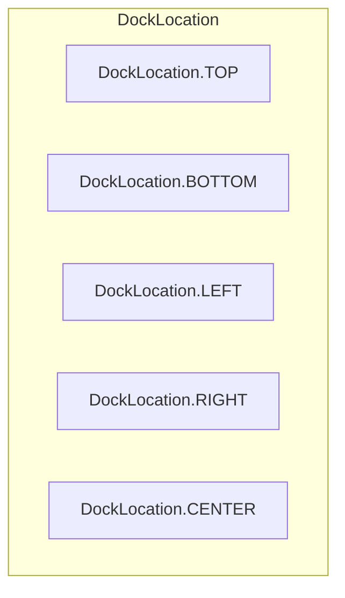
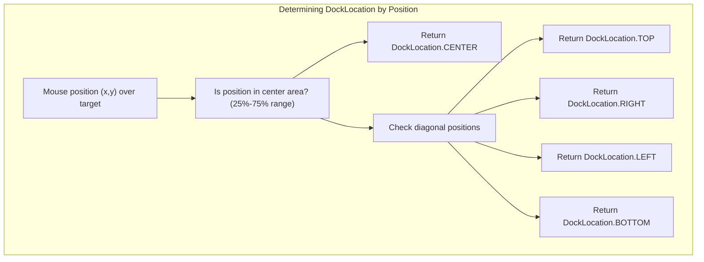
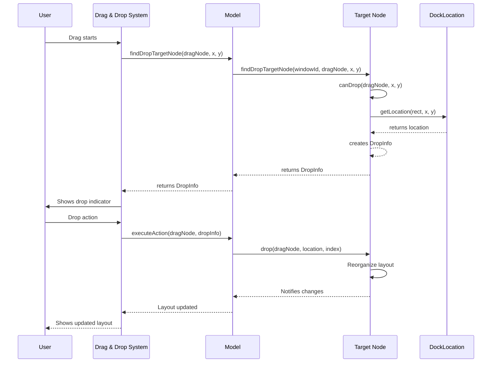
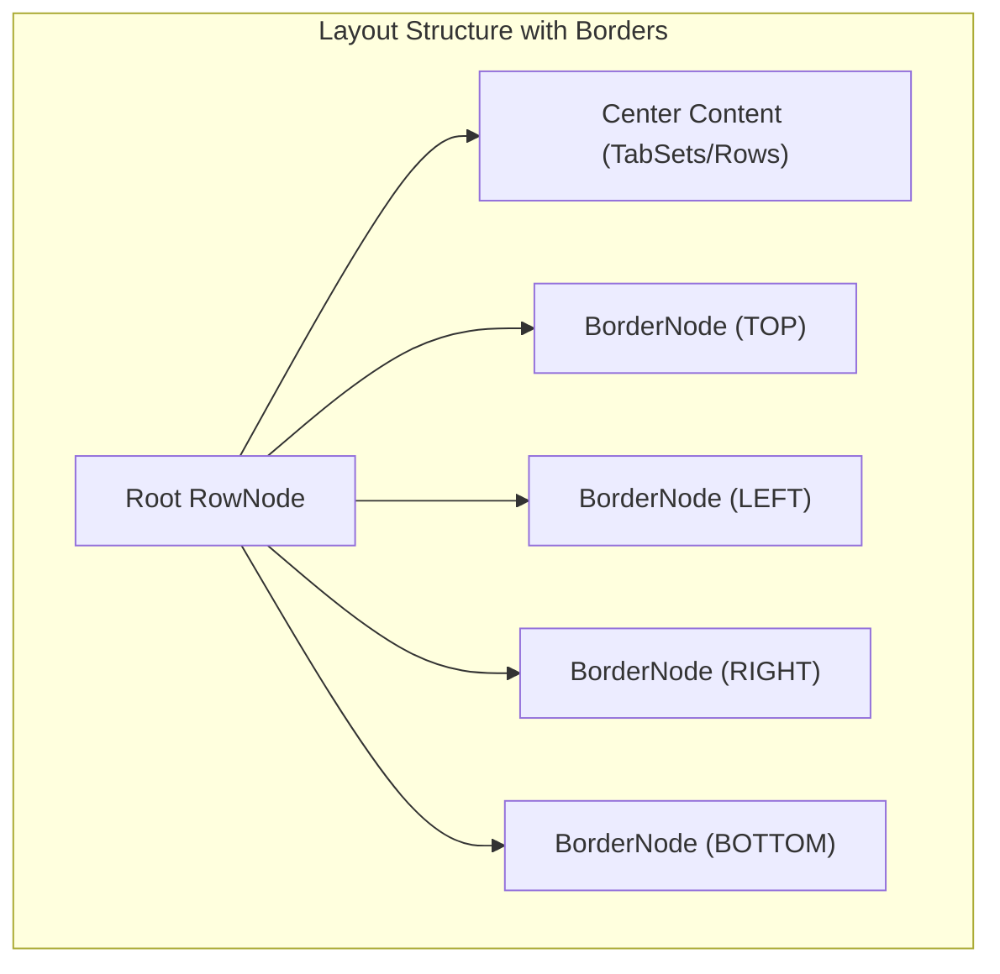
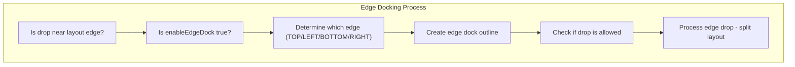

# Docking System

> **Relevant source files**
> * [src/model/BorderNode.ts](https://github.com/caplin/FlexLayout/blob/40753f37/src/model/BorderNode.ts)
> * [src/model/BorderSet.ts](https://github.com/caplin/FlexLayout/blob/40753f37/src/model/BorderSet.ts)
> * [src/model/IJsonModel.ts](https://github.com/caplin/FlexLayout/blob/40753f37/src/model/IJsonModel.ts)
> * [src/model/Model.ts](https://github.com/caplin/FlexLayout/blob/40753f37/src/model/Model.ts)
> * [src/model/Node.ts](https://github.com/caplin/FlexLayout/blob/40753f37/src/model/Node.ts)
> * [src/model/RowNode.ts](https://github.com/caplin/FlexLayout/blob/40753f37/src/model/RowNode.ts)
> * [src/model/TabNode.ts](https://github.com/caplin/FlexLayout/blob/40753f37/src/model/TabNode.ts)
> * [src/model/TabSetNode.ts](https://github.com/caplin/FlexLayout/blob/40753f37/src/model/TabSetNode.ts)
> * [src/view/Layout.tsx](https://github.com/caplin/FlexLayout/blob/40753f37/src/view/Layout.tsx)
> * [src/view/Tab.tsx](https://github.com/caplin/FlexLayout/blob/40753f37/src/view/Tab.tsx)

The FlexLayout docking system enables users to drag and drop panels within the layout to reorganize content. This page documents the core docking mechanism, including the available docking locations, the components involved in docking, and how the docking process works.

For information about the drag and drop implementation details, see [Drag and Drop](/caplin/FlexLayout/6.1-drag-and-drop).

## Docking Locations

FlexLayout defines five primary docking locations where elements can be docked:



Sources: [src/DockLocation.ts L4-L11](https://github.com/caplin/FlexLayout/blob/40753f37/src/DockLocation.ts#L4-L11)

The `DockLocation` class determines where elements can be docked in relation to other elements. Each location is associated with an orientation and direction:

| Location | Orientation | Description |
| --- | --- | --- |
| TOP | Vertical | Docks above the target |
| BOTTOM | Vertical | Docks below the target |
| LEFT | Horizontal | Docks to the left of target |
| RIGHT | Horizontal | Docks to the right of target |
| CENTER | Vertical | Docks into the target (as a tab) |

Sources: [src/DockLocation.ts L6-L10](https://github.com/caplin/FlexLayout/blob/40753f37/src/DockLocation.ts#L6-L10)

 [src/Orientation.ts L2-L3](https://github.com/caplin/FlexLayout/blob/40753f37/src/Orientation.ts#L2-L3)

The system automatically determines the appropriate docking location based on the position of the cursor over a target element:



Sources: [src/DockLocation.ts L18-L51](https://github.com/caplin/FlexLayout/blob/40753f37/src/DockLocation.ts#L18-L51)

## Docking Components

The docking system involves several key components that work together:

```

```

Sources: [src/model/Node.ts L175-L204](https://github.com/caplin/FlexLayout/blob/40753f37/src/model/Node.ts#L175-L204)

 [src/model/TabSetNode.ts L305-L370](https://github.com/caplin/FlexLayout/blob/40753f37/src/model/TabSetNode.ts#L305-L370)

 [src/model/BorderNode.ts L233-L312](https://github.com/caplin/FlexLayout/blob/40753f37/src/model/BorderNode.ts#L233-L312)

 [src/model/RowNode.ts L371-L503](https://github.com/caplin/FlexLayout/blob/40753f37/src/model/RowNode.ts#L371-L503)

 [src/model/BorderSet.ts L76-L86](https://github.com/caplin/FlexLayout/blob/40753f37/src/model/BorderSet.ts#L76-L86)

## Docking Process

The docking process follows a standard sequence of operations when a user drags and drops an element:



Sources: [src/model/Node.ts L175-L196](https://github.com/caplin/FlexLayout/blob/40753f37/src/model/Node.ts#L175-L196)

 [src/model/TabSetNode.ts L386-L494](https://github.com/caplin/FlexLayout/blob/40753f37/src/model/TabSetNode.ts#L386-L494)

 [src/model/BorderNode.ts L315-L348](https://github.com/caplin/FlexLayout/blob/40753f37/src/model/BorderNode.ts#L315-L348)

 [src/model/RowNode.ts L420-L503](https://github.com/caplin/FlexLayout/blob/40753f37/src/model/RowNode.ts#L420-L503)

## Docking Mechanisms

### Center Docking

When a drag node is dropped into the center of a target node, it is added as a tab into that tabset:

1. In TabSetNode, the `drop` method handles center docking when the location is `DockLocation.CENTER`: * The dragged node is added as a child of the target tabset * For TabNodes, they are inserted at the specified index * For RowNodes, each TabNode child is added to the tabset * The active tabset is updated

Sources: [src/model/TabSetNode.ts L412-L444](https://github.com/caplin/FlexLayout/blob/40753f37/src/model/TabSetNode.ts#L412-L444)

### Split Docking (Top, Bottom, Left, Right)

When a drag node is dropped on an edge (top, bottom, left, right) of a target, the layout splits:

1. For TabSetNode, if the docking location is not CENTER: * If the orientations match, the node is added as a sibling * If orientations differ, a new row is created to host both nodes * The appropriate weights are assigned to maintain layout proportions
2. For RowNode, edge docking: * If the drop is on the edge of the entire layout, a new split is created * The node is added at the appropriate position based on dock location * The layout is reorganized to maintain hierarchical structure

Sources: [src/model/TabSetNode.ts L445-L492](https://github.com/caplin/FlexLayout/blob/40753f37/src/model/TabSetNode.ts#L445-L492)

 [src/model/RowNode.ts L468-L496](https://github.com/caplin/FlexLayout/blob/40753f37/src/model/RowNode.ts#L468-L496)

## BorderSet Docking

The `BorderSet` manages the outer borders of the layout where tabs can be docked:



Sources: [src/model/BorderSet.ts L1-L87](https://github.com/caplin/FlexLayout/blob/40753f37/src/model/BorderSet.ts#L1-L87)

Border nodes handle docking in a special way:

1. When a tab is docked to a border: * The tab is added to the border's collection * The border can be shown/hidden based on whether it has tabs * The border size can be adjusted by the user
2. Borders have specialized docking rules: * Only TabNodes can be docked to borders * Borders have header areas where tabs can be dropped * Borders have content areas that show the selected tab's content

Sources: [src/model/BorderNode.ts L233-L348](https://github.com/caplin/FlexLayout/blob/40753f37/src/model/BorderNode.ts#L233-L348)

## Edge Docking

Edge docking occurs when a node is dropped at the edge of the entire layout:



Edge docking is handled by the `canDrop` method in the RowNode when the model's `isEnableEdgeDock` returns true:

* Detects if the drop position is near the edge of the root layout
* Creates a special drop target indicator showing where the content will be docked
* When dropped, splits the layout and adds the node at the edge

Sources: [src/model/RowNode.ts L384-L407](https://github.com/caplin/FlexLayout/blob/40753f37/src/model/RowNode.ts#L384-L407)

## Docking Rules and Constraints

The docking system enforces several rules and constraints:

1. TabSetNode rules: * Cannot drop a node into itself * Named tabsets (with headers) cannot be docked into another tabset * Docking is only allowed if `enableDrop` is true for center docking * Docking is only allowed if `enableDivide` is true for edge docking
2. Border docking rules: * Only TabNodes can be docked into borders * Border docking is only allowed if `enableDrop` is true
3. Global constraints: * The application can provide a custom `onAllowDrop` callback to add custom validation * Docking into popup windows has additional constraints

These constraints are enforced through the `canDockInto` method:

Sources: [src/model/Node.ts L204-L225](https://github.com/caplin/FlexLayout/blob/40753f37/src/model/Node.ts#L204-L225)

 [src/model/TabSetNode.ts L365-L369](https://github.com/caplin/FlexLayout/blob/40753f37/src/model/TabSetNode.ts#L365-L369)

 [src/model/BorderNode.ts L301-L308](https://github.com/caplin/FlexLayout/blob/40753f37/src/model/BorderNode.ts#L301-L308)

## Summary

The FlexLayout docking system provides a flexible way to reorganize content through drag and drop operations. It supports:

* Five docking locations (TOP, BOTTOM, LEFT, RIGHT, CENTER)
* Docking into tabsets, rows, and borders
* Edge docking for creating new layout divisions
* Rules and constraints to ensure valid docking operations

This system forms the foundation for the dynamic and user-configurable layout capabilities of FlexLayout.