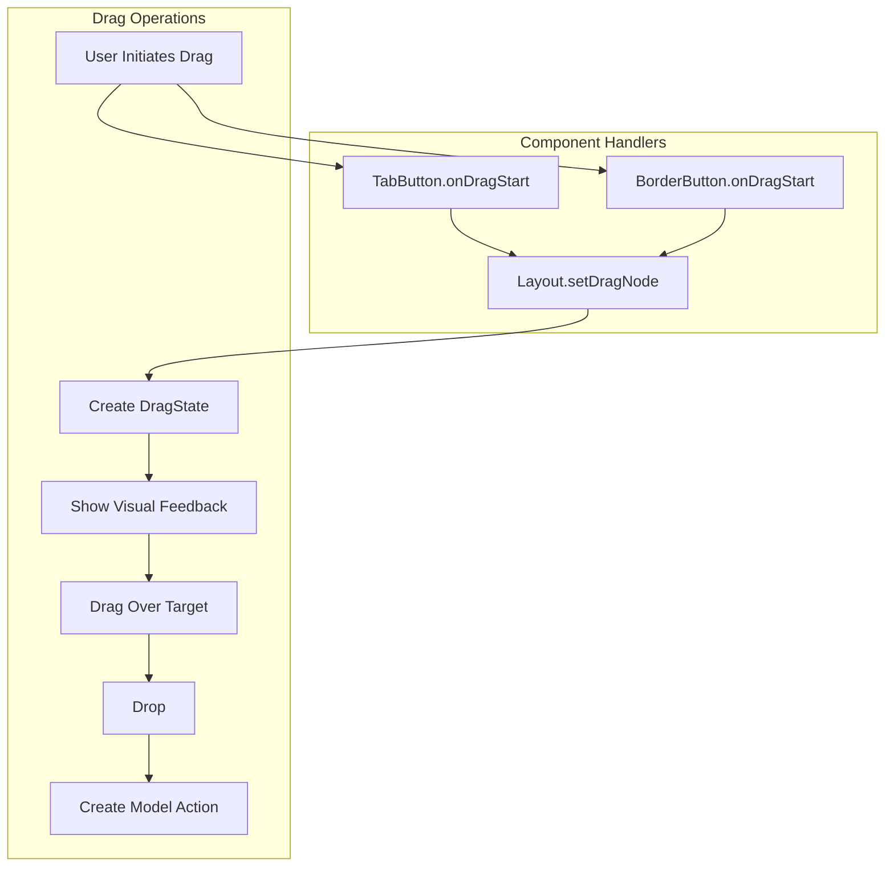
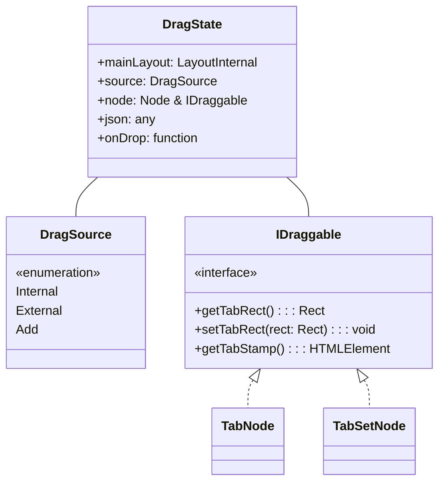
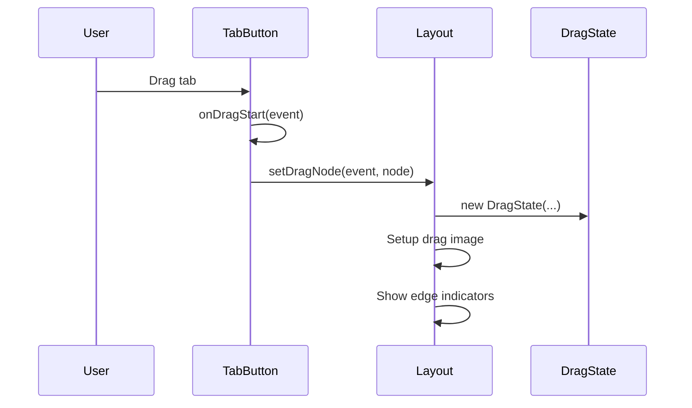
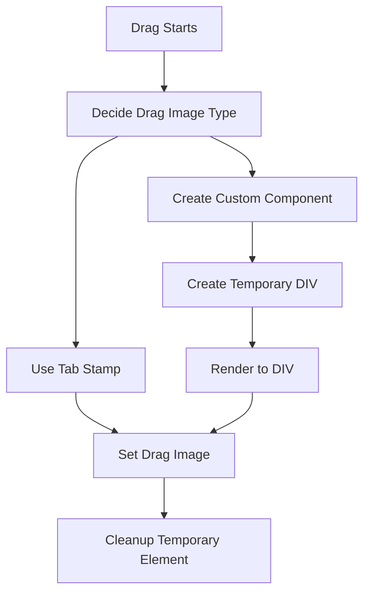
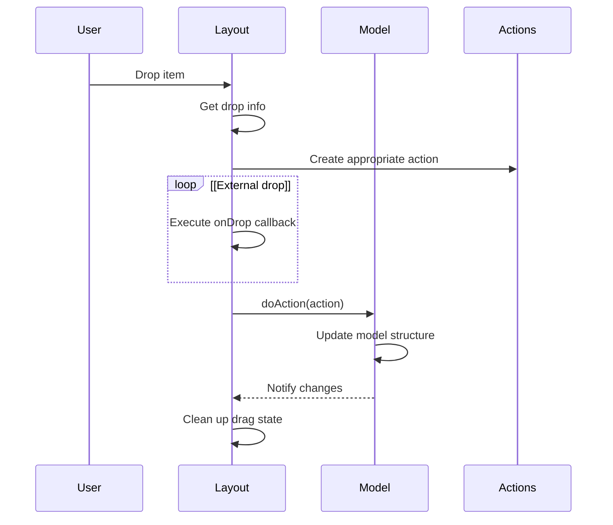

# Drag and Drop

> **Relevant source files**
> * [src/model/BorderNode.ts](https://github.com/caplin/FlexLayout/blob/40753f37/src/model/BorderNode.ts)
> * [src/model/BorderSet.ts](https://github.com/caplin/FlexLayout/blob/40753f37/src/model/BorderSet.ts)
> * [src/model/IJsonModel.ts](https://github.com/caplin/FlexLayout/blob/40753f37/src/model/IJsonModel.ts)
> * [src/model/Model.ts](https://github.com/caplin/FlexLayout/blob/40753f37/src/model/Model.ts)
> * [src/model/Node.ts](https://github.com/caplin/FlexLayout/blob/40753f37/src/model/Node.ts)
> * [src/model/RowNode.ts](https://github.com/caplin/FlexLayout/blob/40753f37/src/model/RowNode.ts)
> * [src/model/TabNode.ts](https://github.com/caplin/FlexLayout/blob/40753f37/src/model/TabNode.ts)
> * [src/model/TabSetNode.ts](https://github.com/caplin/FlexLayout/blob/40753f37/src/model/TabSetNode.ts)
> * [src/view/Layout.tsx](https://github.com/caplin/FlexLayout/blob/40753f37/src/view/Layout.tsx)
> * [src/view/Tab.tsx](https://github.com/caplin/FlexLayout/blob/40753f37/src/view/Tab.tsx)

## Purpose and Scope

This document describes the drag and drop system in FlexLayout, which enables users to rearrange the layout by dragging tabs and tabsets to new positions. The system handles both internal drag operations (moving existing tabs) and external drag operations (adding new content via drag and drop). It also supports cross-window dragging for popout windows.

For information about resizing panels via splitters, see [Splitter Component](/caplin/FlexLayout/3.4-splitter-component). For information about the docking system that determines valid drop targets, see [Docking System](/caplin/FlexLayout/6.2-docking-system).

## Overview

FlexLayout's drag and drop system provides a flexible way to modify the layout structure through user interaction. The system handles:

1. Dragging tabs between tabsets
2. Dragging entire tabsets to new locations
3. Adding new content through drag and drop
4. Visual feedback during drag operations
5. Cross-window drag operations



Sources: [src/view/Layout.tsx L972-L1119](https://github.com/caplin/FlexLayout/blob/40753f37/src/view/Layout.tsx#L972-L1119)

 [src/view/TabButton.tsx L33-L44](https://github.com/caplin/FlexLayout/blob/40753f37/src/view/TabButton.tsx#L33-L44)

 [src/view/BorderButton.tsx L26-L38](https://github.com/caplin/FlexLayout/blob/40753f37/src/view/BorderButton.tsx#L26-L38)

## Drag State Management

The drag and drop system uses a `DragState` object to track the current drag operation. This state is stored as a static property on the `LayoutInternal` class, ensuring only one drag operation can occur at a time across the entire application.

### DragState and DragSource

The system uses these key components:

1. **DragState**: Stores information about the current drag operation
2. **DragSource**: Enum indicating the source of the drag (Internal, External, Add)
3. **IDraggable**: Interface implemented by nodes that can be dragged



Sources: [src/view/Layout.tsx L192](https://github.com/caplin/FlexLayout/blob/40753f37/src/view/Layout.tsx#L192-L192)

 [src/view/Layout.tsx L972-L986](https://github.com/caplin/FlexLayout/blob/40753f37/src/view/Layout.tsx#L972-L986)

## Initiating Drag Operations

Drag operations can be initiated in three ways:

1. User dragging a tab or border button
2. User dragging a tabset
3. Programmatically via `addTabWithDragAndDrop` or `moveTabWithDragAndDrop`

### Tab Dragging

When a user starts dragging a tab, the corresponding `TabButton` or `BorderButton` component captures the drag event and calls the layout's `setDragNode` method.



Sources: [src/view/TabButton.tsx L33-L44](https://github.com/caplin/FlexLayout/blob/40753f37/src/view/TabButton.tsx#L33-L44)

 [src/view/BorderButton.tsx L26-L38](https://github.com/caplin/FlexLayout/blob/40753f37/src/view/BorderButton.tsx#L26-L38)

 [src/view/Layout.tsx L982-L1036](https://github.com/caplin/FlexLayout/blob/40753f37/src/view/Layout.tsx#L982-L1036)

### Programmatic Drag and Drop

FlexLayout provides APIs for programmatically initiating drag operations:

1. `addTabWithDragAndDrop`: Creates a new tab and starts a drag operation
2. `moveTabWithDragAndDrop`: Moves an existing tab or tabset via drag and drop

These methods can be used within application event handlers to integrate with external drag sources.

Sources: [src/view/Layout.tsx L123-L135](https://github.com/caplin/FlexLayout/blob/40753f37/src/view/Layout.tsx#L123-L135)

 [src/view/Layout.tsx L973-L980](https://github.com/caplin/FlexLayout/blob/40753f37/src/view/Layout.tsx#L973-L980)

## Drag Visual Feedback

During drag operations, FlexLayout provides visual feedback to indicate valid drop locations:

1. **Outline Rectangle**: Shows where the dragged item will be placed
2. **Edge Indicators**: Arrows indicating the edges where the item can be docked
3. **Custom Drag Image**: Customizable representation of the dragged item

### Custom Drag Images

FlexLayout uses two approaches for drag images:

1. **TabStamp**: Pre-rendered representation of tabs stored as HTML elements
2. **Custom Components**: React components rendered into temporary DOM elements



Sources: [src/view/Layout.tsx L1038-L1060](https://github.com/caplin/FlexLayout/blob/40753f37/src/view/Layout.tsx#L1038-L1060)

 [src/view/Layout.tsx L597-L611](https://github.com/caplin/FlexLayout/blob/40753f37/src/view/Layout.tsx#L597-L611)

## Drop Processing

When a dragged item is dropped, the system:

1. Determines the drop location
2. Creates an appropriate action to modify the model
3. Executes the action to update the layout

The drop location is determined during drag-over events, which calculate potential drop targets and show appropriate visual indicators.



Sources: [src/view/Layout.tsx L1151-L1158](https://github.com/caplin/FlexLayout/blob/40753f37/src/view/Layout.tsx#L1151-L1158)

 [src/view/Layout.tsx L1098-L1119](https://github.com/caplin/FlexLayout/blob/40753f37/src/view/Layout.tsx#L1098-L1119)

## Cross-Window Drag and Drop

FlexLayout supports dragging tabs between the main window and popout windows. This is implemented through:

1. A central drag state shared across windows
2. Methods to track when a drag enters or leaves a window
3. Coordination between layout instances

When dragging between windows, the dragged item's data follows it, and the drop processing happens in the target window.

Sources: [src/view/Layout.tsx L1061-L1081](https://github.com/caplin/FlexLayout/blob/40753f37/src/view/Layout.tsx#L1061-L1081)

## Customizing Drag Behavior

FlexLayout provides several customization points for drag and drop behavior:

1. **onRenderDragRect**: Customize the appearance of dragged elements
2. **onExternalDrag**: Handle external drag sources
3. **Drag and Drop APIs**: Programmatic drag and drop initiation

### External Drag Sources

Applications can integrate external drag sources by implementing the `onExternalDrag` prop:

```javascript
onExternalDrag?: (event: React.DragEvent<HTMLElement>) => undefined | {    json: any,    onDrop?: (node?: Node, event?: React.DragEvent<HTMLElement>) => void}
```

This function can examine drag events, determine if they contain valid data, and return configuration for creating a new tab.

Sources: [src/view/Layout.tsx L55-L59](https://github.com/caplin/FlexLayout/blob/40753f37/src/view/Layout.tsx#L55-L59)

 [src/view/Layout.tsx L1123-L1129](https://github.com/caplin/FlexLayout/blob/40753f37/src/view/Layout.tsx#L1123-L1129)

## API Reference

### Key Methods

| Method | Description |
| --- | --- |
| `addTabWithDragAndDrop` | Create a new tab and start a drag operation |
| `moveTabWithDragAndDrop` | Start a drag operation for an existing tab or tabset |
| `setDragComponent` | Set a custom drag image for the current drag operation |
| `setDragNode` | Start dragging a node |

Sources: [src/view/Layout.tsx L123-L135](https://github.com/caplin/FlexLayout/blob/40753f37/src/view/Layout.tsx#L123-L135)

 [src/view/Layout.tsx L973-L1036](https://github.com/caplin/FlexLayout/blob/40753f37/src/view/Layout.tsx#L973-L1036)

 [src/view/Layout.tsx L1040-L1060](https://github.com/caplin/FlexLayout/blob/40753f37/src/view/Layout.tsx#L1040-L1060)

### Properties

| Property | Description |
| --- | --- |
| `dragState` | Static property on LayoutInternal that stores the current drag operation |
| `onExternalDrag` | Prop for handling external drag sources |
| `onRenderDragRect` | Prop for customizing the appearance of dragged elements |

Sources: [src/view/Layout.tsx L192](https://github.com/caplin/FlexLayout/blob/40753f37/src/view/Layout.tsx#L192-L192)

 [src/view/Layout.tsx L55-L59](https://github.com/caplin/FlexLayout/blob/40753f37/src/view/Layout.tsx#L55-L59)

 [src/view/Layout.tsx L71](https://github.com/caplin/FlexLayout/blob/40753f37/src/view/Layout.tsx#L71-L71)

## Implementation Details

### Drag Implementation

FlexLayout uses the HTML5 Drag and Drop API for handling drag operations. The implementation deals with several challenges:

1. Creating visual drag representations
2. Tracking drag state across windows
3. Managing browser-specific implementations
4. Providing a consistent user experience

The system creates temporary DOM elements for drag images and manages multiple overlapping event handlers to provide a smooth user experience.

Sources: [src/view/Layout.tsx L982-L1060](https://github.com/caplin/FlexLayout/blob/40753f37/src/view/Layout.tsx#L982-L1060)

 [src/view/Layout.tsx L1081-L1119](https://github.com/caplin/FlexLayout/blob/40753f37/src/view/Layout.tsx#L1081-L1119)

### Splitter Dragging vs Tab Dragging

FlexLayout differentiates between dragging splitters (to resize panels) and dragging tabs (to rearrange the layout). Splitter dragging is handled separately through the `Splitter` component and does not use the same drag state mechanism.

Sources: [src/view/Splitter.tsx L60-L146](https://github.com/caplin/FlexLayout/blob/40753f37/src/view/Splitter.tsx#L60-L146)

## Related Systems

The drag and drop system integrates with several other parts of FlexLayout:

1. The Model and Actions system for updating the layout
2. The Docking system for determining valid drop locations
3. The Tab and TabSet components for initiating drags
4. The Popout Window system for cross-window dragging

See [Actions and State Management](/caplin/FlexLayout/4.3-actions-and-state-management) and [Docking System](/caplin/FlexLayout/6.2-docking-system) for more information on these related systems.