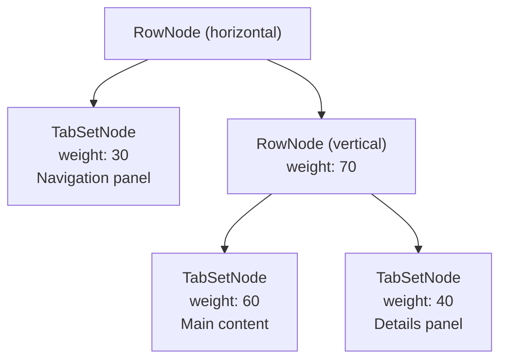
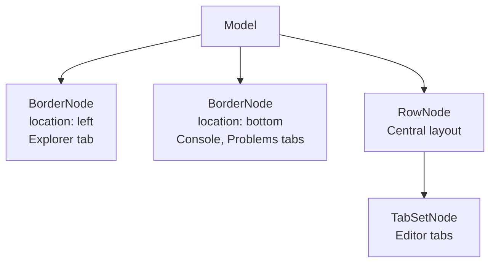
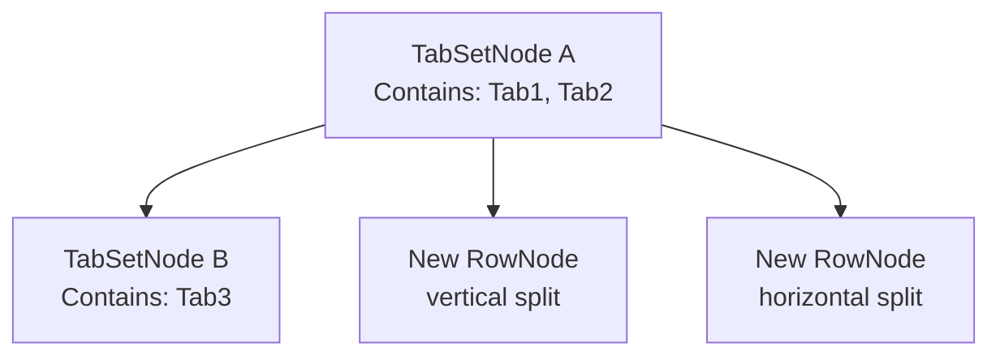
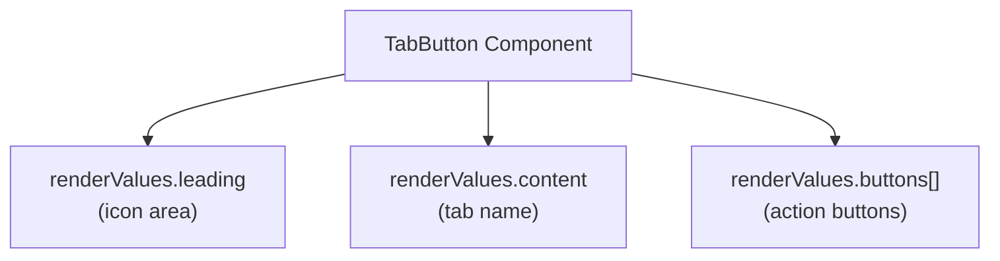
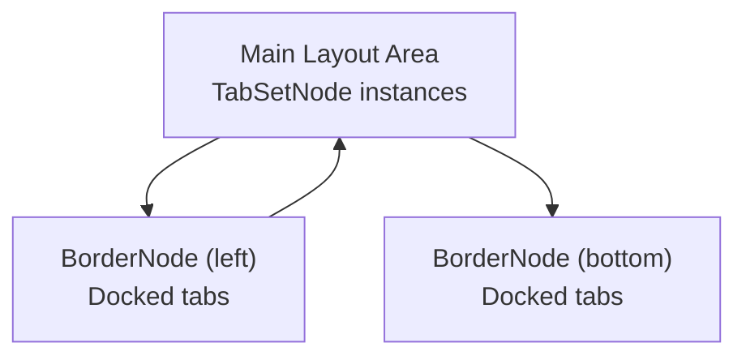
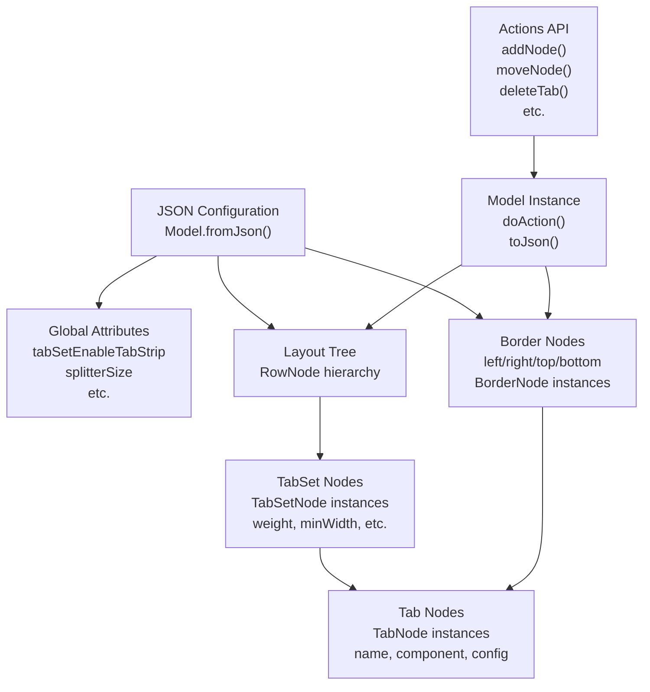

# Examples and Patterns

> **Relevant source files**
> * [.gitignore](https://github.com/caplin/FlexLayout/blob/40753f37/.gitignore)
> * [README.md](https://github.com/caplin/FlexLayout/blob/40753f37/README.md?plain=1)
> * [src/view/BorderTab.tsx](https://github.com/caplin/FlexLayout/blob/40753f37/src/view/BorderTab.tsx)
> * [src/view/TabButtonStamp.tsx](https://github.com/caplin/FlexLayout/blob/40753f37/src/view/TabButtonStamp.tsx)
> * [tests-playwright/view.spec.ts](https://github.com/caplin/FlexLayout/blob/40753f37/tests-playwright/view.spec.ts)
> * [tsconfig.json](https://github.com/caplin/FlexLayout/blob/40753f37/tsconfig.json)

This page provides common usage patterns, configuration examples, and recipes for working with FlexLayout. For detailed API documentation, see [API Reference](/caplin/FlexLayout/7-api-reference). For architectural concepts, see [Architecture](/caplin/FlexLayout/2-architecture).

## Common Layout Configurations

### Two-Column Layout

The simplest layout pattern divides the screen horizontally into two resizable panels:

```json
{  "global": {},  "borders": [],  "layout": {    "type": "row",    "weight": 100,    "children": [      {        "type": "tabset",        "weight": 50,        "children": [          {            "type": "tab",            "name": "One",            "component": "panel1"          }        ]      },      {        "type": "tabset",        "weight": 50,        "children": [          {            "type": "tab",            "name": "Two",            "component": "panel2"          }        ]      }    ]  }}
```

This creates two `TabSetNode` instances within a horizontal `RowNode`. The `weight` attributes determine relative sizing (50/50 creates equal-sized panels).

**Sources:** [README.md L95-L129](https://github.com/caplin/FlexLayout/blob/40753f37/README.md?plain=1#L95-L129)

 [tests-playwright/view.spec.ts L26-L33](https://github.com/caplin/FlexLayout/blob/40753f37/tests-playwright/view.spec.ts#L26-L33)

### Three-Panel Dashboard

A common dashboard pattern uses three panels arranged in an L-shape:

```json
{  "global": {},  "borders": [],  "layout": {    "type": "row",    "weight": 100,    "children": [      {        "type": "tabset",        "weight": 30,        "children": [          {"type": "tab", "name": "Navigation", "component": "nav"}        ]      },      {        "type": "row",        "weight": 70,        "children": [          {            "type": "tabset",            "weight": 60,            "children": [              {"type": "tab", "name": "Main", "component": "main"}            ]          },          {            "type": "tabset",            "weight": 40,            "children": [              {"type": "tab", "name": "Details", "component": "details"}            ]          }        ]      }    ]  }}
```

This creates a left sidebar (30% width) and a right area split vertically (60/40 split).



**Sources:** [README.md L173-L183](https://github.com/caplin/FlexLayout/blob/40753f37/README.md?plain=1#L173-L183)

 [tests-playwright/view.spec.ts L105-L111](https://github.com/caplin/FlexLayout/blob/40753f37/tests-playwright/view.spec.ts#L105-L111)

### IDE-Style Layout with Borders

A typical IDE layout uses borders for tool panels and a main editing area:

```json
{  "global": {},  "borders": [    {      "type": "border",      "location": "left",      "size": 250,      "children": [        {"type": "tab", "name": "Explorer", "component": "explorer"}      ]    },    {      "type": "border",      "location": "bottom",      "size": 150,      "children": [        {"type": "tab", "name": "Console", "component": "console"},        {"type": "tab", "name": "Problems", "component": "problems"}      ]    }  ],  "layout": {    "type": "row",    "weight": 100,    "children": [      {        "type": "tabset",        "weight": 100,        "children": [          {"type": "tab", "name": "Editor", "component": "editor"}        ]      }    ]  }}
```

Borders are docked to screen edges and can be toggled open/closed. The main layout area remains in the center.



**Sources:** [README.md L188-L191](https://github.com/caplin/FlexLayout/blob/40753f37/README.md?plain=1#L188-L191)

 [tests-playwright/view.spec.ts L299-L302](https://github.com/caplin/FlexLayout/blob/40753f37/tests-playwright/view.spec.ts#L299-L302)

## Tab Management Patterns

### Adding Tabs Programmatically

There are three primary patterns for adding tabs:

#### Pattern 1: Add to Specific TabSet by ID

```
model.doAction(Actions.addNode(  {    type: "tab",    component: "grid",    name: "New Grid",    id: "grid-5"  },  "NAVIGATION",  // TabSet ID  DockLocation.CENTER,  -1  // Add at end, or use 0 for start));
```

This adds a tab to the `TabSetNode` with id `"NAVIGATION"`. The `DockLocation.CENTER` means add to the existing tabset rather than creating a new one.

#### Pattern 2: Add to Active TabSet

```
layoutRef.current.addTabToActiveTabSet({  type: "tab",  component: "document",  name: "Document 1"});
```

This uses the `Layout` component's imperative API to add to whichever tabset is currently active.

#### Pattern 3: Drag-and-Drop Addition

```javascript
// In factory functionconst factory = (node) => {  if (node.getComponent() === "add-button") {    return (      <div        draggable={true}        onDragStart={(e) => {          e.dataTransfer.setData("application/json", JSON.stringify({            type: "tab",            component: "newPanel",            name: "New Panel"          }));        }}      >        Drag to add      </div>    );  }};
```

Users can drag the element to any tabset or edge to add a new tab.

**Sources:** [README.md L310-L317](https://github.com/caplin/FlexLayout/blob/40753f37/README.md?plain=1#L310-L317)

 [README.md L382-L387](https://github.com/caplin/FlexLayout/blob/40753f37/README.md?plain=1#L382-L387)

 [tests-playwright/view.spec.ts L481-L498](https://github.com/caplin/FlexLayout/blob/40753f37/tests-playwright/view.spec.ts#L481-L498)

 [tests-playwright/view.spec.ts L506-L513](https://github.com/caplin/FlexLayout/blob/40753f37/tests-playwright/view.spec.ts#L506-L513)

### Moving Tabs Between TabSets

Tabs can be moved via drag-and-drop or programmatically:

```python
// Move tab from one tabset to anothermodel.doAction(Actions.moveNode(  "tab-1",           // Tab ID to move  "tabset-2",        // Destination TabSet ID  DockLocation.CENTER,  0                  // Position in destination (0 = first)));
```

The drag-and-drop system handles this automatically when users drag tabs. Test scenarios demonstrate various movement patterns:



**Sources:** [tests-playwright/view.spec.ts L35-L45](https://github.com/caplin/FlexLayout/blob/40753f37/tests-playwright/view.spec.ts#L35-L45)

 [tests-playwright/view.spec.ts L47-L57](https://github.com/caplin/FlexLayout/blob/40753f37/tests-playwright/view.spec.ts#L47-L57)

 [tests-playwright/view.spec.ts L59-L69](https://github.com/caplin/FlexLayout/blob/40753f37/tests-playwright/view.spec.ts#L59-L69)

### Closing Tabs

Tabs can be closed programmatically or via the close button:

```
// Close a specific tabmodel.doAction(Actions.deleteTab("tab-id"));
```

When the last tab in a `TabSetNode` is closed, the tabset is automatically removed unless `enableDeleteWhenEmpty` is set to `false`:

```
{  "type": "tabset",  "enableDeleteWhenEmpty": false,  "children": [...]}
```

**Sources:** [README.md L361-L362](https://github.com/caplin/FlexLayout/blob/40753f37/README.md?plain=1#L361-L362)

 [tests-playwright/view.spec.ts L522-L528](https://github.com/caplin/FlexLayout/blob/40753f37/tests-playwright/view.spec.ts#L522-L528)

 [tests-playwright/view.spec.ts L530-L537](https://github.com/caplin/FlexLayout/blob/40753f37/tests-playwright/view.spec.ts#L530-L537)

## Customization Patterns

### Custom Tab Rendering

The `onRenderTab` callback allows customization of tab button appearance:

```javascript
function onRenderTab(node, renderValues) {  // Add an icon before the tab name  renderValues.leading = (      );    // Modify tab name with status indicator  if (node.getConfig().modified) {    renderValues.content = node.getName() + " *";  }    // Add custom buttons  renderValues.buttons.push(     openSettings(node)}      style={{width: "1em", height: "1em"}}    />  );}
```

The `renderValues` object contains three customizable areas:

* `leading`: Content before the tab name (typically icons)
* `content`: The main tab text
* `buttons`: Array of buttons displayed on the right



**Sources:** [README.md L231-L256](https://github.com/caplin/FlexLayout/blob/40753f37/README.md?plain=1#L231-L256)

 [tests-playwright/view.spec.ts L762-L772](https://github.com/caplin/FlexLayout/blob/40753f37/tests-playwright/view.spec.ts#L762-L772)

 [tests-playwright/view.spec.ts L773-L782](https://github.com/caplin/FlexLayout/blob/40753f37/tests-playwright/view.spec.ts#L773-L782)

### Custom TabSet Rendering

The `onRenderTabSet` callback customizes the tabset header:

```javascript
function onRenderTabSet(node, renderValues) {  // Add sticky buttons (always visible)  renderValues.stickyButtons.push(    <button      key="add"      className="flexlayout__tab_toolbar_button"      onClick={() => addTabToSet(node)}    >      +    </button>  );    // Add toolbar buttons (may overflow)  renderValues.buttons.push(     showMenu(node)}    />  );    // Add leading content  renderValues.leading = <span>Group: {node.getName()}</span>;}
```

The `renderValues` object contains:

* `leading`: Content at the start of the header
* `stickyButtons`: Buttons that remain visible even when tabs overflow
* `buttons`: Regular toolbar buttons

**Sources:** [README.md L258-L295](https://github.com/caplin/FlexLayout/blob/40753f37/README.md?plain=1#L258-L295)

 [tests-playwright/view.spec.ts L784-L798](https://github.com/caplin/FlexLayout/blob/40753f37/tests-playwright/view.spec.ts#L784-L798)

 [tests-playwright/view.spec.ts L792-L797](https://github.com/caplin/FlexLayout/blob/40753f37/tests-playwright/view.spec.ts#L792-L797)

### Dynamic Theme Switching

To enable runtime theme switching, use `combined.css` and change the className:

```javascript
// In your componentimport 'flexlayout-react/style/combined.css'; function App() {  const containerRef = useRef(null);  const [theme, setTheme] = useState('light');    useEffect(() => {    containerRef.current.className = `flexlayout__theme_${theme}`;  }, [theme]);    return (    <div ref={containerRef} className="flexlayout__theme_light">      <Layout model={model} factory={factory} />    </div>  );}
```

Available themes: `light`, `dark`, `gray`, `underline`.

**Sources:** [README.md L211-L229](https://github.com/caplin/FlexLayout/blob/40753f37/README.md?plain=1#L211-L229)

## Border Usage Patterns

### Toggle Border Visibility

Borders can be shown/hidden programmatically:

```
// Show/hide a bordermodel.doAction(Actions.updateNodeAttributes("border_left", {  show: false}));
```

### Auto-Hide Borders

Borders can auto-hide when empty by setting `autoHide`:

```
{  "type": "border",  "location": "left",  "autoHide": true,  "children": [...]}
```

When the last tab is removed, the border automatically hides. It reappears when a tab is docked to that edge.

**Sources:** [tests-playwright/view.spec.ts L891-L911](https://github.com/caplin/FlexLayout/blob/40753f37/tests-playwright/view.spec.ts#L891-L911)

### Moving Tabs to/from Borders

Tabs can be moved between borders and the main layout:

```python
// Move tab to bordermodel.doAction(Actions.moveNode(  "tab-id",  "border_left",  DockLocation.CENTER,  -1)); // Move tab from border to main layoutmodel.doAction(Actions.moveNode(  "border-tab-id",  "main-tabset",  DockLocation.CENTER,  -1));
```

The drag-and-drop system supports this naturally:



**Sources:** [tests-playwright/view.spec.ts L304-L327](https://github.com/caplin/FlexLayout/blob/40753f37/tests-playwright/view.spec.ts#L304-L327)

 [tests-playwright/view.spec.ts L329-L352](https://github.com/caplin/FlexLayout/blob/40753f37/tests-playwright/view.spec.ts#L329-L352)

## Advanced Patterns

### Popout Windows Configuration

Enable popout capability on individual tabs:

```json
{  "type": "tab",  "name": "Chart",  "component": "chart",  "enablePopout": true,  "config": {    "popoutUrl": "popout.html"  }}
```

Handle popout document context in components:

```javascript
function ChartComponent({node}) {  const selfRef = useRef(null);    useEffect(() => {    // Get the document of the current window (main or popout)    const currentDocument = selfRef.current.ownerDocument;    const currentWindow = currentDocument.defaultView;        // Use currentDocument for event listeners    currentDocument.addEventListener('click', handleClick);        return () => {      currentDocument.removeEventListener('click', handleClick);    };  }, []);    return <div ref={selfRef}>Chart content</div>;}
```

This pattern ensures event listeners work correctly in popout windows.

**Sources:** [README.md L417-L461](https://github.com/caplin/FlexLayout/blob/40753f37/README.md?plain=1#L417-L461)

### Tab State Preservation

Component state is preserved when tabs are moved:

```javascript
function StatefulComponent({node}) {  const [count, setCount] = useState(0);    // State persists when tab is dragged to a different tabset  return (    <div>      <p>Count: {count}</p>      <button onClick={() => setCount(count + 1)}>Increment</button>    </div>  );}
```

To force re-mounting when moving between windows:

```json
{  "type": "tab",  "name": "Component",  "component": "stateful",  "enableWindowReMount": true}
```

**Sources:** [README.md L38](https://github.com/caplin/FlexLayout/blob/40753f37/README.md?plain=1#L38-L38)

 [README.md L458-L459](https://github.com/caplin/FlexLayout/blob/40753f37/README.md?plain=1#L458-L459)

### Tab Overflow Handling

When tabs exceed available space, FlexLayout provides automatic overflow handling:

```
{  "type": "tabset",  "enableTabOverflow": "menu",  // or "scroll"  "children": [...]}
```

With `"menu"`, hidden tabs appear in an overflow menu. With `"scroll"`, tabs scroll horizontally.

**Sources:** [README.md L28](https://github.com/caplin/FlexLayout/blob/40753f37/README.md?plain=1#L28-L28)

 [tests-playwright/view.spec.ts L437-L473](https://github.com/caplin/FlexLayout/blob/40753f37/tests-playwright/view.spec.ts#L437-L473)

### Action Interception

Intercept and modify actions before they're applied:

```javascript
function onAction(action) {  if (action.type === Actions.DELETE_TAB) {    const node = model.getNodeById(action.data.node);    if (node.getConfig().preventClose) {      // Prevent closing this tab      return undefined;    }  }    if (action.type === Actions.RENAME_TAB) {    // Validate tab name    if (action.data.text.length === 0) {      return undefined;  // Cancel action    }    // Modify action    return Actions.renameTab(action.data.node, action.data.text.toUpperCase());  }    return action;  // Allow action} <Layout   model={model}   factory={factory}   onAction={onAction}/>
```

Returning `undefined` cancels the action. Returning a modified action changes its behavior.

**Sources:** [README.md L332-L333](https://github.com/caplin/FlexLayout/blob/40753f37/README.md?plain=1#L332-L333)

### Event Listeners on Tabs

React to tab lifecycle events:

```javascript
function MyComponent({node}) {  useEffect(() => {    // Called when tab is resized    node.setEventListener("resize", (rect) => {      console.log("New size:", rect.width, rect.height);    });        // Called when tab closes    node.setEventListener("close", () => {      console.log("Tab closing");      // Cleanup if needed    });        // Called when visibility changes    node.setEventListener("visibility", (visible) => {      if (visible) {        console.log("Tab became visible");      }    });        // Called before serialization    node.setEventListener("save", () => {      // Save state to node config      node.getConfig().savedData = someData;    });        return () => {      node.removeEventListener("resize");      node.removeEventListener("close");      node.removeEventListener("visibility");      node.removeEventListener("save");    };  }, [node]);    return <div>Component content</div>;}
```

**Sources:** [README.md L391-L416](https://github.com/caplin/FlexLayout/blob/40753f37/README.md?plain=1#L391-L416)

## Common Recipes

### Multi-Splitter (No Tabs)

Create a layout with only splitters, no tab headers:

```json
{  "global": {    "tabSetEnableTabStrip": false,    "tabSetEnableClose": false,    "tabSetEnableDrag": false,    "tabSetEnableDrop": false  },  "borders": [],  "layout": {    "type": "row",    "weight": 100,    "children": [      {        "type": "tabset",        "weight": 50,        "children": [          {"type": "tab", "name": "Panel 1", "component": "panel"}        ]      },      {        "type": "tabset",        "weight": 50,        "children": [          {"type": "tab", "name": "Panel 2", "component": "panel"}        ]      }    ]  }}
```

This disables all tab-related UI, leaving only resizable panels.

**Sources:** [README.md L202-L209](https://github.com/caplin/FlexLayout/blob/40753f37/README.md?plain=1#L202-L209)

### Fixed Minimum Sizes

Prevent panels from becoming too small:

```
{  "type": "tabset",  "weight": 30,  "minWidth": 100,  "minHeight": 130,  "children": [...]}
```

Applies to both `TabSetNode` and `BorderNode` instances.

**Sources:** [tests-playwright/view.spec.ts L816-L876](https://github.com/caplin/FlexLayout/blob/40753f37/tests-playwright/view.spec.ts#L816-L876)

### Tab Renaming

Enable double-click to rename tabs:

```json
{  "global": {    "tabSetEnableTabRename": true  }}
```

Or on individual tabs:

```json
{  "type": "tab",  "name": "Document 1",  "component": "editor",  "enableRename": true}
```

Users can double-click the tab name to edit it.

**Sources:** [README.md L32](https://github.com/caplin/FlexLayout/blob/40753f37/README.md?plain=1#L32-L32)

 [tests-playwright/view.spec.ts L676-L693](https://github.com/caplin/FlexLayout/blob/40753f37/tests-playwright/view.spec.ts#L676-L693)

### Maximize/Restore TabSets

Allow tabsets to maximize to full screen:

```
{  "type": "tabset",  "enableMaximize": true,  "children": [...]}
```

Users can:

* Click the maximize button in the tabset header
* Double-click the tabset header area

**Sources:** [README.md L27](https://github.com/caplin/FlexLayout/blob/40753f37/README.md?plain=1#L27-L27)

 [tests-playwright/view.spec.ts L639-L668](https://github.com/caplin/FlexLayout/blob/40753f37/tests-playwright/view.spec.ts#L639-L668)

### Persistent Layout State

Save and restore layout configuration:

```javascript
// Save current layoutconst json = model.toJson();localStorage.setItem('layout', JSON.stringify(json)); // Restore layoutconst saved = localStorage.getItem('layout');if (saved) {  const model = Model.fromJson(JSON.parse(saved));  setModel(model);}
```

The `save` event listener allows components to persist their state:

```javascript
useEffect(() => {  node.setEventListener("save", () => {    // Save component state to config    node.getConfig().scrollPosition = scrollY;    node.getConfig().selection = selectedItems;  });}, [node, scrollY, selectedItems]);
```

**Sources:** [README.md L93](https://github.com/caplin/FlexLayout/blob/40753f37/README.md?plain=1#L93-L93)

 [README.md L415](https://github.com/caplin/FlexLayout/blob/40753f37/README.md?plain=1#L415-L415)

### Active TabSet Tracking

Track which tabset is currently active:

```javascript
function App() {  const [model] = useState(() => Model.fromJson(json));    useEffect(() => {    const listener = (action) => {      if (action.type === Actions.SET_ACTIVE_TABSET) {        const tabset = model.getNodeById(action.data.tabsetNode);        console.log("Active tabset:", tabset.getId());      }    };        model.addChangeListener(listener);    return () => model.removeChangeListener(listener);  }, [model]);    return <Layout model={model} factory={factory} />;}
```

Clicking on any tab, tab button, or tabstrip activates that tabset.

**Sources:** [tests-playwright/view.spec.ts L695-L744](https://github.com/caplin/FlexLayout/blob/40753f37/tests-playwright/view.spec.ts#L695-L744)

### Conditional Tab Visibility

Show/hide tabs based on application state:

```javascript
// In factory functionconst factory = (node) => {  const component = node.getComponent();    if (component === "admin-panel" && !isAdmin) {    return <div>Access Denied</div>;  }    return <ActualComponent node={node} />;};
```

Or disable certain actions:

```javascript
function onAction(action) {  if (action.type === Actions.MOVE_NODE) {    const node = model.getNodeById(action.data.fromNode);    if (node.getConfig().locked) {      return undefined;  // Prevent moving    }  }  return action;}
```

**Sources:** [README.md L332-L333](https://github.com/caplin/FlexLayout/blob/40753f37/README.md?plain=1#L332-L333)

## Configuration Patterns Summary



**Sources:** [README.md L89-L93](https://github.com/caplin/FlexLayout/blob/40753f37/README.md?plain=1#L89-L93)

 [README.md L166-L197](https://github.com/caplin/FlexLayout/blob/40753f37/README.md?plain=1#L166-L197)

 [README.md L297-L333](https://github.com/caplin/FlexLayout/blob/40753f37/README.md?plain=1#L297-L333)