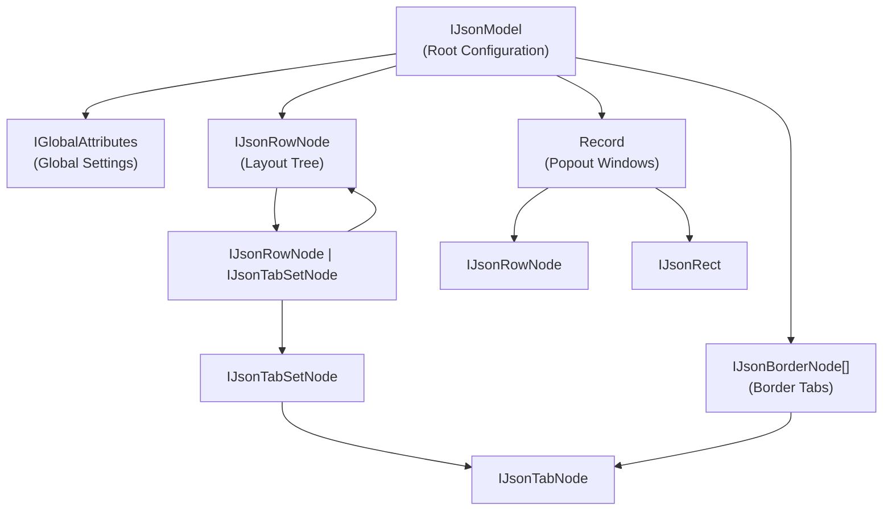
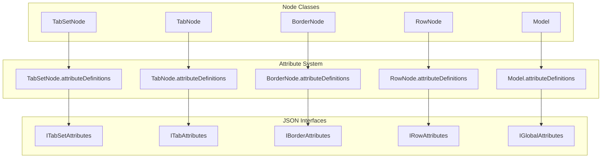
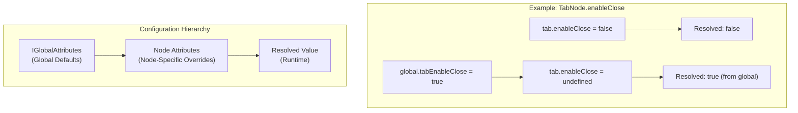

# Interfaces and Types

> **Relevant source files**
> * [src/Types.ts](https://github.com/caplin/FlexLayout/blob/40753f37/src/Types.ts)
> * [src/model/BorderNode.ts](https://github.com/caplin/FlexLayout/blob/40753f37/src/model/BorderNode.ts)
> * [src/model/BorderSet.ts](https://github.com/caplin/FlexLayout/blob/40753f37/src/model/BorderSet.ts)
> * [src/model/IJsonModel.ts](https://github.com/caplin/FlexLayout/blob/40753f37/src/model/IJsonModel.ts)
> * [src/model/Model.ts](https://github.com/caplin/FlexLayout/blob/40753f37/src/model/Model.ts)
> * [src/model/Node.ts](https://github.com/caplin/FlexLayout/blob/40753f37/src/model/Node.ts)
> * [src/model/RowNode.ts](https://github.com/caplin/FlexLayout/blob/40753f37/src/model/RowNode.ts)
> * [src/model/TabNode.ts](https://github.com/caplin/FlexLayout/blob/40753f37/src/model/TabNode.ts)
> * [src/model/TabSetNode.ts](https://github.com/caplin/FlexLayout/blob/40753f37/src/model/TabSetNode.ts)
> * [src/view/Tab.tsx](https://github.com/caplin/FlexLayout/blob/40753f37/src/view/Tab.tsx)

This page documents the TypeScript interface definitions and type aliases exposed by FlexLayout. These interfaces define the structure of JSON configurations, node attributes, and the data model used throughout the library.

For information about the Model API methods and Actions, see [Model API](/caplin/FlexLayout/7.2-model-api). For component props, see [Component Props](/caplin/FlexLayout/7.1-component-props).

---

## Overview

FlexLayout provides a comprehensive set of TypeScript interfaces organized into three main categories:

| Category | Purpose | Primary File |
| --- | --- | --- |
| **JSON Model Interfaces** | Define the structure of layout configurations that can be serialized to/from JSON | `IJsonModel` |
| **Attribute Interfaces** | Define the configurable properties for each node type and global settings | `IGlobalAttributes`, `IRowAttributes`, `ITabSetAttributes`, `ITabAttributes`, `IBorderAttributes` |
| **Type Aliases** | Provide constrained string types for specific configuration values | `IBorderLocation`, `ITabLocation`, `ICloseType` |

All interfaces are defined in [src/model/IJsonModel.ts L1-L967](https://github.com/caplin/FlexLayout/blob/40753f37/src/model/IJsonModel.ts#L1-L967)

 and are auto-generated from attribute definitions in the codebase (see line comment at [src/model/IJsonModel.ts L47-L48](https://github.com/caplin/FlexLayout/blob/40753f37/src/model/IJsonModel.ts#L47-L48)

).

**Sources:** [src/model/IJsonModel.ts L1-L967](https://github.com/caplin/FlexLayout/blob/40753f37/src/model/IJsonModel.ts#L1-L967)

---

## JSON Model Structure

The following diagram shows the hierarchical structure of the JSON model interfaces:



**Sources:** [src/model/IJsonModel.ts L5-L44](https://github.com/caplin/FlexLayout/blob/40753f37/src/model/IJsonModel.ts#L5-L44)

---

## Core JSON Interfaces

### IJsonModel

The root interface for FlexLayout configuration:

```
interface IJsonModel {    global?: IGlobalAttributes;    borders?: IJsonBorderNode[];    layout: IJsonRowNode;    popouts?: Record<string, IJsonPopout>;}
```

| Property | Type | Required | Description |
| --- | --- | --- | --- |
| `global` | `IGlobalAttributes` | No | Global default settings for all nodes |
| `borders` | `IJsonBorderNode[]` | No | Configuration for edge border areas |
| `layout` | `IJsonRowNode` | **Yes** | The main layout tree structure |
| `popouts` | `Record<string, IJsonPopout>` | No | Popout window configurations keyed by window ID |

**Sources:** [src/model/IJsonModel.ts L5-L10](https://github.com/caplin/FlexLayout/blob/40753f37/src/model/IJsonModel.ts#L5-L10)

### IJsonRowNode

Represents a row container that can hold other rows or tabsets:

```
interface IJsonRowNode extends IRowAttributes {    children: (IJsonRowNode | IJsonTabSetNode)[];}
```

Rows alternate orientation with their parent (horizontal rows contain vertical rows, and vice versa). The root row is horizontal by default unless `rootOrientationVertical` is set to `true`.

**Sources:** [src/model/IJsonModel.ts L29-L31](https://github.com/caplin/FlexLayout/blob/40753f37/src/model/IJsonModel.ts#L29-L31)

### IJsonTabSetNode

Represents a container for multiple tabs:

```
interface IJsonTabSetNode extends ITabSetAttributes {    active?: boolean;      // Marks this tabset as active (only one per window)    maximized?: boolean;   // Marks this tabset as maximized (only one per window)    children: IJsonTabNode[];}
```

The `active` and `maximized` flags are read from initial JSON but must subsequently be managed through the Model API using [Actions.setActiveTabset()](https://github.com/caplin/FlexLayout/blob/40753f37/Actions.setActiveTabset())

 and [Actions.maximizeToggle()](https://github.com/caplin/FlexLayout/blob/40753f37/Actions.maximizeToggle())

**Sources:** [src/model/IJsonModel.ts L33-L41](https://github.com/caplin/FlexLayout/blob/40753f37/src/model/IJsonModel.ts#L33-L41)

### IJsonTabNode

Represents an individual tab:

```
interface IJsonTabNode extends ITabAttributes {    // All properties defined in ITabAttributes}
```

Tabs can be placed in tabsets (main layout area) or borders (edge areas).

**Sources:** [src/model/IJsonModel.ts L43-L44](https://github.com/caplin/FlexLayout/blob/40753f37/src/model/IJsonModel.ts#L43-L44)

### IJsonBorderNode

Represents an edge border that can hold tabs:

```
interface IJsonBorderNode extends IBorderAttributes {    location: IBorderLocation;    children: IJsonTabNode[];}
```

Borders are docked to the edges of the layout: `"top"`, `"bottom"`, `"left"`, or `"right"`.

**Sources:** [src/model/IJsonModel.ts L24-L27](https://github.com/caplin/FlexLayout/blob/40753f37/src/model/IJsonModel.ts#L24-L27)

### IJsonPopout

Represents a popout window configuration:

```
interface IJsonPopout {    layout: IJsonRowNode;    rect: IJsonRect;}
```

Where `IJsonRect` is:

```
interface IJsonRect {    x: number;    y: number;    width: number;    height: number;}
```

**Sources:** [src/model/IJsonModel.ts L12-L22](https://github.com/caplin/FlexLayout/blob/40753f37/src/model/IJsonModel.ts#L12-L22)

---

## Type Aliases

FlexLayout defines several type aliases for constrained string values:

| Type | Values | Description |
| --- | --- | --- |
| `IBorderLocation` | `"top"` \| `"bottom"` \| `"left"` \| `"right"` | Valid border edge positions |
| `ITabLocation` | `"top"` \| `"bottom"` | Valid tab strip positions within a tabset |
| `ICloseType` | Numeric enum | Controls close button behavior (defined in separate file) |

**Sources:** [src/model/IJsonModel.ts L2-L3](https://github.com/caplin/FlexLayout/blob/40753f37/src/model/IJsonModel.ts#L2-L3)

---

## Attribute Interfaces

Attribute interfaces define the configurable properties for nodes. These interfaces are auto-generated from [AttributeDefinitions](https://github.com/caplin/FlexLayout/blob/40753f37/AttributeDefinitions)

 in the source code via `Model.toTypescriptInterfaces()`.

### Relationship Between Interfaces and Node Classes



**Sources:** [src/model/TabSetNode.ts L48-L588](https://github.com/caplin/FlexLayout/blob/40753f37/src/model/TabSetNode.ts#L48-L588)

 [src/model/TabNode.ts L336-L424](https://github.com/caplin/FlexLayout/blob/40753f37/src/model/TabNode.ts#L336-L424)

 [src/model/BorderNode.ts L35-L446](https://github.com/caplin/FlexLayout/blob/40753f37/src/model/BorderNode.ts#L35-L446)

 [src/model/RowNode.ts L41-L558](https://github.com/caplin/FlexLayout/blob/40753f37/src/model/RowNode.ts#L41-L558)

 [src/model/Model.ts L32-L702](https://github.com/caplin/FlexLayout/blob/40753f37/src/model/Model.ts#L32-L702)

---

## IGlobalAttributes

Global attributes provide default values for node-specific attributes. All properties are optional.

### Structure

The interface contains ~70 properties organized by category:

| Category | Example Properties | Count |
| --- | --- | --- |
| Border defaults | `borderSize`, `borderMinSize`, `borderEnableDrop` | 9 |
| Layout settings | `enableEdgeDock`, `rootOrientationVertical` | 3 |
| Splitter settings | `splitterSize`, `splitterEnableHandle` | 3 |
| Tab defaults | `tabEnableClose`, `tabEnableDrag`, `tabIcon` | 13 |
| TabSet defaults | `tabSetEnableMaximize`, `tabSetMinWidth`, `tabSetAutoSelectTab` | 18 |

### Example Properties

```
interface IGlobalAttributes {    // Layout    enableEdgeDock?: boolean;                    // Default: true    rootOrientationVertical?: boolean;           // Default: false        // Splitter    splitterSize?: number;                       // Default: 8    splitterEnableHandle?: boolean;              // Default: false        // Tab defaults    tabEnableClose?: boolean;                    // Default: true    tabEnableDrag?: boolean;                     // Default: true    tabEnablePopout?: boolean;                   // Default: false    tabMinWidth?: number;                        // Default: 0        // TabSet defaults    tabSetEnableMaximize?: boolean;              // Default: true    tabSetEnableDeleteWhenEmpty?: boolean;       // Default: true    tabSetMinWidth?: number;                     // Default: 0        // Border defaults    borderSize?: number;                         // Default: 200    borderEnableDrop?: boolean;                  // Default: true        // ... ~60 more properties}
```

**Full interface:** [src/model/IJsonModel.ts L49-L496](https://github.com/caplin/FlexLayout/blob/40753f37/src/model/IJsonModel.ts#L49-L496)

**Sources:** [src/model/IJsonModel.ts L49-L496](https://github.com/caplin/FlexLayout/blob/40753f37/src/model/IJsonModel.ts#L49-L496)

 [src/model/Model.ts L626-L702](https://github.com/caplin/FlexLayout/blob/40753f37/src/model/Model.ts#L626-L702)

---

## IRowAttributes

Attributes specific to `RowNode` containers:

```
interface IRowAttributes {    id?: string;      // Unique identifier (auto-generated if undefined)    type?: string;    // Fixed value: "row"    weight?: number;  // Relative sizing weight (default: 100)}
```

Rows have minimal configuration since they primarily serve as layout containers.

**Sources:** [src/model/IJsonModel.ts L497-L519](https://github.com/caplin/FlexLayout/blob/40753f37/src/model/IJsonModel.ts#L497-L519)

 [src/model/RowNode.ts L547-L558](https://github.com/caplin/FlexLayout/blob/40753f37/src/model/RowNode.ts#L547-L558)

---

## ITabSetAttributes

Attributes for configuring `TabSetNode` containers (~30 properties):

```python
interface ITabSetAttributes {    // Identity    id?: string;                          // Unique ID (auto-generated if undefined)    type?: string;                        // Fixed value: "tabset"    name?: string;                        // Display name (optional)        // Layout    weight?: number;                      // Default: 100    selected?: number;                    // Index of selected tab (default: 0)        // Size constraints    minWidth?: number;                    // Inherited from global (default: 0)    minHeight?: number;                   // Inherited from global (default: 0)    maxWidth?: number;                    // Inherited from global (default: 99999)    maxHeight?: number;                   // Inherited from global (default: 99999)        // Behavior    enableDrop?: boolean;                 // Allow drop (inherited, default: true)    enableDrag?: boolean;                 // Allow drag out (inherited, default: true)    enableDivide?: boolean;               // Allow split (inherited, default: true)    enableMaximize?: boolean;             // Show maximize button (inherited, default: true)    enableClose?: boolean;                // Show close button (inherited, default: false)    enableDeleteWhenEmpty?: boolean;      // Auto-delete when empty (inherited, default: true)    autoSelectTab?: boolean;              // Auto-select moved tabs (inherited, default: true)        // Tab strip    enableTabStrip?: boolean;             // Show tab strip (inherited, default: true)    enableTabWrap?: boolean;              // Wrap tabs to multiple lines (inherited, default: false)    tabLocation?: ITabLocation;           // "top" or "bottom" (inherited, default: "top")    enableTabScrollbar?: boolean;         // Show mini scrollbar (inherited, default: false)        // Styling    classNameTabStrip?: string;           // CSS class for tab strip (inherited)    enableSingleTabStretch?: boolean;     // Stretch single tab (inherited, default: false)    enableActiveIcon?: boolean;           // Show active indicator (inherited, default: false)        // Storage    config?: any;                         // User data storage}
```

Properties marked "inherited" can be overridden at the node level or inherit from the corresponding global attribute.

**Sources:** [src/model/IJsonModel.ts L520-L689](https://github.com/caplin/FlexLayout/blob/40753f37/src/model/IJsonModel.ts#L520-L689)

 [src/model/TabSetNode.ts L512-L588](https://github.com/caplin/FlexLayout/blob/40753f37/src/model/TabSetNode.ts#L512-L588)

---

## ITabAttributes

Attributes for individual `TabNode` instances (~25 properties):

```typescript
interface ITabAttributes {    // Identity    id?: string;                          // Unique ID (auto-generated if undefined)    type?: string;                        // Fixed value: "tab"    name?: string;                        // Tab display name (default: "[Unnamed Tab]")    altName?: string;                     // Fallback name for overflow menu        // Component    component?: string;                   // Component identifier for factory function    config?: any;                         // Component-specific configuration        // Visual    icon?: string;                        // Tab icon (inherited)    helpText?: string;                    // Tooltip text        // Size constraints    minWidth?: number;                    // Inherited from global (default: 0)    minHeight?: number;                   // Inherited from global (default: 0)    maxWidth?: number;                    // Inherited from global (default: 99999)    maxHeight?: number;                   // Inherited from global (default: 99999)        // Border sizing (when in border)    borderWidth?: number;                 // Width in border (inherited, default: -1 = use border size)    borderHeight?: number;                // Height in border (inherited, default: -1 = use border size)        // Behavior    enableClose?: boolean;                // Show close button (inherited, default: true)    closeType?: ICloseType;               // Close behavior (inherited, default: 1)    enableDrag?: boolean;                 // Allow dragging (inherited, default: true)    enableRename?: boolean;               // Allow rename via double-click (inherited, default: true)    enablePopout?: boolean;               // Allow popout (inherited, default: false)    enablePopoutIcon?: boolean;           // Show popout icon (inherited, default: true)    enablePopoutOverlay?: boolean;        // Gray out when inactive (inherited, default: false)    enableRenderOnDemand?: boolean;       // Defer render until visible (inherited, default: true)    enableWindowReMount?: boolean;        // Re-mount on popout/in (default: false)        // Styling    className?: string;                   // CSS class for tab button (inherited)    contentClassName?: string;            // CSS class for tab content (inherited)    tabsetClassName?: string;             // CSS class when stretched in tabset}
```

**Sources:** [src/model/IJsonModel.ts L690-L874](https://github.com/caplin/FlexLayout/blob/40753f37/src/model/IJsonModel.ts#L690-L874)

 [src/model/TabNode.ts L339-L423](https://github.com/caplin/FlexLayout/blob/40753f37/src/model/TabNode.ts#L339-L423)

---

## IBorderAttributes

Attributes for `BorderNode` edge containers (~10 properties):

```python
interface IBorderAttributes {    type?: string;                        // Fixed value: "border"        // Selection    selected?: number;                    // Index of selected tab (default: -1 = none)    show?: boolean;                       // Show/hide border (default: true)        // Size    size?: number;                        // Border size when open (inherited, default: 200)    minSize?: number;                     // Minimum size (inherited, default: 0)    maxSize?: number;                     // Maximum size (inherited, default: 99999)        // Behavior    enableDrop?: boolean;                 // Allow drop (inherited, default: true)    autoSelectTabWhenOpen?: boolean;      // Auto-select on move when open (inherited, default: true)    autoSelectTabWhenClosed?: boolean;    // Auto-select on move when closed (inherited, default: false)    enableAutoHide?: boolean;             // Hide when empty (inherited, default: false)    enableTabScrollbar?: boolean;         // Show mini scrollbar (inherited, default: false)        // Styling    className?: string;                   // CSS class for border buttons (inherited)        // Storage    config?: any;                         // User data storage}
```

**Sources:** [src/model/IJsonModel.ts L875-L967](https://github.com/caplin/FlexLayout/blob/40753f37/src/model/IJsonModel.ts#L875-L967)

 [src/model/BorderNode.ts L403-L445](https://github.com/caplin/FlexLayout/blob/40753f37/src/model/BorderNode.ts#L403-L445)

---

## Attribute Inheritance System

FlexLayout implements a hierarchical attribute system where node-specific attributes can inherit default values from global attributes:



### How Inheritance Works

1. **Attribute Definitions**: Each node class defines attributes using `AttributeDefinitions.addInherited(nodeName, globalName)`
2. **Resolution**: When reading an attribute via `node.getAttr(name)`, the system checks: * First: Node's own attributes * Second: Global model attributes (if the attribute is inheritable)
3. **Naming Convention**: Global attributes use prefixes like `tab`, `tabSet`, `border` to namespace defaults

### Example from Code

```
// In TabNode.createAttributeDefinitions()attributeDefinitions.addInherited("enableClose", "tabEnableClose")    .setType(Attribute.BOOLEAN)    .setDescription("allow user to close tab via close button");
```

This creates:

* Node attribute: `TabNode.enableClose`
* Global fallback: `IGlobalAttributes.tabEnableClose`
* Default value: `true` (defined in [Model.ts L651](https://github.com/caplin/FlexLayout/blob/40753f37/Model.ts#L651-L651) )

**Sources:** [src/model/TabNode.ts L368-L370](https://github.com/caplin/FlexLayout/blob/40753f37/src/model/TabNode.ts#L368-L370)

 [src/model/Node.ts L105-L117](https://github.com/caplin/FlexLayout/blob/40753f37/src/model/Node.ts#L105-L117)

 [src/model/Model.ts L651](https://github.com/caplin/FlexLayout/blob/40753f37/src/model/Model.ts#L651-L651)

---

## Attribute Type Reference

All attribute values have specific types defined in the attribute definitions:

| Type | TypeScript Type | Examples |
| --- | --- | --- |
| `Attribute.BOOLEAN` | `boolean` | `enableClose`, `enableDrag` |
| `Attribute.NUMBER` | `number` | `minWidth`, `weight`, `selected` |
| `Attribute.STRING` | `string` | `name`, `className`, `icon` |
| `"any"` | `any` | `config` (user data) |
| `"ICloseType"` | `ICloseType` | `closeType` |
| `"ITabLocation"` | `ITabLocation` | `tabLocation` |

Fixed attributes (like `type`) are marked with `.setFixed()` and cannot be changed after node creation.

**Sources:** [src/Attribute.ts L1-L51](https://github.com/caplin/FlexLayout/blob/40753f37/src/Attribute.ts#L1-L51)

 [src/model/TabNode.ts L339-L423](https://github.com/caplin/FlexLayout/blob/40753f37/src/model/TabNode.ts#L339-L423)

---

## Usage Examples

### Creating a Model from JSON

```javascript
import { Model, IJsonModel } from 'flexlayout-react'; const json: IJsonModel = {    global: {        tabEnableClose: false,        splitterSize: 10    },    layout: {        type: "row",        children: [            {                type: "tabset",                weight: 50,                children: [                    { type: "tab", name: "Tab 1", component: "panel1" }                ]            }        ]    }}; const model = Model.fromJson(json);
```

### Updating Node Attributes

```javascript
import { Actions } from 'flexlayout-react'; // Update a single node's attributesmodel.doAction(Actions.updateNodeAttributes(nodeId, {    name: "New Name",    config: { customData: "value" }})); // Update global model attributesmodel.doAction(Actions.updateModelAttributes({    tabEnableClose: false}));
```

### Type-Safe Configuration

```javascript
// TypeScript will validate the structureconst tabsetConfig: ITabSetAttributes = {    enableMaximize: true,    minWidth: 200,    selected: 0,    config: { myCustomData: "value" }}; const tabConfig: ITabAttributes = {    name: "My Tab",    component: "editor",    enableClose: false,    config: { filePath: "/path/to/file" }};
```

**Sources:** [src/model/Model.ts L400-L418](https://github.com/caplin/FlexLayout/blob/40753f37/src/model/Model.ts#L400-L418)

 [src/model/Model.ts L424-L446](https://github.com/caplin/FlexLayout/blob/40753f37/src/model/Model.ts#L424-L446)

---

## Generated Interface Documentation

The attribute interfaces in [IJsonModel.ts](https://github.com/caplin/FlexLayout/blob/40753f37/IJsonModel.ts)

 are auto-generated using the following command:

```
Model.toTypescriptInterfaces()
```

This method (defined at [src/model/Model.ts L610-L623](https://github.com/caplin/FlexLayout/blob/40753f37/src/model/Model.ts#L610-L623)

) traverses all AttributeDefinitions and generates TypeScript interface text with:

* Property names and types
* Default values
* Descriptions from attribute definitions
* Inheritance annotations

Each property includes a JSDoc comment showing:

* Description of the property
* Default value (either direct or inherited)
* Whether it's inherited from a global attribute

**Sources:** [src/model/Model.ts L610-L623](https://github.com/caplin/FlexLayout/blob/40753f37/src/model/Model.ts#L610-L623)

 [src/model/IJsonModel.ts L47-L48](https://github.com/caplin/FlexLayout/blob/40753f37/src/model/IJsonModel.ts#L47-L48)