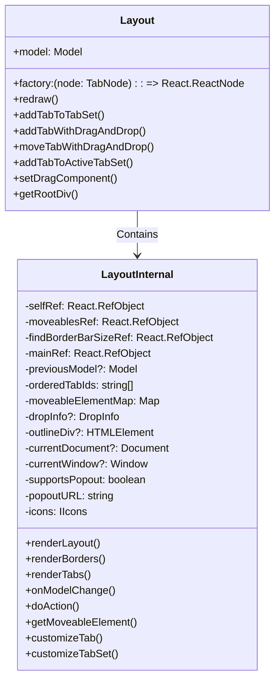
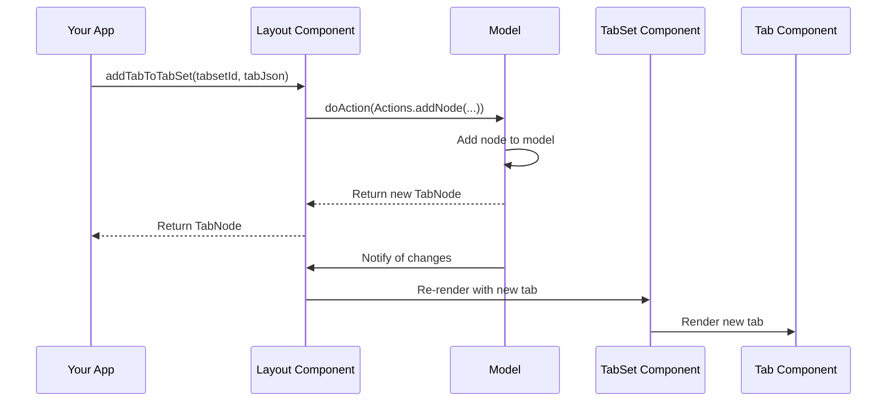
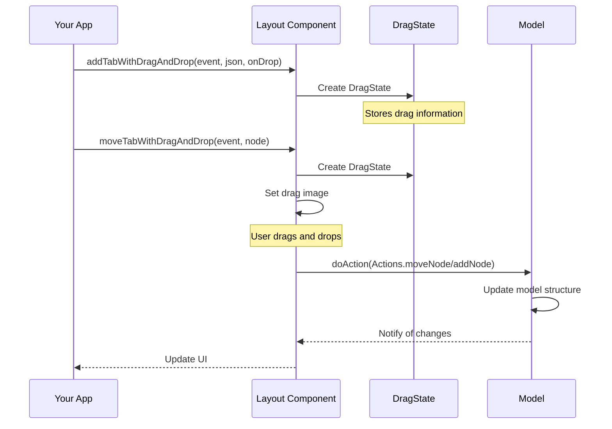
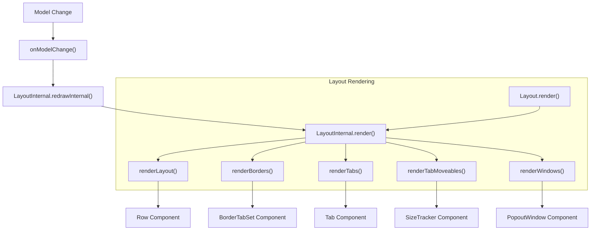
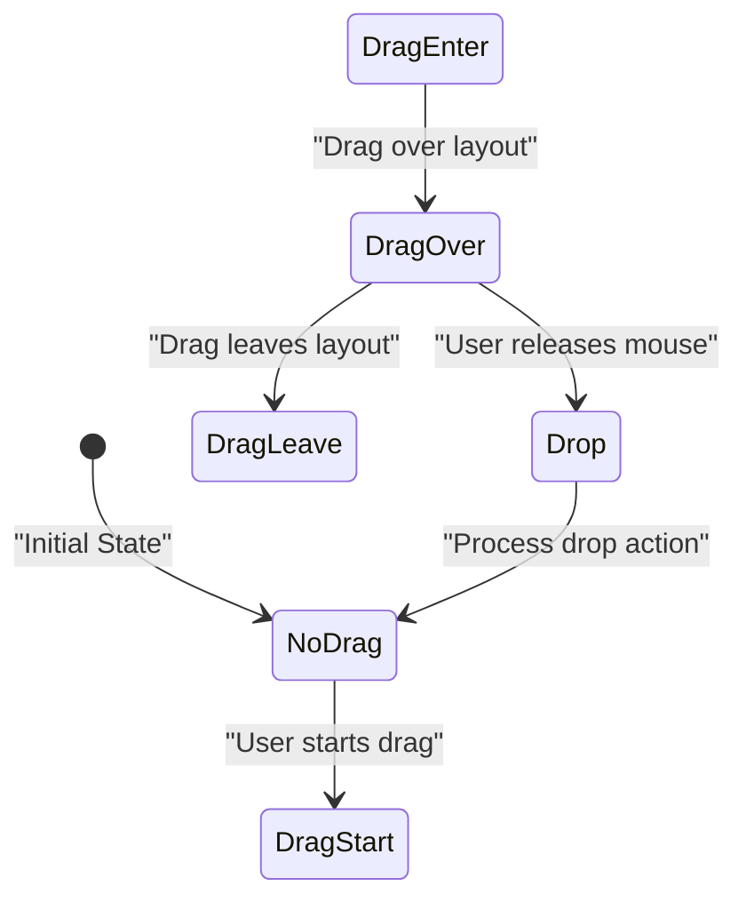
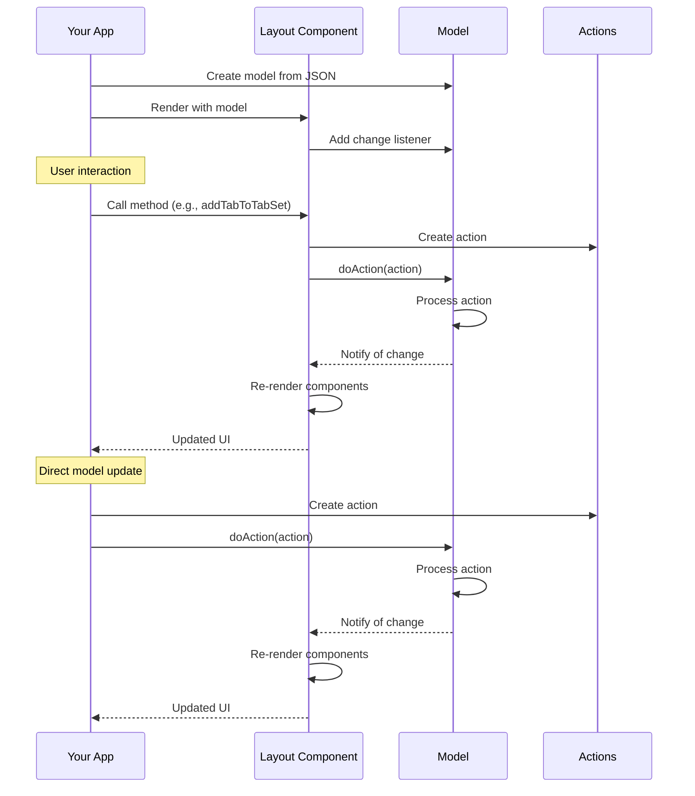

# Layout Component

> **Relevant source files**
> * [README.md](https://github.com/caplin/FlexLayout/blob/40753f37/README.md?plain=1)
> * [src/view/Layout.tsx](https://github.com/caplin/FlexLayout/blob/40753f37/src/view/Layout.tsx)

The Layout component is the main React component in FlexLayout that renders the entire tabbed interface. It serves as the bridge between your React application and the FlexLayout layout management system, handling the visualization of the layout model and all user interactions.

For information about the underlying data model, see [Data Model](/caplin/FlexLayout/4-data-model). For information about specific sub-components like TabSet and Tab, see [TabSet Component](/caplin/FlexLayout/3.2-tabset-component) and [Tab and Button Components](/caplin/FlexLayout/3.3-tab-and-button-components).

## Overview

The Layout component takes a model containing the layout structure and a factory function for rendering tab content. It manages the rendering of tabsets, tabs, borders, and splitters, as well as handling drag and drop operations, tab selection, and other user interactions.

```

```

Sources: [src/view/Layout.tsx L86-L166](https://github.com/caplin/FlexLayout/blob/40753f37/src/view/Layout.tsx#L86-L166)

 [README.md L76-L89](https://github.com/caplin/FlexLayout/blob/40753f37/README.md?plain=1#L76-L89)

## Component Architecture

The Layout component is composed of two main parts:

1. The public `Layout` class, which provides the API for the component
2. The internal `LayoutInternal` class, which handles the actual rendering and logic

This separation allows the public API to remain stable while the internal implementation can change as needed.



Sources: [src/view/Layout.tsx L87-L166](https://github.com/caplin/FlexLayout/blob/40753f37/src/view/Layout.tsx#L87-L166)

 [src/view/Layout.tsx L191-L1233](https://github.com/caplin/FlexLayout/blob/40753f37/src/view/Layout.tsx#L191-L1233)

## Required Properties

The Layout component requires two primary props:

| Property | Type | Description |
| --- | --- | --- |
| `model` | `Model` | The model object that defines the layout structure |
| `factory` | `(node: TabNode) => React.ReactNode` | A function that creates React components for tabs |

```javascript
// Example of the required props<Layout   model={model}   factory={(node) => {    const component = node.getComponent();    if (component === "placeholder") {      return <div>{node.getName()}</div>;    }  }} />
```

Sources: [src/view/Layout.tsx L33-L35](https://github.com/caplin/FlexLayout/blob/40753f37/src/view/Layout.tsx#L33-L35)

 [README.md L82-L85](https://github.com/caplin/FlexLayout/blob/40753f37/README.md?plain=1#L82-L85)

## Optional Properties

There are numerous optional properties to customize the Layout component's behavior:

| Property | Type | Description |
| --- | --- | --- |
| `popoutClassName` | `string` | Sets a top-level class name on popout windows |
| `icons` | `IIcons` | Customizes icons for close, maximize, etc. |
| `onAction` | `(action: Action) => Action \| undefined` | Intercepts actions before they are dispatched |
| `onRenderTab` | `(node: TabNode, renderValues: ITabRenderValues) => void` | Customizes tab rendering |
| `onRenderTabSet` | `(tabSetNode: TabSetNode \| BorderNode, renderValues: ITabSetRenderValues) => void` | Customizes tabset rendering |
| `onModelChange` | `(model: Model, action: Action) => void` | Called when model has changed |
| `onExternalDrag` | `(event: React.DragEvent<HTMLElement>) => undefined \| { json: any, onDrop?: (node?: Node, event?: React.DragEvent<HTMLElement>) => void }` | Handles external drag and drop |
| `classNameMapper` | `(defaultClassName: string) => string` | Maps default class names |
| `i18nMapper` | `(id: I18nLabel, param?: string) => string \| undefined` | Translates labels |
| `supportsPopout` | `boolean \| undefined` | Enables/disables popout windows |
| `popoutURL` | `string \| undefined` | URL for popout windows |
| `realtimeResize` | `boolean \| undefined` | Enables/disables realtime resizing |
| `onRenderDragRect` | `DragRectRenderCallback` | Customizes drag rectangles |
| `onContextMenu` | `NodeMouseEvent` | Handles context menus |
| `onAuxMouseClick` | `NodeMouseEvent` | Handles auxiliary mouse clicks |
| `onShowOverflowMenu` | `ShowOverflowMenuCallback` | Customizes overflow menu display |
| `onTabSetPlaceHolder` | `TabSetPlaceHolderCallback` | Customizes empty tabset placeholder |
| `popoutWindowName` | `string` | Sets the name for popout windows |

Sources: [src/view/Layout.tsx L37-L82](https://github.com/caplin/FlexLayout/blob/40753f37/src/view/Layout.tsx#L37-L82)

 [README.md L87](https://github.com/caplin/FlexLayout/blob/40753f37/README.md?plain=1#L87-L87)

## Key Methods

The Layout component provides several public methods for programmatically manipulating the layout:

### Adding Tabs



Sources: [src/view/Layout.tsx L111-L113](https://github.com/caplin/FlexLayout/blob/40753f37/src/view/Layout.tsx#L111-L113)

 [src/view/Layout.tsx L880-L887](https://github.com/caplin/FlexLayout/blob/40753f37/src/view/Layout.tsx#L880-L887)

### Tab Drag and Drop



Sources: [src/view/Layout.tsx L123-L135](https://github.com/caplin/FlexLayout/blob/40753f37/src/view/Layout.tsx#L123-L135)

 [src/view/Layout.tsx L973-L1226](https://github.com/caplin/FlexLayout/blob/40753f37/src/view/Layout.tsx#L973-L1226)

## Rendering Process

The Layout component follows a specific rendering process:

1. `Layout` component renders `LayoutInternal`
2. `LayoutInternal` renders the layout structure: * Root row from the model * Border tabsets (if any) * Tabs * Splitters
3. When the model changes, it triggers a re-render



Sources: [src/view/Layout.tsx L163-L166](https://github.com/caplin/FlexLayout/blob/40753f37/src/view/Layout.tsx#L163-L166)

 [src/view/Layout.tsx L342-L399](https://github.com/caplin/FlexLayout/blob/40753f37/src/view/Layout.tsx#L342-L399)

 [src/view/Layout.tsx L486-L493](https://github.com/caplin/FlexLayout/blob/40753f37/src/view/Layout.tsx#L486-L493)

## Customization

The Layout component offers several ways to customize its appearance and behavior:

### Tab Customization

The `onRenderTab` prop allows you to customize how tabs appear:

```javascript
onRenderTab={(node, renderValues) => {  // Add an icon to the leading part of the tab  renderValues.leading = ;    // Modify the content  renderValues.content += " *";    // Add a custom button  renderValues.buttons.push(    <button key="custom" onClick={() => console.log("Custom button clicked")}>      Custom    </button>  );}}
```

Sources: [src/view/Layout.tsx L44-L47](https://github.com/caplin/FlexLayout/blob/40753f37/src/view/Layout.tsx#L44-L47)

 [README.md L233-L255](https://github.com/caplin/FlexLayout/blob/40753f37/README.md?plain=1#L233-L255)

### TabSet Customization

The `onRenderTabSet` prop allows you to customize how tabsets appear:

```javascript
onRenderTabSet={(node, renderValues) => {  // Add a component at the start of the tabset  renderValues.leading = <div>Leading content</div>;    // Add buttons that stay visible even when tabs overflow  renderValues.stickyButtons.push(    <button key="add" onClick={() => addNewTab(node.getId())}>      Add Tab    </button>  );    // Add regular buttons that can be hidden in overflow  renderValues.buttons.push(    <button key="options" onClick={() => showOptions(node.getId())}>      Options    </button>  );}}
```

Sources: [src/view/Layout.tsx L48-L52](https://github.com/caplin/FlexLayout/blob/40753f37/src/view/Layout.tsx#L48-L52)

 [README.md L258-L294](https://github.com/caplin/FlexLayout/blob/40753f37/README.md?plain=1#L258-L294)

## Drag and Drop System

The Layout component implements a comprehensive drag and drop system for moving tabs and tabsets:



The drag and drop system enables:

* Moving tabs between tabsets
* Moving tabsets
* Adding new tabs via drag and drop
* Handling external drag sources

Sources: [src/view/Layout.tsx L971-L1226](https://github.com/caplin/FlexLayout/blob/40753f37/src/view/Layout.tsx#L971-L1226)

## Integration with Model

The Layout component works closely with the Model to maintain the layout state:



Sources: [src/view/Layout.tsx L732-L737](https://github.com/caplin/FlexLayout/blob/40753f37/src/view/Layout.tsx#L732-L737)

 [src/view/Layout.tsx L749-L758](https://github.com/caplin/FlexLayout/blob/40753f37/src/view/Layout.tsx#L749-L758)

## Usage Example

Here's a basic example of using the Layout component:

```javascript
import React from 'react';import { Layout, Model } from 'flexlayout-react';import 'flexlayout-react/style/light.css'; // Create a model from JSONconst json = {  global: {},  borders: [],  layout: {    type: "row",    weight: 100,    children: [      {        type: "tabset",        weight: 50,        children: [          {            type: "tab",            name: "Tab 1",            component: "component1",          }        ]      },      {        type: "tabset",        weight: 50,        children: [          {            type: "tab",            name: "Tab 2",            component: "component2",          }        ]      }    ]  }}; const model = Model.fromJson(json); function App() {  // Factory function to create components for tabs  const factory = (node) => {    const component = node.getComponent();        switch(component) {      case "component1":        return <div>Content for Tab 1</div>;      case "component2":        return <div>Content for Tab 2</div>;      default:        return <div>Unknown component</div>;    }  };    return (    <div style={{ width: '100%', height: '800px' }}>      <Layout         model={model}         factory={factory}        onRenderTab={(node, renderValues) => {          // Customize tab rendering if needed        }}      />    </div>  );} export default App;
```

Sources: [README.md L134-L152](https://github.com/caplin/FlexLayout/blob/40753f37/README.md?plain=1#L134-L152)

## Summary

The Layout component is the cornerstone of the FlexLayout library, serving as the interface between your React application and the layout management system. It handles:

1. Rendering the layout structure defined in the model
2. Managing user interactions like drag and drop
3. Providing customization options for tabs and tabsets
4. Facilitating programmatic manipulation of the layout

By understanding the Layout component's architecture and API, you can effectively implement complex tabbed interfaces in your React applications.

Sources: [src/view/Layout.tsx L86-L166](https://github.com/caplin/FlexLayout/blob/40753f37/src/view/Layout.tsx#L86-L166)

 [README.md L7-L20](https://github.com/caplin/FlexLayout/blob/40753f37/README.md?plain=1#L7-L20)