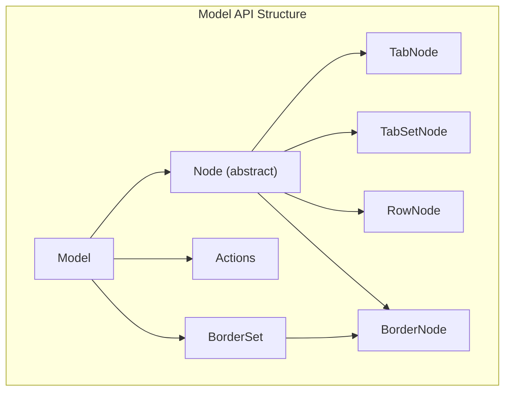
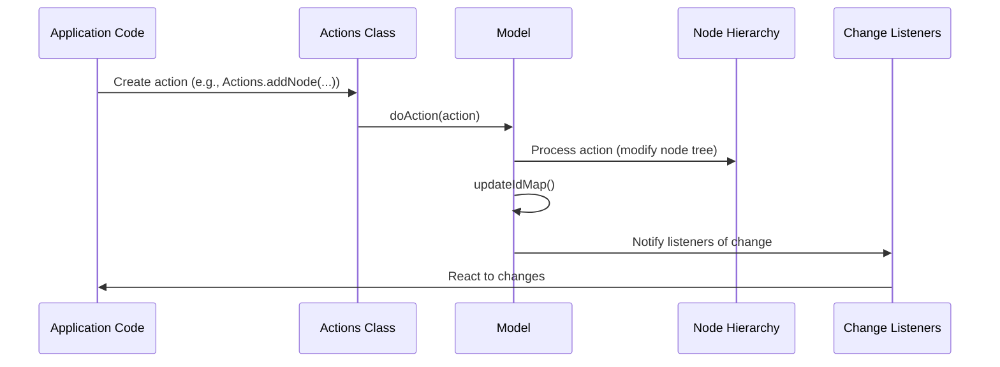
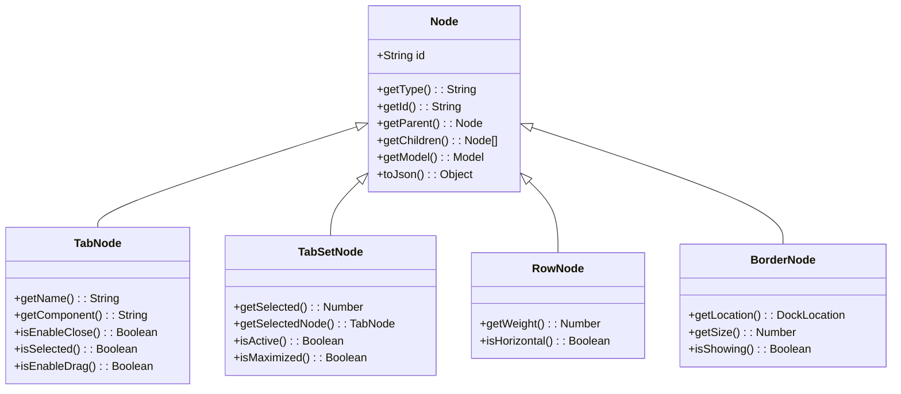
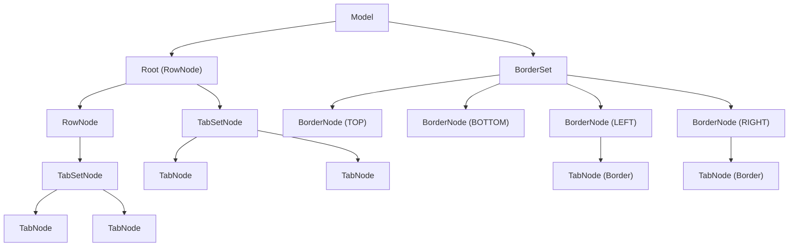

# Model API

> **Relevant source files**
> * [README.md](https://github.com/caplin/FlexLayout/blob/40753f37/README.md?plain=1)
> * [src/model/Actions.ts](https://github.com/caplin/FlexLayout/blob/40753f37/src/model/Actions.ts)
> * [src/model/BorderNode.ts](https://github.com/caplin/FlexLayout/blob/40753f37/src/model/BorderNode.ts)
> * [src/model/BorderSet.ts](https://github.com/caplin/FlexLayout/blob/40753f37/src/model/BorderSet.ts)
> * [src/model/IJsonModel.ts](https://github.com/caplin/FlexLayout/blob/40753f37/src/model/IJsonModel.ts)
> * [src/model/Model.ts](https://github.com/caplin/FlexLayout/blob/40753f37/src/model/Model.ts)
> * [src/model/Node.ts](https://github.com/caplin/FlexLayout/blob/40753f37/src/model/Node.ts)
> * [src/model/RowNode.ts](https://github.com/caplin/FlexLayout/blob/40753f37/src/model/RowNode.ts)
> * [src/model/TabNode.ts](https://github.com/caplin/FlexLayout/blob/40753f37/src/model/TabNode.ts)
> * [src/model/TabSetNode.ts](https://github.com/caplin/FlexLayout/blob/40753f37/src/model/TabSetNode.ts)
> * [src/model/Utils.ts](https://github.com/caplin/FlexLayout/blob/40753f37/src/model/Utils.ts)
> * [src/view/Tab.tsx](https://github.com/caplin/FlexLayout/blob/40753f37/src/view/Tab.tsx)

The Model API is the core data management system of FlexLayout, representing the complete layout structure and providing methods to manipulate it programmatically. This page documents the key classes, methods, and patterns for working with the FlexLayout model. For information on component properties and React integration, see [Component Props](/caplin/FlexLayout/7.1-component-props).

## Overview

The Model class contains the entire tree of nodes that make up a FlexLayout and serves as the central point for modifying the layout structure. All changes to the layout must go through the Model's action system to ensure consistency and proper event propagation.



Sources: [src/model/Model.ts L28-L703](https://github.com/caplin/FlexLayout/blob/40753f37/src/model/Model.ts#L28-L703)

 [src/model/Actions.ts L8-L188](https://github.com/caplin/FlexLayout/blob/40753f37/src/model/Actions.ts#L8-L188)

## Creating and Serializing Models

### Creating a Model

Models are created from JSON using the static `fromJson` method:

```javascript
// Create a model from JSONconst model = Model.fromJson(jsonModel);
```

The JSON structure must conform to the `IJsonModel` interface defined in [src/model/IJsonModel.ts L5-L967](https://github.com/caplin/FlexLayout/blob/40753f37/src/model/IJsonModel.ts#L5-L967)

Sources: [src/model/Model.ts L395-L418](https://github.com/caplin/FlexLayout/blob/40753f37/src/model/Model.ts#L395-L418)

### Serializing a Model

To save a model's state, use the `toJson` method:

```javascript
// Get JSON representation of modelconst json = model.toJson();
```

Sources: [src/model/Model.ts L424-L446](https://github.com/caplin/FlexLayout/blob/40753f37/src/model/Model.ts#L424-L446)

## Action System

The FlexLayout Model uses an action-based system for modifying the layout. All changes to the Model must be made through the `doAction` method, which processes an action and updates the model accordingly.

### Action Flow



Sources: [src/model/Model.ts L71-L301](https://github.com/caplin/FlexLayout/blob/40753f37/src/model/Model.ts#L71-L301)

 [src/model/Actions.ts L8-L188](https://github.com/caplin/FlexLayout/blob/40753f37/src/model/Actions.ts#L8-L188)

### Common Actions

| Action | Method | Description |
| --- | --- | --- |
| Add Node | `Actions.addNode(json, toNodeId, location, index, select)` | Adds a new tab to the layout |
| Move Node | `Actions.moveNode(fromNodeId, toNodeId, location, index, select)` | Moves a node to a new location |
| Delete Tab | `Actions.deleteTab(tabNodeId)` | Removes a tab from the layout |
| Rename Tab | `Actions.renameTab(tabNodeId, text)` | Changes a tab's title |
| Select Tab | `Actions.selectTab(tabNodeId)` | Selects a tab in its parent tabset |
| Maximize Toggle | `Actions.maximizeToggle(tabsetNodeId)` | Toggles maximization of a tabset |
| Update Node Attributes | `Actions.updateNodeAttributes(nodeId, attributes)` | Updates a node's attributes |

Sources: [src/model/Actions.ts L35-L150](https://github.com/caplin/FlexLayout/blob/40753f37/src/model/Actions.ts#L35-L150)

### Example Usage

```sql
// Add a new tabmodel.doAction(Actions.addNode(    {type: "tab", name: "New Tab", component: "myComponent"},     targetTabsetId,     DockLocation.CENTER,     -1)); // Select a tabmodel.doAction(Actions.selectTab(tabId)); // Update a tab's attributesmodel.doAction(Actions.updateNodeAttributes(    tabId,     {name: "Updated Name", icon: "myIcon"}));
```

Sources: [src/model/Model.ts L71-L301](https://github.com/caplin/FlexLayout/blob/40753f37/src/model/Model.ts#L71-L301)

 [src/model/Actions.ts L35-L150](https://github.com/caplin/FlexLayout/blob/40753f37/src/model/Actions.ts#L35-L150)

## Node Hierarchy

The FlexLayout Model uses a hierarchical structure of nodes to represent the layout. All nodes inherit from the base `Node` class.



Sources: [src/model/TabNode.ts L11-L424](https://github.com/caplin/FlexLayout/blob/40753f37/src/model/TabNode.ts#L11-L424)

 [src/model/Model.ts L28-L703](https://github.com/caplin/FlexLayout/blob/40753f37/src/model/Model.ts#L28-L703)

### Node Types

| Node Type | Description | Key Methods |
| --- | --- | --- |
| TabNode | Represents a content tab | `getName()`, `getComponent()`, `isSelected()` |
| TabSetNode | Container for tabs | `getSelected()`, `getSelectedNode()`, `isMaximized()` |
| RowNode | Horizontal/vertical container for TabSetNodes or other RowNodes | `getWeight()`, `isHorizontal()` |
| BorderNode | Tab containers at edge of layout | `getLocation()`, `isShowing()`, `getSize()` |

Sources: [src/model/TabNode.ts L11-L424](https://github.com/caplin/FlexLayout/blob/40753f37/src/model/TabNode.ts#L11-L424)

## Model Navigation Methods

The Model provides methods for traversing and querying the node hierarchy:

| Method | Description |
| --- | --- |
| `getNodeById(id)` | Retrieves a node by its ID |
| `getRoot(windowId)` | Gets the root RowNode of the model |
| `getBorderSet()` | Gets the BorderSet containing border nodes |
| `getActiveTabset(windowId)` | Gets the currently active tabset |
| `getMaximizedTabset(windowId)` | Gets the currently maximized tabset |
| `visitNodes(fn)` | Traverses all nodes in the model |
| `getFirstTabSet(node)` | Finds the first/top left tab set |

Sources: [src/model/Model.ts L308-L392](https://github.com/caplin/FlexLayout/blob/40753f37/src/model/Model.ts#L308-L392)

## Event Handling

The Model provides methods to listen for changes:

```javascript
// Add a listenermodel.addChangeListener((action) => {    console.log("Model changed:", action);}); // Remove a listenermodel.removeChangeListener(myListener);
```

Sources: [src/model/Model.ts L482-L491](https://github.com/caplin/FlexLayout/blob/40753f37/src/model/Model.ts#L482-L491)

## Configuration and Attributes

The Model and its nodes have numerous configurable attributes that control their behavior and appearance. These attributes can be set when creating the model or updated later using the appropriate action.

### Global Attributes

Global attributes affect the entire layout and are defined in the Model's `attributeDefinitions`. Examples include:

* `splitterSize`: Width of splitters between tabsets/borders
* `enableEdgeDock`: Enable docking to the edges of the layout
* `tabEnableClose`: Whether tabs can be closed by default
* `rootOrientationVertical`: Whether the root row is vertical

Sources: [src/model/Model.ts L625-L702](https://github.com/caplin/FlexLayout/blob/40753f37/src/model/Model.ts#L625-L702)

 [src/model/IJsonModel.ts L49-L495](https://github.com/caplin/FlexLayout/blob/40753f37/src/model/IJsonModel.ts#L49-L495)

### Node-Specific Attributes

Each node type (Tab, TabSet, Row, Border) has its own set of attributes. These can be viewed in [src/model/IJsonModel.ts L496-L967](https://github.com/caplin/FlexLayout/blob/40753f37/src/model/IJsonModel.ts#L496-L967)

 and include:

* For TabNode: `name`, `component`, `enableClose`, `enableDrag`, etc.
* For TabSetNode: `enableTabStrip`, `enableMaximize`, `tabLocation`, etc.
* For RowNode: `weight`
* For BorderNode: `size`, `enableAutoHide`, etc.

Sources: [src/model/TabNode.ts L338-L423](https://github.com/caplin/FlexLayout/blob/40753f37/src/model/TabNode.ts#L338-L423)

 [src/model/IJsonModel.ts L690-L874](https://github.com/caplin/FlexLayout/blob/40753f37/src/model/IJsonModel.ts#L690-L874)

## Updating the Model

### Example: Adding a Tab

```javascript
// Create the model from JSONconst model = Model.fromJson(initialLayoutJson); // Add a new tab to a tabsetmodel.doAction(Actions.addNode(    {        type: "tab",        name: "My New Tab",        component: "myComponentType",        config: { customData: "value" }    },    targetTabsetId,    // ID of the tabset to add to    DockLocation.CENTER, // Add to center    -1,                // Add at end    true               // Select the new tab));
```

Sources: [src/model/Model.ts L71-L83](https://github.com/caplin/FlexLayout/blob/40753f37/src/model/Model.ts#L71-L83)

 [src/model/Actions.ts L35-L43](https://github.com/caplin/FlexLayout/blob/40753f37/src/model/Actions.ts#L35-L43)

### Example: Updating Tab Properties

```sql
// Rename a tabmodel.doAction(Actions.renameTab(tabId, "New Name")); // Update tab attributesmodel.doAction(Actions.updateNodeAttributes(tabId, {    icon: "new-icon",    enableClose: false,    className: "custom-tab"}));
```

Sources: [src/model/Model.ts L285-L288](https://github.com/caplin/FlexLayout/blob/40753f37/src/model/Model.ts#L285-L288)

 [src/model/Actions.ts L88-L90](https://github.com/caplin/FlexLayout/blob/40753f37/src/model/Actions.ts#L88-L90)

 [src/model/Actions.ts L148-L150](https://github.com/caplin/FlexLayout/blob/40753f37/src/model/Actions.ts#L148-L150)

## Working with TabNodes

TabNodes represent the content panels in the layout. Key operations include:

```javascript
// Get a tab node by IDconst tabNode = model.getNodeById(tabId) as TabNode; // Access common propertiesconst name = tabNode.getName();const component = tabNode.getComponent();const isSelected = tabNode.isSelected();const config = tabNode.getConfig(); // Access extra data (not saved in JSON)const extraData = tabNode.getExtraData();
```

Sources: [src/model/TabNode.ts L54-L98](https://github.com/caplin/FlexLayout/blob/40753f37/src/model/TabNode.ts#L54-L98)

## Model Structure Visualization

The following diagram shows the typical structure of a FlexLayout model:



Sources: [src/model/Model.ts L357-L361](https://github.com/caplin/FlexLayout/blob/40753f37/src/model/Model.ts#L357-L361)

 [src/model/TabNode.ts L11-L424](https://github.com/caplin/FlexLayout/blob/40753f37/src/model/TabNode.ts#L11-L424)

## Advanced Usage

### Custom Drag and Drop Validation

```javascript
// Set function to allow/deny dropping a nodemodel.setOnAllowDrop((dragNode, dropInfo) => {    // Allow only certain nodes to be dropped in specific locations    if (dragNode.getType() === "tab" &&         (dragNode as TabNode).getComponent() === "restricted") {        return false; // Prevent drop    }    return true; // Allow drop});
```

Sources: [src/model/Model.ts L468-L470](https://github.com/caplin/FlexLayout/blob/40753f37/src/model/Model.ts#L468-L470)

### Custom TabSet Creation

```javascript
// Set callback for when a new TabSet is createdmodel.setOnCreateTabSet((tabNode) => {    // Return custom attributes for the new tabset    return {        className: "custom-tabset",        enableMaximize: false    };});
```

Sources: [src/model/Model.ts L478-L480](https://github.com/caplin/FlexLayout/blob/40753f37/src/model/Model.ts#L478-L480)

### Working with Windows

FlexLayout supports multiple windows (for popout functionality):

```javascript
// Get the root node of a specific windowconst windowRoot = model.getRoot(windowId); // Check if a tab is popped outconst isPoppedOut = tabNode.isPoppedOut(); // Visit nodes in a specific windowmodel.visitWindowNodes(windowId, (node, level) => {    console.log(`Node ${node.getId()} at level ${level}`);});
```

Sources: [src/model/Model.ts L328-L330](https://github.com/caplin/FlexLayout/blob/40753f37/src/model/Model.ts#L328-L330)

 [src/model/TabNode.ts L101-L103](https://github.com/caplin/FlexLayout/blob/40753f37/src/model/TabNode.ts#L101-L103)

 [src/model/Model.ts L363-L370](https://github.com/caplin/FlexLayout/blob/40753f37/src/model/Model.ts#L363-L370)

## Related Pages

* For information on React component props, see [Component Props](/caplin/FlexLayout/7.1-component-props)
* For comprehensive type definitions, see [Interfaces and Types](/caplin/FlexLayout/7.3-interfaces-and-types)
* For an overview of the node hierarchy, see [Node Hierarchy](/caplin/FlexLayout/4.2-node-hierarchy)
* For information on actions and state management, see [Actions and State Management](/caplin/FlexLayout/4.3-actions-and-state-management)