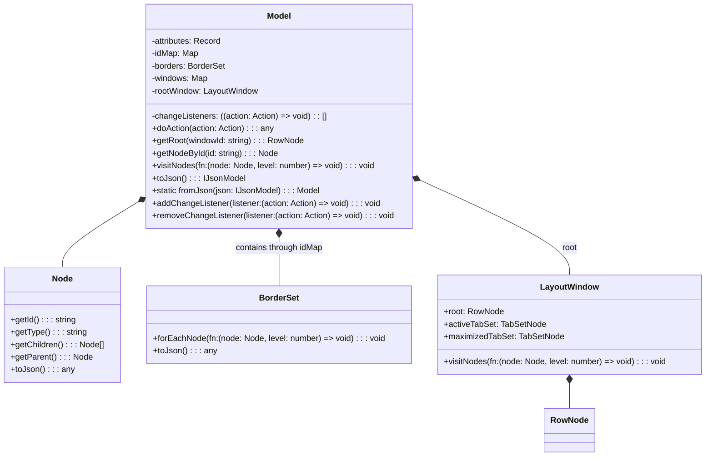
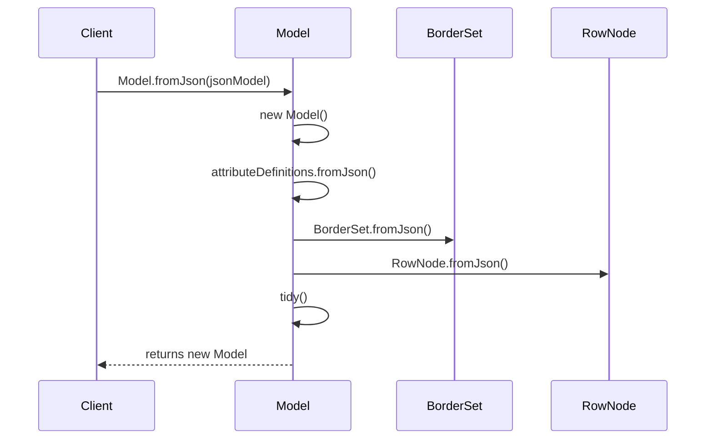
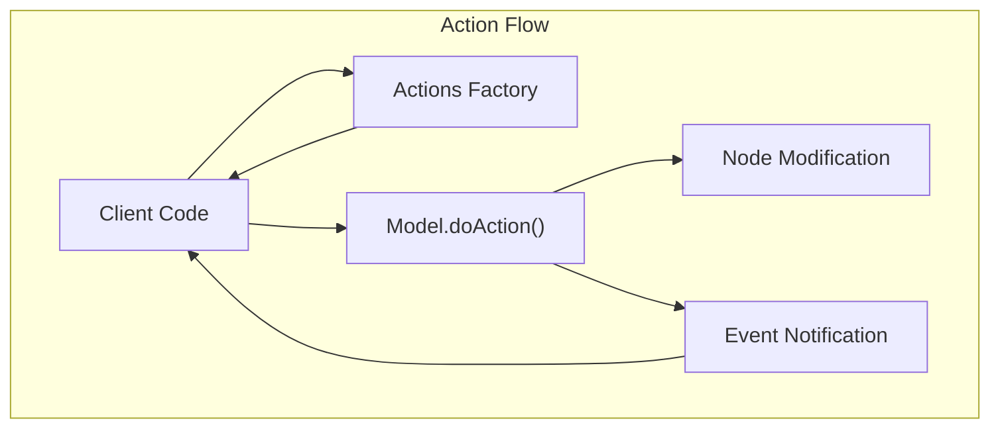
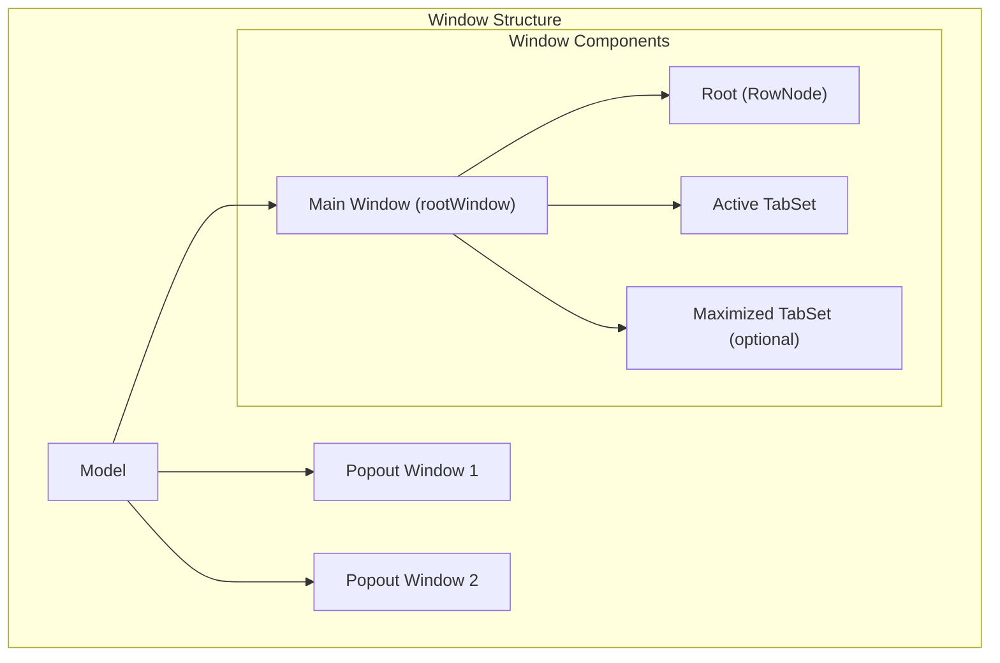
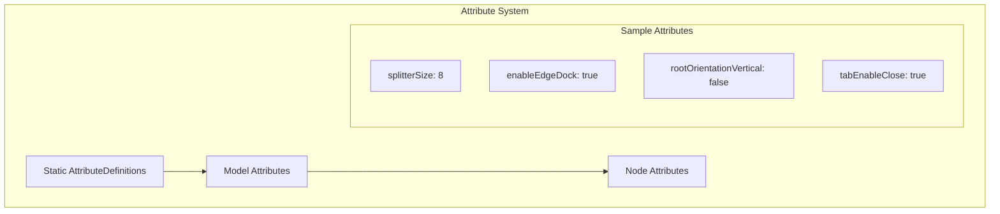
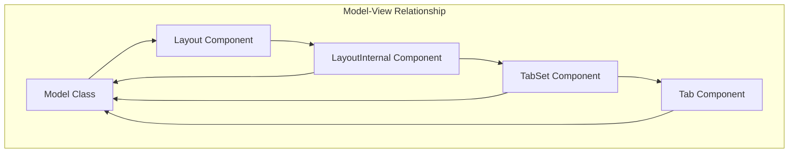

# Model Class

> **Relevant source files**
> * [README.md](https://github.com/caplin/FlexLayout/blob/40753f37/README.md?plain=1)
> * [src/model/BorderNode.ts](https://github.com/caplin/FlexLayout/blob/40753f37/src/model/BorderNode.ts)
> * [src/model/BorderSet.ts](https://github.com/caplin/FlexLayout/blob/40753f37/src/model/BorderSet.ts)
> * [src/model/IJsonModel.ts](https://github.com/caplin/FlexLayout/blob/40753f37/src/model/IJsonModel.ts)
> * [src/model/Model.ts](https://github.com/caplin/FlexLayout/blob/40753f37/src/model/Model.ts)
> * [src/model/Node.ts](https://github.com/caplin/FlexLayout/blob/40753f37/src/model/Node.ts)
> * [src/model/RowNode.ts](https://github.com/caplin/FlexLayout/blob/40753f37/src/model/RowNode.ts)
> * [src/model/TabNode.ts](https://github.com/caplin/FlexLayout/blob/40753f37/src/model/TabNode.ts)
> * [src/model/TabSetNode.ts](https://github.com/caplin/FlexLayout/blob/40753f37/src/model/TabSetNode.ts)
> * [src/view/Tab.tsx](https://github.com/caplin/FlexLayout/blob/40753f37/src/view/Tab.tsx)

The Model class is the core data structure in FlexLayout that represents and manages the entire layout hierarchy. It contains a tree of nodes (tabs, tabsets, rows, and borders) and handles all operations that modify the layout structure. This page documents the Model class, its properties, and methods.

For information about the different types of nodes that can exist in the model, see [Node Hierarchy](/caplin/FlexLayout/4.2-node-hierarchy). For details on how actions modify the model, see [Actions and State Management](/caplin/FlexLayout/4.3-actions-and-state-management).

## Overview

The Model class serves as the central data container for the FlexLayout system. It:

1. Maintains the hierarchy of layout nodes
2. Tracks relationships between nodes through an ID mapping system
3. Processes all layout modifications through an action system
4. Manages window/popout states
5. Provides serialization to/from JSON
6. Supports events for responding to layout changes



Sources: [src/model/Model.ts L28-L703](https://github.com/caplin/FlexLayout/blob/40753f37/src/model/Model.ts#L28-L703)

## Model Creation

Models can be created in two ways:

1. Creating a new model from JSON
2. Programmatically building a model

### Creating a Model from JSON

The most common way to create a Model is using the static `fromJson` method:



Sources: [src/model/Model.ts L400-L418](https://github.com/caplin/FlexLayout/blob/40753f37/src/model/Model.ts#L400-L418)

The JSON structure should conform to the `IJsonModel` interface:

```yaml
{
  global: { /* global attributes */ },
  borders: [ /* border definitions */ ],
  layout: { /* layout definition (root row) */ },
  popouts: { /* popout window definitions */ }
}
```

Sources: [src/model/IJsonModel.ts L5-L10](https://github.com/caplin/FlexLayout/blob/40753f37/src/model/IJsonModel.ts#L5-L10)

## Core Properties

The Model class maintains several important internal properties:

| Property | Type | Description |
| --- | --- | --- |
| `idMap` | `Map<string, Node>` | Maps node IDs to node objects for quick lookup |
| `borders` | `BorderSet` | Manages the border regions of the layout |
| `windows` | `Map<string, LayoutWindow>` | Contains all windows including the main window and any popouts |
| `rootWindow` | `LayoutWindow` | Reference to the main layout window |
| `attributes` | `Record<string, any>` | Global attributes that control layout behavior |
| `changeListeners` | `((action: Action) => void)[]` | Event handlers for model changes |

Sources: [src/model/Model.ts L35-L49](https://github.com/caplin/FlexLayout/blob/40753f37/src/model/Model.ts#L35-L49)

## Action System

All modifications to the model are performed through the `doAction` method, which takes an Action object that describes the change to be made. This ensures that all changes follow a consistent pattern and can be tracked.



Sources: [src/model/Model.ts L71-L301](https://github.com/caplin/FlexLayout/blob/40753f37/src/model/Model.ts#L71-L301)

The `doAction` method supports many action types, including:

| Action | Description |
| --- | --- |
| `ADD_NODE` | Adds a new tab to the layout |
| `MOVE_NODE` | Moves a node to a new location |
| `DELETE_TAB` | Removes a tab from the layout |
| `DELETE_TABSET` | Removes a tabset and its tabs |
| `RENAME_TAB` | Changes a tab's name |
| `SELECT_TAB` | Changes the selected tab |
| `MAXIMIZE_TOGGLE` | Toggles maximization of a tabset |
| `ADJUST_WEIGHTS` | Changes the sizes of rows/tabsets |
| `POPOUT_TAB` | Pops a tab out to a new window |
| `POPOUT_TABSET` | Pops a tabset out to a new window |

Sources: [src/model/Model.ts L74-L290](https://github.com/caplin/FlexLayout/blob/40753f37/src/model/Model.ts#L74-L290)

## Node Access and Traversal

The Model provides several methods to access and traverse nodes in the layout:

### Getting Nodes by ID

```javascript
// Get a specific node by its IDconst node = model.getNodeById("node-id");
```

Sources: [src/model/Model.ts L376-L378](https://github.com/caplin/FlexLayout/blob/40753f37/src/model/Model.ts#L376-L378)

### Traversing All Nodes

```javascript
// Visit all nodes in the modelmodel.visitNodes((node, level) => {    console.log(`Node ${node.getId()} at level ${level}`);});
```

Sources: [src/model/Model.ts L356-L361](https://github.com/caplin/FlexLayout/blob/40753f37/src/model/Model.ts#L356-L361)

### Getting Special Nodes

```javascript
// Get the root nodeconst root = model.getRoot(); // Get the active tabsetconst activeTabset = model.getActiveTabset(); // Get the maximized tabset (if any)const maximizedTabset = model.getMaximizedTabset(); // Get the border setconst borders = model.getBorderSet();
```

Sources: [src/model/Model.ts L328-L346](https://github.com/caplin/FlexLayout/blob/40753f37/src/model/Model.ts#L328-L346)

## Window Management

The Model supports multiple windows - a main window and optional popout windows. Each window has its own layout structure.



Sources: [src/model/Model.ts L46-L49](https://github.com/caplin/FlexLayout/blob/40753f37/src/model/Model.ts#L46-L49)

 [src/model/Model.ts L60-L62](https://github.com/caplin/FlexLayout/blob/40753f37/src/model/Model.ts#L60-L62)

Popout windows can be created and managed using these actions:

* `POPOUT_TAB`: Pops out a single tab to a new window
* `POPOUT_TABSET`: Pops out an entire tabset to a new window
* `CREATE_WINDOW`: Creates a new window with a specified layout
* `CLOSE_WINDOW`: Closes a popout window

Sources: [src/model/Model.ts L129-L205](https://github.com/caplin/FlexLayout/blob/40753f37/src/model/Model.ts#L129-L205)

## Serialization

The Model can be serialized to and from JSON, allowing layouts to be saved and restored:

### From JSON to Model

```javascript
// Create a model from JSONconst model = Model.fromJson({    global: { /* global attributes */ },    borders: [ /* border definitions */ ],    layout: { /* layout definition (root row) */ }});
```

Sources: [src/model/Model.ts L400-L418](https://github.com/caplin/FlexLayout/blob/40753f37/src/model/Model.ts#L400-L418)

### From Model to JSON

```javascript
// Convert model to JSONconst json = model.toJson();// Save JSON to storagelocalStorage.setItem("layout", JSON.stringify(json));
```

Sources: [src/model/Model.ts L424-L446](https://github.com/caplin/FlexLayout/blob/40753f37/src/model/Model.ts#L424-L446)

## Event System

The Model provides an event system to notify listeners when changes occur:

```javascript
// Add a change listenermodel.addChangeListener((action) => {    console.log("Model changed:", action);}); // Remove a change listenermodel.removeChangeListener(myListener);
```

Sources: [src/model/Model.ts L482-L491](https://github.com/caplin/FlexLayout/blob/40753f37/src/model/Model.ts#L482-L491)

Change listeners are called after any action is processed by the `doAction` method, with the action object passed as a parameter.

## Attribute System

The Model uses an attribute system to manage configurable properties. This provides default values and type safety.



Sources: [src/model/Model.ts L32](https://github.com/caplin/FlexLayout/blob/40753f37/src/model/Model.ts#L32-L32)

 [src/model/Model.ts L626-L702](https://github.com/caplin/FlexLayout/blob/40753f37/src/model/Model.ts#L626-L702)

Global attributes affect the entire layout and can be specified in the model JSON:

```javascript
const model = Model.fromJson({    global: {        splitterSize: 10,        tabEnableClose: false    },    // ...});
```

The model defines many attributes with sensible defaults. Some key attributes include:

| Attribute | Default | Description |
| --- | --- | --- |
| `enableEdgeDock` | `true` | Enables docking to layout edges |
| `rootOrientationVertical` | `false` | Whether the root row layouts vertically |
| `splitterSize` | `8` | Width in pixels of splitters |
| `tabEnableClose` | `true` | Whether tabs show close buttons |
| `tabSetEnableMaximize` | `true` | Whether tabsets can be maximized |
| `borderSize` | `200` | Size of border areas when selected |

Sources: [src/model/IJsonModel.ts L49-L495](https://github.com/caplin/FlexLayout/blob/40753f37/src/model/IJsonModel.ts#L49-L495)

## Common Usage Patterns

### Creating a New Model

```javascript
// Create a simple model with a single tabset and tabconst model = Model.fromJson({    global: {        splitterSize: 8    },    layout: {        type: "row",        children: [            {                type: "tabset",                children: [                    {                        type: "tab",                        name: "First Tab",                        component: "myComponent"                    }                ]            }        ]    }});
```

### Adding a Tab Programmatically

```javascript
// Get the first tabsetconst tabset = model.getRoot().getChildren()[0]; // Add a tab to itmodel.doAction(Actions.addNode(    {        type: "tab",        name: "New Tab",        component: "myComponent"    },    tabset.getId(),    DockLocation.CENTER,    -1,    true));
```

### Moving a Tab

```python
// Move a tab from one tabset to anothermodel.doAction(Actions.moveNode(    sourceTabId,    targetTabsetId,    DockLocation.CENTER,    -1,    true));
```

### Listening for Changes

```javascript
// Listen for changes to the modelmodel.addChangeListener((action) => {    // Save layout whenever it changes    localStorage.setItem("layout", JSON.stringify(model.toJson()));});
```

## Relationship with View Components

The Model class works in conjunction with the view components in React:



Sources: [src/view/Tab.tsx L1-L128](https://github.com/caplin/FlexLayout/blob/40753f37/src/view/Tab.tsx#L1-L128)

The React components observe the Model and re-render when it changes. User interactions with the components trigger actions that modify the model, completing the reactive cycle.