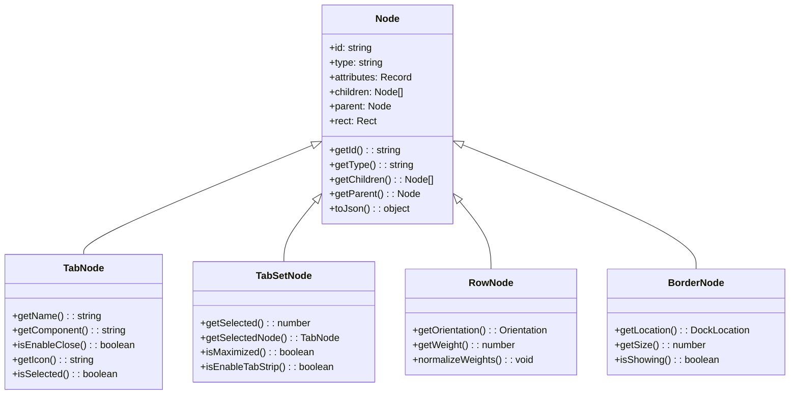
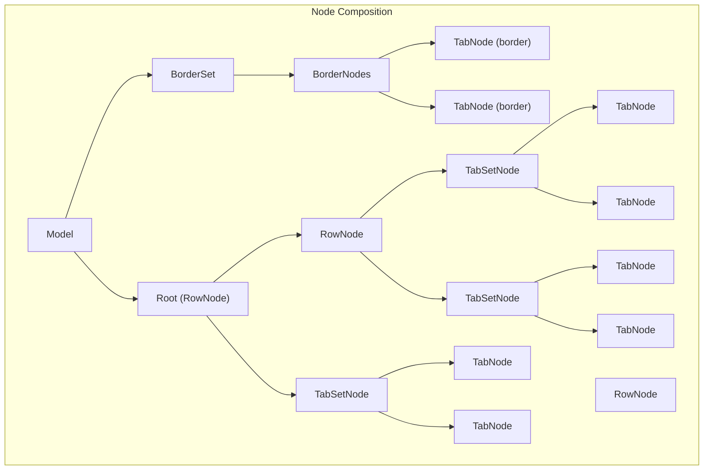
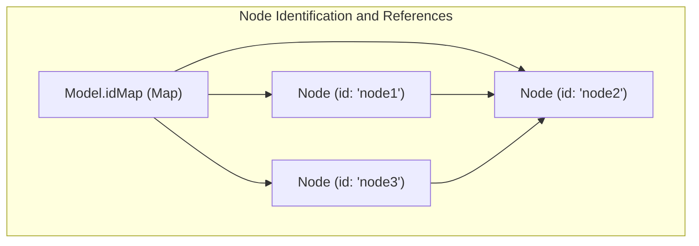
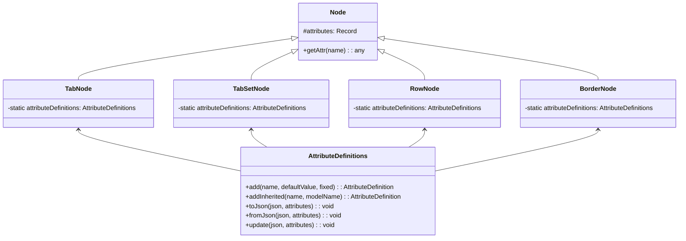
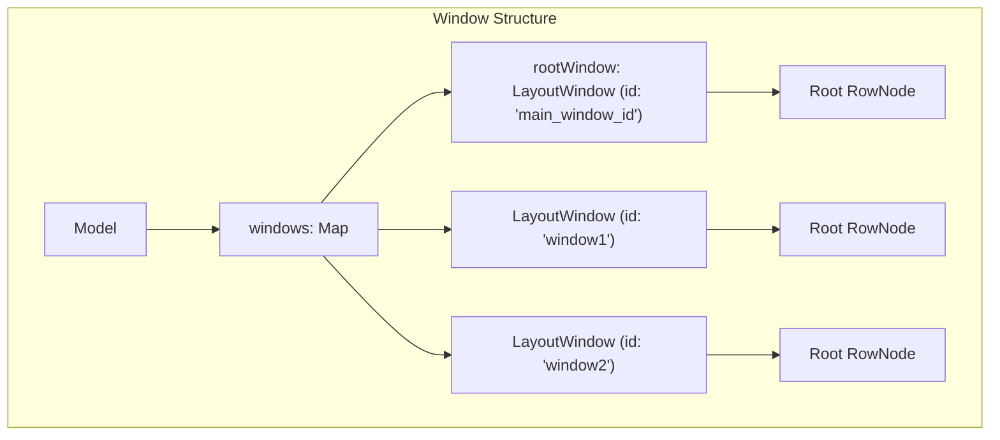
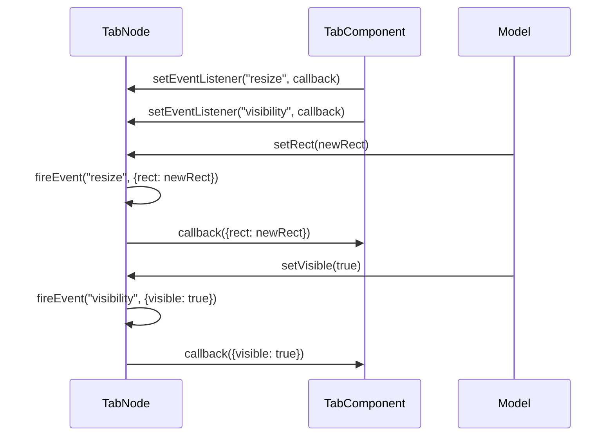

# Node Hierarchy

> **Relevant source files**
> * [src/model/BorderNode.ts](https://github.com/caplin/FlexLayout/blob/40753f37/src/model/BorderNode.ts)
> * [src/model/BorderSet.ts](https://github.com/caplin/FlexLayout/blob/40753f37/src/model/BorderSet.ts)
> * [src/model/IJsonModel.ts](https://github.com/caplin/FlexLayout/blob/40753f37/src/model/IJsonModel.ts)
> * [src/model/Model.ts](https://github.com/caplin/FlexLayout/blob/40753f37/src/model/Model.ts)
> * [src/model/Node.ts](https://github.com/caplin/FlexLayout/blob/40753f37/src/model/Node.ts)
> * [src/model/RowNode.ts](https://github.com/caplin/FlexLayout/blob/40753f37/src/model/RowNode.ts)
> * [src/model/TabNode.ts](https://github.com/caplin/FlexLayout/blob/40753f37/src/model/TabNode.ts)
> * [src/model/TabSetNode.ts](https://github.com/caplin/FlexLayout/blob/40753f37/src/model/TabSetNode.ts)
> * [src/view/Tab.tsx](https://github.com/caplin/FlexLayout/blob/40753f37/src/view/Tab.tsx)

## Purpose and Scope

This document details the hierarchical node system that forms the core structure of FlexLayout. Node hierarchy serves as the underlying model representation of the layout, where different types of nodes form a tree-like structure. Understanding this hierarchy is essential for working with FlexLayout's model programmatically or for extending its functionality.

For information about performing operations on this node structure, see [Actions and State Management](/caplin/FlexLayout/4.3-actions-and-state-management). For details about the top-level Model class that manages this node hierarchy, see [Model Class](/caplin/FlexLayout/4.1-model-class).

## Node Hierarchy Overview

FlexLayout organizes UI elements in a tree structure where different specialized node types handle specific parts of the layout. All nodes in the hierarchy inherit from the abstract `Node` base class.



Sources: [src/model/Node.ts](https://github.com/caplin/FlexLayout/blob/40753f37/src/model/Node.ts)

 [src/model/TabNode.ts](https://github.com/caplin/FlexLayout/blob/40753f37/src/model/TabNode.ts)

 [src/model/TabSetNode.ts](https://github.com/caplin/FlexLayout/blob/40753f37/src/model/TabSetNode.ts)

 [src/model/RowNode.ts](https://github.com/caplin/FlexLayout/blob/40753f37/src/model/RowNode.ts)

 [src/model/BorderNode.ts](https://github.com/caplin/FlexLayout/blob/40753f37/src/model/BorderNode.ts)

## Node Types

FlexLayout implements four primary node types, each responsible for a distinct part of the layout structure:

### TabNode

Represents an individual tab containing content. TabNode is a leaf node in the hierarchy.

Key characteristics:

* Contains reference to the actual content component
* Stores tab properties like name, icon, and close behavior
* Can be dragged between TabSetNodes or BorderNodes
* Maintains its own scroll position when moved

### TabSetNode

Contains and manages a collection of TabNodes. TabSetNode is typically a container for tabs.

Key characteristics:

* Maintains a selected tab index
* Can be maximized to fill the layout
* Can be configured to show/hide the tab strip
* Supports various tab operations (drag, drop, close)

### RowNode

A container node that arranges its children (TabSetNode or other RowNodes) either horizontally or vertically.

Key characteristics:

* Determines its orientation based on its level in the hierarchy
* Manages weight distribution among its children
* Handles splitting and resizing operations
* Implements drop zones for docking

### BorderNode

Represents a border area (top, bottom, left, right) of the layout, which can contain TabNodes.

Key characteristics:

* Has a fixed location (top, left, right, bottom)
* Can be shown/hidden
* Has a customizable size
* Can auto-hide when empty

Sources: [src/model/TabNode.ts](https://github.com/caplin/FlexLayout/blob/40753f37/src/model/TabNode.ts)

 [src/model/TabSetNode.ts](https://github.com/caplin/FlexLayout/blob/40753f37/src/model/TabSetNode.ts)

 [src/model/RowNode.ts](https://github.com/caplin/FlexLayout/blob/40753f37/src/model/RowNode.ts)

 [src/model/BorderNode.ts](https://github.com/caplin/FlexLayout/blob/40753f37/src/model/BorderNode.ts)

## Node Composition Structure

A typical layout in FlexLayout follows this structural composition:



Sources: [src/model/Model.ts L27-L63](https://github.com/caplin/FlexLayout/blob/40753f37/src/model/Model.ts#L27-L63)

 [src/model/Model.ts L395-L418](https://github.com/caplin/FlexLayout/blob/40753f37/src/model/Model.ts#L395-L418)

## Node Creation and JSON Representation

Nodes in FlexLayout are typically created from JSON configuration or through actions. Each node type has a static `fromJson` method that creates an instance from a JSON object.

### Node JSON Structure

Each node type has its own JSON structure:

#### TabNode JSON

```
{
  "type": "tab",
  "id": "tab1",
  "name": "Tab 1",
  "component": "myComponent",
  "config": { /* component-specific config */ },
  "enableClose": true
}
```

#### TabSetNode JSON

```
{
  "type": "tabset",
  "id": "tabset1",
  "weight": 100,
  "selected": 0,
  "children": [
    /* tab nodes */
  ]
}
```

#### RowNode JSON

```
{
  "type": "row",
  "id": "row1",
  "weight": 100,
  "children": [
    /* tabset or row nodes */
  ]
}
```

#### BorderNode JSON

```
{
  "type": "border",
  "location": "left",
  "size": 200,
  "children": [
    /* tab nodes */
  ]
}
```

Sources: [src/model/IJsonModel.ts](https://github.com/caplin/FlexLayout/blob/40753f37/src/model/IJsonModel.ts)

 [src/model/TabNode.ts L181-L185](https://github.com/caplin/FlexLayout/blob/40753f37/src/model/TabNode.ts#L181-L185)

 [src/model/TabSetNode.ts L226-L240](https://github.com/caplin/FlexLayout/blob/40753f37/src/model/TabSetNode.ts#L226-L240)

 [src/model/RowNode.ts L72-L82](https://github.com/caplin/FlexLayout/blob/40753f37/src/model/RowNode.ts#L72-L82)

 [src/model/BorderNode.ts L140-L146](https://github.com/caplin/FlexLayout/blob/40753f37/src/model/BorderNode.ts#L140-L146)

## Node References and Identifiers

Each node in FlexLayout has a unique identifier that can be used to reference it within the model:



Key points:

* Each node has a unique ID (auto-generated if not specified)
* The model maintains an `idMap` to quickly look up nodes by ID
* Nodes maintain parent-child relationships in both directions
* Node IDs are used in actions to target specific nodes

Sources: [src/model/Model.ts L37](https://github.com/caplin/FlexLayout/blob/40753f37/src/model/Model.ts#L37-L37)

 [src/model/Model.ts L376-L378](https://github.com/caplin/FlexLayout/blob/40753f37/src/model/Model.ts#L376-L378)

 [src/model/Model.ts L558-L565](https://github.com/caplin/FlexLayout/blob/40753f37/src/model/Model.ts#L558-L565)

## Node Attributes System

Each node type has a defined set of attributes managed through an AttributeDefinitions system:

* Attributes can be defined directly on the node or inherited from global settings
* Node types have their own specific attributes beyond the common ones
* Attributes control behavior like enabling/disabling drag, drop, close, etc.
* Attributes can be updated at runtime using the `updateNodeAttributes` action

Each node type defines its attributes with default values and inheritance rules:



Sources: [src/model/TabNode.ts L336-L423](https://github.com/caplin/FlexLayout/blob/40753f37/src/model/TabNode.ts#L336-L423)

 [src/model/TabSetNode.ts L512-L588](https://github.com/caplin/FlexLayout/blob/40753f37/src/model/TabSetNode.ts#L512-L588)

 [src/model/RowNode.ts L547-L558](https://github.com/caplin/FlexLayout/blob/40753f37/src/model/RowNode.ts#L547-L558)

 [src/model/BorderNode.ts L403-L445](https://github.com/caplin/FlexLayout/blob/40753f37/src/model/BorderNode.ts#L403-L445)

## Tree Traversal and Operations

FlexLayout provides several methods for traversing and manipulating the node hierarchy:

### Node Traversal

* `model.visitNodes(callback)`: Visits all nodes in the model
* `model.visitWindowNodes(windowId, callback)`: Visits nodes in a specific window
* `node.forEachNode(callback, level)`: Visits a node and all its descendants

### Finding Nodes

* `model.getNodeById(id)`: Retrieves a node by its ID
* `model.getFirstTabSet()`: Gets the first tab set in the model
* `model.findDropTargetNode(windowId, dragNode, x, y)`: Finds a drop target at position

### Tree Manipulation

* `node.addChild(childNode, pos?)`: Adds a child to a node
* `node.removeChild(childNode)`: Removes a child from a node
* `node.delete()`: Deletes a node from the tree

Sources: [src/model/Model.ts L356-L370](https://github.com/caplin/FlexLayout/blob/40753f37/src/model/Model.ts#L356-L370)

 [src/model/Node.ts L120-L127](https://github.com/caplin/FlexLayout/blob/40753f37/src/model/Node.ts#L120-L127)

 [src/model/Node.ts L228-L251](https://github.com/caplin/FlexLayout/blob/40753f37/src/model/Node.ts#L228-L251)

## Window Support and Multi-Window Layout

FlexLayout supports multiple windows with separate layout hierarchies:

* The main window has ID `Model.MAIN_WINDOW_ID`
* Each window has its own root RowNode
* Nodes can be moved between windows using actions
* Windows track their active and maximized TabSetNodes



Sources: [src/model/Model.ts L29-L49](https://github.com/caplin/FlexLayout/blob/40753f37/src/model/Model.ts#L29-L49)

 [src/model/Model.ts L415-L417](https://github.com/caplin/FlexLayout/blob/40753f37/src/model/Model.ts#L415-L417)

 [src/model/Model.ts L328-L330](https://github.com/caplin/FlexLayout/blob/40753f37/src/model/Model.ts#L328-L330)

## Node Event System

Nodes in FlexLayout have an event system that allows components to respond to node changes:

* Events include: resize, visibility, maximize, close
* Event listeners can be attached to any node
* Components use these events to update their state and behavior



Sources: [src/model/Node.ts L81-L87](https://github.com/caplin/FlexLayout/blob/40753f37/src/model/Node.ts#L81-L87)

 [src/model/Node.ts L97-L102](https://github.com/caplin/FlexLayout/blob/40753f37/src/model/Node.ts#L97-L102)

 [src/view/Tab.tsx L26-L48](https://github.com/caplin/FlexLayout/blob/40753f37/src/view/Tab.tsx#L26-L48)

## Summary

The node hierarchy in FlexLayout provides a flexible, extensible foundation for complex layouts:

1. **Base Structure**: Abstract `Node` class defines core functionality
2. **Specialized Nodes**: `TabNode`, `TabSetNode`, `RowNode`, and `BorderNode` handle specific layout aspects
3. **Tree Management**: Parent-child relationships form a tree structure
4. **Attributes System**: Each node type has configurable attributes
5. **JSON Serialization**: Layouts can be saved and loaded from JSON
6. **Event Handling**: Nodes emit events for UI components to respond to
7. **Multi-Window Support**: Layouts can span multiple windows with separate hierarchies

This node hierarchy allows FlexLayout to represent complex, interactive layouts that can be manipulated programmatically or through user interactions.