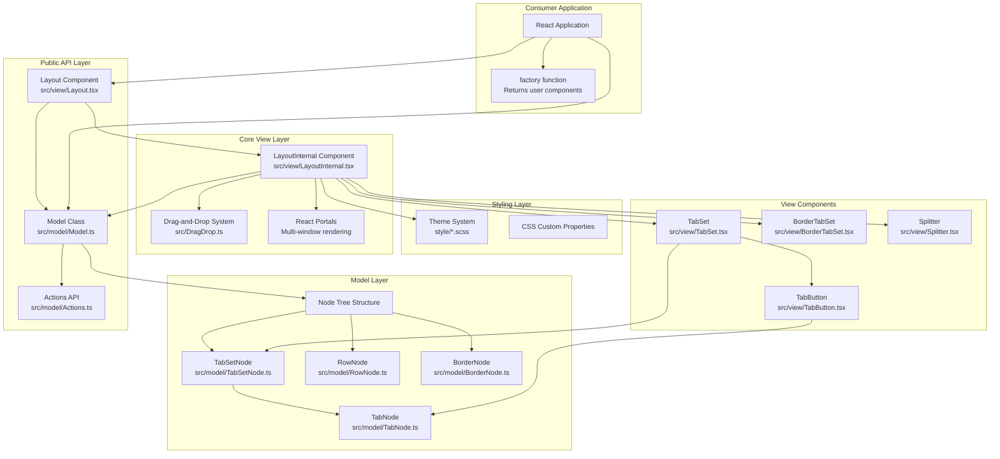
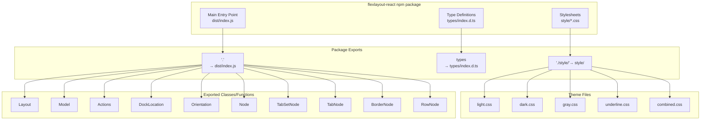
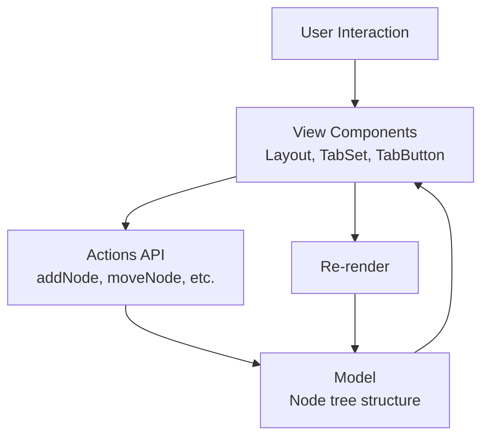

# Overview

> **Relevant source files**
> * [README.md](https://github.com/caplin/FlexLayout/blob/40753f37/README.md?plain=1)
> * [package.json](https://github.com/caplin/FlexLayout/blob/40753f37/package.json)

This document provides a high-level introduction to FlexLayout, explaining what it is, its purpose as a React layout manager, and its key architectural components. This overview is intended to orient new users and developers to the system before diving into specific subsystems.

For installation instructions and a quick start guide, see [Getting Started](/caplin/FlexLayout/1.1-getting-started). For detailed architectural explanations, see [Architecture](/caplin/FlexLayout/2-architecture). For information about the Model-View-Actions pattern, see [Architecture](/caplin/FlexLayout/2-architecture) and [Actions and State Management](/caplin/FlexLayout/4.3-actions-and-state-management).

## What is FlexLayout

FlexLayout is a multi-tab docking layout manager for React applications. It arranges React components into a flexible grid of tabsets where tabs can be resized, moved, dragged between tabsets, docked to different locations, and even popped out into separate browser windows. The library provides a complete solution for building customizable, IDE-like layouts with minimal dependencies.

The library is distributed as the `flexlayout-react` npm package and has a single peer dependency on React (versions 18.0.0+ or 19.0.0+).

**Sources:** [README.md L1-L19](https://github.com/caplin/FlexLayout/blob/40753f37/README.md?plain=1#L1-L19)

 [package.json L1-L14](https://github.com/caplin/FlexLayout/blob/40753f37/package.json#L1-L14)

 [package.json L63-L66](https://github.com/caplin/FlexLayout/blob/40753f37/package.json#L63-L66)

## Key Features

FlexLayout provides a comprehensive set of layout management capabilities:

| Feature Category | Capabilities |
| --- | --- |
| **Layout Structure** | Hierarchical rows and columns with splitters for resizing |
| **Tab Management** | Scrolling or wrapped tabs, tab dragging and ordering, tab renaming (double-click) |
| **Drag and Drop** | Tab dragging, tabset dragging (move all tabs together), dock to tabset or frame edges |
| **Border Areas** | Four border regions (top, bottom, left, right) for tool panels |
| **Multi-Window** | Popout tabs into separate browser windows for multi-monitor setups |
| **Maximization** | Maximize tabsets (double-click header or icon) |
| **Tab Overflow** | Automatic overflow menu, scroll tabs using mouse wheel |
| **Customization** | Tab and tabset attributes (enableTabStrip, enableDock, enableDrop, etc.) |
| **Rendering** | Customizable tab and tabset rendering, factory function for tab content |
| **State Management** | Component state preserved when tabs are moved |
| **Theming** | Built-in themes: light, dark, gray, underline, rounded, combined |
| **Submodels** | Layouts inside layouts for nested hierarchies |
| **Mobile Support** | Works on iPad and Android devices |
| **Type Safety** | TypeScript type declarations included |

**Sources:** [README.md L21-L40](https://github.com/caplin/FlexLayout/blob/40753f37/README.md?plain=1#L21-L40)

## High-Level Architecture

FlexLayout is structured in distinct layers, each with clearly defined responsibilities:



**Architecture Overview: Main System Layers and Components**

This diagram shows how FlexLayout is organized into distinct layers:

* **Public API Layer**: Consumer applications interact only with `Layout`, `Model`, and `Actions`
* **Core View Layer**: `LayoutInternal` orchestrates rendering, drag-and-drop, and multi-window support
* **View Components**: Specialized React components for different layout elements
* **Model Layer**: Tree structure representing the layout hierarchy
* **Styling Layer**: Theme system with CSS custom properties

**Sources:** [README.md L74-L155](https://github.com/caplin/FlexLayout/blob/40753f37/README.md?plain=1#L74-L155)

 [package.json L12-L20](https://github.com/caplin/FlexLayout/blob/40753f37/package.json#L12-L20)

## Package Structure

The FlexLayout npm package (`flexlayout-react`) is organized into three main distribution directories:



**Package Distribution Structure**

The package is structured as an ES module with three main export paths:

1. **Main Module** (`dist/index.js`): Contains all React components and model classes
2. **Type Definitions** (`types/index.d.ts`): TypeScript declarations for type safety
3. **Stylesheets** (`style/*.css`): Pre-compiled theme CSS files

**Sources:** [package.json L12-L26](https://github.com/caplin/FlexLayout/blob/40753f37/package.json#L12-L26)

 [README.md L42-L69](https://github.com/caplin/FlexLayout/blob/40753f37/README.md?plain=1#L42-L69)

## Core Concepts

FlexLayout implements a unidirectional data flow architecture based on three core concepts:

### Model-View-Actions Pattern



**Data Flow Pattern**

| Component | Responsibility |
| --- | --- |
| **Model** | Maintains the tree structure of nodes (rows, tabsets, tabs, borders). Created via `Model.fromJson()` and serialized via `model.toJson()`. |
| **View** | React components that render the layout by reading the Model. Main entry point is the `<Layout>` component. |
| **Actions** | Immutable action objects that describe state changes. Created via `Actions.addNode()`, `Actions.moveNode()`, etc., and applied via `model.doAction()`. |
| **Factory** | User-provided function that maps a tab's component name to a React component. Called during rendering. |

**Sources:** [README.md L74-L155](https://github.com/caplin/FlexLayout/blob/40753f37/README.md?plain=1#L74-L155)

 [README.md L297-L333](https://github.com/caplin/FlexLayout/blob/40753f37/README.md?plain=1#L297-L333)

## Basic Usage Pattern

The typical FlexLayout usage follows this pattern:

```mermaid
sequenceDiagram
  participant Application Code
  participant Model.fromJson()
  participant <Layout>
  participant factory(node)
  participant User Component

  Application Code->>Model.fromJson(): "Create model from JSON config"
  Model.fromJson()-->>Application Code: "model instance"
  Application Code->><Layout>: "<Layout model={model} factory={factory}/>"
  <Layout>->>Model.fromJson(): "Read node tree"
  Model.fromJson()-->><Layout>: "TabNode with component='grid'"
  <Layout>->>factory(node): "Call factory(tabNode)"
  factory(node)->>User Component: "Return <GridComponent/>"
  User Component-->>factory(node): "React element"
  factory(node)-->><Layout>: "React element"
  <Layout>->>User Component: "Render in tab"
```

**Typical Usage Flow**

The minimal usage of FlexLayout involves:

1. **Define Layout JSON**: Structure with `global`, `layout`, and optionally `borders` properties
2. **Create Model**: `const model = Model.fromJson(json)`
3. **Define Factory**: Function that maps component names to React elements
4. **Render Layout**: `<Layout model={model} factory={factory} />`

**Example JSON Structure:**

```json
{  "global": {},  "borders": [],  "layout": {    "type": "row",    "children": [      {        "type": "tabset",        "children": [          {            "type": "tab",            "name": "Panel 1",            "component": "grid"          }        ]      }    ]  }}
```

**Sources:** [README.md L89-L155](https://github.com/caplin/FlexLayout/blob/40753f37/README.md?plain=1#L89-L155)

## Node Type Hierarchy

The Model maintains a tree of nodes, where each node type has a specific role:

| Node Type | Purpose | File Path | Can Contain |
| --- | --- | --- | --- |
| **RowNode** | Container for horizontal or vertical layout | `src/model/RowNode.ts` | TabSetNode, RowNode (nested) |
| **TabSetNode** | Container for tabs with header bar | `src/model/TabSetNode.ts` | TabNode |
| **TabNode** | Individual tab with content | `src/model/TabNode.ts` | None (leaf node) |
| **BorderNode** | Edge-docked tabset | `src/model/BorderNode.ts` | TabNode |

The root of the tree is always a RowNode, and the structure alternates between rows (containers) and tabsets (tab groups). The top-level row renders horizontally by default, with each nested row alternating orientation.

**Sources:** [README.md L166-L195](https://github.com/caplin/FlexLayout/blob/40753f37/README.md?plain=1#L166-L195)

## Related Pages

For more detailed information about specific aspects of FlexLayout:

* Installation and quick start: [Getting Started](/caplin/FlexLayout/1.1-getting-started)
* Detailed architecture explanation: [Architecture](/caplin/FlexLayout/2-architecture)
* Component documentation: [Core Components](/caplin/FlexLayout/3-core-components)
* Model and state management: [Data Model](/caplin/FlexLayout/4-data-model)
* Styling and customization: [Styling and Theming](/caplin/FlexLayout/5-styling-and-theming)
* Advanced features: [Advanced Features](/caplin/FlexLayout/6-advanced-features)
* Complete API reference: [API Reference](/caplin/FlexLayout/7-api-reference)

**Sources:** [README.md L1-L498](https://github.com/caplin/FlexLayout/blob/40753f37/README.md?plain=1#L1-L498)

 [package.json L1-L101](https://github.com/caplin/FlexLayout/blob/40753f37/package.json#L1-L101)