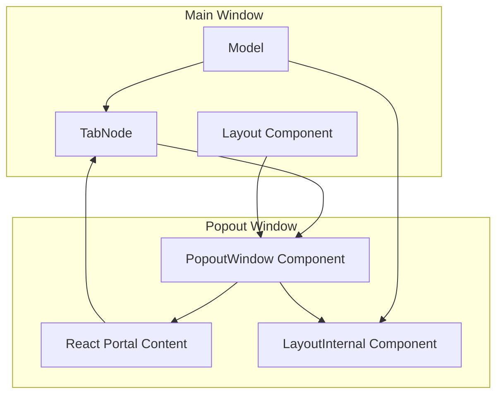
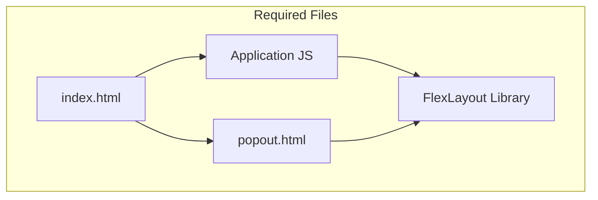
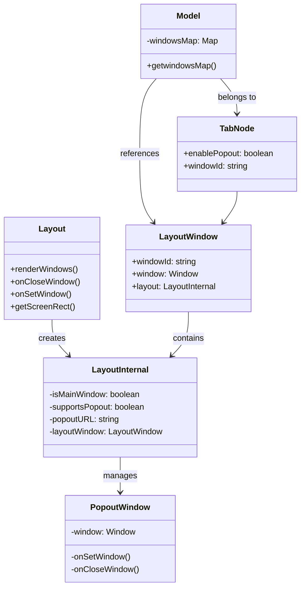
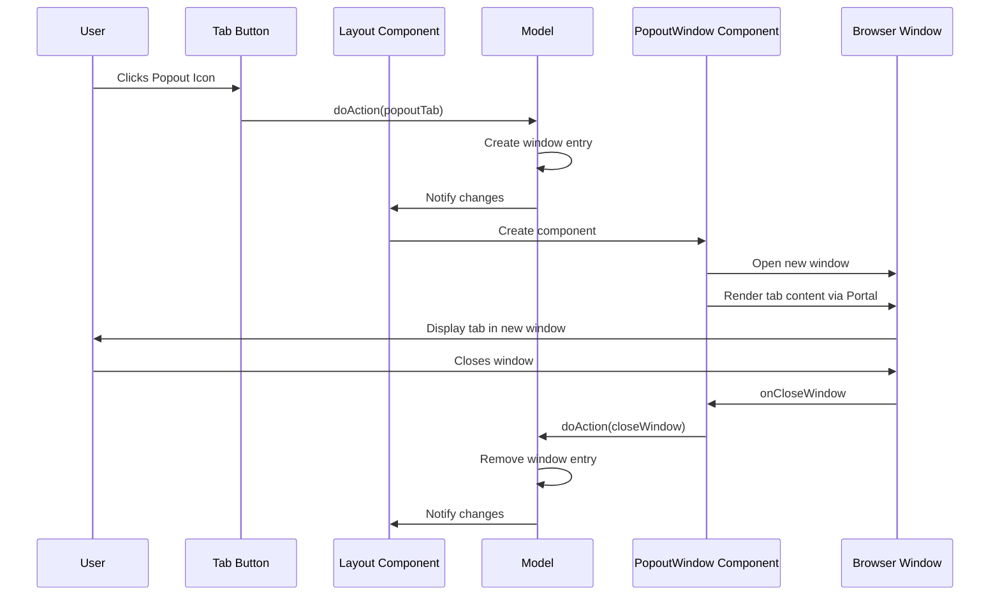

# Popout Windows

> **Relevant source files**
> * [README.md](https://github.com/caplin/FlexLayout/blob/40753f37/README.md?plain=1)
> * [src/model/BorderNode.ts](https://github.com/caplin/FlexLayout/blob/40753f37/src/model/BorderNode.ts)
> * [src/model/BorderSet.ts](https://github.com/caplin/FlexLayout/blob/40753f37/src/model/BorderSet.ts)
> * [src/model/IJsonModel.ts](https://github.com/caplin/FlexLayout/blob/40753f37/src/model/IJsonModel.ts)
> * [src/model/Model.ts](https://github.com/caplin/FlexLayout/blob/40753f37/src/model/Model.ts)
> * [src/model/Node.ts](https://github.com/caplin/FlexLayout/blob/40753f37/src/model/Node.ts)
> * [src/model/RowNode.ts](https://github.com/caplin/FlexLayout/blob/40753f37/src/model/RowNode.ts)
> * [src/model/TabNode.ts](https://github.com/caplin/FlexLayout/blob/40753f37/src/model/TabNode.ts)
> * [src/model/TabSetNode.ts](https://github.com/caplin/FlexLayout/blob/40753f37/src/model/TabSetNode.ts)
> * [src/view/Layout.tsx](https://github.com/caplin/FlexLayout/blob/40753f37/src/view/Layout.tsx)
> * [src/view/Tab.tsx](https://github.com/caplin/FlexLayout/blob/40753f37/src/view/Tab.tsx)

FlexLayout's popout windows feature allows tabs to be rendered into external browser windows, which is particularly useful for multi-monitor setups. This document explains how to configure, use, and understand the limitations of the popout windows functionality in FlexLayout.

For information about the overall drag and drop system, see [Drag and Drop](/caplin/FlexLayout/6.1-drag-and-drop). For information about the docking system, see [Docking System](/caplin/FlexLayout/6.2-docking-system).

## Overview

The popout windows feature enables users to detach tabs from the main layout into separate browser windows. This is accomplished using React Portals to render tab content in external windows, while maintaining the connection to the main application's state and model.



Sources: [src/view/Layout.tsx L530-L558](https://github.com/caplin/FlexLayout/blob/40753f37/src/view/Layout.tsx#L530-L558)

 [README.md L417-L462](https://github.com/caplin/FlexLayout/blob/40753f37/README.md?plain=1#L417-L462)

## Enabling Popout Windows

To enable popout windows for tabs, you need to:

1. Configure the tab with the `enablePopout` attribute
2. Provide a popout.html file at the same location as your main page

When enabled, a popout icon will appear in the tab header allowing users to pop out the tab into an external window.

### Required Files

The popout.html file serves as the host page for popped-out tabs. The styles from the main page will be automatically copied into it at runtime.

You can copy the popout.html from the demo app as a starting point.



Sources: [README.md L424-L427](https://github.com/caplin/FlexLayout/blob/40753f37/README.md?plain=1#L424-L427)

## Implementation Architecture

FlexLayout's popout window system uses React Portals to render content in separate browser windows while maintaining the component state and model consistency.

### Component Hierarchy



Sources: [src/view/Layout.tsx L22-L23](https://github.com/caplin/FlexLayout/blob/40753f37/src/view/Layout.tsx#L22-L23)

 [src/view/Layout.tsx L530-L558](https://github.com/caplin/FlexLayout/blob/40753f37/src/view/Layout.tsx#L530-L558)

 [src/view/Layout.tsx L238-L254](https://github.com/caplin/FlexLayout/blob/40753f37/src/view/Layout.tsx#L238-L254)

### Window Management

FlexLayout maintains a map of windows through the Model class. Each window has a unique ID, with `MAIN_WINDOW_ID` representing the main application window. When a tab is popped out:

1. A new entry is added to the window map
2. A PopoutWindow component is created
3. The tab's `windowId` property is updated to reference the new window
4. Content is rendered using React Portals in the new window
5. Style information is copied from the main window to ensure consistent appearance

Sources: [src/view/Layout.tsx L238-L254](https://github.com/caplin/FlexLayout/blob/40753f37/src/view/Layout.tsx#L238-L254)

 [src/view/Layout.tsx L284-L298](https://github.com/caplin/FlexLayout/blob/40753f37/src/view/Layout.tsx#L284-L298)

## Configuration Options

FlexLayout provides several props for configuring popout window behavior:

| Prop | Type | Default | Description |
| --- | --- | --- | --- |
| `supportsPopout` | boolean | Based on user agent check | Whether popout windows are supported |
| `popoutURL` | string | "popout.html" | URL of the popout window relative to origin |
| `popoutClassName` | string | undefined | Sets a top-level class name on popout windows |
| `popoutWindowName` | string | "Popout Window" | Name given to popout windows |

Example configuration:

```
<Layout   model={model}  factory={factory}  supportsPopout={true}  popoutURL="customPopout.html"  popoutClassName="my-popout-window"  popoutWindowName="Application Window"/>
```

Sources: [src/view/Layout.tsx L37-L81](https://github.com/caplin/FlexLayout/blob/40753f37/src/view/Layout.tsx#L37-L81)

 [src/view/Layout.tsx L232-L240](https://github.com/caplin/FlexLayout/blob/40753f37/src/view/Layout.tsx#L232-L240)

## Working with Popout Windows

When working with popout windows, there are important considerations for accessing the correct document and window objects.

### Accessing the Popout Document

When a component is rendered in a popout window, it needs to use the document and window objects from the popout rather than the main window:

```javascript
// Example of accessing the correct document/window in a popped-out componentconst currentDocument = selfRef.current.ownerDocument;const currentWindow = currentDocument.defaultView; // Use these for event listeners instead of the global document/windowcurrentDocument.addEventListener("click", handleClick);
```

For third-party libraries that support specifying a document, provide the popout document:

```javascript
// Example with a library that accepts a document parameterthirdPartyLibrary.initialize({  getDocument: () => selfRef.current.ownerDocument});
```

Sources: [README.md L428-L442](https://github.com/caplin/FlexLayout/blob/40753f37/README.md?plain=1#L428-L442)

## Limitations

The popout windows implementation has several important limitations to be aware of:

### Technical Limitations

1. **React Portals Architecture**: All code runs in the main window's JS context; popout windows are essentially just rendering surfaces
2. **Event Listeners**: Must use popout window/document objects for event listeners
3. **Timer Throttling**: Timers may be throttled when the main window is in the background
4. **Third-party Controls**: Many third-party components use the global document for event listeners and may not work correctly
5. **Resize Handling**: Resize observers may be throttled or remain attached to the main window
6. **Browser Zoom**: Popouts will not size and position correctly when the browser is zoomed
7. **Window States**: Popouts cannot reload in maximized or minimized states

### Component State Handling

By default, FlexLayout maintains React state when moving tabs between windows. You can use the `enableWindowReMount` tab attribute to force components to re-mount when moved to a popout window.

Sources: [README.md L443-L462](https://github.com/caplin/FlexLayout/blob/40753f37/README.md?plain=1#L443-L462)

## Implementation Details

### PopoutWindow Component

The `PopoutWindow` component manages the creation and lifecycle of external browser windows:

1. Creates a new browser window using the provided URL
2. Renders the tab content into the new window using React Portals
3. Handles window positioning and sizing
4. Manages window close events



Sources: [src/view/Layout.tsx L530-L558](https://github.com/caplin/FlexLayout/blob/40753f37/src/view/Layout.tsx#L530-L558)

 [src/view/Layout.tsx L857-L862](https://github.com/caplin/FlexLayout/blob/40753f37/src/view/Layout.tsx#L857-L862)

### Style Synchronization

FlexLayout copies inline styles from the main layout to popout windows to ensure consistent styling:

1. When a popout window is created, it copies all inline styles from the source element
2. A MutationObserver monitors the main window for style changes
3. When styles change in the main window, they are synchronized to popout windows

This ensures popout windows maintain the same appearance as the main application window.

Sources: [src/view/Layout.tsx L284-L298](https://github.com/caplin/FlexLayout/blob/40753f37/src/view/Layout.tsx#L284-L298)

## Example Usage

To enable popout functionality for a tab, set the `enablePopout` attribute in your tab configuration:

```javascript
const json = {  global: {},  layout: {    type: "row",    children: [      {        type: "tabset",        children: [          {            type: "tab",            name: "Tab with Popout",            component: "myComponent",            enablePopout: true          }        ]      }    ]  }};
```

You can also programmatically create popout windows using model actions:

```
// Pop out a tabmodel.doAction(FlexLayout.Actions.popoutTab(tabNodeId)); // Close a popout windowmodel.doAction(FlexLayout.Actions.closeWindow(windowId));
```

Sources: [README.md L417-L426](https://github.com/caplin/FlexLayout/blob/40753f37/README.md?plain=1#L417-L426)

 [src/view/Layout.tsx L858](https://github.com/caplin/FlexLayout/blob/40753f37/src/view/Layout.tsx#L858-L858)

## Troubleshooting

### Common Issues and Solutions

1. **Tab content disappears or behaves incorrectly in popout**: * Check if third-party components are using global document/window * Ensure event listeners use the popout document
2. **Animations or timers slow down in popout when main window is inactive**: * Consider implementing a WebWorker timer for critical timing functions * Use the tab overlay attribute to 'gray out' affected tabs when main window is hidden
3. **Component doesn't resize properly in popout**: * Implement a custom resize mechanism rather than relying on ResizeObserver * Check for resize logic that might be tied to the main window
4. **Popout window positioning is incorrect**: * Browser zoom can affect positioning - ensure zoom is at 100% * Multi-monitor setups with different DPI settings may have positioning issues

Sources: [README.md L443-L460](https://github.com/caplin/FlexLayout/blob/40753f37/README.md?plain=1#L443-L460)

## Summary

FlexLayout's popout windows feature provides a powerful way to extend your application's interface across multiple windows while maintaining state and model consistency. While there are technical limitations due to the React Portals approach, proper implementation can create a seamless multi-window experience.

Remember that the popout functionality relies on a separate popout.html file, and special attention must be paid to document/window references when working with event listeners and third-party components.