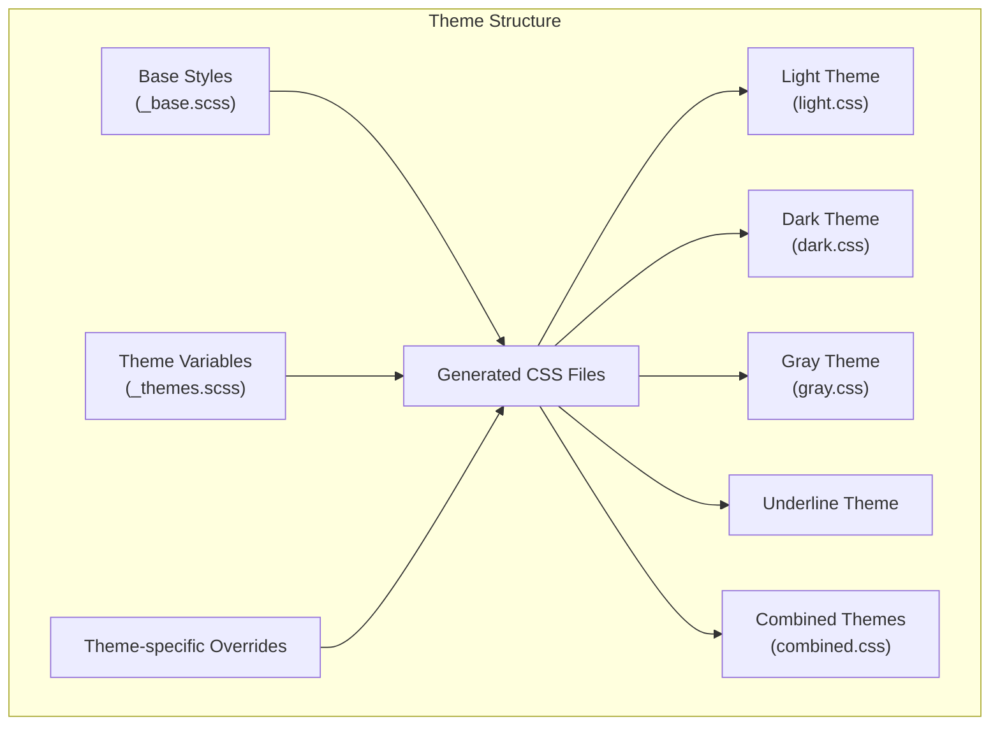
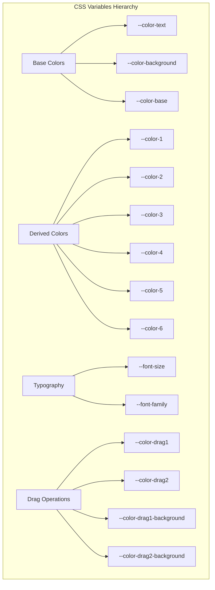
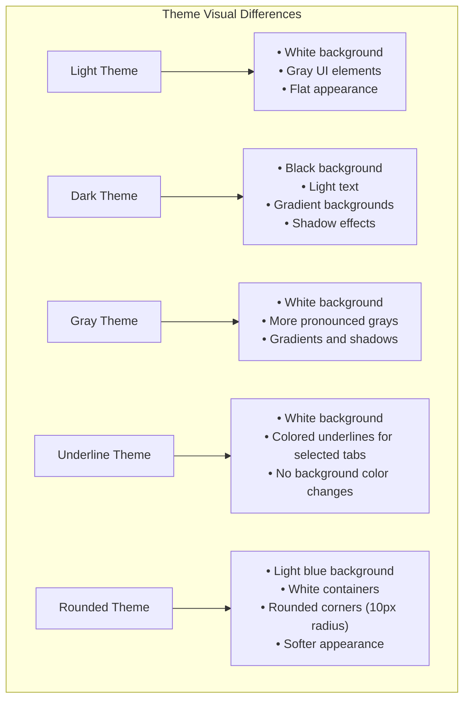

# Styling and Theming

> **Relevant source files**
> * [style/_base.scss](https://github.com/caplin/FlexLayout/blob/40753f37/style/_base.scss)
> * [style/dark.css](https://github.com/caplin/FlexLayout/blob/40753f37/style/dark.css)
> * [style/dark.scss](https://github.com/caplin/FlexLayout/blob/40753f37/style/dark.scss)
> * [style/gray.css](https://github.com/caplin/FlexLayout/blob/40753f37/style/gray.css)
> * [style/gray.scss](https://github.com/caplin/FlexLayout/blob/40753f37/style/gray.scss)
> * [style/light.css](https://github.com/caplin/FlexLayout/blob/40753f37/style/light.css)
> * [style/light.scss](https://github.com/caplin/FlexLayout/blob/40753f37/style/light.scss)

FlexLayout provides a comprehensive styling and theming system to customize the appearance of your layouts. This document explains the CSS variable-based theming architecture, available built-in themes, and how to customize or create your own themes.

## Overview

FlexLayout's styling system is built around CSS variables (custom properties) that control colors, sizes, and other visual aspects of the components. The library comes with several pre-defined themes and allows for easy customization through CSS variable overrides.



Sources: [style/_base.scss](https://github.com/caplin/FlexLayout/blob/40753f37/style/_base.scss)

 [style/_themes.scss](https://github.com/caplin/FlexLayout/blob/40753f37/style/_themes.scss)

 [style/light.css](https://github.com/caplin/FlexLayout/blob/40753f37/style/light.css)

 [style/dark.css](https://github.com/caplin/FlexLayout/blob/40753f37/style/dark.css)

 [style/gray.css](https://github.com/caplin/FlexLayout/blob/40753f37/style/gray.css)

 [style/combined.css](https://github.com/caplin/FlexLayout/blob/40753f37/style/combined.css)

## CSS Variables System

FlexLayout uses a hierarchical system of CSS variables to define its styling. The variables are organized into categories:

### Base Variables

These variables define the core colors and properties used throughout the system:



Sources: [style/light.css L1-L56](https://github.com/caplin/FlexLayout/blob/40753f37/style/light.css#L1-L56)

 [style/_themes.scss L3-L92](https://github.com/caplin/FlexLayout/blob/40753f37/style/_themes.scss#L3-L92)

### Component Variables

These variables reference the base variables and provide styling for specific components:

| Component | Key Variables |
| --- | --- |
| TabSet | `--color-tabset-background`, `--color-tabset-background-selected`, `--color-tabset-divider-line` |
| Tab | `--color-tab-selected`, `--color-tab-selected-background`, `--color-tab-unselected` |
| Border | `--color-border-background`, `--color-border-tab-selected`, `--color-border-divider-line` |
| Splitter | `--color-splitter`, `--color-splitter-hover`, `--color-splitter-drag` |
| Popup | `--color-popup-border`, `--color-popup-selected`, `--color-popup-unselected` |

Sources: [style/light.css L19-L55](https://github.com/caplin/FlexLayout/blob/40753f37/style/light.css#L19-L55)

 [style/dark.css L19-L55](https://github.com/caplin/FlexLayout/blob/40753f37/style/dark.css#L19-L55)

 [style/gray.css L19-L55](https://github.com/caplin/FlexLayout/blob/40753f37/style/gray.css#L19-L55)

## Available Themes

FlexLayout includes several built-in themes:

### Light Theme (Default)

A clean, white background theme with subtle gray shades for UI elements.

```
--color-text: black;--color-background: white;--color-tab-selected-background: rgb(224.4, 224.4, 224.4); /* --color-4 */
```

Sources: [style/light.css L1-L56](https://github.com/caplin/FlexLayout/blob/40753f37/style/light.css#L1-L56)

### Dark Theme

A dark theme with light text and dark backgrounds.

```
--color-text: #eeeeee;--color-background: black;--color-tab-selected-background: #333333; /* --color-4 */
```

Sources: [style/dark.css L1-L56](https://github.com/caplin/FlexLayout/blob/40753f37/style/dark.css#L1-L56)

 [style/dark.css L687-L709](https://github.com/caplin/FlexLayout/blob/40753f37/style/dark.css#L687-L709)

### Gray Theme

A light theme with more pronounced gray gradients and shadow effects.

```
--color-text: black;--color-background: white;--color-tab-selected-background: rgb(216.75, 216.75, 216.75); /* --color-3 */
```

Sources: [style/gray.css L1-L56](https://github.com/caplin/FlexLayout/blob/40753f37/style/gray.css#L1-L56)

 [style/gray.css L687-L712](https://github.com/caplin/FlexLayout/blob/40753f37/style/gray.css#L687-L712)

### Underline Theme

Uses underlines to indicate selected tabs instead of background colors.

```
--color-tab-selected-background: transparent;--color-underline: rgb(65, 105, 225);--underline_height: 3px;
```

Sources: [style/combined.css L172-L230](https://github.com/caplin/FlexLayout/blob/40753f37/style/combined.css#L172-L230)

 [style/combined.css L982-L1013](https://github.com/caplin/FlexLayout/blob/40753f37/style/combined.css#L982-L1013)

### Rounded Theme

Features rounded corners for tab containers and buttons.

```
--color-background: #f2f6fb;--color-tabset-background: white;
```

Sources: [style/combined.css L232-L287](https://github.com/caplin/FlexLayout/blob/40753f37/style/combined.css#L232-L287)

 [style/combined.css L1014-L1057](https://github.com/caplin/FlexLayout/blob/40753f37/style/combined.css#L1014-L1057)

The visual differences between themes are implemented through both CSS variables and theme-specific overrides that add effects like shadows, gradients, and border-radius.



Sources: [style/dark.css L687-L709](https://github.com/caplin/FlexLayout/blob/40753f37/style/dark.css#L687-L709)

 [style/gray.css L687-L712](https://github.com/caplin/FlexLayout/blob/40753f37/style/gray.css#L687-L712)

 [style/combined.css L982-L1057](https://github.com/caplin/FlexLayout/blob/40753f37/style/combined.css#L982-L1057)

## Using Themes

To apply a theme to your layout, add the appropriate theme class to a container element that wraps your FlexLayout component:

```html
// Light theme (default)<div className="flexlayout__theme_light">    <Layout model={model} /></div> // Dark theme<div className="flexlayout__theme_dark">    <Layout model={model} /></div> // Gray theme<div className="flexlayout__theme_gray">    <Layout model={model} /></div> // Underline theme<div className="flexlayout__theme_underline">    <Layout model={model} /></div> // Rounded theme<div className="flexlayout__theme_rounded">    <Layout model={model} /></div>
```

You can dynamically change themes by updating the class name of the container element.

Sources: [style/combined.css L1-L1059](https://github.com/caplin/FlexLayout/blob/40753f37/style/combined.css#L1-L1059)

## Customizing Themes

There are several ways to customize the appearance of FlexLayout:

### 1. Overriding CSS Variables

The simplest approach is to override specific CSS variables. This allows you to tweak individual aspects of a theme:

```css
/* Customize tab colors in the light theme */.flexlayout__theme_light .flexlayout__layout {    --color-tab-selected: #0066cc;    --color-tab-selected-background: #e6f2ff;}
```

### 2. Creating a Custom Theme

To create a more comprehensive custom theme, you can define a new set of CSS variables based on the existing themes:

```css
/* Custom theme definition */.flexlayout__theme_custom .flexlayout__layout {    /* Base colors */    --color-text: #333333;    --color-background: #f5f5f5;    --color-base: #f5f5f5;    --color-1: #e6e6e6;    --color-2: #d8d8d8;    --color-3: #c9c9c9;    --color-4: #bbbbbb;    --color-5: #adadad;    --color-6: #9e9e9e;        /* Component-specific variables */    --color-tab-selected: #0066cc;    --color-tab-selected-background: #e6f2ff;    /* ... other component variables ... */} /* Theme-specific overrides */.flexlayout__theme_custom .flexlayout__tabset_header {    box-shadow: inset 0 0 3px 0 rgba(0, 102, 204, 0.2);}
```

### 3. Extended Customization with onRenderTab and onRenderTabSet

For more complex customization needs, FlexLayout provides callback props that allow you to modify the rendering of tabs and tabsets:

```javascript
<Layout     model={model}    onRenderTab={(node, renderValues) => {        // Custom rendering logic for tabs        if (node.getType() === "important") {            renderValues.className += " important-tab";        }    }}    onRenderTabSet={(node, renderValues) => {        // Custom rendering logic for tabsets        if (node.getId() === "main") {            renderValues.className += " main-tabset";        }    }}/>
```

Sources: [style/_themes.scss L3-L646](https://github.com/caplin/FlexLayout/blob/40753f37/style/_themes.scss#L3-L646)

## Component Styling Reference

For comprehensive theme customization, it's helpful to understand which CSS variables affect each component:

### TabSet Component

| Variable | Purpose |
| --- | --- |
| `--color-tabset-background` | Background color of the tabset |
| `--color-tabset-background-selected` | Background color when the tabset is selected |
| `--color-tabset-background-maximized` | Background color when the tabset is maximized |
| `--color-tabset-divider-line` | Color of the divider lines in tabsets |
| `--color-tabset-header-background` | Background color of the tabset header |
| `--color-tabset-header` | Text color in the tabset header |

### Tab Component

| Variable | Purpose |
| --- | --- |
| `--color-tab-content` | Background color of the tab content area |
| `--color-tab-selected` | Text color of selected tabs |
| `--color-tab-selected-background` | Background color of selected tabs |
| `--color-tab-unselected` | Text color of unselected tabs |
| `--color-tab-unselected-background` | Background color of unselected tabs |
| `--color-tab-textbox` | Text color in tab editing textbox |
| `--color-tab-textbox-background` | Background color of tab editing textbox |

### Border Component

| Variable | Purpose |
| --- | --- |
| `--color-border-background` | Background color of border regions |
| `--color-border-divider-line` | Color of divider lines in border regions |
| `--color-border-tab-content` | Background color of tab content in border regions |
| `--color-border-tab-selected` | Text color of selected border tabs |
| `--color-border-tab-selected-background` | Background color of selected border tabs |
| `--color-border-tab-unselected` | Text color of unselected border tabs |
| `--color-border-tab-unselected-background` | Background color of unselected border tabs |

### Other Components

| Component | Key Variables |
| --- | --- |
| Splitter | `--color-splitter`, `--color-splitter-hover`, `--color-splitter-drag` |
| Drag & Drop | `--color-drag1`, `--color-drag2`, `--color-drag-rect-border`, `--color-drag-rect-background` |
| Popup Menu | `--color-popup-border`, `--color-popup-unselected`, `--color-popup-selected-background` |

Sources: [style/light.css L19-L55](https://github.com/caplin/FlexLayout/blob/40753f37/style/light.css#L19-L55)

 [style/dark.css L19-L55](https://github.com/caplin/FlexLayout/blob/40753f37/style/dark.css#L19-L55)

 [style/gray.css L19-L55](https://github.com/caplin/FlexLayout/blob/40753f37/style/gray.css#L19-L55)

 [src/view/PopupMenu.tsx L1-L156](https://github.com/caplin/FlexLayout/blob/40753f37/src/view/PopupMenu.tsx#L1-L156)

## CSS Class Structure

FlexLayout uses a consistent naming convention for CSS classes, following the pattern `flexlayout__componentname_elementname`:

```

```

Sources: [style/_base.scss L16-L763](https://github.com/caplin/FlexLayout/blob/40753f37/style/_base.scss#L16-L763)

 [style/light.css L61-L681](https://github.com/caplin/FlexLayout/blob/40753f37/style/light.css#L61-L681)

Understanding this class structure is helpful when you need to write custom CSS selectors to target specific elements within the layout.

## Best Practices for Styling

1. **Use CSS Variables First**: Whenever possible, customize through CSS variables rather than overriding classes directly.
2. **Component-Specific Overrides**: If you need to target specific components, use component-specific CSS variables before writing custom CSS.
3. **Theme Class Container**: Always apply theme classes to a container element that wraps your Layout component, not to the Layout component itself.
4. **Custom Themes**: When creating custom themes, base them on existing themes to ensure you don't miss any necessary variables.
5. **Testing Across Components**: When customizing, test the effects on all components (TabSets, Tabs, Borders, Splitters) to ensure a consistent appearance.

For more detailed information about specific component styling, see the related component documentation pages:

* [TabSet Component](/caplin/FlexLayout/3.2-tabset-component)
* [Tab and Button Components](/caplin/FlexLayout/3.3-tab-and-button-components)
* [Splitter Component](/caplin/FlexLayout/3.4-splitter-component)