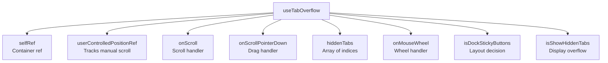
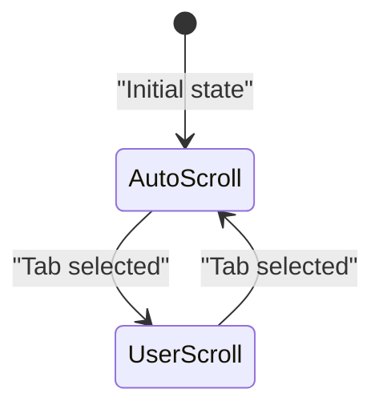
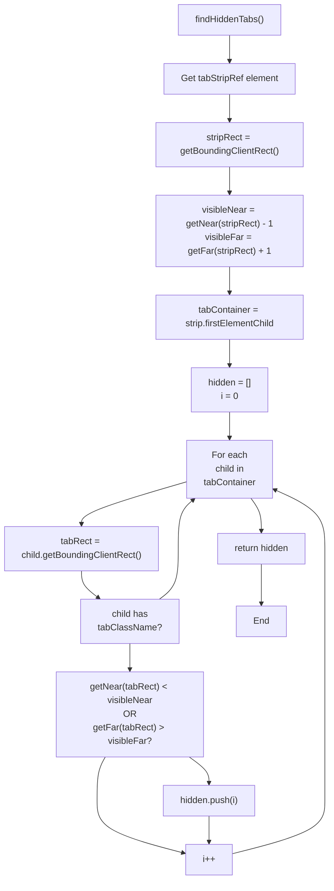
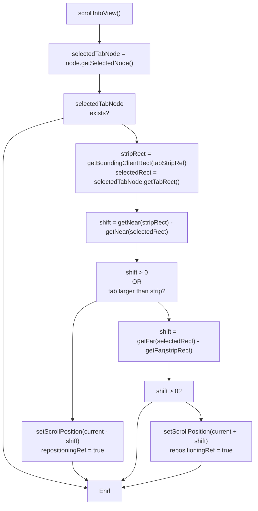
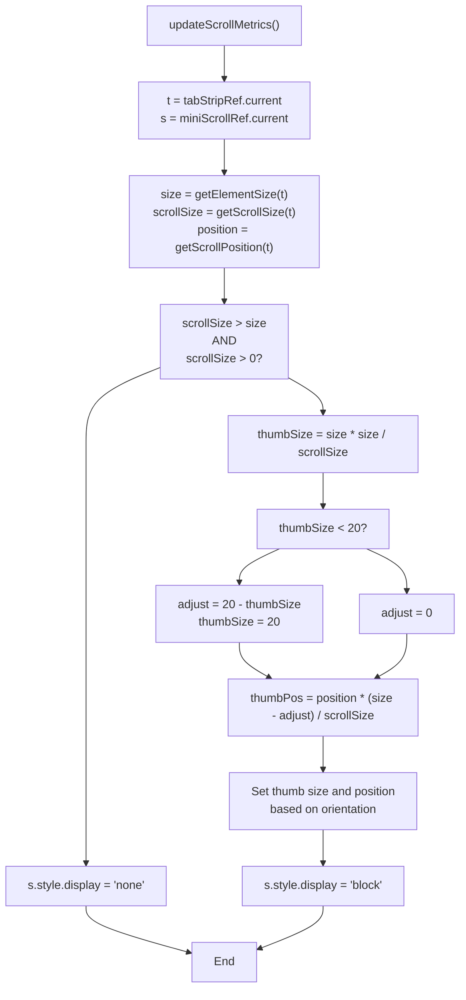
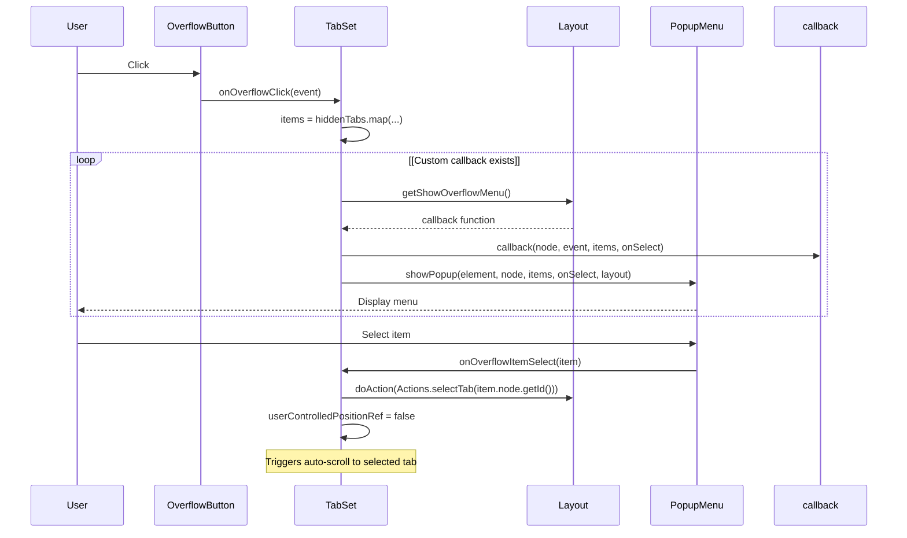
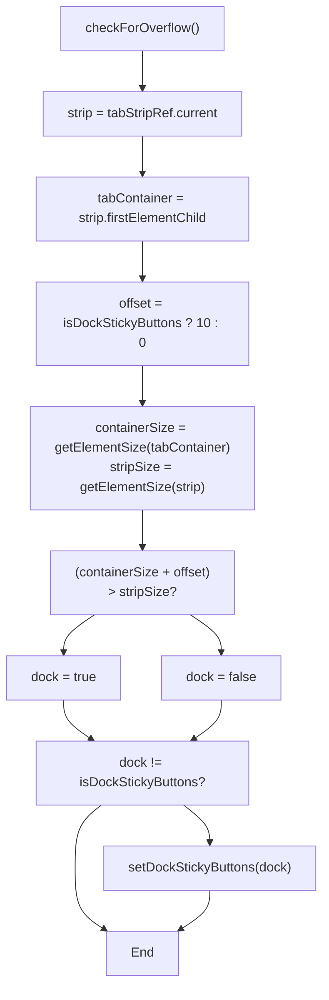

# Tab Overflow

> **Relevant source files**
> * [src/view/BorderTabSet.tsx](https://github.com/caplin/FlexLayout/blob/40753f37/src/view/BorderTabSet.tsx)
> * [src/view/TabOverflowHook.tsx](https://github.com/caplin/FlexLayout/blob/40753f37/src/view/TabOverflowHook.tsx)
> * [src/view/TabSet.tsx](https://github.com/caplin/FlexLayout/blob/40753f37/src/view/TabSet.tsx)

## Purpose and Scope

This document describes the tab overflow system in FlexLayout, which handles the display and navigation of tabs when there are too many to fit in the visible area. The system provides scrolling, hidden tab tracking, and an overflow menu to access tabs that are not currently visible.

For information about the TabSet and BorderTabSet components themselves, see [Tab and Button Components](/caplin/FlexLayout/3.3-tab-and-button-components) and [TabSet Component](/caplin/FlexLayout/3.2-tabset-component).

## Overview

The tab overflow system activates when the combined width (or height, for vertical orientations) of all tabs exceeds the available space in the tab strip. When this occurs, the system provides several mechanisms for accessing non-visible tabs:

* **Scrolling**: Users can scroll the tab strip using mouse wheel or a mini scrollbar
* **Overflow Menu**: A button displays the count of hidden tabs and provides a menu to select them
* **Auto-positioning**: Selected tabs are automatically scrolled into view
* **Sticky Button Management**: Optional sticky buttons are repositioned to the toolbar when space is limited

The system is used by both `TabSet` and `BorderTabSet` components and adapts to horizontal or vertical orientations.

**Sources:** [src/view/TabOverflowHook.tsx L1-L318](https://github.com/caplin/FlexLayout/blob/40753f37/src/view/TabOverflowHook.tsx#L1-L318)

## Architecture

```mermaid
flowchart TD

TabSet["TabSet Component"]
BorderTabSet["BorderTabSet Component"]
Hook["useTabOverflow Hook"]
HiddenTabs["hiddenTabs: number[]"]
ShowHidden["isShowHiddenTabs: boolean"]
DockSticky["isDockStickyButtons: boolean"]
UserControlled["userControlledPositionRef"]
SelfRef["selfRef: HTMLDivElement"]
TabStripRef["tabStripInnerRef: HTMLElement"]
MiniScrollRef["miniScrollRef: HTMLElement"]
OnScroll["onScroll()"]
OnWheel["onMouseWheel()"]
OnScrollPointerDown["onScrollPointerDown()"]
FindHidden["findHiddenTabs()"]
ScrollIntoView["scrollIntoView()"]
UpdateMetrics["updateScrollMetrics()"]
CheckOverflow["checkForOverflow()"]
MiniScrollbar["Mini Scrollbar<br>Drag handle"]
OverflowButton["Overflow Button<br>Shows count"]
OverflowMenu["Overflow Menu<br>Hidden tab list"]
StickyButtons["Sticky Buttons<br>Optional UI"]

TabSet --> Hook
BorderTabSet --> Hook
TabSet --> MiniScrollbar
TabSet --> OverflowButton
TabSet --> StickyButtons
MiniScrollbar --> OnScrollPointerDown

subgraph subGraph6 ["UI Elements"]
    MiniScrollbar
    OverflowButton
    OverflowMenu
    StickyButtons
    OverflowButton --> OverflowMenu
end

subgraph subGraph5 ["Tab Overflow System"]
    Hook
    Hook --> HiddenTabs
    Hook --> ShowHidden
    Hook --> DockSticky
    Hook --> UserControlled
    Hook --> SelfRef
    Hook --> TabStripRef
    Hook --> MiniScrollRef
    Hook --> OnScroll
    Hook --> OnWheel
    Hook --> OnScrollPointerDown
    Hook --> FindHidden
    Hook --> ScrollIntoView
    Hook --> UpdateMetrics
    Hook --> CheckOverflow
    TabStripRef --> OnScroll
    SelfRef --> OnWheel

subgraph subGraph4 ["Core Functions"]
    FindHidden
    ScrollIntoView
    UpdateMetrics
    CheckOverflow
end

subgraph subGraph3 ["Event Handlers"]
    OnScroll
    OnWheel
    OnScrollPointerDown
end

subgraph subGraph2 ["DOM References"]
    SelfRef
    TabStripRef
    MiniScrollRef
end

subgraph subGraph1 ["State Management"]
    HiddenTabs
    ShowHidden
    DockSticky
    UserControlled
end
end

subgraph subGraph0 ["Consumer Components"]
    TabSet
    BorderTabSet
end
```



**Sources:** [src/view/TabOverflowHook.tsx L10-L313](https://github.com/caplin/FlexLayout/blob/40753f37/src/view/TabOverflowHook.tsx#L10-L313)

 [src/view/TabSet.tsx L16-L485](https://github.com/caplin/FlexLayout/blob/40753f37/src/view/TabSet.tsx#L16-L485)

 [src/view/BorderTabSet.tsx L15-L272](https://github.com/caplin/FlexLayout/blob/40753f37/src/view/BorderTabSet.tsx#L15-L272)

## The useTabOverflow Hook

The `useTabOverflow` hook is the core of the tab overflow system. It manages scroll state, detects hidden tabs, and provides event handlers for user interactions.

### Hook Signature

```
useTabOverflow(    layout: LayoutInternal,    node: TabSetNode | BorderNode,    orientation: Orientation,    tabStripRef: React.RefObject<HTMLElement | null>,    miniScrollRef: React.RefObject<HTMLElement | null>,    tabClassName: string)
```

### Parameters

| Parameter | Type | Purpose |
| --- | --- | --- |
| `layout` | `LayoutInternal` | Access to layout utilities and methods |
| `node` | `TabSetNode \| BorderNode` | The tabset or border containing the tabs |
| `orientation` | `Orientation` | `HORZ` or `VERT` - determines scroll direction |
| `tabStripRef` | `React.RefObject` | Reference to the scrollable tab container |
| `miniScrollRef` | `React.RefObject` | Reference to the mini scrollbar element |
| `tabClassName` | `string` | CSS class to identify tab elements |

### Return Values



**Sources:** [src/view/TabOverflowHook.tsx L10-L18](https://github.com/caplin/FlexLayout/blob/40753f37/src/view/TabOverflowHook.tsx#L10-L18)

 [src/view/TabOverflowHook.tsx L312](https://github.com/caplin/FlexLayout/blob/40753f37/src/view/TabOverflowHook.tsx#L312-L312)

## State Management

The hook maintains several pieces of state that control the overflow behavior:

### React State

* **`hiddenTabs`** (`number[]`): Array of tab indices that are currently not visible
* **`isShowHiddenTabs`** (`boolean`): Whether to display the overflow button
* **`isDockStickyButtons`** (`boolean`): Whether to move sticky buttons to the toolbar

### Refs

* **`userControlledPositionRef`** (`boolean`): Tracks whether the user has manually scrolled (vs automatic scroll-to-selected)
* **`updateHiddenTabsTimerRef`**: Throttles hidden tab updates to prevent excessive re-renders
* **`hiddenTabsRef`**: Current hidden tabs for comparison
* **`thumbInternalPos`**: Internal position for mini scrollbar dragging
* **`repositioningRef`**: Prevents setting user-controlled flag during auto-scroll



**Sources:** [src/view/TabOverflowHook.tsx L19-L29](https://github.com/caplin/FlexLayout/blob/40753f37/src/view/TabOverflowHook.tsx#L19-L29)

 [src/view/TabOverflowHook.tsx L32-L41](https://github.com/caplin/FlexLayout/blob/40753f37/src/view/TabOverflowHook.tsx#L32-L41)

 [src/view/TabOverflowHook.tsx L144-L151](https://github.com/caplin/FlexLayout/blob/40753f37/src/view/TabOverflowHook.tsx#L144-L151)

## Hidden Tab Detection

The system continuously monitors which tabs are visible and which are hidden based on their position relative to the visible tab strip area.

### Detection Algorithm

The `findHiddenTabs` function implements the following logic:

1. Get the bounding rectangle of the tab strip container
2. Calculate the visible range (near edge to far edge)
3. Iterate through all tab children
4. For each tab, check if its rectangle falls outside the visible range
5. Return an array of hidden tab indices



**Sources:** [src/view/TabOverflowHook.tsx L208-L232](https://github.com/caplin/FlexLayout/blob/40753f37/src/view/TabOverflowHook.tsx#L208-L232)

### Update Mechanism

Hidden tabs are updated through `updateHiddenTabs`, which:

1. Calls `findHiddenTabs()` to get the current hidden tab list
2. Determines if the overflow button should be shown (`showHidden = newHiddenTabs.length > 0`)
3. Throttles updates using a 100ms timer to prevent excessive re-renders
4. Only updates state if the hidden tabs array has changed

**Sources:** [src/view/TabOverflowHook.tsx L123-L142](https://github.com/caplin/FlexLayout/blob/40753f37/src/view/TabOverflowHook.tsx#L123-L142)

## Scroll Management

### Automatic Scroll-to-Selected

When a tab is selected and `userControlledPositionRef` is false, the `scrollIntoView` function automatically positions the tab strip to make the selected tab visible:



The `repositioningRef` flag prevents the `onScroll` handler from marking the scroll as user-controlled during automatic positioning.

**Sources:** [src/view/TabOverflowHook.tsx L66-L84](https://github.com/caplin/FlexLayout/blob/40753f37/src/view/TabOverflowHook.tsx#L66-L84)

### Manual Scrolling

Users can manually scroll the tab strip using three methods:

#### 1. Mouse Wheel

The `onMouseWheel` handler responds to wheel events:

* Extracts the delta value from `event.deltaY`
* Handles both pixel and line delta modes
* Calculates new scroll position within valid bounds
* Calls `setScrollPosition` to update the scroll

**Sources:** [src/view/TabOverflowHook.tsx L234-L252](https://github.com/caplin/FlexLayout/blob/40753f37/src/view/TabOverflowHook.tsx#L234-L252)

#### 2. Mini Scrollbar Drag

The mini scrollbar provides a visual indicator of scroll position and can be dragged:

* `onScrollPointerDown` initiates the drag operation
* Records the internal thumb position for offset calculations
* `onDragMove` calculates scroll position based on thumb position
* Scroll position is proportional to thumb position relative to container size

**Sources:** [src/view/TabOverflowHook.tsx L153-L193](https://github.com/caplin/FlexLayout/blob/40753f37/src/view/TabOverflowHook.tsx#L153-L193)

#### 3. Native Scroll

The tab strip container itself is scrollable, and the `onScroll` handler tracks scroll events:

* Sets `userControlledPositionRef` to true (unless `repositioningRef` is set)
* Updates scroll metrics (mini scrollbar position)
* Updates hidden tabs list

**Sources:** [src/view/TabOverflowHook.tsx L144-L151](https://github.com/caplin/FlexLayout/blob/40753f37/src/view/TabOverflowHook.tsx#L144-L151)

### Scroll Metrics Update

The `updateScrollMetrics` function positions and sizes the mini scrollbar thumb:



**Sources:** [src/view/TabOverflowHook.tsx L86-L121](https://github.com/caplin/FlexLayout/blob/40753f37/src/view/TabOverflowHook.tsx#L86-L121)

## Overflow Menu

When tabs are hidden, an overflow button appears in the toolbar showing the count of hidden tabs. Clicking this button displays a menu with all hidden tabs.

### Integration with TabSet



**Sources:** [src/view/TabSet.tsx L66-L87](https://github.com/caplin/FlexLayout/blob/40753f37/src/view/TabSet.tsx#L66-L87)

 [src/view/BorderTabSet.tsx L57-L78](https://github.com/caplin/FlexLayout/blob/40753f37/src/view/BorderTabSet.tsx#L57-L78)

### Overflow Button Rendering

The overflow button is conditionally rendered when `isShowHiddenTabs` is true:

* Displays the `icons.more` icon (or custom icon function result)
* Shows the count of hidden tabs in a badge
* Positioned according to `overflowPosition` in the render state
* Clicking the button calls `onOverflowClick`

**Sources:** [src/view/TabSet.tsx L214-L241](https://github.com/caplin/FlexLayout/blob/40753f37/src/view/TabSet.tsx#L214-L241)

 [src/view/BorderTabSet.tsx L153-L178](https://github.com/caplin/FlexLayout/blob/40753f37/src/view/BorderTabSet.tsx#L153-L178)

## Sticky Button Management

Sticky buttons are optional UI elements that can be positioned either within the tab strip or moved to the toolbar when space is limited.

### Overflow Detection

The `checkForOverflow` function determines whether sticky buttons should be docked:

1. Measures the size of the tab container (including tabs and inline sticky buttons)
2. Compares with the available size in the tab strip
3. Applies a 10-pixel hysteresis offset to prevent flickering
4. Sets `isDockStickyButtons` state accordingly



**Sources:** [src/view/TabOverflowHook.tsx L195-L206](https://github.com/caplin/FlexLayout/blob/40753f37/src/view/TabOverflowHook.tsx#L195-L206)

### Rendering Logic

In `TabSet` and `BorderTabSet`, sticky buttons are rendered conditionally:

| Condition | Action |
| --- | --- |
| Tab wrapping enabled | Always render in tab strip |
| Tab stretching enabled | Move to toolbar |
| `isDockStickyButtons` is true | Move to toolbar |
| Otherwise | Render in tab strip container |

**Sources:** [src/view/TabSet.tsx L198-L212](https://github.com/caplin/FlexLayout/blob/40753f37/src/view/TabSet.tsx#L198-L212)

 [src/view/BorderTabSet.tsx L137-L151](https://github.com/caplin/FlexLayout/blob/40753f37/src/view/BorderTabSet.tsx#L137-L151)

## Orientation Helpers

The overflow system works with both horizontal and vertical tab strips. Helper functions abstract orientation-specific logic:

| Function | Horizontal | Vertical |
| --- | --- | --- |
| `getNear(rect)` | `rect.x` | `rect.y` |
| `getFar(rect)` | `rect.right` | `rect.bottom` |
| `getSize(rect)` | `rect.width` | `rect.height` |
| `getElementSize(elm)` | `elm.clientWidth` | `elm.clientHeight` |
| `getScrollSize(elm)` | `elm.scrollWidth` | `elm.scrollHeight` |
| `getScrollPosition(elm)` | `elm.scrollLeft` | `elm.scrollTop` |
| `setScrollPosition(p)` | `elm.scrollLeft = p` | `elm.scrollTop = p` |

These functions allow the same overflow logic to work for TabSet (typically horizontal) and BorderTabSet (can be vertical or horizontal depending on border location).

**Sources:** [src/view/TabOverflowHook.tsx L256-L310](https://github.com/caplin/FlexLayout/blob/40753f37/src/view/TabOverflowHook.tsx#L256-L310)

## Lifecycle and Effects

The hook uses several React effects to manage its behavior:

### Layout Effects (useLayoutEffect)

1. **Model change handler** [src/view/TabOverflowHook.tsx L32-L36](https://github.com/caplin/FlexLayout/blob/40753f37/src/view/TabOverflowHook.tsx#L32-L36) * Resets scroll position to 0 when node ID changes (new model loaded)
2. **Selection/resize handler** [src/view/TabOverflowHook.tsx L38-L41](https://github.com/caplin/FlexLayout/blob/40753f37/src/view/TabOverflowHook.tsx#L38-L41) * Resets `userControlledPositionRef` when selected tab changes or node rectangle changes * Ensures selected tab is scrolled into view on next render
3. **Main update handler** [src/view/TabOverflowHook.tsx L43-L52](https://github.com/caplin/FlexLayout/blob/40753f37/src/view/TabOverflowHook.tsx#L43-L52) * Checks for overflow (sticky button repositioning) * Scrolls selected tab into view if not user-controlled * Updates scroll metrics (mini scrollbar) * Updates hidden tabs list

### Standard Effects (useEffect)

1. **Wheel event handler** [src/view/TabOverflowHook.tsx L54-L59](https://github.com/caplin/FlexLayout/blob/40753f37/src/view/TabOverflowHook.tsx#L54-L59) * Registers native wheel event listener with `passive: false` * Prevents default wheel behavior to avoid page scrolling * Cleans up on unmount

**Sources:** [src/view/TabOverflowHook.tsx L32-L59](https://github.com/caplin/FlexLayout/blob/40753f37/src/view/TabOverflowHook.tsx#L32-L59)

## Usage Example

The TabSet component demonstrates typical usage of the overflow hook:

```javascript
const { selfRef, userControlledPositionRef, onScroll, onScrollPointerDown,         hiddenTabs, onMouseWheel, isDockStickyButtons, isShowHiddenTabs } =    useTabOverflow(        layout,         node,         Orientation.HORZ,         tabStripInnerRef,         miniScrollRef,        layout.getClassName(CLASSES.FLEXLAYOUT__TAB_BUTTON)    );
```

The returned values are used throughout the component:

* `selfRef` is attached to the container div
* `onScroll` is attached to the scrollable tab strip inner div
* `onScrollPointerDown` handles mini scrollbar dragging
* `hiddenTabs` populates the overflow menu
* `onMouseWheel` handles wheel events on the tab strip
* `isDockStickyButtons` determines sticky button placement
* `isShowHiddenTabs` controls overflow button visibility

**Sources:** [src/view/TabSet.tsx L62-L64](https://github.com/caplin/FlexLayout/blob/40753f37/src/view/TabSet.tsx#L62-L64)

 [src/view/BorderTabSet.tsx L38-L41](https://github.com/caplin/FlexLayout/blob/40753f37/src/view/BorderTabSet.tsx#L38-L41)