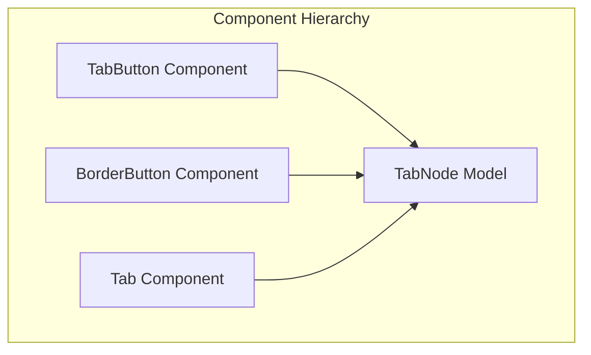
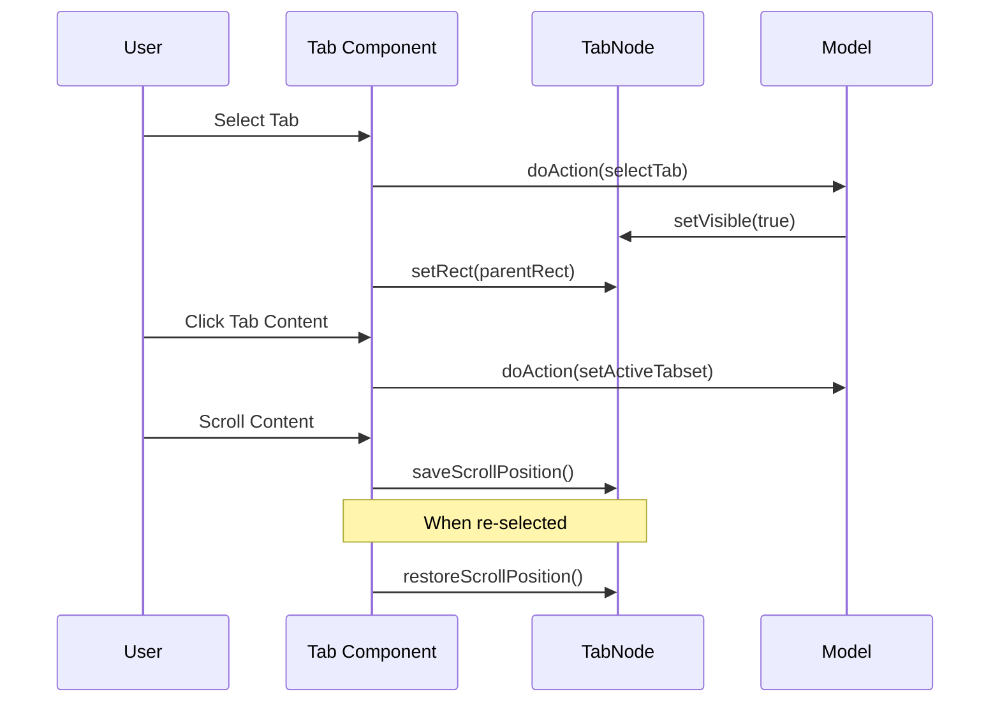
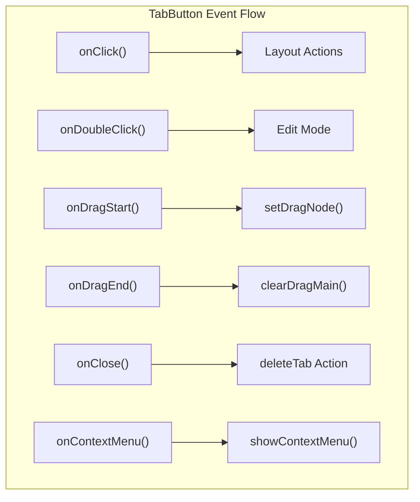
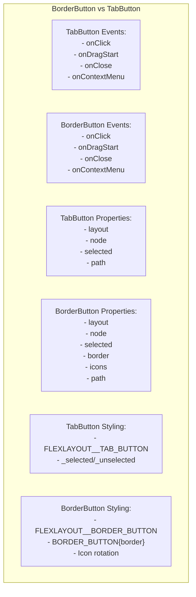
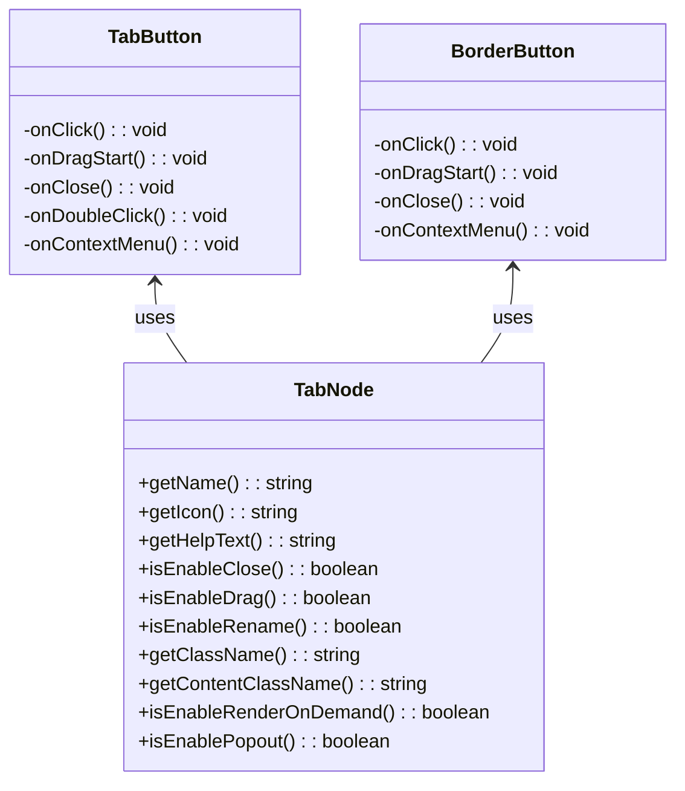
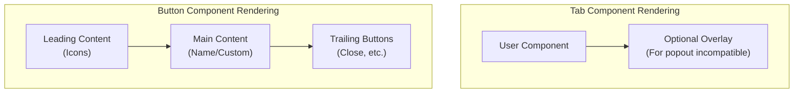
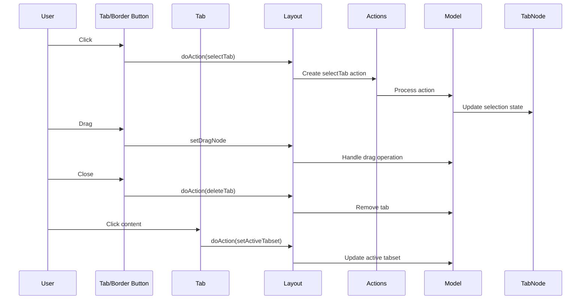

# Tab and Button Components

> **Relevant source files**
> * [src/view/BorderButton.tsx](https://github.com/caplin/FlexLayout/blob/40753f37/src/view/BorderButton.tsx)
> * [src/view/BorderTabSet.tsx](https://github.com/caplin/FlexLayout/blob/40753f37/src/view/BorderTabSet.tsx)
> * [src/view/Splitter.tsx](https://github.com/caplin/FlexLayout/blob/40753f37/src/view/Splitter.tsx)
> * [src/view/TabButton.tsx](https://github.com/caplin/FlexLayout/blob/40753f37/src/view/TabButton.tsx)
> * [src/view/TabSet.tsx](https://github.com/caplin/FlexLayout/blob/40753f37/src/view/TabSet.tsx)

This page documents the Tab and Button components within FlexLayout, essential elements that enable user interaction with content panels. These components handle tab display, selection, and manipulation within the layout system. For information about the TabSet component that contains these elements, see [TabSet Component](/caplin/FlexLayout/3.2-tabset-component).

## Overview

FlexLayout uses three primary components to display and interact with tabs:

1. **Tab**: The content container that renders the user's component
2. **TabButton**: The clickable header button within a TabSet
3. **BorderButton**: A specialized button for tabs in border regions

Together, these components provide the interface for selecting, moving, and managing tabs within the layout.

Sources: [src/view/TabButton.tsx L12-L20](https://github.com/caplin/FlexLayout/blob/40753f37/src/view/TabButton.tsx#L12-L20)

 [src/view/BorderButton.tsx L11-L19](https://github.com/caplin/FlexLayout/blob/40753f37/src/view/BorderButton.tsx#L11-L19)

 [src/view/Tab.tsx L10-L16](https://github.com/caplin/FlexLayout/blob/40753f37/src/view/Tab.tsx#L10-L16)

 [src/model/TabNode.ts L11-L14](https://github.com/caplin/FlexLayout/blob/40753f37/src/model/TabNode.ts#L11-L14)

## Tab Component

The Tab component is responsible for rendering the content of a tab. It serves as a container for the user-provided content and manages content visibility based on selection state.

### Purpose and Functionality

* Renders the user's component specified in the TabNode model
* Manages visibility based on tab selection state
* Preserves scroll position when switching between tabs
* Sets active tabset when the tab content is clicked
* Updates the TabNode rect for resize events

### Implementation Details

The Tab component is a React functional component that:

1. Mounts the tab's moveable element (user content) in its DOM container
2. Maintains scroll position when tabs are switched
3. Sets itself as the active tabset when clicked
4. Updates visibility based on selection state
5. Applies appropriate CSS classes based on parent node type

Sources: [src/view/Tab.tsx L18-L126](https://github.com/caplin/FlexLayout/blob/40753f37/src/view/Tab.tsx#L18-L126)

## TabButton Component

The TabButton component represents the clickable header button for a tab within a TabSet. It displays the tab's name, icon, and provides user interactions for tab management.

### Purpose and Functionality

* Displays the tab's name and optional icon
* Handles tab selection via click events
* Manages tab drag operations for moving tabs
* Provides close button functionality when enabled
* Supports tab renaming through double-clicks
* Handles context menu and auxiliary mouse events

### Key Properties

| Property | Type | Description |
| --- | --- | --- |
| `layout` | LayoutInternal | Reference to the layout engine |
| `node` | TabNode | The model node this button represents |
| `selected` | boolean | Whether this tab is currently selected |
| `path` | string | Layout path for identification |

### Event Handling

TabButton handles various user interactions:

* **Click**: Selects the tab
* **Context Menu**: Shows the tab context menu
* **Double-Click**: Activates tab renaming if enabled
* **Drag Start/End**: Initiates and completes tab dragging
* **Close Button Click**: Removes the tab from layout

Sources: [src/view/TabButton.tsx L20-L200](https://github.com/caplin/FlexLayout/blob/40753f37/src/view/TabButton.tsx#L20-L200)

## BorderButton Component

The BorderButton component is a specialized button used for tabs in border regions. It shares many similarities with TabButton but includes additional handling for border orientation and icon rotation.

### Purpose and Functionality

* Similar core functionality to TabButton
* Adapts to the border orientation (top, bottom, left, right)
* Handles icon rotation based on border position
* Controls tab visibility in border regions

### Differences from TabButton

* Uses different CSS classes for styling
* Handles icon rotation for left and right borders
* Connects to BorderNode instead of TabSetNode
* Has specialized border-specific behaviors

Sources: [src/view/BorderButton.tsx L21-L201](https://github.com/caplin/FlexLayout/blob/40753f37/src/view/BorderButton.tsx#L21-L201)

## Tab and Button Attributes

The TabNode model contains numerous attributes that control the appearance and behavior of tabs and buttons. These can be configured globally or per-tab.

### Common Tab Attributes

| Attribute | Purpose | Default |
| --- | --- | --- |
| `name` | Text displayed in the tab button | "[Unnamed Tab]" |
| `enableClose` | Allow closing via tab button | `true` |
| `enableDrag` | Allow dragging to move tab | `true` |
| `enableRename` | Allow renaming by double-click | `true` |
| `className` | CSS class for button | `undefined` |
| `contentClassName` | CSS class for content | `undefined` |
| `icon` | Icon to display in button | `undefined` |
| `helpText` | Tooltip text for the tab | `undefined` |

### Visibility and Rendering Attributes

| Attribute | Purpose | Default |
| --- | --- | --- |
| `enableRenderOnDemand` | Only render when tab is visible | `true` |
| `closeType` | When to show close button | `ICloseType.Visible` |
| `enablePopout` | Enable tab pop-out functionality | `false` |
| `enablePopoutIcon` | Show popout icon in the header | `true` |

Sources: [src/model/TabNode.ts L11-L424](https://github.com/caplin/FlexLayout/blob/40753f37/src/model/TabNode.ts#L11-L424)

 [src/model/IJsonModel.ts L690-L874](https://github.com/caplin/FlexLayout/blob/40753f37/src/model/IJsonModel.ts#L690-L874)

## Tab and Button Rendering

Both button components use a common approach to rendering content. They construct elements for:

1. **Leading content**: Typically icons
2. **Main content**: The tab name or custom content
3. **Trailing content**: Action buttons (close, etc.)

The rendering state is computed by the `getRenderStateEx` utility function, which applies:

* Custom rendering hooks if defined
* Default rendering behavior if not overridden
* Icon rotation for border buttons when needed

### Tab Component Rendering

The Tab component renders differently:

1. It acts as a container for user content
2. Content is mounted into the Tab div via refs
3. Visibility is controlled by the `selected` prop
4. Preserves scroll position between visibility changes
5. May show an overlay for popout-incompatible tabs

Sources: [src/view/TabButton.tsx L139-L197](https://github.com/caplin/FlexLayout/blob/40753f37/src/view/TabButton.tsx#L139-L197)

 [src/view/BorderButton.tsx L142-L198](https://github.com/caplin/FlexLayout/blob/40753f37/src/view/BorderButton.tsx#L142-L198)

 [src/view/Tab.tsx L74-L123](https://github.com/caplin/FlexLayout/blob/40753f37/src/view/Tab.tsx#L74-L123)

## Integration with Layout System

The Tab and Button components integrate with the broader layout system through:

1. **Action Dispatching**: Components trigger actions that the Model processes
2. **Event Handling**: User interactions are translated to model operations
3. **State Management**: Components reflect the state from the model
4. **Style Application**: CSS classes are applied based on model attributes

Sources: [src/view/TabButton.tsx L56-L58](https://github.com/caplin/FlexLayout/blob/40753f37/src/view/TabButton.tsx#L56-L58)

 [src/view/BorderButton.tsx L50-L52](https://github.com/caplin/FlexLayout/blob/40753f37/src/view/BorderButton.tsx#L50-L52)

 [src/view/Tab.tsx L59-L66](https://github.com/caplin/FlexLayout/blob/40753f37/src/view/Tab.tsx#L59-L66)

 [src/model/Model.ts L71-L301](https://github.com/caplin/FlexLayout/blob/40753f37/src/model/Model.ts#L71-L301)

## Customization and Styling

Both Tab and Button components provide extensive customization options:

1. **Attribute Configuration**: Through model attributes
2. **CSS Classes**: Custom classes can be applied to both buttons and content
3. **Render Hooks**: Custom rendering via layout callbacks
4. **Icon Customization**: Custom icons via layout configuration
5. **Themes**: Styled through the theme system

The styling follows a hierarchical approach, with default values that can be overridden at the global level or per-node level.

Sources: [src/model/TabNode.ts L339-L423](https://github.com/caplin/FlexLayout/blob/40753f37/src/model/TabNode.ts#L339-L423)

 [src/model/Model.ts L625-L702](https://github.com/caplin/FlexLayout/blob/40753f37/src/model/Model.ts#L625-L702)

 [src/model/IJsonModel.ts L690-L874](https://github.com/caplin/FlexLayout/blob/40753f37/src/model/IJsonModel.ts#L690-L874)