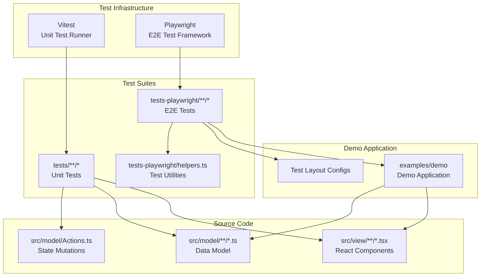
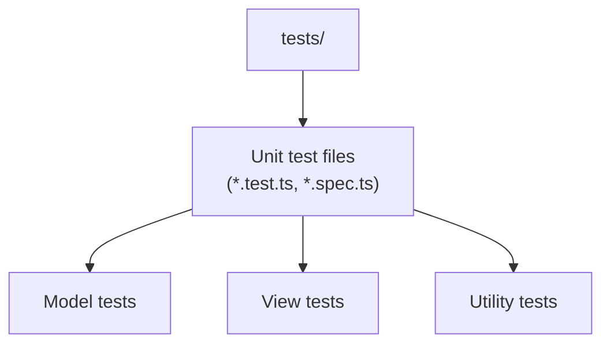
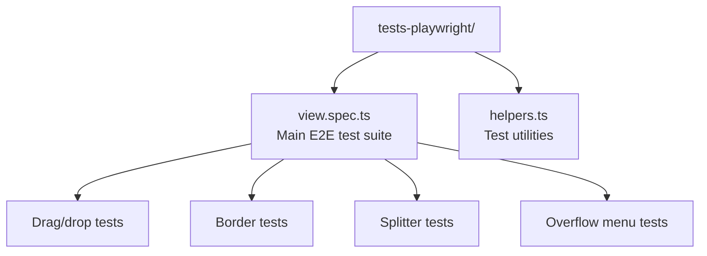
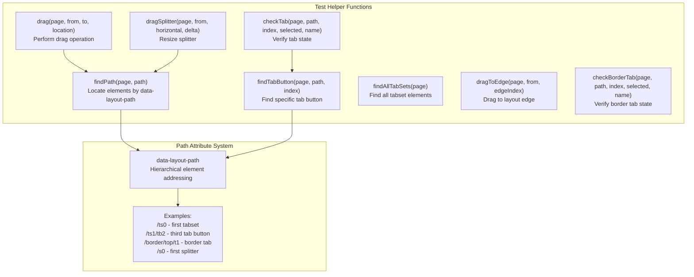
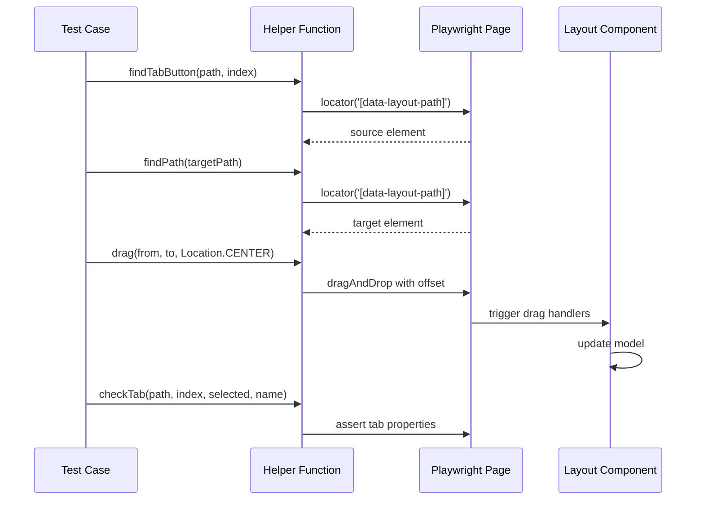
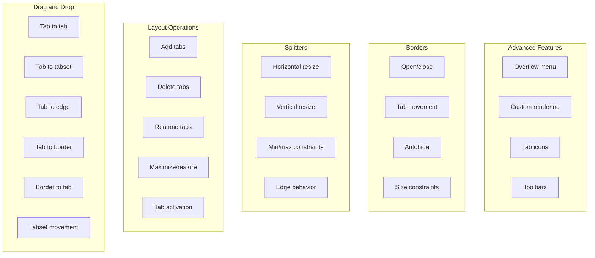

# Testing

> **Relevant source files**
> * [.gitignore](https://github.com/caplin/FlexLayout/blob/40753f37/.gitignore)
> * [package.json](https://github.com/caplin/FlexLayout/blob/40753f37/package.json)
> * [src/view/BorderTab.tsx](https://github.com/caplin/FlexLayout/blob/40753f37/src/view/BorderTab.tsx)
> * [src/view/TabButtonStamp.tsx](https://github.com/caplin/FlexLayout/blob/40753f37/src/view/TabButtonStamp.tsx)
> * [tests-playwright/view.spec.ts](https://github.com/caplin/FlexLayout/blob/40753f37/tests-playwright/view.spec.ts)
> * [tsconfig.json](https://github.com/caplin/FlexLayout/blob/40753f37/tsconfig.json)

This document describes the testing infrastructure for FlexLayout, including unit tests and end-to-end tests. It covers test execution, test organization, and guidelines for writing new tests.

For information about the build system that compiles the tests, see [Build System](/caplin/FlexLayout/9.1-build-system). For contribution guidelines including code quality standards, see [Contributing Guidelines](/caplin/FlexLayout/9.3-contributing-guidelines).

## Overview

FlexLayout uses a two-tier testing strategy combining unit tests and end-to-end tests:



**Sources:** [package.json L54-L55](https://github.com/caplin/FlexLayout/blob/40753f37/package.json#L54-L55)

 [tsconfig.json L17-L21](https://github.com/caplin/FlexLayout/blob/40753f37/tsconfig.json#L17-L21)

## Testing Tools

### Vitest

Vitest is configured as the unit test runner for FlexLayout. It provides fast test execution with native TypeScript support.

**Configuration:**

* TypeScript types imported globally via `tsconfig.json`: `"types": ["vitest/globals"]` [tsconfig.json L17](https://github.com/caplin/FlexLayout/blob/40753f37/tsconfig.json#L17-L17)
* Test files located in: `./tests/**/*` [tsconfig.json L21](https://github.com/caplin/FlexLayout/blob/40753f37/tsconfig.json#L21-L21)
* DevDependency version: `^3.1.1` [package.json L99](https://github.com/caplin/FlexLayout/blob/40753f37/package.json#L99-L99)

**Key Features:**

| Feature | Description |
| --- | --- |
| Fast Execution | Native ES modules support with Vite |
| TypeScript Support | Direct `.ts` and `.tsx` execution |
| Global Test APIs | `describe`, `test`, `expect` available globally |
| Watch Mode | Automatic re-running on file changes |

### Playwright

Playwright provides end-to-end testing capabilities, testing the full application behavior in a browser environment.

**Configuration:**

* Test files located in: `./tests-playwright/**/*` [tsconfig.json L21](https://github.com/caplin/FlexLayout/blob/40753f37/tsconfig.json#L21-L21)
* DevDependency version: `^1.51.1` [package.json L73](https://github.com/caplin/FlexLayout/blob/40753f37/package.json#L73-L73)
* Test artifacts ignored via `.gitignore`: `/test-results/`, `/playwright-report/`, `/blob-report/`, `/playwright/.cache/` [.gitignore L11-L15](https://github.com/caplin/FlexLayout/blob/40753f37/.gitignore#L11-L15)

**Target Application:**

* Base URL: `http://localhost:5173/demo` [tests-playwright/view.spec.ts L23](https://github.com/caplin/FlexLayout/blob/40753f37/tests-playwright/view.spec.ts#L23-L23)
* Tests interact with the demo application running locally

**Sources:** [package.json L54-L55](https://github.com/caplin/FlexLayout/blob/40753f37/package.json#L54-L55)

 [package.json L73](https://github.com/caplin/FlexLayout/blob/40753f37/package.json#L73-L73)

 [package.json L99](https://github.com/caplin/FlexLayout/blob/40753f37/package.json#L99-L99)

 [tsconfig.json L17-L21](https://github.com/caplin/FlexLayout/blob/40753f37/tsconfig.json#L17-L21)

 [.gitignore L11-L15](https://github.com/caplin/FlexLayout/blob/40753f37/.gitignore#L11-L15)

 [tests-playwright/view.spec.ts L23](https://github.com/caplin/FlexLayout/blob/40753f37/tests-playwright/view.spec.ts#L23-L23)

## Test Organization

### Unit Tests Directory Structure



The `tests/` directory contains unit tests that test individual components, model classes, and utilities in isolation.

### End-to-End Tests Directory Structure



The E2E test suite is organized into test describes, each focusing on specific functionality:

| Test Suite | Purpose | Line Range |
| --- | --- | --- |
| `drag tests two tabs` | Basic drag-and-drop operations | [tests-playwright/view.spec.ts L25-L102](https://github.com/caplin/FlexLayout/blob/40753f37/tests-playwright/view.spec.ts#L25-L102) |
| `three tabs` | Complex multi-tab scenarios | [tests-playwright/view.spec.ts L104-L296](https://github.com/caplin/FlexLayout/blob/40753f37/tests-playwright/view.spec.ts#L104-L296) |
| `borders` | Border tab operations | [tests-playwright/view.spec.ts L298-L435](https://github.com/caplin/FlexLayout/blob/40753f37/tests-playwright/view.spec.ts#L298-L435) |
| `Overflow menu` | Tab overflow behavior | [tests-playwright/view.spec.ts L437-L473](https://github.com/caplin/FlexLayout/blob/40753f37/tests-playwright/view.spec.ts#L437-L473) |
| `Add methods` | Tab addition operations | [tests-playwright/view.spec.ts L475-L514](https://github.com/caplin/FlexLayout/blob/40753f37/tests-playwright/view.spec.ts#L475-L514) |
| `Delete methods` | Tab deletion operations | [tests-playwright/view.spec.ts L516-L545](https://github.com/caplin/FlexLayout/blob/40753f37/tests-playwright/view.spec.ts#L516-L545) |
| `Splitters` | Splitter resizing | [tests-playwright/view.spec.ts L547-L636](https://github.com/caplin/FlexLayout/blob/40753f37/tests-playwright/view.spec.ts#L547-L636) |
| `Maximize methods` | Tabset maximize/restore | [tests-playwright/view.spec.ts L639-L668](https://github.com/caplin/FlexLayout/blob/40753f37/tests-playwright/view.spec.ts#L639-L668) |
| `Others` | Misc functionality (rename, activation) | [tests-playwright/view.spec.ts L670-L746](https://github.com/caplin/FlexLayout/blob/40753f37/tests-playwright/view.spec.ts#L670-L746) |
| `Extended App` | Custom render callbacks | [tests-playwright/view.spec.ts L756-L806](https://github.com/caplin/FlexLayout/blob/40753f37/tests-playwright/view.spec.ts#L756-L806) |
| `Extended layout2` | Min sizes and autohide | [tests-playwright/view.spec.ts L810-L912](https://github.com/caplin/FlexLayout/blob/40753f37/tests-playwright/view.spec.ts#L810-L912) |

**Sources:** [tsconfig.json L21](https://github.com/caplin/FlexLayout/blob/40753f37/tsconfig.json#L21-L21)

 [tests-playwright/view.spec.ts L1-L913](https://github.com/caplin/FlexLayout/blob/40753f37/tests-playwright/view.spec.ts#L1-L913)

## Running Tests

### Unit Tests with Vitest

**Basic execution:**

```
npm test
```

This runs all unit tests in the `tests/` directory using Vitest [package.json L54](https://github.com/caplin/FlexLayout/blob/40753f37/package.json#L54-L54)

**Watch mode:**
Vitest supports watch mode for continuous testing during development. While not explicitly configured in package.json, Vitest's default behavior enables this via:

```
npm test -- --watch
```

### End-to-End Tests with Playwright

**UI Mode execution:**

```
npm run playwright
```

This launches Playwright's UI mode with the `--ui` flag [package.json L55](https://github.com/caplin/FlexLayout/blob/40753f37/package.json#L55-L55)

 providing an interactive test runner with:

* Visual test execution
* Step-by-step debugging
* Screenshot/video capture
* Test filtering and search

**Headless execution:**

```
npx playwright test
```

**Prerequisites:**

* Demo application must be running at `http://localhost:5173/demo`
* Start the demo server with `npm run dev` before running E2E tests

**Sources:** [package.json L54-L55](https://github.com/caplin/FlexLayout/blob/40753f37/package.json#L54-L55)

 [tests-playwright/view.spec.ts L23](https://github.com/caplin/FlexLayout/blob/40753f37/tests-playwright/view.spec.ts#L23-L23)

## Test Utilities and Helpers

The E2E test suite includes a comprehensive set of helper functions for interacting with the layout:



### Path Attribute System

FlexLayout components expose `data-layout-path` attributes for test targeting:

**Path Format:**

* `/ts0` - First tabset in root row
* `/ts1/tabstrip` - Tabstrip of second tabset
* `/ts1/header` - Header of second tabset
* `/r2/ts0` - First tabset in row at position 2
* `/s0` - First splitter in root row
* `/ts1/t2` - Third tab content in second tabset
* `/ts1/tb2` - Third tab button in second tabset
* `/border/top/t1` - Border tab content
* `/border/top/tb1` - Border tab button

**Sources:** [tests-playwright/view.spec.ts L1-L21](https://github.com/caplin/FlexLayout/blob/40753f37/tests-playwright/view.spec.ts#L1-L21)

### Key Helper Functions

#### Element Location

**`findPath(page: Page, path: string)`**
Locates an element by its `data-layout-path` attribute. Used throughout tests to reference specific layout components.

**`findTabButton(page: Page, path: string, index: number)`**
Finds a specific tab button within a tabset. Combines path lookup with tab index.

**`findAllTabSets(page: Page)`**
Returns all tabset elements in the layout, useful for counting and verification.

#### Drag Operations

**`drag(page: Page, from: Locator, to: Locator, location: Location)`**
Performs a drag-and-drop operation from one element to another with a specific drop location (CENTER, TOP, BOTTOM, LEFT, RIGHT).

**`dragSplitter(page: Page, from: Locator, horizontal: boolean, delta: number)`**
Drags a splitter by a specified pixel delta. The `horizontal` parameter indicates orientation.

**`dragToEdge(page: Page, from: Locator, edgeIndex: number)`**
Drags an element to a layout edge (0=top, 1=left, 2=bottom, 3=right).

#### Verification

**`checkTab(page: Page, path: string, index: number, selected: boolean, name: string)`**
Verifies tab state including selection status and display name.

**`checkBorderTab(page: Page, path: string, index: number, selected: boolean, name: string)`**
Similar to `checkTab` but for border tabs.

**Sources:** [tests-playwright/view.spec.ts L2](https://github.com/caplin/FlexLayout/blob/40753f37/tests-playwright/view.spec.ts#L2-L2)

## Test Patterns

### Drag-and-Drop Testing

Drag-and-drop tests follow a consistent pattern:



**Example test structure:**

```javascript
test('tab to tab center', async ({ page }) => {    const from = await findTabButton(page, '/ts0', 0);    const to = await findPath(page, '/ts1/t0');    await drag(page, from, to, Location.CENTER);        const tabSets = await findAllTabSets(page);    expect(await tabSets.count()).toBe(1);        await checkTab(page, '/ts0', 0, false, 'Two');    await checkTab(page, '/ts0', 1, true, 'One');});
```

[tests-playwright/view.spec.ts L35-L45](https://github.com/caplin/FlexLayout/blob/40753f37/tests-playwright/view.spec.ts#L35-L45)

**Sources:** [tests-playwright/view.spec.ts L25-L102](https://github.com/caplin/FlexLayout/blob/40753f37/tests-playwright/view.spec.ts#L25-L102)

### Border Testing

Border tests verify tab movement between borders and main layout:

**Common operations:**

* Dragging from border to tabset [tests-playwright/view.spec.ts L304-L311](https://github.com/caplin/FlexLayout/blob/40753f37/tests-playwright/view.spec.ts#L304-L311)
* Dragging from tabset to border [tests-playwright/view.spec.ts L329-L336](https://github.com/caplin/FlexLayout/blob/40753f37/tests-playwright/view.spec.ts#L329-L336)
* Moving tabs within borders [tests-playwright/view.spec.ts L406-L418](https://github.com/caplin/FlexLayout/blob/40753f37/tests-playwright/view.spec.ts#L406-L418)

**Sources:** [tests-playwright/view.spec.ts L298-L435](https://github.com/caplin/FlexLayout/blob/40753f37/tests-playwright/view.spec.ts#L298-L435)

### Splitter Testing

Splitter tests verify resizing behavior and constraints:

**Test scenarios:**

* Basic horizontal/vertical splitter dragging
* Dragging to edges and back
* Respecting minimum size constraints

**Example pattern:**

```javascript
test('vsplitter', async ({ page }) => {    const from = findPath(page, '/s0');    await dragSplitter(page, from, false, 100); // right 100px        const e1 = findPath(page, '/ts1');    const e2 = findPath(page, '/ts0');        const w1 = (await e1.boundingBox())?.width ?? 0;    const w2 = (await e2.boundingBox())?.width ?? 0;        expect(w2 - w1).toBeGreaterThan(99);});
```

[tests-playwright/view.spec.ts L553-L564](https://github.com/caplin/FlexLayout/blob/40753f37/tests-playwright/view.spec.ts#L553-L564)

**Sources:** [tests-playwright/view.spec.ts L547-L636](https://github.com/caplin/FlexLayout/blob/40753f37/tests-playwright/view.spec.ts#L547-L636)

## Test Layout Configurations

E2E tests use predefined layout configurations loaded via URL parameters:

| Layout Name | URL Parameter | Purpose |
| --- | --- | --- |
| `test_two_tabs` | `?layout=test_two_tabs` | Basic two-tabset layout |
| `test_three_tabs` | `?layout=test_three_tabs` | Three-tabset layout for complex operations |
| `test_with_borders` | `?layout=test_with_borders` | Layout with all four borders |
| `test_with_onRenderTab` | `?layout=test_with_onRenderTab` | Custom render callbacks |
| `test_with_min_size` | `?layout=test_with_min_size` | Tests minimum size constraints |

**Loading layouts:**

```
await page.goto(baseURL + '?layout=test_two_tabs');
```

[tests-playwright/view.spec.ts L27](https://github.com/caplin/FlexLayout/blob/40753f37/tests-playwright/view.spec.ts#L27-L27)

**Sources:** [tests-playwright/view.spec.ts L27](https://github.com/caplin/FlexLayout/blob/40753f37/tests-playwright/view.spec.ts#L27-L27)

 [tests-playwright/view.spec.ts L106](https://github.com/caplin/FlexLayout/blob/40753f37/tests-playwright/view.spec.ts#L106-L106)

 [tests-playwright/view.spec.ts L300](https://github.com/caplin/FlexLayout/blob/40753f37/tests-playwright/view.spec.ts#L300-L300)

 [tests-playwright/view.spec.ts L758](https://github.com/caplin/FlexLayout/blob/40753f37/tests-playwright/view.spec.ts#L758-L758)

 [tests-playwright/view.spec.ts L812](https://github.com/caplin/FlexLayout/blob/40753f37/tests-playwright/view.spec.ts#L812-L812)

## Writing New Tests

### Unit Test Guidelines

1. **File naming**: Use `.test.ts` or `.spec.ts` suffix
2. **Location**: Place in `tests/` directory
3. **Imports**: Use global Vitest APIs (`describe`, `test`, `expect`)
4. **Focus**: Test individual classes/functions in isolation
5. **Mocking**: Mock external dependencies

### E2E Test Guidelines

1. **BeforeEach setup**: Always initialize with a known layout state ```javascript test.beforeEach(async ({ page }) => {    await page.goto(baseURL + '?layout=test_name');    await expect(await findAllTabSets(page)).toHaveCount(expectedCount);}); ```
2. **Use helpers**: Leverage existing helper functions for common operations * `findPath()`, `findTabButton()` for element location * `drag()`, `dragSplitter()` for interactions * `checkTab()`, `checkBorderTab()` for assertions
3. **Wait for elements**: Use Playwright's built-in waiting mechanisms ``` await expect(element).toBeVisible();await expect(element).toHaveClass(className); ```
4. **Test independence**: Each test should be runnable in isolation * Don't rely on state from previous tests * Reset to known state in `beforeEach`
5. **Descriptive names**: Use clear, specific test names ```javascript test('tab to tab center', async ({ page }) => { ... });test('tab to tab top', async ({ page }) => { ... }); ```
6. **Verify state changes**: Always assert the expected outcome ``` await checkTab(page, '/ts0', 0, true, 'One');expect(await tabSets.count()).toBe(2); ```

**Sources:** [tests-playwright/view.spec.ts L25-L913](https://github.com/caplin/FlexLayout/blob/40753f37/tests-playwright/view.spec.ts#L25-L913)

## Test Coverage Areas

The test suite covers the following major functional areas:



**Coverage by test suite:**

| Functional Area | Test Count | Test Suite |
| --- | --- | --- |
| Drag and drop | ~40 tests | `drag tests two tabs`, `three tabs`, `borders` |
| Tab operations | ~10 tests | `Add methods`, `Delete methods`, `Others` |
| Splitters | ~8 tests | `Splitters` |
| Borders | ~20 tests | `borders`, `Extended layout2` |
| Overflow | ~1 test | `Overflow menu` |
| Maximize | ~2 tests | `Maximize methods` |
| Custom rendering | ~7 tests | `Extended App` |

**Sources:** [tests-playwright/view.spec.ts L1-L913](https://github.com/caplin/FlexLayout/blob/40753f37/tests-playwright/view.spec.ts#L1-L913)

## Test Artifacts and Debugging

### Playwright Test Artifacts

Test execution generates several artifact directories:

| Directory | Content | Purpose |
| --- | --- | --- |
| `test-results/` | Test execution results | Pass/fail status, timing |
| `playwright-report/` | HTML test report | Visual browsing of results |
| `blob-report/` | Binary report data | For CI/CD integration |
| `playwright/.cache/` | Browser binaries | Cached browser downloads |

These directories are excluded from version control [.gitignore L11-L15](https://github.com/caplin/FlexLayout/blob/40753f37/.gitignore#L11-L15)

### Debugging E2E Tests

**UI Mode features:**

* **Step-through execution**: Execute tests step-by-step
* **Screenshot capture**: Automatic screenshots on failure
* **Video recording**: Record full test execution
* **Network inspection**: View network requests
* **Console logs**: See browser console output

**Accessing debug information:**

```markdown
npm run playwright# UI opens at http://localhost:PORT/
```

The UI mode provides:

* Test file browser
* Individual test runner
* Time-travel debugging through test steps
* DOM snapshot inspection

**Sources:** [package.json L55](https://github.com/caplin/FlexLayout/blob/40753f37/package.json#L55-L55)

 [.gitignore L11-L15](https://github.com/caplin/FlexLayout/blob/40753f37/.gitignore#L11-L15)