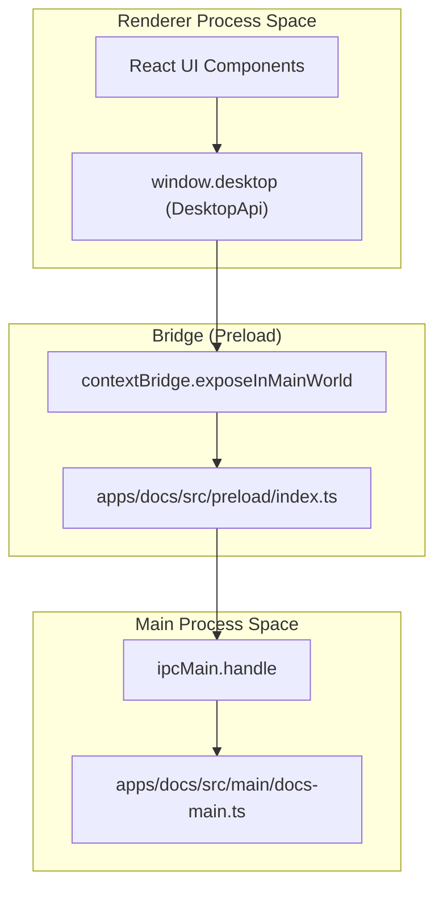
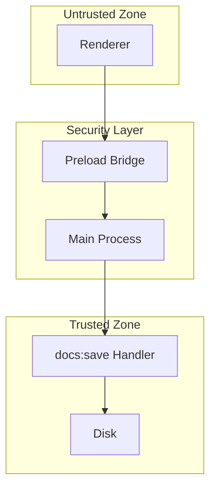

# Core Architecture

> **Relevant source files**
> * [apps/docs/electron.vite.config.ts](https://github.com/genspark-ai/genoffice/blob/d5558b6b/apps/docs/electron.vite.config.ts)
> * [apps/docs/src/main/index.ts](https://github.com/genspark-ai/genoffice/blob/d5558b6b/apps/docs/src/main/index.ts)
> * [apps/docs/src/preload/index.ts](https://github.com/genspark-ai/genoffice/blob/d5558b6b/apps/docs/src/preload/index.ts)

This page provides a high-level overview of the shared architectural patterns and philosophies that underpin all six applications within the GenOffice suite (Docs, Sheets, Slides, PDF, Markdown, and the Shell). It covers the fundamental Electron process model, the byte-preserving round-trip data handling, the security model for inter-process communication (IPC), and the common libraries used across the codebase.

## Electron Process Model

All GenOffice applications leverage Electron's multi-process architecture, which separates the application into a main process and multiple renderer processes. This design enhances security, stability, and performance.

* **Main Process**: This process is responsible for managing native GUI interactions, such as creating windows, handling system dialogs, and interacting with the operating system. It also manages application lifecycle events and acts as a central hub for IPC. Each application has its own main process entry point, which can be run standalone or integrated into the `apps/shell` application. For example, `apps/docs/src/main/docs-main.ts` contains the main process logic for the Docs application [apps/docs/src/main/docs-main.ts L1-L67](https://github.com/genspark-ai/genoffice/blob/d5558b6b/apps/docs/src/main/docs-main.ts#L1-L67)  When running standalone, `apps/docs/src/main/index.ts` initiates this logic [apps/docs/src/main/index.ts L1-L3](https://github.com/genspark-ai/genoffice/blob/d5558b6b/apps/docs/src/main/index.ts#L1-L3)
* **Renderer Process**: Each window or `WebContentsView` in Electron runs in its own renderer process. These processes are essentially Chromium browser instances, responsible for rendering the user interface using web technologies (HTML, CSS, JavaScript). They are isolated from the main process and the operating system for security reasons.
* **Preload Script**: A preload script runs in the renderer process before web content is loaded, but it has access to Node.js APIs. It acts as a bridge between the renderer process and the main process, exposing a carefully selected set of APIs to the renderer via `contextBridge`. This mechanism ensures that the renderer process does not have direct access to Node.js or Electron APIs. For instance, `apps/docs/src/preload/index.ts` defines the `DesktopApi` and `ProjectApi` that are exposed to the Docs renderer [apps/docs/src/preload/index.ts L13-L124](https://github.com/genspark-ai/genoffice/blob/d5558b6b/apps/docs/src/preload/index.ts#L13-L124)

For details, see [Electron Shell & Tab Manager](/genspark-ai/genoffice/2.1-electron-shell-and-tab-manager).

### System Mapping: Renderer to Main Bridge

This diagram associates high-level system names with specific code entities that bridge the "Natural Language Space" to the "Code Entity Space".

Sources:

* apps/docs/src/preload/index.ts:1-129
* apps/docs/src/main/docs-main.ts:1-67

## Byte-Preserving Round-Trip Philosophy

A core architectural philosophy across GenOffice is the "byte-preserving round-trip" for document formats. This means that when a document (e.g., `.docx`, `.pptx`, `.xlsx`, `.md`) is opened, edited, and saved, the application strives to preserve as much of the original file's structure and data as possible, even for features it doesn't fully understand or render.

Instead of fully re-generating the document from an internal model, GenOffice applications often parse the original file, make targeted modifications to specific parts (e.g., XML fragments in OOXML or frontmatter in Markdown), and then re-serialize the modified parts back into the original container.

For details, see [DOCX Engine (packages/docx-engine)](/genspark-ai/genoffice/3.2-docx-engine-(packagesdocx-engine)) and [PPTX Engine & Renderer (packages/pptx-engine, pptx-render)](/genspark-ai/genoffice/5.1-pptx-engine-and-renderer-(packagespptx-engine-pptx-render)).

## IPC Security Model

Given the multi-process nature of Electron and the potential for untrusted content (e.g., AI-generated scripts), a robust IPC security model is paramount.

* **Context Isolation and Sandboxing**: All renderer windows run with `contextIsolation: true`, `nodeIntegration: false`, and `sandbox: true`. This prevents renderer processes from directly accessing Node.js APIs or the file system [SECURITY.md L13-L14](https://github.com/genspark-ai/genoffice/blob/d5558b6b/SECURITY.md?plain=1#L13-L14)
* **Typed, Validated IPC Channels**: Communication occurs exclusively through explicitly defined, typed IPC channels. For example, `DesktopApi` in `apps/docs/src/preload/index.ts` strictly maps renderer calls to specific `ipcRenderer.invoke` channels like `docs:save` or `ai:chat` [apps/docs/src/preload/index.ts L46-L75](https://github.com/genspark-ai/genoffice/blob/d5558b6b/apps/docs/src/preload/index.ts#L46-L75)
* **`safeExternalUrl` Gate**: All calls to `shell.openExternal` are routed through a single `safeExternalUrl` gate provided by `@genoffice/electron-utils` to prevent arbitrary code execution via malicious URL schemes [SECURITY.md L18-L22](https://github.com/genspark-ai/genoffice/blob/d5558b6b/SECURITY.md?plain=1#L18-L22)
* **AI Layout Script Sandboxed Interpreter**: For AI-generated layout scripts in Slides, a custom AST interpreter (`apps/slides/src/renderer/ai/layout-script-interpreter.ts`) is used to evaluate a synchronous subset of JavaScript without access to dangerous globals or APIs [SECURITY.md L25-L62](https://github.com/genspark-ai/genoffice/blob/d5558b6b/SECURITY.md?plain=1#L25-L62)

For details, see [Security Model & IPC Architecture](/genspark-ai/genoffice/2.2-security-model-and-ipc-architecture).

### Security Architecture: IPC Flow

Sources:

* SECURITY.md:13-62
* apps/docs/src/preload/index.ts:46-47

## Shared Packages Overview

The GenOffice monorepo uses `npm` workspaces to manage shared libraries in `packages/*`. These are bundled into the applications at build time via `electron-vite` configuration [apps/docs/electron.vite.config.ts L8-L23](https://github.com/genspark-ai/genoffice/blob/d5558b6b/apps/docs/electron.vite.config.ts#L8-L23)

| Package | Purpose |
| --- | --- |
| `docx-engine` | OOXML parsing and byte-level paragraph patching. |
| `pptx-engine` | PPTX structure management and generation. |
| `agent-core` | The core AI `AgentLoop` and tool-calling logic. |
| `ai-provider` | Abstraction for Anthropic, Gemini, OpenAI, etc. |
| `ui` | Shared React components and design tokens. |
| `electron-utils` | Common Electron helpers (security gates, navigation guards). |

For details, see [Shared Packages Overview](/genspark-ai/genoffice/2.3-shared-packages-overview).

Sources:

* apps/docs/electron.vite.config.ts:8-23
* apps/docs/src/preload/index.ts:131-135
* SECURITY.md:13-62