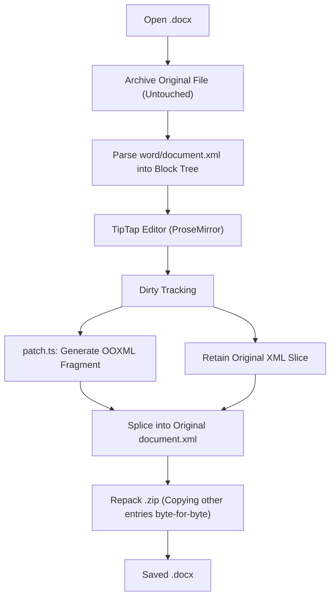
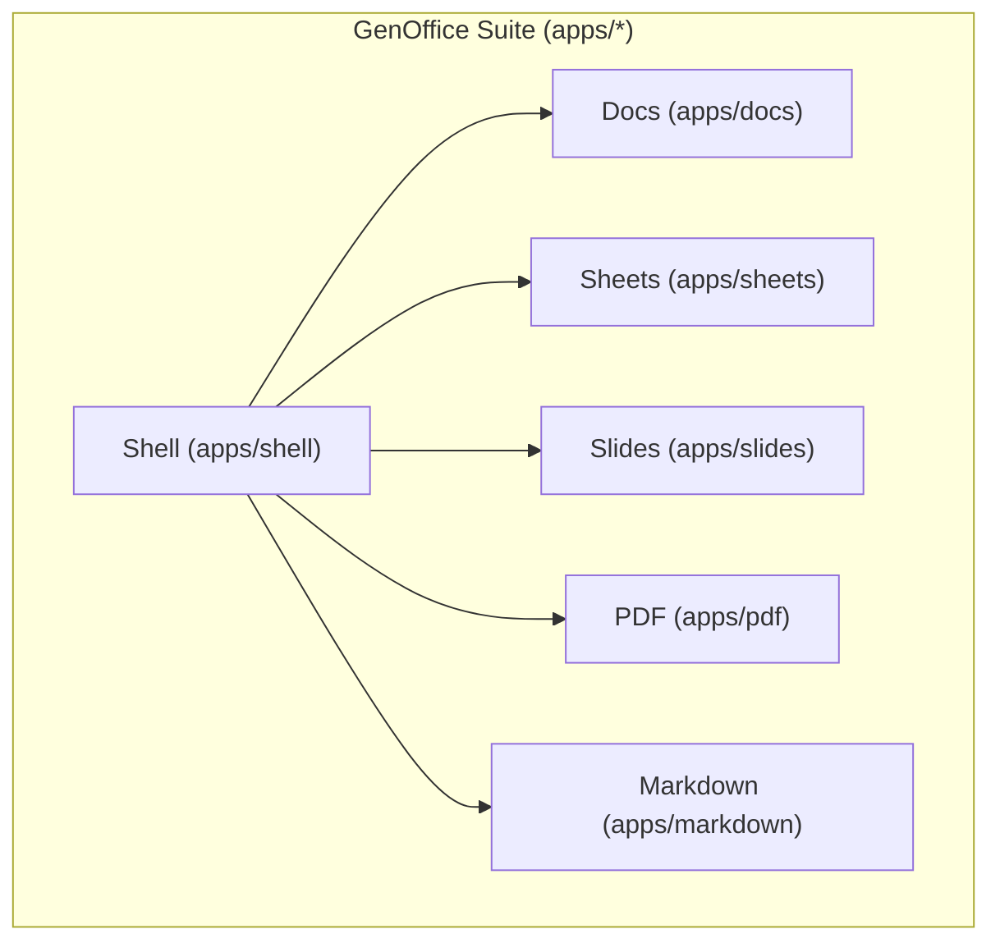
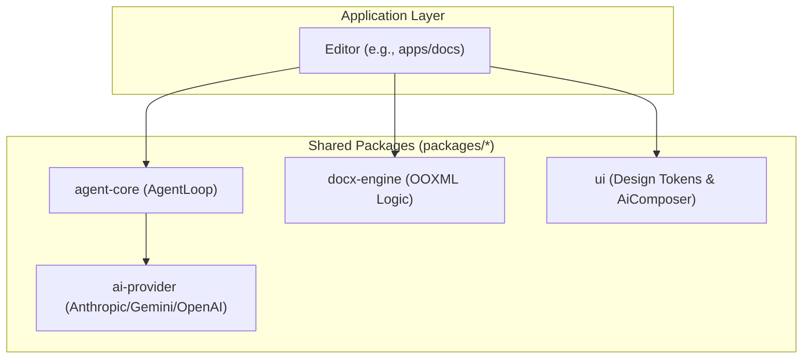

# GenOffice Overview

> **Relevant source files**
> * [.github/ISSUE_TEMPLATE/bug_report.yml](https://github.com/genspark-ai/genoffice/blob/d5558b6b/.github/ISSUE_TEMPLATE/bug_report.yml)
> * [.github/ISSUE_TEMPLATE/feature_request.yml](https://github.com/genspark-ai/genoffice/blob/d5558b6b/.github/ISSUE_TEMPLATE/feature_request.yml)
> * [CLAUDE.md](https://github.com/genspark-ai/genoffice/blob/d5558b6b/CLAUDE.md?plain=1)
> * [README.md](https://github.com/genspark-ai/genoffice/blob/d5558b6b/README.md?plain=1)

GenOffice is the world's first full-featured open-source AI Office suite, designed for macOS, Windows, and Linux. It comprises six Electron applications sharing a common engine layer. Its core philosophy centers on integrating AI editing as a fundamental workflow rather than an add-on, while maintaining strict byte-preserving fidelity for Microsoft Office formats.

Sources: [README.md L1-L5](https://github.com/genspark-ai/genoffice/blob/d5558b6b/README.md?plain=1#L1-L5)

 [README.md L11-L17](https://github.com/genspark-ai/genoffice/blob/d5558b6b/README.md?plain=1#L11-L17)

## What is GenOffice?

GenOffice is a desktop application suite that includes a word processor (Docs), a spreadsheet (Sheets), a presentation tool (Slides), a PDF editor, and a Markdown editor. These productivity applications are hosted within a common shell application (`apps/shell`). A key differentiator is its "AI-native" approach, where AI capabilities are deeply integrated into the editing experience across all applications, providing block-level edits with snapshots and diffs.

Sources: [README.md L11-L17](https://github.com/genspark-ai/genoffice/blob/d5558b6b/README.md?plain=1#L11-L17)

 [README.md L23-L31](https://github.com/genspark-ai/genoffice/blob/d5558b6b/README.md?plain=1#L23-L31)

## Architectural Philosophy: Byte-Preserving Round-Trip

A foundational principle across GenOffice applications is the "byte-preserving round-trip" architecture. This means that when a document is opened, edited, and saved, the application strives to modify only the parts of the file that were explicitly changed. Unmodified sections of the original file are preserved byte-for-byte. This approach minimizes the risk of layout shifts or data corruption in complex document formats like `.docx`, `.xlsx`, and `.pptx`.

For details, see [Core Architecture](/genspark-ai/genoffice/2-core-architecture).

### DOCX Example: Paragraph Patching

In GenOffice Docs, when a `.docx` file is opened, the original document is archived. The `word/document.xml` is parsed into a `Block` tree. Each block is anchored by a `docxIndex` and retains its original XML slice. During saving, the `patch.ts` logic ensures only "dirty" blocks are converted into OOXML fragments and spliced back into the original `document.xml`.

Sources: [README.md L80-L82](https://github.com/genspark-ai/genoffice/blob/d5558b6b/README.md?plain=1#L80-L82)

 [README.md L26-L27](https://github.com/genspark-ai/genoffice/blob/d5558b6b/README.md?plain=1#L26-L27)

### Diagram: DOCX Round-Trip Architecture

Sources: [README.md L80-L82](https://github.com/genspark-ai/genoffice/blob/d5558b6b/README.md?plain=1#L80-L82)

## The Six-App Suite Structure

GenOffice is composed of six distinct Electron applications organized as a monorepo. They share common engine packages and infrastructure while maintaining specialized editors for different file types.

For details on the repository structure, see [Repository Layout & Monorepo Structure](/genspark-ai/genoffice/1.2-repository-layout-and-monorepo-structure).

### Diagram: GenOffice Application Suite

Sources: [README.md L78-L95](https://github.com/genspark-ai/genoffice/blob/d5558b6b/README.md?plain=1#L78-L95)

 [.github/ISSUE_TEMPLATE/bug_report.yml L5-L19](https://github.com/genspark-ai/genoffice/blob/d5558b6b/.github/ISSUE_TEMPLATE/bug_report.yml#L5-L19)

### Application Overview

| App | Product | Core Engine / Tech |
| --- | --- | --- |
| `apps/docs` | **GenOffice Docs** | TipTap/ProseMirror + `docx-engine`. Features paragraph patching and Word-faithful pagination. |
| `apps/sheets` | **GenOffice Sheets** | Univer core + Rust `xlsx-engine` sidecar. Supports pivot tables, slicers, and Konva charts. |
| `apps/slides` | **GenOffice Slides** | In-house `pptx-engine`. Supports masters, layouts, and HarfBuzz text shaping. |
| `apps/pdf` | **GenOffice PDF** | `pdf.js` + `pdf-lib`. Allows retyping text and editing images in-page. |
| `apps/markdown` | **GenOffice Markdown** | TipTap GFM. Supports frontmatter preservation and local Markdown-to-Word export. |
| `apps/shell` | **GenOffice Shell** | Electron Shell. Manages tabs, home screen, and the `project-store` for recent files. |

Sources: [README.md L78-L95](https://github.com/genspark-ai/genoffice/blob/d5558b6b/README.md?plain=1#L78-L95)

## Shared Engine Packages

Beyond the individual applications, GenOffice leverages a set of shared, pure TypeScript engine packages in `packages/*`. These packages encapsulate core functionalities like AI orchestration, document parsing, and UI tokens, ensuring consistency across the suite.

For a detailed overview of these packages, see [Shared Packages Overview](/genspark-ai/genoffice/2.3-shared-packages-overview).

### Diagram: Shared Logic & AI Orchestration

Sources: [CLAUDE.md L7-L11](https://github.com/genspark-ai/genoffice/blob/d5558b6b/CLAUDE.md?plain=1#L7-L11)

 [README.md L30-L32](https://github.com/genspark-ai/genoffice/blob/d5558b6b/README.md?plain=1#L30-L32)

## AI System & Theming

Every GenOffice application integrates an AI panel powered by `packages/agent-core`. The AI is document-aware, using per-app "Skills" (e.g., `docs-skill.ts`, `slides-skill.ts`) to perform block-level edits.

The entire suite supports Light, Dark, and System themes controlled via a `data-theme` attribute on `<html>`. UI chrome colors must use semantic tokens defined in `packages/ui/src/tokens.css`, while document content (the "paper") remains theme-independent to ensure visual fidelity.

For details on theming, see [CLAUDE.md L5-L35](https://github.com/genspark-ai/genoffice/blob/d5558b6b/CLAUDE.md?plain=1#L5-L35)

 For AI details, see [AI System](/genspark-ai/genoffice/8-ai-system).

Sources: [CLAUDE.md L5-L35](https://github.com/genspark-ai/genoffice/blob/d5558b6b/CLAUDE.md?plain=1#L5-L35)

 [README.md L31-L33](https://github.com/genspark-ai/genoffice/blob/d5558b6b/README.md?plain=1#L31-L33)

## Navigating This Wiki

This wiki is structured to provide a progressive understanding of the GenOffice codebase:

* **[Getting Started & Development Setup](/genspark-ai/genoffice/1.1-getting-started-and-development-setup)**: Environment setup, Node 22 requirements, and Rust toolchain for the Sheets sidecar.
* **[Repository Layout & Monorepo Structure](/genspark-ai/genoffice/1.2-repository-layout-and-monorepo-structure)**: Deep dive into the `apps/`, `packages/`, and `ee/` (Enterprise) directory structure.
* **[Core Architecture](/genspark-ai/genoffice/2-core-architecture)**: Shared Electron patterns, IPC security, and the `TabManager`.
* **Editor Deep Dives**: Detailed technical documentation for [GenOffice Docs (Word Processor)](/genspark-ai/genoffice/3-genoffice-docs-(word-processor)), [GenOffice Sheets (Spreadsheet)](/genspark-ai/genoffice/4-genoffice-sheets-(spreadsheet)), [GenOffice Slides (Presentations)](/genspark-ai/genoffice/5-genoffice-slides-(presentations)), [GenOffice PDF](/genspark-ai/genoffice/6-genoffice-pdf), and [GenOffice Markdown (Markdown Editor)](/genspark-ai/genoffice/7-genoffice-markdown-(markdown-editor)).
* **[AI System](/genspark-ai/genoffice/8-ai-system)**: The `AgentLoop`, `AgentSkill` interfaces, and provider abstractions.
* **[Shared Infrastructure Packages](/genspark-ai/genoffice/9-shared-infrastructure-packages)**: Font metrics, i18n, and the UI kit.
* **[Testing & Quality Infrastructure](/genspark-ai/genoffice/10-testing-and-quality-infrastructure)**: Vitest unit tests, Playwright E2E, and the `fidelity-compare` tools.
* **[Contributing & Community](/genspark-ai/genoffice/11-contributing-and-community)**: PR processes, licensing (Apache-2.0), and the snapshot-commit workflow.
* **[Glossary](/genspark-ai/genoffice/12-glossary)**: Definitions for terms like `docxIndex`, `EMU`, and `xlsx-sidecar`.

Sources: [README.md L5-L7](https://github.com/genspark-ai/genoffice/blob/d5558b6b/README.md?plain=1#L5-L7)

 [CLAUDE.md L1-L3](https://github.com/genspark-ai/genoffice/blob/d5558b6b/CLAUDE.md?plain=1#L1-L3)