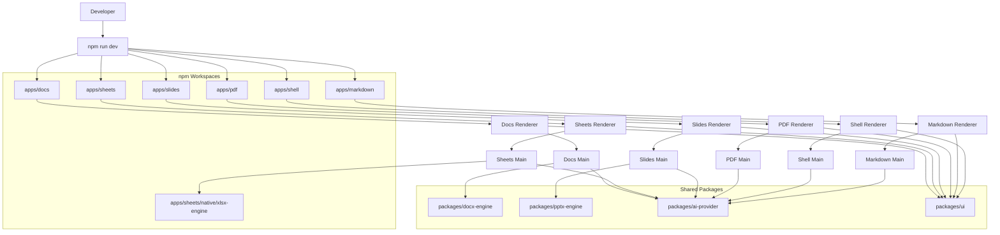
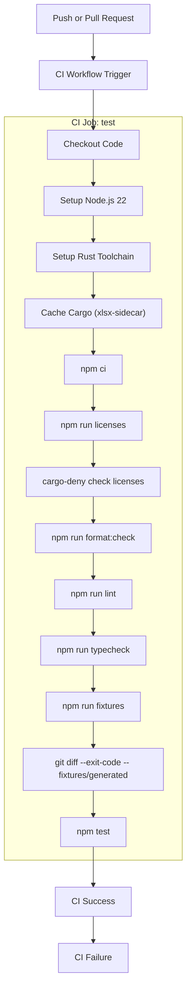

# Getting Started & Development Setup

> **Relevant source files**
> * [.gitattributes](https://github.com/genspark-ai/genoffice/blob/d5558b6b/.gitattributes)
> * [.nvmrc](https://github.com/genspark-ai/genoffice/blob/d5558b6b/.nvmrc)
> * [.prettierignore](https://github.com/genspark-ai/genoffice/blob/d5558b6b/.prettierignore)
> * [.prettierrc.json](https://github.com/genspark-ai/genoffice/blob/d5558b6b/.prettierrc.json)
> * [CONTRIBUTING.md](https://github.com/genspark-ai/genoffice/blob/d5558b6b/CONTRIBUTING.md?plain=1)

This page details the steps required to set up a development environment for the GenOffice codebase. It covers cloning the repository, installing necessary dependencies, running development servers, executing tests, and building installers. Key requirements include Node.js version 22 and a Rust toolchain for the `xlsx-engine` sidecar. The document also explains the `npm` workspace layout and important `npm` scripts.

## Prerequisites

Before you begin, ensure you have the following installed:

* **Node.js**: Version 22 or higher. The project specifies Node.js 22 in its `.nvmrc` file [./nvmrc L1](https://github.com/genspark-ai/genoffice/blob/d5558b6b/./nvmrc#L1-L1)
* **npm**: Version 10 or higher [./CONTRIBUTING.md L35-L36](https://github.com/genspark-ai/genoffice/blob/d5558b6b/./CONTRIBUTING.md?plain=1#L35-L36)
* **Rust Toolchain**: Required for the `xlsx-engine` sidecar located at `apps/sheets/native/xlsx-engine` for handling XLSX import/export [./CONTRIBUTING.md L31-L36](https://github.com/genspark-ai/genoffice/blob/d5558b6b/./CONTRIBUTING.md?plain=1#L31-L36)  This means `cargo` must be available on your PATH.

## Repository Layout

The GenOffice codebase is structured as a monorepo using `npm` workspaces. This allows for shared dependencies and consistent development practices across multiple applications and packages.

* **`apps/*`**: Contains the six Electron applications: `docs`, `sheets`, `slides`, `pdf`, `markdown`, and `shell`. Each application is an `npm` workspace with its own `src/main` (Electron main process), `src/renderer` (React UI), and `tests/` directories [./CONTRIBUTING.md L25-L28](https://github.com/genspark-ai/genoffice/blob/d5558b6b/./CONTRIBUTING.md?plain=1#L25-L28)
* **`packages/*`**: Houses pure TypeScript engine and shared utility packages. These packages have no direct Electron dependency and are unit-tested. Examples include `docx-engine`, `pptx-engine`, AI agent core, providers, `i18n`, and the UI kit [./CONTRIBUTING.md L29-L31](https://github.com/genspark-ai/genoffice/blob/d5558b6b/./CONTRIBUTING.md?plain=1#L29-L31)
* **`apps/sheets/native/xlsx-engine`**: This directory contains the Rust-based `xlsx-engine`, which functions as a sidecar process for XLSX import/export functionality in the Sheets application [./CONTRIBUTING.md L31-L32](https://github.com/genspark-ai/genoffice/blob/d5558b6b/./CONTRIBUTING.md?plain=1#L31-L32)

## Getting Started

Follow these steps to clone the repository and set up your development environment:

1. **Clone the repository**: ``` git clone https://github.com/genspark-ai/genoffice.gitcd genoffice ```
2. **Install dependencies**: This command installs all `npm` dependencies across all workspaces. ``` npm install ```
3. **Generate test fixtures**: This is a one-time step and should be repeated after any changes to the `docx-engine`. It populates `fixtures/generated` [./CONTRIBUTING.md L40](https://github.com/genspark-ai/genoffice/blob/d5558b6b/./CONTRIBUTING.md?plain=1#L40-L40) ``` npm run fixtures ```

### Running Development Servers

You can run all applications simultaneously or focus on a single application.

* **Run all applications**: This command starts all editors and the shell against their respective Vite development servers. ``` npm run dev ``` This script sets environment variables like `*_DEV_PORT` and `*_RENDERER_URL` for each app [./CONTRIBUTING.md L41](https://github.com/genspark-ai/genoffice/blob/d5558b6b/./CONTRIBUTING.md?plain=1#L41-L41)  [./CONTRIBUTING.md L109](https://github.com/genspark-ai/genoffice/blob/d5558b6b/./CONTRIBUTING.md?plain=1#L109-L109)
* **Run a single application**: For example, to run only the Docs application: ``` npm run dev:docs ``` Each application's `package.json` defines its own `dev` script. For instance, `apps/docs/package.json` defines `dev` as `electron-vite dev` [./apps/docs/package.json L10-L11](https://github.com/genspark-ai/genoffice/blob/d5558b6b/./apps/docs/package.json#L10-L11)

### Development Environment Diagram



Title: "GenOffice Development Environment Overview"
Sources: [./CONTRIBUTING.md L25-L32](https://github.com/genspark-ai/genoffice/blob/d5558b6b/./CONTRIBUTING.md?plain=1#L25-L32)

 [./CONTRIBUTING.md L39-L43](https://github.com/genspark-ai/genoffice/blob/d5558b6b/./CONTRIBUTING.md?plain=1#L39-L43)

 [./CONTRIBUTING.md L109](https://github.com/genspark-ai/genoffice/blob/d5558b6b/./CONTRIBUTING.md?plain=1#L109-L109)

## Running Tests

The project includes various checks and tests that are run in CI. It's recommended to run these locally before committing changes.

* **Check formatting**: This command checks for uncommitted changed or new files that do not conform to the Prettier formatting rules (configured with `lf` line endings) [./.prettierrc.json L7](https://github.com/genspark-ai/genoffice/blob/d5558b6b/./.prettierrc.json#L7-L7) ``` npm run format:check ``` For PRs, CI checks only files changed from the base branch to avoid repository-wide formatting diffs [./CONTRIBUTING.md L66-L68](https://github.com/genspark-ai/genoffice/blob/d5558b6b/./CONTRIBUTING.md?plain=1#L66-L68)
* **Linting**: Runs ESLint across the entire repository. Zero errors are required [./CONTRIBUTING.md L51](https://github.com/genspark-ai/genoffice/blob/d5558b6b/./CONTRIBUTING.md?plain=1#L51-L51) ``` npm run lint ```
* **Typechecking**: Executes `tsc --noEmit` across every workspace to ensure type correctness [./CONTRIBUTING.md L52](https://github.com/genspark-ai/genoffice/blob/d5558b6b/./CONTRIBUTING.md?plain=1#L52-L52) ``` npm run typecheck ```
* **Unit tests**: Runs unit tests for both engine packages and application code using Vitest. This also includes tests for the Rust `xlsx-engine` sidecar [./CONTRIBUTING.md L53](https://github.com/genspark-ai/genoffice/blob/d5558b6b/./CONTRIBUTING.md?plain=1#L53-L53)  [./CONTRIBUTING.md L122-L123](https://github.com/genspark-ai/genoffice/blob/d5558b6b/./CONTRIBUTING.md?plain=1#L122-L123) ``` npm test ```
* **Check dependency licenses**: Verifies that production dependency licenses are within the permissive allowlist [./CONTRIBUTING.md L54](https://github.com/genspark-ai/genoffice/blob/d5558b6b/./CONTRIBUTING.md?plain=1#L54-L54) ``` npm run licenses ```
* **Regenerate and check test fixtures**: ``` npm run fixturesgit diff --exit-code -- fixtures/generated ``` The fixture generation is byte-deterministic, meaning a `git diff` check ensures that the generator and committed fixtures have not diverged.

### CI Workflow Diagram



Title: "CI Workflow for GenOffice"
Sources: [./.github/workflows/ci.yml L1-L93](https://github.com/genspark-ai/genoffice/blob/d5558b6b/./.github/workflows/ci.yml#L1-L93)

 [./CONTRIBUTING.md L47-L55](https://github.com/genspark-ai/genoffice/blob/d5558b6b/./CONTRIBUTING.md?plain=1#L47-L55)

## Building Installers

To build installers for macOS and Windows, run the following commands from the repository root. These commands regenerate third-party notices and build all applications before packaging them [./CONTRIBUTING.md L70-L74](https://github.com/genspark-ai/genoffice/blob/d5558b6b/./CONTRIBUTING.md?plain=1#L70-L74)

* **Build macOS installers (dmg + zip)**: ``` npm run dist:mac ```
* **Build Windows installers (nsis)**: ``` npm run dist:win ```

**Note on Signing Credentials**: If Apple or Windows signing credentials are not present in your environment, these commands will produce unsigned artifacts. Code signing and notarization will be skipped with a warning, which is expected for contributor builds [./CONTRIBUTING.md L80-L82](https://github.com/genspark-ai/genoffice/blob/d5558b6b/./CONTRIBUTING.md?plain=1#L80-L82)

**Windows `dist:win` specific requirement**:
For `dist:win`, the `xlsx-sidecar` needs to be available at the MinGW cross-compilation path. If building on Windows, the sidecar is typically built under the MSVC target. You'll need to stage it correctly:

```python
cargo build --release --target x86_64-pc-windows-gnu   # from apps/sheets/native/xlsx-engine
```

Alternatively, copy an existing `target/release/xlsx-sidecar.exe` to `target/x86_64-pc-windows-gnu/release/` [./CONTRIBUTING.md L88-L93](https://github.com/genspark-ai/genoffice/blob/d5558b6b/./CONTRIBUTING.md?plain=1#L88-L93)

Sources: [./CONTRIBUTING.md L70-L93](https://github.com/genspark-ai/genoffice/blob/d5558b6b/./CONTRIBUTING.md?plain=1#L70-L93)

 [./apps/docs/package.json L16-L18](https://github.com/genspark-ai/genoffice/blob/d5558b6b/./apps/docs/package.json#L16-L18)

## Environment Variables

While not strictly required for basic operation, several environment variables can be used for testing and local overrides [./CONTRIBUTING.md L95-L109](https://github.com/genspark-ai/genoffice/blob/d5558b6b/./CONTRIBUTING.md?plain=1#L95-L109)

:

| Variable | Effect |
| --- | --- |
| `GENOFFICE_USER_DATA` | Override the Electron `userData` directory for test isolation. |
| `GENOFFICE_LANG` | Force the UI language instead of following the OS locale. |
| `GENOFFICE_FAKE_UPDATE` | Exercise the updater UI without a real release feed. |
| `GSK_API_KEY`, `GSK_CLI_PATH` | Genspark credentials / CLI location for the built-in AI provider. |
| `XLSX_SIDECAR_PATH` | Point at a locally built xlsx sidecar. |
| `*_DEV_PORT`, `*_RENDERER_URL` | Per-app Vite dev server ports and renderer URLs (set by `npm run dev`). |

Sources: [./CONTRIBUTING.md L95-L110](https://github.com/genspark-ai/genoffice/blob/d5558b6b/./CONTRIBUTING.md?plain=1#L95-L110)