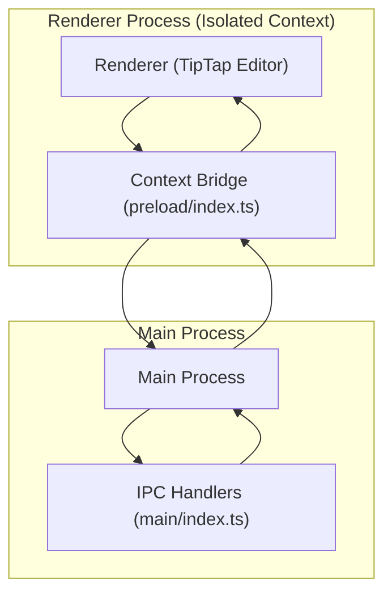
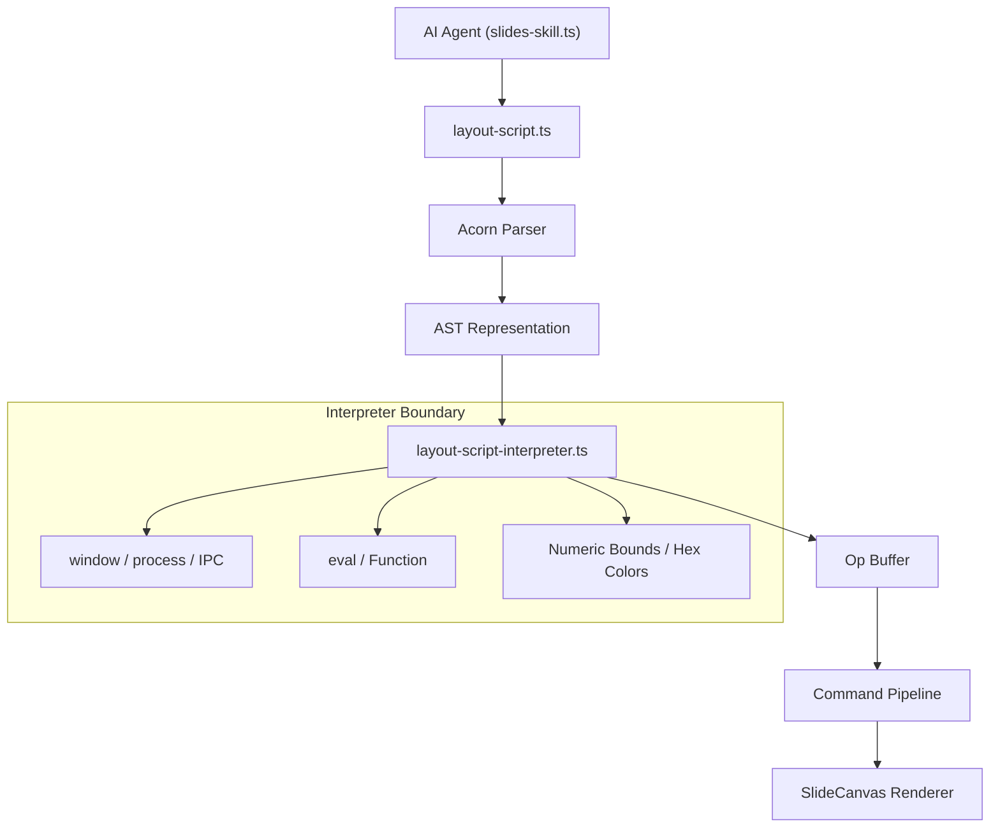

# Security Model & IPC Architecture

> **Relevant source files**
> * [SECURITY.md](https://github.com/genspark-ai/genoffice/blob/d5558b6b/SECURITY.md?plain=1)
> * [apps/docs/src/renderer/ai/protocol.ts](https://github.com/genspark-ai/genoffice/blob/d5558b6b/apps/docs/src/renderer/ai/protocol.ts)
> * [apps/docs/src/renderer/ai/transport.ts](https://github.com/genspark-ai/genoffice/blob/d5558b6b/apps/docs/src/renderer/ai/transport.ts)

This page details the security posture of GenOffice, focusing on Electron's built-in security features, the Inter-Process Communication (IPC) architecture, and specific threat models outlined in `SECURITY.md` [SECURITY.md L1-L86](https://github.com/genspark-ai/genoffice/blob/d5558b6b/SECURITY.md?plain=1#L1-L86)

 It covers `contextIsolation`, `sandbox` mode, typed IPC channels, the `safeExternalUrl` gate, and the sandboxed interpreter for AI-generated layout scripts.

## Electron Security Posture

GenOffice applications leverage Electron's security features to isolate renderer processes and restrict their capabilities. All application windows and tab views (docs, sheets, slides, pdf, markdown, shell, updater) are configured with a strict security posture [SECURITY.md L12-L15](https://github.com/genspark-ai/genoffice/blob/d5558b6b/SECURITY.md?plain=1#L12-L15)

### Context Isolation and Sandboxing

Every document window and tab view runs with `contextIsolation: true`, `nodeIntegration: false`, and `sandbox: true` [SECURITY.md L14-L15](https://github.com/genspark-ai/genoffice/blob/d5558b6b/SECURITY.md?plain=1#L14-L15)

* **`contextIsolation: true`**: This ensures that the preload script and Electron's internal modules run in an isolated JavaScript context, separate from the renderer process's main JavaScript context. This prevents the renderer process from directly accessing Node.js APIs or the `contextBridge` exposed APIs, even if the renderer is compromised.
* **`nodeIntegration: false`**: This disables Node.js integration in the renderer process, preventing direct access to Node.js APIs like `fs` or `child_process`.
* **`sandbox: true`**: This enables Chromium's sandbox for the renderer process, providing an additional layer of security by limiting the renderer's access to system resources.

Sources:

* [SECURITY.md L12-L15](https://github.com/genspark-ai/genoffice/blob/d5558b6b/SECURITY.md?plain=1#L12-L15)

## Inter-Process Communication (IPC) Architecture

Communication between the renderer processes and the main process is strictly controlled and typed.

### Typed and Validated IPC Channels

Renderers communicate with the main process exclusively through typed, validated IPC channels [SECURITY.md L16-L17](https://github.com/genspark-ai/genoffice/blob/d5558b6b/SECURITY.md?plain=1#L16-L17)

 This means that all data exchanged between the renderer and main processes must conform to predefined schemas. For example, the Sheets application uses `zod` for end-to-end schema validation of IPC payloads [SECURITY.md L17-L18](https://github.com/genspark-ai/genoffice/blob/d5558b6b/SECURITY.md?plain=1#L17-L18)

The `contextBridge.exposeInMainWorld()` API is used in preload scripts to expose a limited set of APIs to the renderer process. These exposed APIs are functions that internally use `ipcRenderer.invoke()` or `ipcRenderer.on()` to communicate with the main process.

For instance, in `apps/docs/src/preload/index.ts`, a `DesktopApi` object is exposed to the renderer's `window.desktop` object [apps/docs/src/preload/index.ts L13-L127](https://github.com/genspark-ai/genoffice/blob/d5558b6b/apps/docs/src/preload/index.ts#L13-L127)

 This API includes methods like `openDocx()`, `saveDocx()`, `aiChat()`, and `onMenuCommand()`, each corresponding to a specific IPC channel (e.g., `docs:open`, `docs:save`, `ai:chat`, `menu:command`).

**Diagram: IPC Communication Flow (Docs Example)**

Sources:

* [SECURITY.md L16-L18](https://github.com/genspark-ai/genoffice/blob/d5558b6b/SECURITY.md?plain=1#L16-L18)
* [apps/docs/src/preload/index.ts L13-L127](https://github.com/genspark-ai/genoffice/blob/d5558b6b/apps/docs/src/preload/index.ts#L13-L127)

### AI Transport & Security

The AI system uses a specialized transport layer to bridge the renderer and main process securely. In `apps/docs/src/renderer/ai/transport.ts`, the `createElectronTransport` function wraps the `window.desktop` IPC methods (`aiStream`, `onAiStream`, `aiStreamCancel`) into an `AgentTransport` interface [apps/docs/src/renderer/ai/transport.ts L6-L16](https://github.com/genspark-ai/genoffice/blob/d5558b6b/apps/docs/src/renderer/ai/transport.ts#L6-L16)

This ensures that the AI `AgentLoop` (from `@genoffice/agent-core`) never directly touches Electron APIs. Instead, it uses the validated IPC bridge to send requests and receive streaming responses [apps/docs/src/renderer/ai/transport.ts L7-L11](https://github.com/genspark-ai/genoffice/blob/d5558b6b/apps/docs/src/renderer/ai/transport.ts#L7-L11)

Sources:

* [apps/docs/src/renderer/ai/transport.ts L1-L17](https://github.com/genspark-ai/genoffice/blob/d5558b6b/apps/docs/src/renderer/ai/transport.ts#L1-L17)
* [apps/docs/src/renderer/ai/protocol.ts L14-L20](https://github.com/genspark-ai/genoffice/blob/d5558b6b/apps/docs/src/renderer/ai/protocol.ts#L14-L20)

### safeExternalUrl Gate

All calls to `shell.openExternal` are routed through a single shared gate provided by `@genoffice/electron-utils` called `safeExternalUrl` [SECURITY.md L18-L20](https://github.com/genspark-ai/genoffice/blob/d5558b6b/SECURITY.md?plain=1#L18-L20)

 This gate parses the URL and enforces a protocol allowlist. Only `http` and `https` protocols are generally allowed. PDF link annotations additionally permit `mailto` [SECURITY.md L20-L21](https://github.com/genspark-ai/genoffice/blob/d5558b6b/SECURITY.md?plain=1#L20-L21)

 Protocols like `file:`, `javascript:`, and custom schemes are always rejected [SECURITY.md L21-L22](https://github.com/genspark-ai/genoffice/blob/d5558b6b/SECURITY.md?plain=1#L21-L22)

Sources:

* [SECURITY.md L18-L22](https://github.com/genspark-ai/genoffice/blob/d5558b6b/SECURITY.md?plain=1#L18-L22)

### AI API Keys

No API keys are hardcoded within the application [SECURITY.md L23](https://github.com/genspark-ai/genoffice/blob/d5558b6b/SECURITY.md?plain=1#L23-L23)

 AI requests are proxied through the user's signed-in account by default. User-supplied API keys are stored securely in the OS-level settings store [SECURITY.md L23-L24](https://github.com/genspark-ai/genoffice/blob/d5558b6b/SECURITY.md?plain=1#L23-L24)

Sources:

* [SECURITY.md L23-L24](https://github.com/genspark-ai/genoffice/blob/d5558b6b/SECURITY.md?plain=1#L23-L24)

## Threat Model: AI-Generated Layout Scripts (Slides)

The Slides application incorporates an AI feature that can adjust slide layouts by generating small scripts. These scripts are not executed directly by the JavaScript engine but are instead processed by a sandboxed interpreter.

### Sandboxed Interpreter for Layout Scripts

The AI-generated layout scripts are parsed with Acorn and evaluated by a constrained Abstract Syntax Tree (AST) interpreter [SECURITY.md L26-L29](https://github.com/genspark-ai/genoffice/blob/d5558b6b/SECURITY.md?plain=1#L26-L29)

 Although the source code of these scripts resembles a small, synchronous subset of JavaScript, it is explicitly *not* passed to `eval`, `Function`, a VM context, a worker, or the JavaScript engine as executable source [SECURITY.md L29-L31](https://github.com/genspark-ai/genoffice/blob/d5558b6b/SECURITY.md?plain=1#L29-L31)

**Capabilities of the Script (by design):**
The interpreter allows scripts to:

* Read prototype-free JSON copies of `els` (elements) and `canvas` data.
* Perform bounded arithmetic and control flow.
* Utilize explicitly implemented string, array, regular expression, and `Math` helpers.
* Call specific predefined functions such as `setBox`, `moveBy`, `resizeBy`, `setText`, `setStyle`, `setFill`, `setStroke`, and `log` [SECURITY.md L34-L36](https://github.com/genspark-ai/genoffice/blob/d5558b6b/SECURITY.md?plain=1#L34-L36)

Every edit primitive within the interpreter validates its arguments and writes operations into an op buffer applied through the standard command pipeline [SECURITY.md L36-L40](https://github.com/genspark-ai/genoffice/blob/d5558b6b/SECURITY.md?plain=1#L36-L40)

**Interpreter Boundary:**

1. **Lexical Scopes**: Identifiers resolve only within interpreter-owned lexical scopes. No ambient globals or process APIs [SECURITY.md L41-L46](https://github.com/genspark-ai/genoffice/blob/d5558b6b/SECURITY.md?plain=1#L41-L46)
2. **Property Access**: Data objects expose only own JSON fields. Host prototypes and function properties are never traversed [SECURITY.md L47-L50](https://github.com/genspark-ai/genoffice/blob/d5558b6b/SECURITY.md?plain=1#L47-L50)
3. **Function Calls**: Calls are restricted to interpreter-created functions or explicit built-ins [SECURITY.md L51-L53](https://github.com/genspark-ai/genoffice/blob/d5558b6b/SECURITY.md?plain=1#L51-L53)
4. **Data Copying**: Inputs crossing into edit primitives are recursively copied as prototype-free data. Errors discard all buffered operations [SECURITY.md L54-L56](https://github.com/genspark-ai/genoffice/blob/d5558b6b/SECURITY.md?plain=1#L54-L56)
5. **Resource Limits**: Execution has statement/expression and call-depth limits [SECURITY.md L57-L58](https://github.com/genspark-ai/genoffice/blob/d5558b6b/SECURITY.md?plain=1#L57-L58)

**Diagram: AI Layout Script Execution Flow**

Sources:

* [SECURITY.md L26-L62](https://github.com/genspark-ai/genoffice/blob/d5558b6b/SECURITY.md?plain=1#L26-L62)

## Threat Model: Rendering AI-Generated HTML (Slides Export)

The HTML-to-PPTX export pipeline in the Slides application involves rendering AI-generated HTML. This process is handled with extreme caution.

### Hostile Content Rendering in Hidden BrowserWindow

AI-generated HTML for PPTX export is rendered within a hidden `BrowserWindow` [SECURITY.md L69-L70](https://github.com/genspark-ai/genoffice/blob/d5558b6b/SECURITY.md?plain=1#L69-L70)

 This window is treated as hostile content:

* Full renderer lockdown: `sandbox: true`, `contextIsolation: true`, `nodeIntegration: false` [SECURITY.md L70-L72](https://github.com/genspark-ai/genoffice/blob/d5558b6b/SECURITY.md?plain=1#L70-L72)
* No preload script and no IPC surface [SECURITY.md L72-L73](https://github.com/genspark-ai/genoffice/blob/d5558b6b/SECURITY.md?plain=1#L72-L73)
* The main process drives it exclusively through `executeJavaScript` and destroys it under a watchdog timeout [SECURITY.md L73-L74](https://github.com/genspark-ai/genoffice/blob/d5558b6b/SECURITY.md?plain=1#L73-L74)

Sources:

* [SECURITY.md L69-L74](https://github.com/genspark-ai/genoffice/blob/d5558b6b/SECURITY.md?plain=1#L69-L74)

## AI Protocol and Data Flow

The AI interaction model follows a strict "read-only preview, tool-based mutation" protocol to prevent unauthorized document changes. In the Docs app, the `COMMANDS_GUIDE` defines how the AI must format its requests using a `batchUpdate`-style JSON envelope [apps/docs/src/renderer/ai/protocol.ts L34-L80](https://github.com/genspark-ai/genoffice/blob/d5558b6b/apps/docs/src/renderer/ai/protocol.ts#L34-L80)

* **Context Budgets**: The system enforces character limits on selection (`24,000`) and document context (`8,000`) to prevent context window overflow and maintain performance [apps/docs/src/renderer/ai/protocol.ts L24-L25](https://github.com/genspark-ai/genoffice/blob/d5558b6b/apps/docs/src/renderer/ai/protocol.ts#L24-L25)
* **Semantic Addressing**: The AI addresses document nodes by type (`docHeading`, `docParagraph`) or block index rather than raw memory addresses or character positions [apps/docs/src/renderer/ai/protocol.ts L39-L46](https://github.com/genspark-ai/genoffice/blob/d5558b6b/apps/docs/src/renderer/ai/protocol.ts#L39-L46)
* **HTML Sanitization**: When the AI inserts content via the `html` tool, it is restricted to a subset of tags (e.g., `h1-h6`, `p`, `table`, `strong`) to prevent XSS or layout corruption [apps/docs/src/renderer/ai/protocol.ts L82-L86](https://github.com/genspark-ai/genoffice/blob/d5558b6b/apps/docs/src/renderer/ai/protocol.ts#L82-L86)

Sources:

* [apps/docs/src/renderer/ai/protocol.ts L22-L86](https://github.com/genspark-ai/genoffice/blob/d5558b6b/apps/docs/src/renderer/ai/protocol.ts#L22-L86)

## Out of Scope

* **Cloud AI Services**: Managed by service providers, not part of this repository [SECURITY.md L76-L80](https://github.com/genspark-ai/genoffice/blob/d5558b6b/SECURITY.md?plain=1#L76-L80)
* **Compromised Machines**: Vulnerabilities requiring environment variable control (e.g., `GSK_CLI_PATH`) are out of scope as they imply existing machine compromise [SECURITY.md L81-L86](https://github.com/genspark-ai/genoffice/blob/d5558b6b/SECURITY.md?plain=1#L81-L86)

Sources:

* [SECURITY.md L76-L86](https://github.com/genspark-ai/genoffice/blob/d5558b6b/SECURITY.md?plain=1#L76-L86)