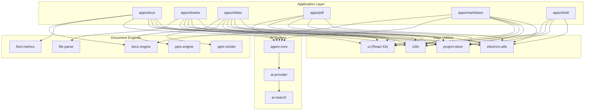
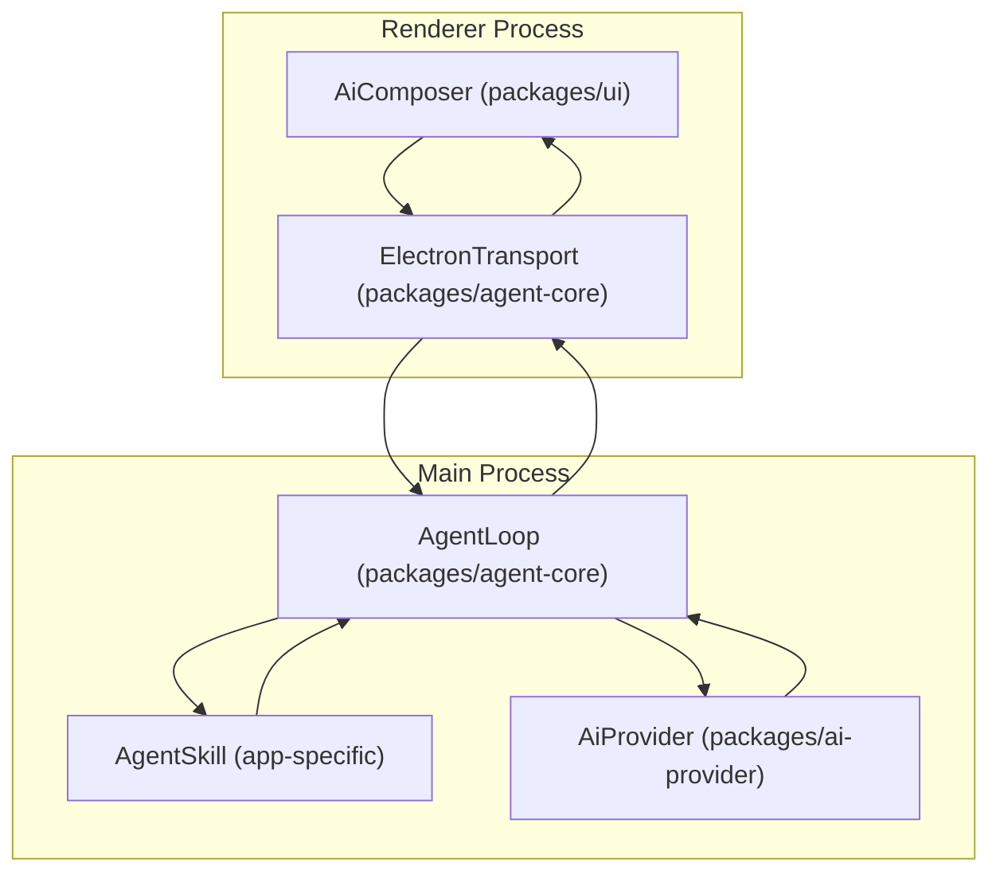
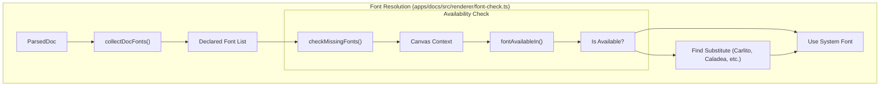

# Shared Packages Overview

> **Relevant source files**
> * [apps/docs/package.json](https://github.com/genspark-ai/genoffice/blob/d5558b6b/apps/docs/package.json)

This page provides a survey of the shared packages located in the `packages/*` directory of the GenOffice monorepo. These packages encapsulate core functionalities, engines, and utilities that are leveraged across all applications in the suite (Docs, Sheets, Slides, PDF, Markdown, Shell), promoting code reuse and a consistent architectural approach.

The `packages/*` directory contains pure TypeScript engine and shared packages, meaning they generally have no direct Electron dependency and are unit-tested independently.

## Package Architecture

The shared packages are categorized by their primary domain. Applications consume these packages via npm workspaces, allowing for modular development and shared logic for complex tasks like OOXML parsing or AI agent orchestration.

Sources: [apps/docs/package.json L21-L28](https://github.com/genspark-ai/genoffice/blob/d5558b6b/apps/docs/package.json#L21-L28)

 [apps/docs/package.json L93-L97](https://github.com/genspark-ai/genoffice/blob/d5558b6b/apps/docs/package.json#L93-L97)

## Package Breakdown

### Document Engines & Metrics

These packages provide the core logic for parsing, manipulating, and rendering standard document formats with high fidelity.

* **`docx-engine`**: A pure-TypeScript engine for `.docx` files. It parses `word/document.xml` into a `Block` tree and implements byte-level paragraph patching for round-trip fidelity. Used by `apps/docs` and `apps/markdown` (for export).
* **`pptx-engine`**: Handles parsing and generation of `.pptx` files, including masters, themes, and placeholder resolution.
* **`pptx-render`**: The rendering layer for presentations. It builds the render tree, handles text layout, and coordinate transformations. `apps/docs` also depends on this for rendering embedded presentation elements [apps/docs/package.json L97](https://github.com/genspark-ai/genoffice/blob/d5558b6b/apps/docs/package.json#L97-L97)
* **`font-metrics`**: Provides critical typography data, including `familyVerticalMetrics` and `sfnt` table parsing. This ensures that line-heights and cursor positions match between the editor and the printed output [apps/docs/package.json L94](https://github.com/genspark-ai/genoffice/blob/d5558b6b/apps/docs/package.json#L94-L94)
* **`file-parse`**: Extracts text content from `.docx`, `.pptx`, `.xlsx`, and `.pdf` for use as AI context or search indexing [apps/docs/package.json L26](https://github.com/genspark-ai/genoffice/blob/d5558b6b/apps/docs/package.json#L26-L26)

### AI System Components

These packages form the "Brain" of GenOffice, abstracting LLM interactions and agentic behavior.

* **`agent-core`**: Implements the `AgentLoop` for multi-turn tool-calling. It handles context compaction, history trimming, and provides the `AgentSkill` interface used by app-specific AI features [apps/docs/package.json L21](https://github.com/genspark-ai/genoffice/blob/d5558b6b/apps/docs/package.json#L21-L21)
* **`ai-provider`**: An abstraction layer for LLM providers (Genspark, Anthropic, OpenAI, etc.). It manages streaming responses and unified settings [apps/docs/package.json L23](https://github.com/genspark-ai/genoffice/blob/d5558b6b/apps/docs/package.json#L23-L23)
* **`ai-search`**: Provides tools for web and image search, including authentication for the Genspark search API [apps/docs/package.json L24](https://github.com/genspark-ai/genoffice/blob/d5558b6b/apps/docs/package.json#L24-L24)

### Core Utilities & UI

* **`ui`**: The shared React component library. It contains design tokens (`tokens.css`), icons, and complex components like `AiComposer` and `AiTypingIndicator` [apps/docs/package.json L28](https://github.com/genspark-ai/genoffice/blob/d5558b6b/apps/docs/package.json#L28-L28)
* **`i18n`**: Manages the locale key system and translations across the suite [apps/docs/package.json L22](https://github.com/genspark-ai/genoffice/blob/d5558b6b/apps/docs/package.json#L22-L22)
* **`project-store`**: A shared persistence layer for "Recent Files" and application state, synchronized via Electron IPC [apps/docs/package.json L27](https://github.com/genspark-ai/genoffice/blob/d5558b6b/apps/docs/package.json#L27-L27)
* **`electron-utils`**: Security-focused utilities including `safeExternalUrl` gates and navigation guards [apps/docs/package.json L93](https://github.com/genspark-ai/genoffice/blob/d5558b6b/apps/docs/package.json#L93-L93)

## AI Agent Data Flow

The following diagram bridges the "Natural Language Space" (User Input) to the "Code Entity Space" (Classes and Interfaces) within the shared packages.

Sources: [apps/docs/package.json L21-L23](https://github.com/genspark-ai/genoffice/blob/d5558b6b/apps/docs/package.json#L21-L23)

## Font Resolution Logic

Accurate rendering across different operating systems requires a robust font substitution system. While `font-metrics` provides raw data, `apps/docs` implements the resolution logic.

Sources: [apps/docs/package.json L94](https://github.com/genspark-ai/genoffice/blob/d5558b6b/apps/docs/package.json#L94-L94)

 [apps/docs/src/renderer/font-check.ts L19-L34](https://github.com/genspark-ai/genoffice/blob/d5558b6b/apps/docs/src/renderer/font-check.ts#L19-L34)

 [apps/docs/src/renderer/font-check.ts L71-L86](https://github.com/genspark-ai/genoffice/blob/d5558b6b/apps/docs/src/renderer/font-check.ts#L71-L86)