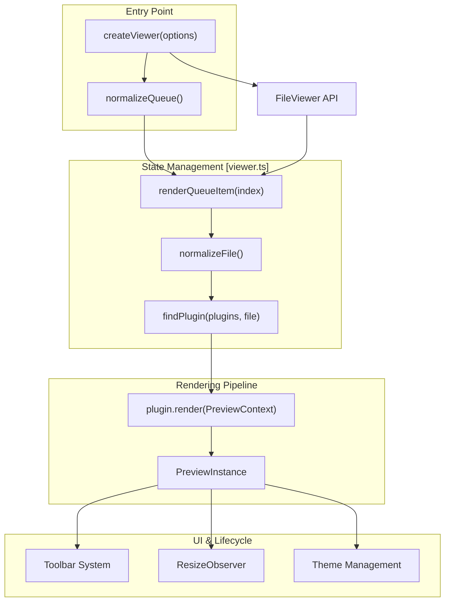
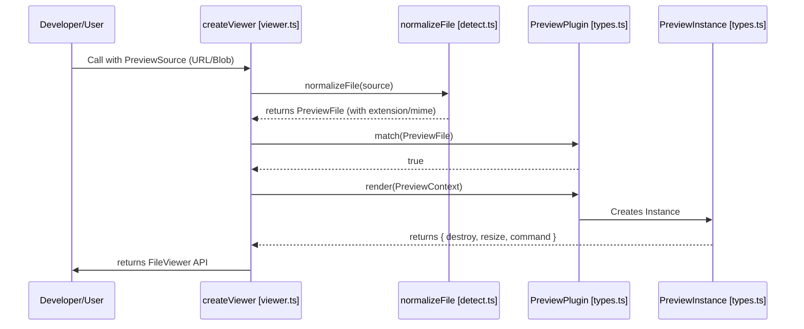

# Core Architecture

> **Relevant source files**
> * [packages/core/src/index.ts](https://github.com/xushanpei/open-file-viewer/blob/ea5b8aef/packages/core/src/index.ts)
> * [packages/core/src/types.ts](https://github.com/xushanpei/open-file-viewer/blob/ea5b8aef/packages/core/src/types.ts)
> * [packages/core/src/viewer.test.ts](https://github.com/xushanpei/open-file-viewer/blob/ea5b8aef/packages/core/src/viewer.test.ts)
> * [packages/core/src/viewer.ts](https://github.com/xushanpei/open-file-viewer/blob/ea5b8aef/packages/core/src/viewer.ts)

The `@open-file-viewer/core` engine is a framework-agnostic previewing system designed to orchestrate file normalization, plugin matching, and lifecycle management. It transforms raw file sources into interactive preview instances while providing a unified toolbar and theming layer.

## System Overview

The core engine operates as a pipeline that takes a `PreviewSource` and renders it into a DOM container. The orchestration is handled by the `createViewer` function, which manages a queue of files and delegates actual rendering to a prioritized list of plugins.

### High-Level Component Relationship

The following diagram illustrates how `createViewer` connects the various subsystems and code entities.

**Viewer Orchestration Flow**

Sources: [packages/core/src/viewer.ts L19-L184](https://github.com/xushanpei/open-file-viewer/blob/ea5b8aef/packages/core/src/viewer.ts#L19-L184)

 [packages/core/src/types.ts L143-L151](https://github.com/xushanpei/open-file-viewer/blob/ea5b8aef/packages/core/src/types.ts#L143-L151)

## Core Subsystems

### 1. createViewer & Lifecycle Management

The `createViewer` function is the main entry point. It initializes the DOM structure (creating `.ofv-host` and `.ofv-viewport`), sets up the `ResizeObserver` for responsive scaling, and manages the "Render Token" system to prevent race conditions during rapid file switching.

* **Key Entity:** `FileViewer` interface.
* **For details, see [createViewer & FileViewer Lifecycle](/xushanpei/open-file-viewer/2.1-createviewer-and-fileviewer-lifecycle).**

Sources: [packages/core/src/viewer.ts L19-L62](https://github.com/xushanpei/open-file-viewer/blob/ea5b8aef/packages/core/src/viewer.ts#L19-L62)

 [packages/core/src/viewer.ts L93-L138](https://github.com/xushanpei/open-file-viewer/blob/ea5b8aef/packages/core/src/viewer.ts#L93-L138)

### 2. Plugin Architecture

The engine itself contains no format-specific logic. Instead, it iterates through a list of `PreviewPlugin` objects. Each plugin must provide a `match` function to claim a file and a `render` function to produce a `PreviewInstance`.

* **Key Entity:** `PreviewPlugin` and `PreviewInstance`.
* **For details, see [Plugin Interface & Registration](/xushanpei/open-file-viewer/2.2-plugin-interface-and-registration).**

Sources: [packages/core/src/types.ts L128-L141](https://github.com/xushanpei/open-file-viewer/blob/ea5b8aef/packages/core/src/types.ts#L128-L141)

 [packages/core/src/viewer.ts L101-L122](https://github.com/xushanpei/open-file-viewer/blob/ea5b8aef/packages/core/src/viewer.ts#L101-L122)

### 3. File Normalization

Before a plugin sees a file, the engine converts various inputs (`Blob`, `File`, `URL string`, `ArrayBuffer`) into a unified `PreviewFile` object. This process includes extension detection and MIME type sniffing.

* **Key Entity:** `normalizeFile` and `PreviewFile`.
* **For details, see [File Detection & Normalization](/xushanpei/open-file-viewer/2.3-file-detection-and-normalization).**

Sources: [packages/core/src/detect.ts L1-L20](https://github.com/xushanpei/open-file-viewer/blob/ea5b8aef/packages/core/src/detect.ts#L1-L20)

 [packages/core/src/types.ts L27-L35](https://github.com/xushanpei/open-file-viewer/blob/ea5b8aef/packages/core/src/types.ts#L27-L35)

### 4. Toolbar & Command System

The toolbar is a decoupled subsystem that communicates with the active `PreviewInstance` via a command delegation pattern. It supports built-in actions like `zoom-in`, `rotate-right`, and `print`, as well as custom user-defined actions.

* **Key Entity:** `PreviewToolbarOptions` and `PreviewCommand`.
* **For details, see [Toolbar System](/xushanpei/open-file-viewer/2.4-toolbar-system).**

Sources: [packages/core/src/types.ts L48-L94](https://github.com/xushanpei/open-file-viewer/blob/ea5b8aef/packages/core/src/types.ts#L48-L94)

 [packages/core/src/viewer.ts L51-L59](https://github.com/xushanpei/open-file-viewer/blob/ea5b8aef/packages/core/src/viewer.ts#L51-L59)

### 5. Theming & CSS Design System

The viewer uses a CSS-variable-based theming system. It supports `light`, `dark`, and `auto` (system preference) modes. All styles are scoped under the `.ofv-root` namespace to prevent global CSS leakage.

* **Key Entity:** `PreviewTheme`.
* **For details, see [Theming & CSS Design System](/xushanpei/open-file-viewer/2.5-theming-and-css-design-system).**

Sources: [packages/core/src/viewer.ts L234-L255](https://github.com/xushanpei/open-file-viewer/blob/ea5b8aef/packages/core/src/viewer.ts#L234-L255)

 [packages/core/src/types.ts L12](https://github.com/xushanpei/open-file-viewer/blob/ea5b8aef/packages/core/src/types.ts#L12-L12)

## Data Flow: From Source to Screen

This diagram bridges the gap between the natural language concept of "Opening a file" and the internal code entities that handle the data.

**Data Transformation Pipeline**

Sources: [packages/core/src/viewer.ts L140-L144](https://github.com/xushanpei/open-file-viewer/blob/ea5b8aef/packages/core/src/viewer.ts#L140-L144)

 [packages/core/src/viewer.ts L93-L138](https://github.com/xushanpei/open-file-viewer/blob/ea5b8aef/packages/core/src/viewer.ts#L93-L138)

 [packages/core/src/types.ts L1-L35](https://github.com/xushanpei/open-file-viewer/blob/ea5b8aef/packages/core/src/types.ts#L1-L35)

## Component Summary Table

| Entity | File | Role |
| --- | --- | --- |
| `createViewer` | `viewer.ts` | Orchestrates the entire lifecycle and DOM mounting. |
| `PreviewFile` | `types.ts` | The unified data structure representing the file to be previewed. |
| `PreviewContext` | `types.ts` | The "toolbox" provided to plugins during the `render` phase. |
| `PreviewInstance` | `types.ts` | The object returned by a plugin to handle cleanup and commands. |
| `PreviewPlugin` | `types.ts` | The contract for adding support for new file formats. |
| `FileViewer` | `types.ts` | The public API returned to the developer to control the viewer. |

Sources: [packages/core/src/viewer.ts L19-L184](https://github.com/xushanpei/open-file-viewer/blob/ea5b8aef/packages/core/src/viewer.ts#L19-L184)

 [packages/core/src/types.ts L1-L151](https://github.com/xushanpei/open-file-viewer/blob/ea5b8aef/packages/core/src/types.ts#L1-L151)