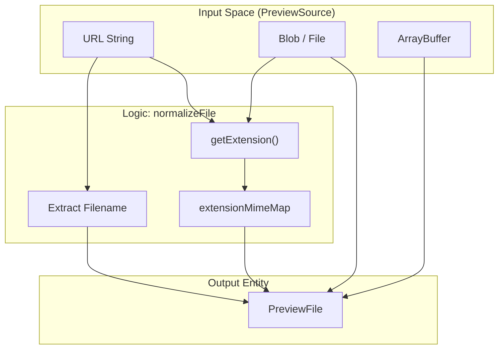
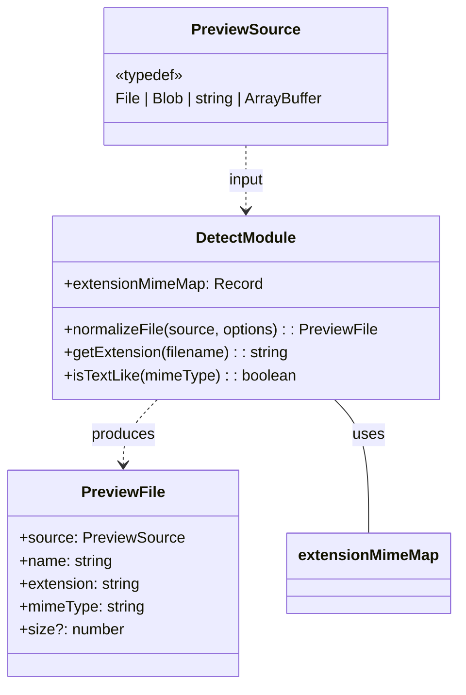

# File Detection & Normalization

> **Relevant source files**
> * [packages/core/src/detect.ts](https://github.com/xushanpei/open-file-viewer/blob/ea5b8aef/packages/core/src/detect.ts)
> * [packages/core/src/plugins/mime-match.test.ts](https://github.com/xushanpei/open-file-viewer/blob/ea5b8aef/packages/core/src/plugins/mime-match.test.ts)
> * [packages/core/src/types.ts](https://github.com/xushanpei/open-file-viewer/blob/ea5b8aef/packages/core/src/types.ts)

The File Detection & Normalization system is responsible for transforming various input formats into a standardized `PreviewFile` object. This process occurs before any plugin matching takes place, ensuring that plugins receive a consistent data structure regardless of whether the source was a URL, a raw `Blob`, an `ArrayBuffer`, or a browser `File` object.

## The Normalization Pipeline

The core of this system is the `normalizeFile` function defined in `packages/core/src/detect.ts`. It takes a `PreviewSource` (which can be a `string`, `File`, `Blob`, or `ArrayBuffer`) and optional metadata to produce a `PreviewFile` [packages/core/src/detect.ts L258-L306](https://github.com/xushanpei/open-file-viewer/blob/ea5b8aef/packages/core/src/detect.ts#L258-L306)

### Data Flow: Source to PreviewFile

The following diagram illustrates how different input types are resolved into the final `PreviewFile` entity.

**Normalization Data Flow**

Sources: [packages/core/src/detect.ts L258-L306](https://github.com/xushanpei/open-file-viewer/blob/ea5b8aef/packages/core/src/detect.ts#L258-L306)

 [packages/core/src/types.ts L1-L35](https://github.com/xushanpei/open-file-viewer/blob/ea5b8aef/packages/core/src/types.ts#L1-L35)

### Implementation Details

1. **URL Handling**: If the source is a string, `normalizeFile` attempts to extract the filename from the URL path. It uses `getExtension` to determine the file type and looks up the MIME type in the `extensionMimeMap` [packages/core/src/detect.ts L260-L272](https://github.com/xushanpei/open-file-viewer/blob/ea5b8aef/packages/core/src/detect.ts#L260-L272)
2. **Blob/File Handling**: If the source is a `Blob` or `File`, the system prioritizes the object's native `name` and `type` properties. If the `type` is missing, it falls back to extension-based detection [packages/core/src/detect.ts L274-L287](https://github.com/xushanpei/open-file-viewer/blob/ea5b8aef/packages/core/src/detect.ts#L274-L287)
3. **ArrayBuffer Handling**: Since buffers lack metadata, the system relies entirely on the `fileName` provided in the options to derive the extension and MIME type [packages/core/src/detect.ts L289-L301](https://github.com/xushanpei/open-file-viewer/blob/ea5b8aef/packages/core/src/detect.ts#L289-L301)

## Extension & MIME Mapping

The system maintains an extensive internal dictionary, `extensionMimeMap`, to map file extensions to standardized MIME types. This is critical for plugins that rely on MIME matching rather than just extension strings.

### Key Mapping Categories

| Category | Extensions (Examples) | Standardized MIME Type |
| --- | --- | --- |
| **Images** | jpg, png, webp, heic | `image/jpeg`, `image/png`, etc. |
| **Documents** | pdf, epub, xps, ofd | `application/pdf`, `application/epub+zip`, etc. |
| **Office** | docx, xlsx, pptx | `application/vnd.openxmlformats-officedocument...` |
| **Code** | js, ts, py, go, rs | `text/javascript`, `text/typescript`, etc. |
| **Archives** | zip, rar, 7z, tar | `application/zip`, `application/x-7z-compressed` |

Sources: [packages/core/src/detect.ts L3-L228](https://github.com/xushanpei/open-file-viewer/blob/ea5b8aef/packages/core/src/detect.ts#L3-L228)

## Utility Functions

### getExtension

The `getExtension` function extracts the lowercase extension from a filename or path. It handles complex cases like removing query parameters or fragments from URLs [packages/core/src/detect.ts L236-L242](https://github.com/xushanpei/open-file-viewer/blob/ea5b8aef/packages/core/src/detect.ts#L236-L242)

### isTextLike

This function is used by the `textPlugin` and others to determine if a file should be treated as plain text even if it doesn't have a specific code extension. It checks if the MIME type starts with `text/` or matches common application-level text formats like `application/json` or `application/xml` [packages/core/src/detect.ts L308-L315](https://github.com/xushanpei/open-file-viewer/blob/ea5b8aef/packages/core/src/detect.ts#L308-L315)

## Code Entity Association

This diagram bridges the natural language requirements of file detection to the specific code entities in the `@open-file-viewer/core` package.

**Detection System Architecture**

Sources: [packages/core/src/types.ts L1-L35](https://github.com/xushanpei/open-file-viewer/blob/ea5b8aef/packages/core/src/types.ts#L1-L35)

 [packages/core/src/detect.ts L1-L315](https://github.com/xushanpei/open-file-viewer/blob/ea5b8aef/packages/core/src/detect.ts#L1-L315)

## Integration in Plugin Matching

Once `normalizeFile` produces a `PreviewFile`, it is passed to the `match` method of registered `PreviewPlugin`s. For example, the `officePlugin` or `archivePlugin` use the normalized `mimeType` to determine if they can handle the file [packages/core/src/plugins/mime-match.test.ts L18-L44](https://github.com/xushanpei/open-file-viewer/blob/ea5b8aef/packages/core/src/plugins/mime-match.test.ts#L18-L44)

 This normalization ensures that a `.docx` file is recognized as such whether it arrives as a URL string or a raw Blob without a filename.

Sources: [packages/core/src/plugins/mime-match.test.ts L1-L66](https://github.com/xushanpei/open-file-viewer/blob/ea5b8aef/packages/core/src/plugins/mime-match.test.ts#L1-L66)