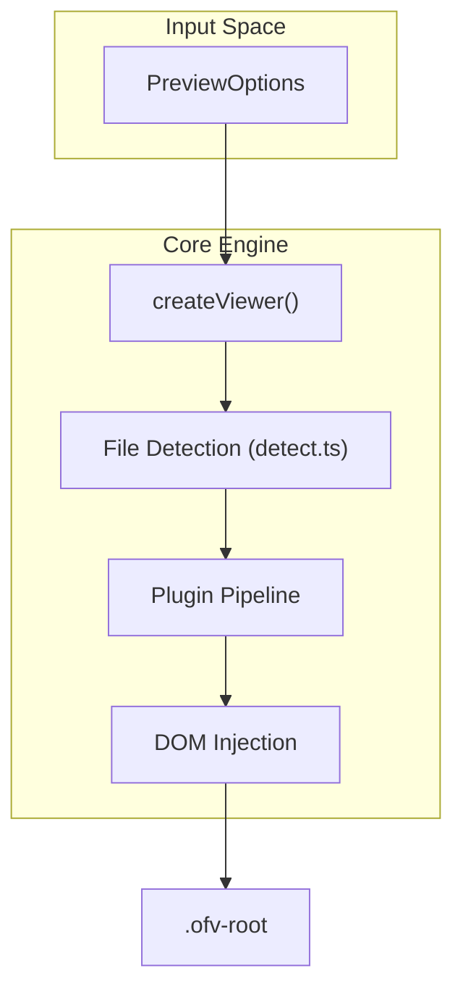

# Getting Started

> **Relevant source files**
> * [README.md](https://github.com/xushanpei/open-file-viewer/blob/ea5b8aef/README.md?plain=1)
> * [examples/react/src/main.tsx](https://github.com/xushanpei/open-file-viewer/blob/ea5b8aef/examples/react/src/main.tsx)
> * [examples/react/vite.config.ts](https://github.com/xushanpei/open-file-viewer/blob/ea5b8aef/examples/react/vite.config.ts)
> * [examples/vanilla/index.html](https://github.com/xushanpei/open-file-viewer/blob/ea5b8aef/examples/vanilla/index.html)
> * [examples/vanilla/package.json](https://github.com/xushanpei/open-file-viewer/blob/ea5b8aef/examples/vanilla/package.json)
> * [examples/vanilla/src/main.ts](https://github.com/xushanpei/open-file-viewer/blob/ea5b8aef/examples/vanilla/src/main.ts)
> * [examples/vue/vite.config.ts](https://github.com/xushanpei/open-file-viewer/blob/ea5b8aef/examples/vue/vite.config.ts)
> * [package.json](https://github.com/xushanpei/open-file-viewer/blob/ea5b8aef/package.json)
> * [packages/core/package.json](https://github.com/xushanpei/open-file-viewer/blob/ea5b8aef/packages/core/package.json)
> * [pnpm-lock.yaml](https://github.com/xushanpei/open-file-viewer/blob/ea5b8aef/pnpm-lock.yaml)

This guide provides a step-by-step walkthrough for installing and initializing **Open File Viewer**. It covers the installation of core and framework-specific packages, mandatory peer dependencies, and the basic setup required to render your first file preview.

## Installation

The library is distributed as a set of scoped packages under `@open-file-viewer`. You must install the core package regardless of which framework you use.

### 1. Install Core and Framework Adapters

Depending on your project type, run the following command:

| Environment | Command |
| --- | --- |
| **Vanilla JS** | `npm install @open-file-viewer/core` |
| **React** | `npm install @open-file-viewer/core @open-file-viewer/react` |
| **Vue** | `npm install @open-file-viewer/core @open-file-viewer/vue` |
| **Svelte** | `npm install @open-file-viewer/core @open-file-viewer/svelte` |

Sources: [README.md L39-L61](https://github.com/xushanpei/open-file-viewer/blob/ea5b8aef/README.md?plain=1#L39-L61)

 [packages/core/package.json L2-L3](https://github.com/xushanpei/open-file-viewer/blob/ea5b8aef/packages/core/package.json#L2-L3)

### 2. Peer Dependency: PDF.js

For PDF preview support, `pdfjs-dist` is a required peer dependency. This ensures you can control the version and worker configuration of the PDF engine.

```
npm install pdfjs-dist
```

Sources: [README.md L63-L67](https://github.com/xushanpei/open-file-viewer/blob/ea5b8aef/README.md?plain=1#L63-L67)

 [packages/core/package.json L45-L47](https://github.com/xushanpei/open-file-viewer/blob/ea5b8aef/packages/core/package.json#L45-L47)

---

## Basic Initialization

To get started, you need to import the required plugins, the global stylesheet, and call the initialization function.

### Vanilla JavaScript Implementation

In a standard JavaScript environment, use the `createViewer` function. This function orchestrates the lifecycle of the viewer within a target DOM element.

```javascript
import { createViewer, imagePlugin, pdfPlugin, textPlugin } from "@open-file-viewer/core";import "@open-file-viewer/core/style.css";import pdfWorkerSrc from "pdfjs-dist/build/pdf.worker.mjs?url"; const viewer = createViewer({  container: "#viewer-host", // Selector or HTMLElement  file: myFileBlob,          // File, Blob, URL, or ArrayBuffer  fileName: "example.pdf",  plugins: [    imagePlugin(),    textPlugin(),    pdfPlugin({ workerSrc: pdfWorkerSrc })  ]});
```

### Initialization Data Flow

The following diagram illustrates how the `createViewer` function consumes options to instantiate the internal engine.

**Viewer Bootstrapping Pipeline**



Sources: [README.md L80-L124](https://github.com/xushanpei/open-file-viewer/blob/ea5b8aef/README.md?plain=1#L80-L124)

 [examples/vanilla/src/main.ts L46-L79](https://github.com/xushanpei/open-file-viewer/blob/ea5b8aef/examples/vanilla/src/main.ts#L46-L79)

---

## Integration Examples

### React

The React adapter provides a `FileViewer` component that manages the `createViewer` lifecycle internally using hooks.

```javascript
import { FileViewer } from "@open-file-viewer/react";import { imagePlugin, pdfPlugin } from "@open-file-viewer/core";import "@open-file-viewer/core/style.css"; const plugins = [imagePlugin(), pdfPlugin()]; function App() {  return (    <FileViewer       file={someFile}       plugins={plugins}       height="500px"      toolbar     />  );}
```

Sources: [README.md L132-L159](https://github.com/xushanpei/open-file-viewer/blob/ea5b8aef/README.md?plain=1#L132-L159)

 [examples/react/src/main.tsx L80-L88](https://github.com/xushanpei/open-file-viewer/blob/ea5b8aef/examples/react/src/main.tsx#L80-L88)

### Vue

The Vue adapter uses a component-based approach with props mapping directly to `PreviewOptions`.

```javascript
<template>  <OpenFileViewer    :file="file"    :plugins="plugins"    height="600px"    toolbar  /></template> <script setup>import { OpenFileViewer } from "@open-file-viewer/vue";import { imagePlugin } from "@open-file-viewer/core";import "@open-file-viewer/core/style.css"; const plugins = [imagePlugin()];</script>
```

Sources: [README.md L163-L191](https://github.com/xushanpei/open-file-viewer/blob/ea5b8aef/README.md?plain=1#L163-L191)

 [examples/vue/vite.config.ts L16](https://github.com/xushanpei/open-file-viewer/blob/ea5b8aef/examples/vue/vite.config.ts#L16-L16)

---

## Critical Requirements

### Stylesheet Import

The viewer will not render correctly without its structural CSS. You must import the stylesheet globally:
`import "@open-file-viewer/core/style.css";`
This file defines the `.ofv-root` and `.ofv-viewport` classes necessary for layout.

Sources: [packages/core/package.json L25-L27](https://github.com/xushanpei/open-file-viewer/blob/ea5b8aef/packages/core/package.json#L25-L27)

 [examples/vanilla/src/main.ts L23](https://github.com/xushanpei/open-file-viewer/blob/ea5b8aef/examples/vanilla/src/main.ts#L23-L23)

### PDF Worker Configuration

When using `pdfPlugin`, you must provide a `workerSrc`. Most modern bundlers (Vite, Webpack 5) allow you to import the worker URL directly from the `pdfjs-dist` package.

**Code-to-Entity Mapping: PDF Setup**

```mermaid
flowchart TD

WS["pdfWorkerSrc"]
PL["pdfPlugin()"]
CFG["Plugin Configuration"]
WKR["pdf.worker.mjs"]

PL --> CFG
CFG --> WKR

subgraph pdfjs-dist ["pdfjs-dist"]
    WKR
end

subgraph @open-file-viewer/core ["@open-file-viewer/core"]
    CFG
end

subgraph subGraph0 ["User Code"]
    WS
    PL
    WS --> PL
end
```

Sources: [README.md L98](https://github.com/xushanpei/open-file-viewer/blob/ea5b8aef/README.md?plain=1#L98-L98)

 [examples/vanilla/src/main.ts L62](https://github.com/xushanpei/open-file-viewer/blob/ea5b8aef/examples/vanilla/src/main.ts#L62-L62)

## Summary Table of Package Exports

| Export | Type | Description |
| --- | --- | --- |
| `createViewer` | Function | The primary entry point for Vanilla JS. |
| `imagePlugin` | Plugin | Handles common image formats (JPG, PNG, SVG, etc.). |
| `pdfPlugin` | Plugin | Handles PDF files via PDF.js. |
| `textPlugin` | Plugin | Handles plain text and code with syntax highlighting. |
| `officePlugin` | Plugin | Handles DOCX, XLSX, and PPTX formats. |

Sources: [packages/core/src/index.ts:1-22] (implied by exports in examples), [README.md L81-L96](https://github.com/xushanpei/open-file-viewer/blob/ea5b8aef/README.md?plain=1#L81-L96)