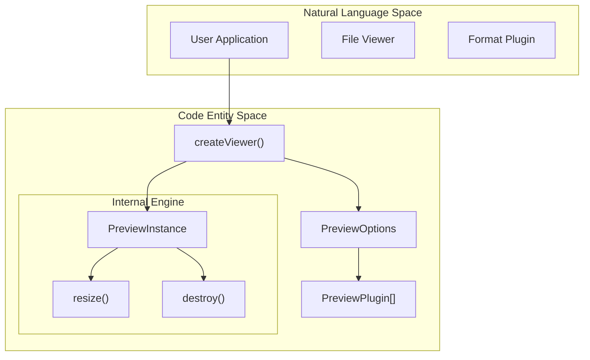
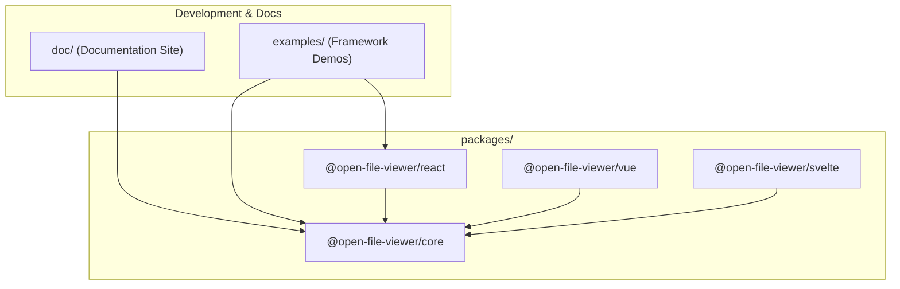

# Overview

> **Relevant source files**
> * [README.md](https://github.com/xushanpei/open-file-viewer/blob/ea5b8aef/README.md?plain=1)
> * [package.json](https://github.com/xushanpei/open-file-viewer/blob/ea5b8aef/package.json)
> * [packages/core/package.json](https://github.com/xushanpei/open-file-viewer/blob/ea5b8aef/packages/core/package.json)
> * [packages/core/src/index.ts](https://github.com/xushanpei/open-file-viewer/blob/ea5b8aef/packages/core/src/index.ts)
> * [pnpm-lock.yaml](https://github.com/xushanpei/open-file-viewer/blob/ea5b8aef/pnpm-lock.yaml)

Open File Viewer is a modern, framework-agnostic file preview SDK designed to provide a unified container for viewing a vast array of file formats—including PDF, Office, images, audio/video, archives, emails, CAD, and 3D models—directly within the browser. [README.md L1-L3](https://github.com/xushanpei/open-file-viewer/blob/ea5b8aef/README.md?plain=1#L1-L3)

The project is built with a **container-first** and **plugin-first** philosophy, ensuring that file content is rendered within a specified DOM element without breaking the host application's user experience. [README.md L32-L34](https://github.com/xushanpei/open-file-viewer/blob/ea5b8aef/README.md?plain=1#L32-L34)

## Design Philosophy

The system is architected around several core principles:

* **Container-First**: Content is scoped to a DOM container provided by the user, supporting responsive dimensions (`px`, `%`, `vh`, etc.) via `ResizeObserver`. [README.md L32-L35](https://github.com/xushanpei/open-file-viewer/blob/ea5b8aef/README.md?plain=1#L32-L35)
* **Plugin-First**: Every file format is handled by an independent plugin. This allows developers to include only the necessary parsers, reducing bundle size and facilitating extension. [README.md L34](https://github.com/xushanpei/open-file-viewer/blob/ea5b8aef/README.md?plain=1#L34-L34)
* **Multi-Framework Compatibility**: A single core engine (`@open-file-viewer/core`) powers adapters for React, Vue, and Svelte. [README.md L33](https://github.com/xushanpei/open-file-viewer/blob/ea5b8aef/README.md?plain=1#L33-L33)
* **Production-Ready State Management**: Built-in handling for loading states, error boundaries, unsupported format fallbacks, and a customizable toolbar. [README.md L36](https://github.com/xushanpei/open-file-viewer/blob/ea5b8aef/README.md?plain=1#L36-L36)

### Conceptual Architecture

The following diagram illustrates how the natural language concepts of "Viewer" and "Plugins" map to specific code entities within the engine.

**System Entity Mapping**



Sources: [packages/core/src/index.ts L1-L38](https://github.com/xushanpei/open-file-viewer/blob/ea5b8aef/packages/core/src/index.ts#L1-L38)

 [README.md L100-L128](https://github.com/xushanpei/open-file-viewer/blob/ea5b8aef/README.md?plain=1#L100-L128)

## Supported Formats

The SDK provides a comprehensive set of built-in plugins exported from the core package. [packages/core/src/index.ts L2-L18](https://github.com/xushanpei/open-file-viewer/blob/ea5b8aef/packages/core/src/index.ts#L2-L18)

| Category | Plugins | Key Formats |
| --- | --- | --- |
| **Documents** | `pdfPlugin`, `epubPlugin`, `xpsPlugin`, `ofdPlugin` | PDF, EPUB, XPS, OFD |
| **Office** | `officePlugin` | DOCX, XLSX, PPTX, ODT, ODS |
| **Media** | `imagePlugin`, `videoPlugin`, `audioPlugin` | JPG, PNG, HEIC, MP4, HLS (m3u8), MP3 |
| **Development** | `textPlugin`, `cadPlugin`, `model3dPlugin`, `gisPlugin` | TS/JS, DXF, GLTF/OBJ, GeoJSON, KML |
| **Utilities** | `archivePlugin`, `emailPlugin`, `fallbackPlugin` | ZIP, RAR, 7z, EML, MSG |

Sources: [README.md L252-L262](https://github.com/xushanpei/open-file-viewer/blob/ea5b8aef/README.md?plain=1#L252-L262)

 [packages/core/src/index.ts L2-L18](https://github.com/xushanpei/open-file-viewer/blob/ea5b8aef/packages/core/src/index.ts#L2-L18)

## Monorepo Structure

The project is managed as a pnpm workspace, separating the core logic from framework-specific adapters and documentation. [package.json L1-L47](https://github.com/xushanpei/open-file-viewer/blob/ea5b8aef/package.json#L1-L47)

**Repository Organization**



Sources: [pnpm-lock.yaml L54-L165](https://github.com/xushanpei/open-file-viewer/blob/ea5b8aef/pnpm-lock.yaml#L54-L165)

 [package.json L17-L29](https://github.com/xushanpei/open-file-viewer/blob/ea5b8aef/package.json#L17-L29)

## Getting Started

To begin using the viewer, you must install the core package and the `pdfjs-dist` peer dependency if PDF support is required. [README.md L41-L67](https://github.com/xushanpei/open-file-viewer/blob/ea5b8aef/README.md?plain=1#L41-L67)

```javascript
import { createViewer, imagePlugin, pdfPlugin } from "@open-file-viewer/core";import "@open-file-viewer/core/style.css"; const viewer = createViewer({  container: "#viewer-host",  file: "https://example.com/sample.pdf",  plugins: [imagePlugin(), pdfPlugin()]});
```

For a step-by-step guide on installation and framework-specific initialization, see **[Getting Started (#1.1)](https://github.com/xushanpei/open-file-viewer/blob/ea5b8aef/Getting Started (#1.1))**.

## Build and Contribution

The project uses `tsup` for bundling and `vitest` for testing. [package.json L42-L45](https://github.com/xushanpei/open-file-viewer/blob/ea5b8aef/package.json#L42-L45)

 It enforces package integrity through a custom `check-package-exports` script. [package.json L20](https://github.com/xushanpei/open-file-viewer/blob/ea5b8aef/package.json#L20-L20)

For details on the workspace layout, build pipeline, and development scripts, see **[Monorepo Structure & Build System (#1.2)](https://github.com/xushanpei/open-file-viewer/blob/ea5b8aef/Monorepo Structure & Build System (#1.2))**.

---

**Sources:**

* [README.md L1-L262](https://github.com/xushanpei/open-file-viewer/blob/ea5b8aef/README.md?plain=1#L1-L262)
* [packages/core/src/index.ts L1-L39](https://github.com/xushanpei/open-file-viewer/blob/ea5b8aef/packages/core/src/index.ts#L1-L39)
* [package.json L1-L49](https://github.com/xushanpei/open-file-viewer/blob/ea5b8aef/package.json#L1-L49)
* [packages/core/package.json L1-L79](https://github.com/xushanpei/open-file-viewer/blob/ea5b8aef/packages/core/package.json#L1-L79)
* [pnpm-lock.yaml L1-L165](https://github.com/xushanpei/open-file-viewer/blob/ea5b8aef/pnpm-lock.yaml#L1-L165)