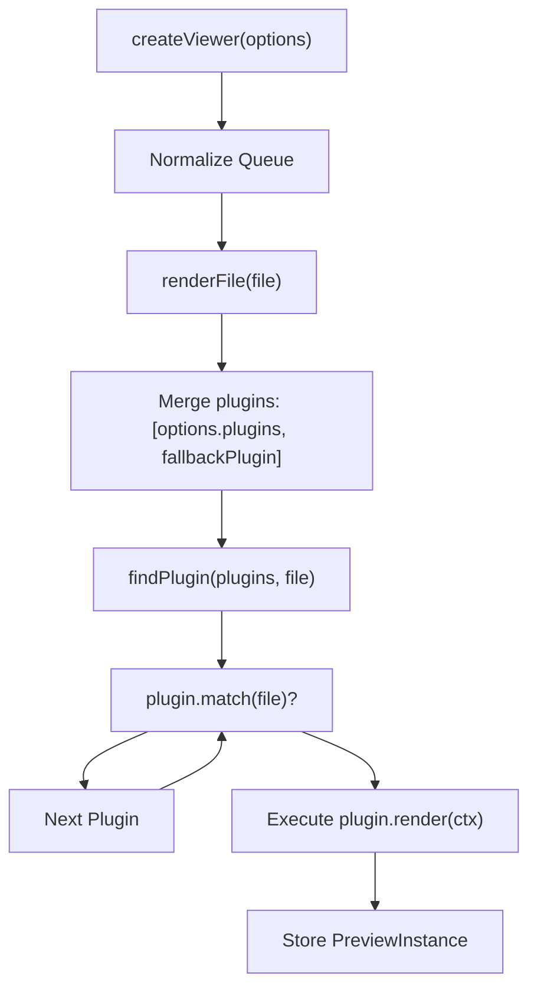
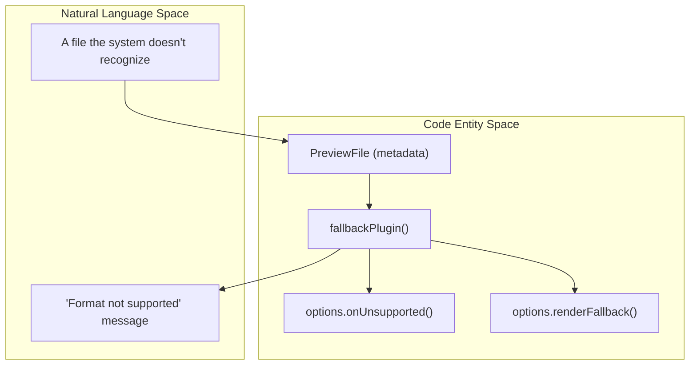
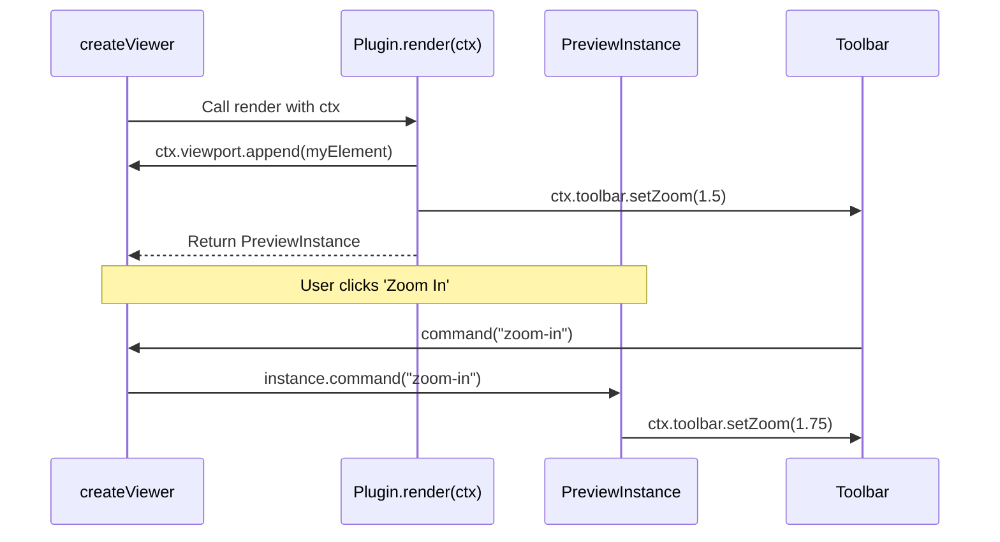

# Plugin Interface & Registration

> **Relevant source files**
> * [packages/core/src/plugins/fallback.test.ts](https://github.com/xushanpei/open-file-viewer/blob/ea5b8aef/packages/core/src/plugins/fallback.test.ts)
> * [packages/core/src/plugins/fallback.ts](https://github.com/xushanpei/open-file-viewer/blob/ea5b8aef/packages/core/src/plugins/fallback.ts)
> * [packages/core/src/types.ts](https://github.com/xushanpei/open-file-viewer/blob/ea5b8aef/packages/core/src/types.ts)
> * [packages/core/src/viewer.test.ts](https://github.com/xushanpei/open-file-viewer/blob/ea5b8aef/packages/core/src/viewer.test.ts)
> * [packages/core/src/viewer.ts](https://github.com/xushanpei/open-file-viewer/blob/ea5b8aef/packages/core/src/viewer.ts)

The `@open-file-viewer/core` engine is built on a plugin-first architecture. Every file format, from simple images to complex 3D models, is handled by a plugin that satisfies a specific contract. This page details the interfaces and the lifecycle of plugin matching and execution.

## The PreviewPlugin Contract

A plugin is an object that implements the `PreviewPlugin` interface. It must provide a name for identification, a matching function to claim responsibility for a file, and a render function to initialize the preview.

| Property | Type | Description |
| --- | --- | --- |
| `name` | `string` | Unique identifier for the plugin (e.g., `"pdf"`, `"image"`). |
| `match` | `(file: PreviewFile) => boolean \| Promise<boolean>` | Logic to determine if this plugin can handle the given file based on extension or MIME type. |
| `render` | `(ctx: PreviewContext) => Promise<PreviewInstance> \| PreviewInstance` | The entry point for rendering. It receives a context and must return a `PreviewInstance`. |

**Sources:** [packages/core/src/types.ts L137-L141](https://github.com/xushanpei/open-file-viewer/blob/ea5b8aef/packages/core/src/types.ts#L137-L141)

### Data Flow: Matching and Selection

When `createViewer` is called, it aggregates plugins from the `options.plugins` array and appends the `fallbackPlugin` at the end. The engine iterates through this list in order; the first plugin whose `match` returns `true` is selected.



**Sources:** [packages/core/src/viewer.ts L101-L102](https://github.com/xushanpei/open-file-viewer/blob/ea5b8aef/packages/core/src/viewer.ts#L101-L102)

 [packages/core/src/viewer.ts L108-L117](https://github.com/xushanpei/open-file-viewer/blob/ea5b8aef/packages/core/src/viewer.ts#L108-L117)

---

## PreviewInstance Lifecycle

The `render` function returns a `PreviewInstance`, which represents the active preview's lifecycle and its bridge to the viewer UI (like the toolbar).

### Interface Definition

```typescript
export interface PreviewInstance {  resize?: (size: PreviewSize) => void;  command?: (command: PreviewCommand) => void | boolean;  canCommand?: (command: PreviewCommand) => boolean;  destroy: () => void;}
```

**Sources:** [packages/core/src/types.ts L128-L133](https://github.com/xushanpei/open-file-viewer/blob/ea5b8aef/packages/core/src/types.ts#L128-L133)

### Key Methods

* **`resize(size)`**: Called by the engine whenever the container size changes via `ResizeObserver`. Plugins use this to re-calculate canvas dimensions or adjust zoom levels. [packages/core/src/viewer.ts L83-L89](https://github.com/xushanpei/open-file-viewer/blob/ea5b8aef/packages/core/src/viewer.ts#L83-L89)
* **`command(command)`**: Handles actions triggered by the toolbar, such as `zoom-in`, `zoom-out`, or `rotate-right`. [packages/core/src/viewer.ts L55](https://github.com/xushanpei/open-file-viewer/blob/ea5b8aef/packages/core/src/viewer.ts#L55-L55)
* **`canCommand(command)`**: Returns a boolean indicating if the specific command is currently applicable. The viewer uses this to toggle the `disabled` state of toolbar buttons. [packages/core/src/viewer.ts L124-L126](https://github.com/xushanpei/open-file-viewer/blob/ea5b8aef/packages/core/src/viewer.ts#L124-L126)
* **`destroy()`**: Essential for memory management. Plugins must use this to revoke Object URLs, remove event listeners, and clear intervals. [packages/core/src/viewer.ts L95](https://github.com/xushanpei/open-file-viewer/blob/ea5b8aef/packages/core/src/viewer.ts#L95-L95)

---

## PreviewContext

The `PreviewContext` is passed to the `render` function. It provides the plugin with everything needed to draw the UI and communicate state back to the container.

| Field | Role |
| --- | --- |
| `viewport` | The `HTMLElement` where the plugin should append its DOM. [packages/core/src/types.ts L119](https://github.com/xushanpei/open-file-viewer/blob/ea5b8aef/packages/core/src/types.ts#L119-L119) |
| `file` | The normalized `PreviewFile` object containing `source`, `extension`, and `mimeType`. [packages/core/src/types.ts L120](https://github.com/xushanpei/open-file-viewer/blob/ea5b8aef/packages/core/src/types.ts#L120-L120) |
| `toolbar` | A context for interacting with the toolbar (e.g., calling `setZoom`). [packages/core/src/types.ts L123](https://github.com/xushanpei/open-file-viewer/blob/ea5b8aef/packages/core/src/types.ts#L123-L123) |
| `setLoading` | Function to toggle the viewer's internal loading overlay. [packages/core/src/types.ts L124](https://github.com/xushanpei/open-file-viewer/blob/ea5b8aef/packages/core/src/types.ts#L124-L124) |
| `setError` | Function to display an error message if rendering fails. [packages/core/src/types.ts L125](https://github.com/xushanpei/open-file-viewer/blob/ea5b8aef/packages/core/src/types.ts#L125-L125) |

**Sources:** [packages/core/src/types.ts L117-L126](https://github.com/xushanpei/open-file-viewer/blob/ea5b8aef/packages/core/src/types.ts#L117-L126)

---

## Fallback System

The `fallbackPlugin` acts as a catch-all. If no user-provided or built-in plugin matches the file, this plugin renders a "Format not supported" UI.

1. **Unsupported Event**: It triggers the `onUnsupported` callback if provided in options. [packages/core/src/plugins/fallback.ts L11](https://github.com/xushanpei/open-file-viewer/blob/ea5b8aef/packages/core/src/plugins/fallback.ts#L11-L11)
2. **Custom Fallback**: If `options.fallback` is set to `"custom"`, it delegates rendering to `options.renderFallback`. [packages/core/src/plugins/fallback.ts L12-L14](https://github.com/xushanpei/open-file-viewer/blob/ea5b8aef/packages/core/src/plugins/fallback.ts#L12-L14)
3. **Default UI**: It creates an `.ofv-fallback` panel showing file metadata (Name, Extension, MIME, Size) and a download link. [packages/core/src/plugins/fallback.ts L18-L34](https://github.com/xushanpei/open-file-viewer/blob/ea5b8aef/packages/core/src/plugins/fallback.ts#L18-L34)



**Sources:** [packages/core/src/plugins/fallback.ts L4-L50](https://github.com/xushanpei/open-file-viewer/blob/ea5b8aef/packages/core/src/plugins/fallback.ts#L4-L50)

---

## Implementation Example

The following diagram illustrates how a plugin's `render` method interacts with the viewer's `viewport` and `toolbar`.

**Plugin-Viewer Interaction Diagram**



**Sources:** [packages/core/src/viewer.ts L108-L128](https://github.com/xushanpei/open-file-viewer/blob/ea5b8aef/packages/core/src/viewer.ts#L108-L128)

 [packages/core/src/viewer.test.ts L95-L146](https://github.com/xushanpei/open-file-viewer/blob/ea5b8aef/packages/core/src/viewer.test.ts#L95-L146)