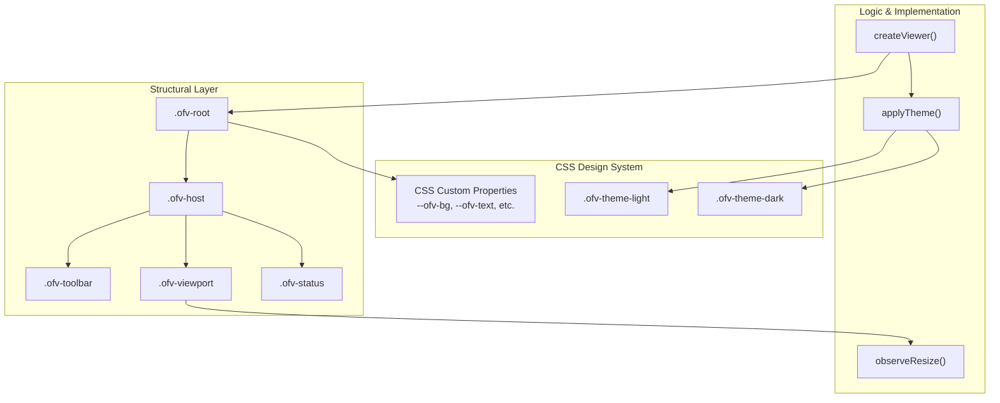
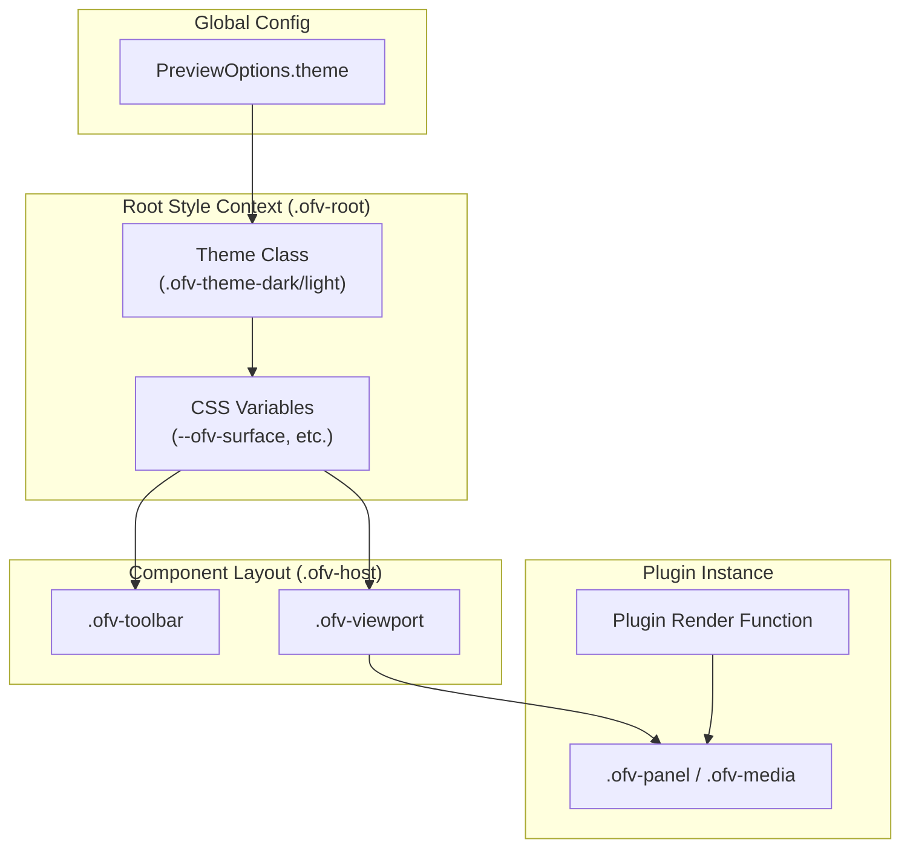

# Theming & CSS Design System

> **Relevant source files**
> * [packages/core/src/style.css](https://github.com/xushanpei/open-file-viewer/blob/ea5b8aef/packages/core/src/style.css)
> * [packages/core/src/style.test.ts](https://github.com/xushanpei/open-file-viewer/blob/ea5b8aef/packages/core/src/style.test.ts)
> * [packages/core/src/viewer.test.ts](https://github.com/xushanpei/open-file-viewer/blob/ea5b8aef/packages/core/src/viewer.test.ts)
> * [packages/core/src/viewer.ts](https://github.com/xushanpei/open-file-viewer/blob/ea5b8aef/packages/core/src/viewer.ts)

The Open File Viewer (OFV) utilizes a scoped CSS design system built on CSS custom properties (variables) and a strictly namespaced class hierarchy. The system is designed to be "container-first," meaning the viewer adapts to the dimensions and color scheme of its parent element rather than the global window context.

## CSS Namespace and Root Configuration

All styles are encapsulated under the `.ofv-root` namespace to prevent style leakage into the host application. When `createViewer` is called, it injects this class into the target container [packages/core/src/viewer.ts L23](https://github.com/xushanpei/open-file-viewer/blob/ea5b8aef/packages/core/src/viewer.ts#L23-L23)

### Core Structural Classes

The viewer UI is composed of three primary structural layers:

| Class | Role | Implementation Detail |
| --- | --- | --- |
| `.ofv-root` | **Boundary** | Sets the CSS variable defaults and base layout [packages/core/src/style.css L1-L22](https://github.com/xushanpei/open-file-viewer/blob/ea5b8aef/packages/core/src/style.css#L1-L22) |
| `.ofv-host` | **Layout Manager** | A flex column container that manages the relationship between the toolbar and the viewport [packages/core/src/style.css L45-L55](https://github.com/xushanpei/open-file-viewer/blob/ea5b8aef/packages/core/src/style.css#L45-L55) |
| `.ofv-viewport` | **Content Stage** | The scrollable region where plugins render file content. It acts as a **Container Query** root [packages/core/src/style.css L57-L68](https://github.com/xushanpei/open-file-viewer/blob/ea5b8aef/packages/core/src/style.css#L57-L68) |

### Design System Entities

The following diagram maps the logical UI components to their corresponding CSS classes and implementation logic.

**UI Component to Code Entity Mapping**



Sources: [packages/core/src/style.css L1-L82](https://github.com/xushanpei/open-file-viewer/blob/ea5b8aef/packages/core/src/style.css#L1-L82)

 [packages/core/src/viewer.ts L19-L38](https://github.com/xushanpei/open-file-viewer/blob/ea5b8aef/packages/core/src/viewer.ts#L19-L38)

 [packages/core/src/viewer.ts L234-L250](https://github.com/xushanpei/open-file-viewer/blob/ea5b8aef/packages/core/src/viewer.ts#L234-L250)

## Theming Engine

OFV supports three theme modes: `light`, `dark`, and `auto`. The theme is controlled via the `theme` property in `PreviewOptions` [packages/core/src/types.ts L10-L17](https://github.com/xushanpei/open-file-viewer/blob/ea5b8aef/packages/core/src/types.ts#L10-L17)

### CSS Custom Properties

The design system relies on a set of variables defined at the root. Plugins are encouraged to use these variables to ensure visual consistency.

| Variable | Light (Default) | Dark (`.ofv-theme-dark`) |
| --- | --- | --- |
| `--ofv-bg` | `#f3f4f6` | `#111827` |
| `--ofv-surface` | `#ffffff` | `#1f2937` |
| `--ofv-text` | `#111827` | `#f9fafb` |
| `--ofv-border` | `#d1d5db` | `#374151` |
| `--ofv-highlight` | `#fde68a` | `#92400e` |

Sources: [packages/core/src/style.css L1-L33](https://github.com/xushanpei/open-file-viewer/blob/ea5b8aef/packages/core/src/style.css#L1-L33)

### Auto Theme Implementation

The `applyTheme` function manages theme switching. When set to `auto`, it uses `window.matchMedia('(prefers-color-scheme: dark)')` to synchronize with the OS settings [packages/core/src/viewer.ts L238-L245](https://github.com/xushanpei/open-file-viewer/blob/ea5b8aef/packages/core/src/viewer.ts#L238-L245)

 It also attaches an event listener to the media query to handle real-time OS theme changes [packages/core/src/viewer.ts L249-L251](https://github.com/xushanpei/open-file-viewer/blob/ea5b8aef/packages/core/src/viewer.ts#L249-L251)

## Responsive Design & Container Queries

Unlike traditional responsive design which uses Viewport Units (vw/vh), OFV uses **Container Queries** and **Flexbox** to ensure the viewer works inside small side-panels or large dashboard widgets.

### Container Queries

The `.ofv-viewport` is defined as a container for inline-size queries:

```
.ofv-viewport {  container-type: inline-size;  flex: 1 1 auto;  overflow-x: hidden;  overflow-y: auto;}
```

[packages/core/src/style.css L57-L65](https://github.com/xushanpei/open-file-viewer/blob/ea5b8aef/packages/core/src/style.css#L57-L65)

This allows plugins to adjust their internal layout (e.g., hiding sidebar thumbnails in the PDF viewer or collapsing archive trees) based on the width of the viewer itself rather than the browser window [packages/core/src/style.test.ts L15-L18](https://github.com/xushanpei/open-file-viewer/blob/ea5b8aef/packages/core/src/style.test.ts#L15-L18)

### Flexible Toolbars

The toolbar utilizes `flex-wrap: wrap` and `min-width: 0` to prevent UI breakage in narrow containers [packages/core/src/style.css L70-L75](https://github.com/xushanpei/open-file-viewer/blob/ea5b8aef/packages/core/src/style.css#L70-L75)

 Search inputs and button labels use `text-overflow: ellipsis` to gracefully degrade when space is limited [packages/core/src/style.css L104-L106](https://github.com/xushanpei/open-file-viewer/blob/ea5b8aef/packages/core/src/style.css#L104-L106)

## Component Styling Reference

| Class | Description |
| --- | --- |
| `.ofv-status` | Absolute-positioned overlay for loading states and error messages [packages/core/src/style.css L203-L214](https://github.com/xushanpei/open-file-viewer/blob/ea5b8aef/packages/core/src/style.css#L203-L214) |
| `.ofv-toolbar` | The top action bar containing buttons and search [packages/core/src/style.css L70-L82](https://github.com/xushanpei/open-file-viewer/blob/ea5b8aef/packages/core/src/style.css#L70-L82) |
| `.ofv-toolbar-search` | Wrapper for the search input, using `flex: 1 1 180px` to claim available space [packages/core/src/style.css L159-L166](https://github.com/xushanpei/open-file-viewer/blob/ea5b8aef/packages/core/src/style.css#L159-L166) |
| `.ofv-search-match` | Highlight class used for text/PDF search results, mapped to `--ofv-highlight` [packages/core/src/style.css L181-L185](https://github.com/xushanpei/open-file-viewer/blob/ea5b8aef/packages/core/src/style.css#L181-L185) |
| `.ofv-center` | Utility class for centering content via flexbox [packages/core/src/style.css L197-L201](https://github.com/xushanpei/open-file-viewer/blob/ea5b8aef/packages/core/src/style.css#L197-L201) |

## Visual Hierarchy and Data Flow

The following diagram illustrates how CSS variables flow from the root to individual plugin instances and how the layout is structured.

**CSS Property and Layout Flow**



Sources: [packages/core/src/viewer.ts L27-L38](https://github.com/xushanpei/open-file-viewer/blob/ea5b8aef/packages/core/src/viewer.ts#L27-L38)

 [packages/core/src/style.css L1-L82](https://github.com/xushanpei/open-file-viewer/blob/ea5b8aef/packages/core/src/style.css#L1-L82)

 [packages/core/src/style.test.ts L75-L76](https://github.com/xushanpei/open-file-viewer/blob/ea5b8aef/packages/core/src/style.test.ts#L75-L76)