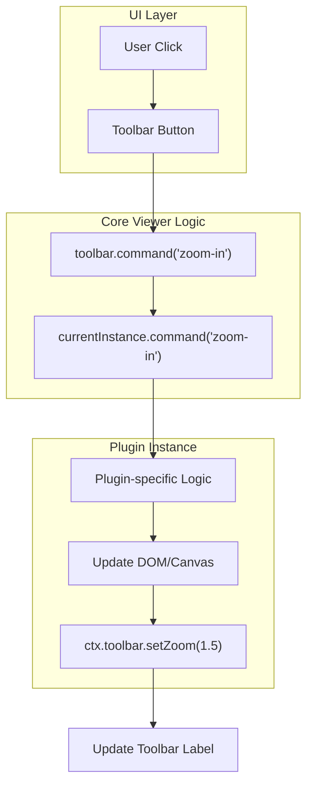
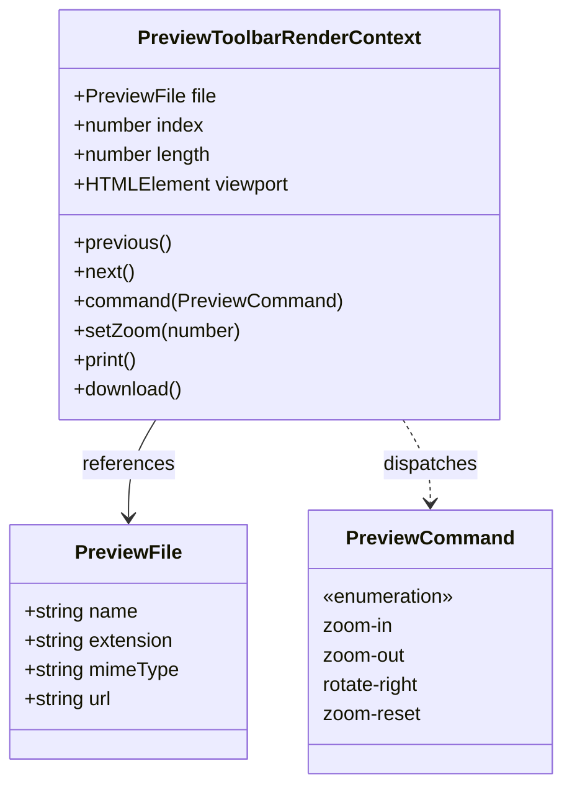
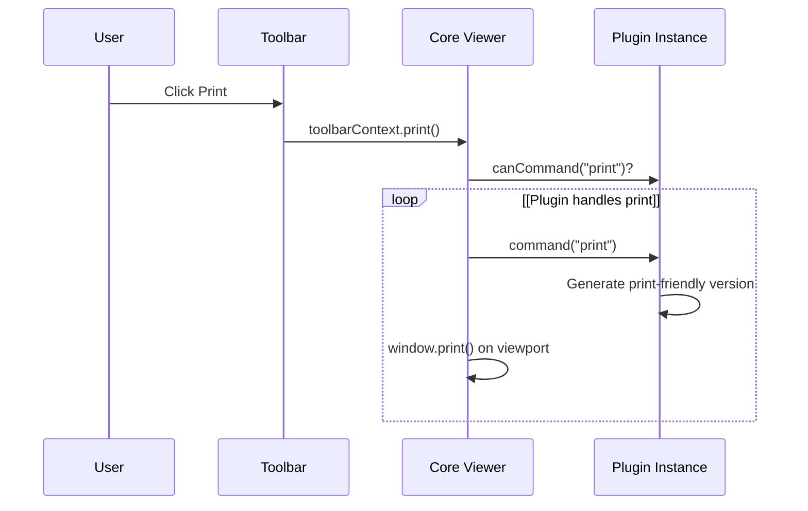

# Toolbar System

> **Relevant source files**
> * [packages/core/src/types.ts](https://github.com/xushanpei/open-file-viewer/blob/ea5b8aef/packages/core/src/types.ts)
> * [packages/core/src/viewer.test.ts](https://github.com/xushanpei/open-file-viewer/blob/ea5b8aef/packages/core/src/viewer.test.ts)
> * [packages/core/src/viewer.ts](https://github.com/xushanpei/open-file-viewer/blob/ea5b8aef/packages/core/src/viewer.ts)

The Toolbar System in `@open-file-viewer/core` provides a unified interface for file navigation, view manipulation (zoom, rotation), and document actions (download, print, fullscreen). It operates on a command delegation model, where UI interactions are translated into commands and passed down to the active plugin instance.

## Overview and Implementation

The toolbar is initialized during the `createViewer` lifecycle [packages/core/src/viewer.ts L51-L56](https://github.com/xushanpei/open-file-viewer/blob/ea5b8aef/packages/core/src/viewer.ts#L51-L56)

 It is managed as a separate DOM element within the `.ofv-host` container [packages/core/src/viewer.ts L30-L61](https://github.com/xushanpei/open-file-viewer/blob/ea5b8aef/packages/core/src/viewer.ts#L30-L61)

### Data Flow: Command Delegation

The toolbar does not manipulate the document directly. Instead, it communicates with the `PreviewInstance` returned by a plugin via a command pipeline.

1. **User Interaction**: User clicks a button (e.g., "Zoom In").
2. **Command Dispatch**: The toolbar calls the `command` callback provided during its creation [packages/core/src/viewer.ts L55](https://github.com/xushanpei/open-file-viewer/blob/ea5b8aef/packages/core/src/viewer.ts#L55-L55)
3. **Plugin Execution**: The `FileViewer` delegates this to the `currentInstance.command(command)` method [packages/core/src/viewer.ts L55](https://github.com/xushanpei/open-file-viewer/blob/ea5b8aef/packages/core/src/viewer.ts#L55-L55)
4. **State Feedback**: Plugins can report state changes (like current zoom level) back to the toolbar using the `PreviewToolbarRenderContext.setZoom` method [packages/core/src/types.ts L88](https://github.com/xushanpei/open-file-viewer/blob/ea5b8aef/packages/core/src/types.ts#L88-L88)

### Command Support Validation

To prevent invalid interactions, the viewer queries the active plugin's `canCommand` method to determine if a specific toolbar action should be enabled or disabled [packages/core/src/viewer.ts L124-L126](https://github.com/xushanpei/open-file-viewer/blob/ea5b8aef/packages/core/src/viewer.ts#L124-L126)

Title: Toolbar Command Pipeline



Sources: [packages/core/src/viewer.ts L51-L56](https://github.com/xushanpei/open-file-viewer/blob/ea5b8aef/packages/core/src/viewer.ts#L51-L56)

 [packages/core/src/viewer.ts L124-L126](https://github.com/xushanpei/open-file-viewer/blob/ea5b8aef/packages/core/src/viewer.ts#L124-L126)

 [packages/core/src/types.ts L128-L135](https://github.com/xushanpei/open-file-viewer/blob/ea5b8aef/packages/core/src/types.ts#L128-L135)

---

## Toolbar Configuration

The toolbar is highly configurable via the `PreviewToolbarOptions` interface [packages/core/src/types.ts L48-L61](https://github.com/xushanpei/open-file-viewer/blob/ea5b8aef/packages/core/src/types.ts#L48-L61)

### Configuration Properties

| Property | Type | Description |
| --- | --- | --- |
| `zoom`, `rotate` | `boolean` | Toggles visibility of zoom and rotation controls. |
| `download`, `print` | `boolean` | Toggles file export actions. |
| `order` | `PreviewToolbarActionId[]` | Defines the sequence of buttons. |
| `labels` | `Record<string, string>` | Customizes text for built-in actions. |
| `icons` | `Record<string, string \| Element>` | Customizes icons. String inputs are sanitized. |
| `actions` | `PreviewToolbarCustomAction[]` | Array of user-defined buttons. |
| `render` | `(ctx) => HTMLElement` | Complete override for custom toolbar rendering. |

Sources: [packages/core/src/types.ts L48-L61](https://github.com/xushanpei/open-file-viewer/blob/ea5b8aef/packages/core/src/types.ts#L48-L61)

 [packages/core/src/types.ts L63-L73](https://github.com/xushanpei/open-file-viewer/blob/ea5b8aef/packages/core/src/types.ts#L63-L73)

### SVG Sanitization

When icons are provided as strings, the system performs basic sanitization to ensure only safe SVG elements are rendered. This prevents XSS when loading dynamic toolbar configurations [packages/core/src/viewer.test.ts L215-L216](https://github.com/xushanpei/open-file-viewer/blob/ea5b8aef/packages/core/src/viewer.test.ts#L215-L216)

---

## Custom Actions and Rendering

Users can extend the toolbar with `PreviewToolbarCustomAction`. These actions have access to the `PreviewToolbarRenderContext`, allowing them to interact with the file and the viewer state [packages/core/src/types.ts L75-L94](https://github.com/xushanpei/open-file-viewer/blob/ea5b8aef/packages/core/src/types.ts#L75-L94)

### Custom Action Interface

```typescript
interface PreviewToolbarCustomAction {  id: string;  label: string;  onClick: (ctx: PreviewToolbarRenderContext) => void;  disabled?: boolean | ((ctx: PreviewToolbarRenderContext) => boolean);  hidden?: boolean | ((ctx: PreviewToolbarRenderContext) => boolean);}
```

### Context Entities Mapping

The following diagram maps the logical concepts of the Toolbar System to the specific code entities used in the `PreviewToolbarRenderContext` [packages/core/src/types.ts L75-L94](https://github.com/xushanpei/open-file-viewer/blob/ea5b8aef/packages/core/src/types.ts#L75-L94)

Title: Toolbar Context Entity Mapping



Sources: [packages/core/src/types.ts L27-L35](https://github.com/xushanpei/open-file-viewer/blob/ea5b8aef/packages/core/src/types.ts#L27-L35)

 [packages/core/src/types.ts L75-L94](https://github.com/xushanpei/open-file-viewer/blob/ea5b8aef/packages/core/src/types.ts#L75-L94)

 [packages/core/src/types.ts L135](https://github.com/xushanpei/open-file-viewer/blob/ea5b8aef/packages/core/src/types.ts#L135-L135)

---

## Print Subsystem

The print functionality is handled via the `print()` method in the toolbar context [packages/core/src/types.ts L91](https://github.com/xushanpei/open-file-viewer/blob/ea5b8aef/packages/core/src/types.ts#L91-L91)

1. **Trigger**: The user clicks the print button.
2. **Plugin Interception**: Some plugins (like PDF) may provide high-fidelity printing by intercepting the print command.
3. **Default Behavior**: If not handled by a plugin, the system attempts to print the current `viewport` content or the original file source.

### Print Data Flow

Title: Print Command Flow



Sources: [packages/core/src/types.ts L91](https://github.com/xushanpei/open-file-viewer/blob/ea5b8aef/packages/core/src/types.ts#L91-L91)

 [packages/core/src/viewer.ts L55](https://github.com/xushanpei/open-file-viewer/blob/ea5b8aef/packages/core/src/viewer.ts#L55-L55)

 [packages/core/src/viewer.ts L124-L126](https://github.com/xushanpei/open-file-viewer/blob/ea5b8aef/packages/core/src/viewer.ts#L124-L126)