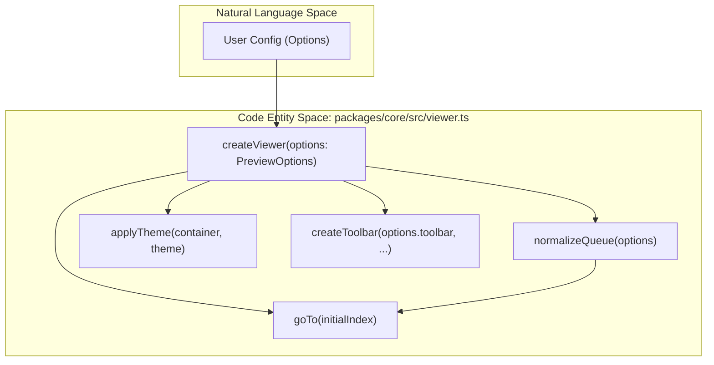
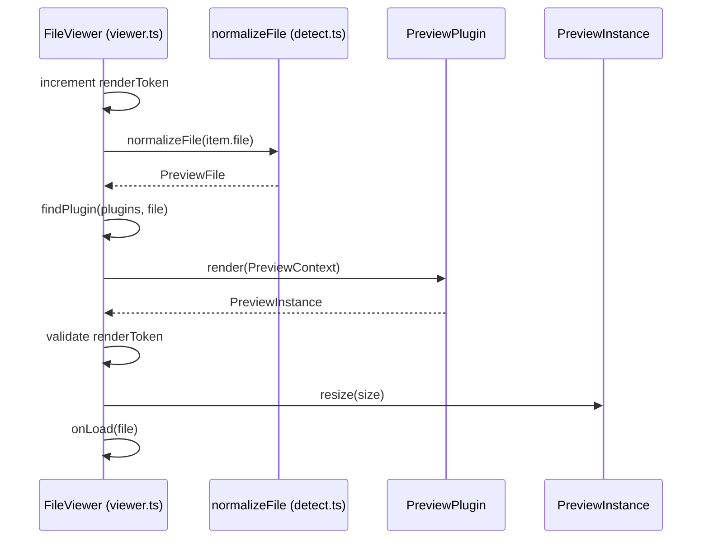

# createViewer & FileViewer Lifecycle

> **Relevant source files**
> * [packages/core/src/dom.ts](https://github.com/xushanpei/open-file-viewer/blob/ea5b8aef/packages/core/src/dom.ts)
> * [packages/core/src/types.ts](https://github.com/xushanpei/open-file-viewer/blob/ea5b8aef/packages/core/src/types.ts)
> * [packages/core/src/viewer.test.ts](https://github.com/xushanpei/open-file-viewer/blob/ea5b8aef/packages/core/src/viewer.test.ts)
> * [packages/core/src/viewer.ts](https://github.com/xushanpei/open-file-viewer/blob/ea5b8aef/packages/core/src/viewer.ts)

The `createViewer` function is the primary entry point for the `@open-file-viewer/core` engine. It orchestrates the entire lifecycle of a file preview, from DOM initialization and file normalization to plugin execution and cleanup.

## The createViewer Entry Point

The `createViewer` function accepts a `PreviewOptions` object and returns a `FileViewer` instance. It handles the initial setup of the viewer's DOM structure, including the host, viewport, and status layers.

### Initialization Flow

1. **Container Resolution**: Resolves the target element via `resolveContainer` and applies dimensions [packages/core/src/viewer.ts L20-L21](https://github.com/xushanpei/open-file-viewer/blob/ea5b8aef/packages/core/src/viewer.ts#L20-L21)
2. **DOM Construction**: Creates the internal hierarchy: `.ofv-root` (container) -> `.ofv-host` -> `.ofv-viewport` and `.ofv-status` [packages/core/src/viewer.ts L23-L38](https://github.com/xushanpei/open-file-viewer/blob/ea5b8aef/packages/core/src/viewer.ts#L23-L38)
3. **Theme Application**: Initializes the `applyTheme` helper to manage light/dark modes, including `auto` mode via `matchMedia` [packages/core/src/viewer.ts L27-L248](https://github.com/xushanpei/open-file-viewer/blob/ea5b8aef/packages/core/src/viewer.ts#L27-L248)
4. **Queue Normalization**: Converts the provided `file` or `files` into a uniform `PreviewItem[]` queue [packages/core/src/viewer.ts L39-L206](https://github.com/xushanpei/open-file-viewer/blob/ea5b8aef/packages/core/src/viewer.ts#L39-L206)
5. **Toolbar Setup**: If enabled, initializes the toolbar and links it to the viewer's command and navigation systems [packages/core/src/viewer.ts L51-L59](https://github.com/xushanpei/open-file-viewer/blob/ea5b8aef/packages/core/src/viewer.ts#L51-L59)

### Data Flow: Initialization to First Render

The following diagram illustrates the transition from the "Natural Language" configuration space to the internal "Code Entity" space during initialization.

**Title: Initialization Data Flow**

Sources: [packages/core/src/viewer.ts L19-L56](https://github.com/xushanpei/open-file-viewer/blob/ea5b8aef/packages/core/src/viewer.ts#L19-L56)

 [packages/core/src/types.ts L96-L115](https://github.com/xushanpei/open-file-viewer/blob/ea5b8aef/packages/core/src/types.ts#L96-L115)

---

## The Render Pipeline

The render pipeline is an asynchronous process triggered by `goTo`, `next`, `previous`, or `reload`. It ensures that only one file is being processed at a time using a `renderToken` to prevent race conditions.

### 1. Normalization

The `renderQueueItem` function retrieves the item from the queue and calls `normalizeFile` [packages/core/src/viewer.ts L140-L143](https://github.com/xushanpei/open-file-viewer/blob/ea5b8aef/packages/core/src/viewer.ts#L140-L143)

 This step converts various sources (URL, Blob, File, ArrayBuffer) into a standardized `PreviewFile` object containing metadata like `extension` and `mimeType`.

### 2. Plugin Matching

The engine iterates through the `plugins` array (provided in options) and appends the `fallbackPlugin` at the end [packages/core/src/viewer.ts L101](https://github.com/xushanpei/open-file-viewer/blob/ea5b8aef/packages/core/src/viewer.ts#L101-L101)

 It calls `findPlugin`, which executes the `match(file)` method of each plugin sequentially until one returns `true` [packages/core/src/viewer.ts L102](https://github.com/xushanpei/open-file-viewer/blob/ea5b8aef/packages/core/src/viewer.ts#L102-L102)

### 3. Token Validation

Before proceeding to render, the engine checks if the `renderToken` matches the token at the start of the call [packages/core/src/viewer.ts L103-L105](https://github.com/xushanpei/open-file-viewer/blob/ea5b8aef/packages/core/src/viewer.ts#L103-L105)

 This invalidates stale render requests if the user navigates quickly through the queue.

### 4. Rendering & Instance Management

The selected plugin's `render(ctx)` method is called with a `PreviewContext` [packages/core/src/viewer.ts L108-L117](https://github.com/xushanpei/open-file-viewer/blob/ea5b8aef/packages/core/src/viewer.ts#L108-L117)

* **Context**: Provides the `viewport`, `file`, `setLoading`, and `setError` callbacks.
* **Instance**: The plugin returns a `PreviewInstance`. The viewer stores this as `currentInstance` to manage its lifecycle [packages/core/src/viewer.ts L122](https://github.com/xushanpei/open-file-viewer/blob/ea5b8aef/packages/core/src/viewer.ts#L122-L122)
* **Command Support**: The viewer queries `canCommand` on the instance to update the toolbar button states [packages/core/src/viewer.ts L124-L126](https://github.com/xushanpei/open-file-viewer/blob/ea5b8aef/packages/core/src/viewer.ts#L124-L126)

**Title: Render Pipeline Sequence**

Sources: [packages/core/src/viewer.ts L93-L138](https://github.com/xushanpei/open-file-viewer/blob/ea5b8aef/packages/core/src/viewer.ts#L93-L138)

 [packages/core/src/types.ts L128-L141](https://github.com/xushanpei/open-file-viewer/blob/ea5b8aef/packages/core/src/types.ts#L128-L141)

---

## Resize Handling

The viewer maintains responsiveness through a `ResizeObserver` initialized during creation [packages/core/src/viewer.ts L91](https://github.com/xushanpei/open-file-viewer/blob/ea5b8aef/packages/core/src/viewer.ts#L91-L91)

1. **Observation**: The `observeResize` helper monitors the `container` element.
2. **Trigger**: When the container dimensions change, the `resize` function is called [packages/core/src/viewer.ts L83-L89](https://github.com/xushanpei/open-file-viewer/blob/ea5b8aef/packages/core/src/viewer.ts#L83-L89)
3. **Delegation**: The viewer calculates the new viewport size using `getElementSize` and passes it to `currentInstance.resize(size)` [packages/core/src/viewer.ts L87-L88](https://github.com/xushanpei/open-file-viewer/blob/ea5b8aef/packages/core/src/viewer.ts#L87-L88)
4. **Manual Trigger**: Users can also manually trigger a resize via the `FileViewer.resize()` method exported by the instance [packages/core/src/viewer.ts L169](https://github.com/xushanpei/open-file-viewer/blob/ea5b8aef/packages/core/src/viewer.ts#L169-L169)

Sources: [packages/core/src/viewer.ts L83-L91](https://github.com/xushanpei/open-file-viewer/blob/ea5b8aef/packages/core/src/viewer.ts#L83-L91)

 [packages/core/src/dom.ts L28-L34](https://github.com/xushanpei/open-file-viewer/blob/ea5b8aef/packages/core/src/dom.ts#L28-L34)

---

## Destroy Flow

The `destroy()` method on the `FileViewer` object ensures a clean teardown to prevent memory leaks and residual DOM elements.

| Step | Action | Code Reference |
| --- | --- | --- |
| **Flagging** | Sets `destroyed = true` to abort any pending async render tasks. | [packages/core/src/viewer.ts L171](https://github.com/xushanpei/open-file-viewer/blob/ea5b8aef/packages/core/src/viewer.ts#L171-L171) |
| **Token Invalidation** | Increments `renderToken` to fail any active `token !== renderToken` checks. | [packages/core/src/viewer.ts L172](https://github.com/xushanpei/open-file-viewer/blob/ea5b8aef/packages/core/src/viewer.ts#L172-L172) |
| **Observer Cleanup** | Disconnects the `ResizeObserver`. | [packages/core/src/viewer.ts L173](https://github.com/xushanpei/open-file-viewer/blob/ea5b8aef/packages/core/src/viewer.ts#L173-L173) |
| **Instance Cleanup** | Calls `currentInstance.destroy()` to let the active plugin release resources (e.g., Worker threads, Object URLs). | [packages/core/src/viewer.ts L174](https://github.com/xushanpei/open-file-viewer/blob/ea5b8aef/packages/core/src/viewer.ts#L174-L174) |
| **UI Cleanup** | Destroys the toolbar, removes theme classes, and clears the container DOM. | [packages/core/src/viewer.ts L175-L182](https://github.com/xushanpei/open-file-viewer/blob/ea5b8aef/packages/core/src/viewer.ts#L175-L182) |

Sources: [packages/core/src/viewer.ts L170-L183](https://github.com/xushanpei/open-file-viewer/blob/ea5b8aef/packages/core/src/viewer.ts#L170-L183)

 [packages/core/src/viewer.test.ts L44-L46](https://github.com/xushanpei/open-file-viewer/blob/ea5b8aef/packages/core/src/viewer.test.ts#L44-L46)