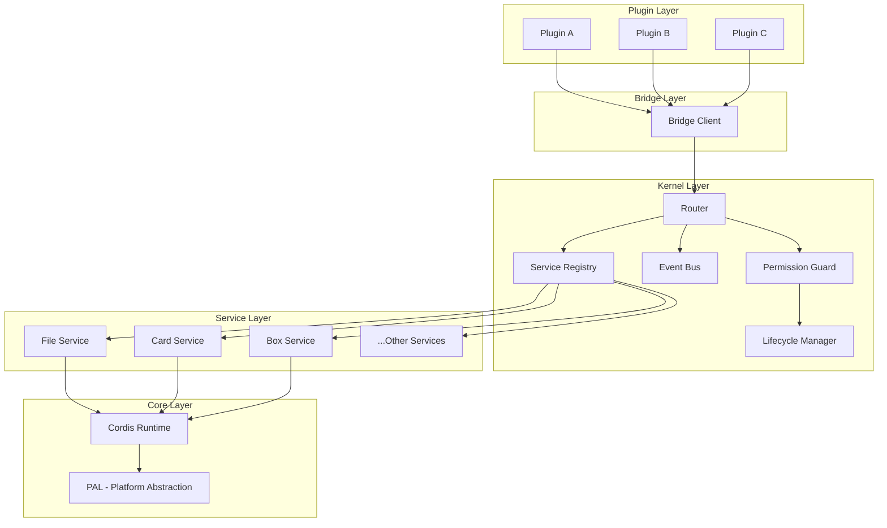

# 薯片内核设计

> **版本**：v1.0.0
> **日期**：2026-09-19
> **适用范围**：薯片生态 Rust 核心设计与实现

---

## 一、概述

薯片内核（Chips Kernel）是整个生态的核心运行时，负责：

1. **服务注册与路由**：管理所有服务的注册和调用路由
2. **事件总线**：提供进程内/进程间事件通信
3. **生命周期管理**：管理服务、插件的生命周期状态
4. **权限控制**：在调用链路中实施权限校验

## 二、架构概览

### 2.1 整体架构图



### 2.2 模块职责

| 模块 | 职责 |
|------|------|
| Router | 路由请求到目标服务 |
| Registry | 管理服务注册和发现 |
| EventBus | 进程内/进程间事件通信 |
| Lifecycle | 管理服务生命周期状态 |
| Permission | 运行时权限校验 |
| Cordis Runtime | 插件运行时（原子化模块） |
| PAL | 平台抽象层 |

## 三、服务注册与路由

### 3.1 服务注册

```rust
// 服务描述符
#[derive(Debug, Clone)]
pub struct ServiceDescriptor {
    pub name: String,
    pub version: String,
    pub actions: HashMap<String, ActionDescriptor>,
    pub permissions: Vec<String>,
}

// 动作描述符
#[derive(Debug, Clone)]
pub struct ActionDescriptor {
    pub name: String,
    pub schema_in: Schema,
    pub schema_out: Schema,
    pub timeout_ms: u64,
    pub idempotent: bool,
    pub permissions: Vec<String>,
}

// 服务注册
impl ServiceRegistry {
    pub fn register(&mut self, service: ServiceDescriptor) -> Result<(), RegistryError> {
        // 检查是否已存在
        if self.services.contains_key(&service.name) {
            return Err(RegistryError::AlreadyExists(service.name));
        }
        
        // 验证 schema
        self.validate_schema(&service)?;
        
        // 注册服务
        self.services.insert(service.name.clone(), service);
        
        // 发布服务注册事件
        self.event_bus.publish("kernel.service.registered", &service);
        
        Ok(())
    }
}
```

### 3.2 路由机制

```rust
// 路由请求
pub struct RouteRequest {
    pub service: String,
    pub action: String,
    pub params: Value,
    pub context: RouteContext,
}

// 路由上下文
pub struct RouteContext {
    pub request_id: String,
    pub caller: CallerInfo,
    pub timestamp: u64,
    pub deadline: u64,
}

// 路由实现
impl Router {
    pub async fn route(&self, request: RouteRequest) -> Result<Value, RouteError> {
        // 1. 查找服务
        let service = self.registry.get(&request.service)
            .ok_or(RouteError::ServiceNotFound(request.service.clone()))?;
        
        // 2. 查找动作
        let action = service.actions.get(&request.action)
            .ok_or(RouteError::ActionNotFound {
                service: request.service.clone(),
                action: request.action.clone(),
            })?;
        
        // 3. 权限校验
        self.permission_guard.check(&request.context, &action.permissions)?;
        
        // 4. 参数验证
        let validated_params = action.schema_in.validate(&request.params)
            .map_err(RouteError::InvalidParams)?;
        
        // 5. 执行动作
        let result = service.execute(&request.action, validated_params, request.context).await?;
        
        // 6. 结果验证
        let validated_result = action.schema_out.validate(&result)
            .map_err(RouteError::InvalidResult)?;
        
        Ok(validated_result)
    }
}
```

### 3.3 路由匹配模式

```rust
// 支持精确匹配、前缀匹配、通配符匹配
pub enum RoutePattern {
    Exact(String),           // exact:file.read
    Prefix(String),         // prefix:file.*
    Wildcard(String),       // wildcard:**
}

// 匹配器实现
impl RouteMatcher {
    pub fn matches(&self, pattern: &RoutePattern, route: &str) -> bool {
        match pattern {
            RoutePattern::Exact(p) => p == route,
            RoutePattern::Prefix(p) => route.starts_with(p.trim_end_matches('*')),
            RoutePattern::Wildcard(_) => true,
        }
    }
}
```

## 四、事件总线

### 4.1 事件模型

```rust
// 事件结构
pub struct Event {
    pub id: String,
    pub name: String,
    pub source: EventSource,
    pub data: Value,
    pub timestamp: u64,
    pub metadata: HashMap<String, Value>,
}

// 事件源
#[derive(Debug, Clone)]
pub enum EventSource {
    Kernel,
    Service { service: String },
    Plugin { plugin_id: String },
    External,
}

// 订阅器
pub struct Subscriber {
    pub id: String,
    pub filter: EventFilter,
    pub handler: Box<dyn EventHandler>,
    pub options: SubscriberOptions,
}

// 订阅选项
#[derive(Debug, Clone)]
pub struct SubscriberOptions {
    pub async_handler: bool,
    pub buffer_size: usize,
    pub timeout_ms: Option<u64>,
}
```

### 4.2 事件订阅

```rust
impl EventBus {
    // 订阅事件
    pub fn subscribe(
        &mut self,
        filter: EventFilter,
        handler: Box<dyn EventHandler>,
        options: SubscriberOptions,
    ) -> Result<SubscriberId, EventBusError> {
        let id = SubscriberId::new();
        
        let subscriber = Subscriber {
            id: id.clone(),
            filter,
            handler,
            options,
        };
        
        self.subscribers.insert(id.clone(), subscriber);
        
        Ok(id)
    }
    
    // 发布事件
    pub async fn publish(&self, name: &str, data: &Value) -> Result<(), EventBusError> {
        let event = Event {
            id: Uuid::new_v4().to_string(),
            name: name.to_string(),
            source: EventSource::Kernel,
            data: data.clone(),
            timestamp: current_timestamp(),
            metadata: HashMap::new(),
        };
        
        // 匹配订阅者
        let matches = self.subscribers.values()
            .filter(|sub| sub.filter.matches(&event))
            .collect::<Vec<_>>();
        
        // 异步分发事件
        for subscriber in matches {
            self.dispatch_event(subscriber, &event).await;
        }
        
        Ok(())
    }
}
```

### 4.3 事件过滤器

```rust
// 事件过滤器
#[derive(Debug, Clone)]
pub enum EventFilter {
    All,                                        // 匹配所有事件
    Name(String),                              // 精确匹配名称
    NamePrefix(String),                        // 名称前缀匹配
    NamePattern(Regex),                        // 名称正则匹配
    Source(SourceFilter),                      // 事件源过滤
    And(Box<EventFilter>, Box<EventFilter>),  // 逻辑与
    Or(Box<EventFilter>, Box<EventFilter>),   // 逻辑或
    Not(Box<EventFilter>),                     // 逻辑非
}

// 使用示例
let filter = EventFilter::And(
    Box::new(EventFilter::NamePrefix("file.".to_string())),
    Box::new(EventFilter::Source(SourceFilter::Plugin {
        plugin_id: Some("my-plugin".to_string()),
        ..Default::default()
    })),
);
```

## 五、生命周期管理

### 5.1 生命周期状态

```rust
// 服务生命周期状态
#[derive(Debug, Clone, Copy, PartialEq, Eq)]
pub enum ServiceState {
    Unloaded,    // 未加载
    Loading,     // 加载中
    Ready,       // 就绪
    Running,     // 运行中
    Stopping,    // 停止中
    Stopped,     // 已停止
    Error,       // 错误状态
}

// 状态转换
pub enum StateTransition {
    Load,
    Start,
    Stop,
    Restart,
    Unload,
}

// 状态机实现
impl ServiceStateMachine {
    pub fn transition(&self, current: ServiceState, event: StateTransition) 
        -> Result<ServiceState, StateError> 
    {
        let next = match (current, event) {
            (Unloaded, Load) => Ready,
            (Ready, Start) => Running,
            (Running, Stop) => Stopping,
            (Stopping, Stopped) => Stopped,
            (Stopped, Load) => Ready,
            // ... 其他转换
            _ => return Err(StateError::InvalidTransition(current, event)),
        };
        
        Ok(next)
    }
}
```

### 5.2 生命周期钩子

```rust
// 生命周期钩子接口
pub trait LifecycleHooks: Send + Sync {
    // 初始化前
    fn on_before_init(&self) -> Result<(), HookError> { Ok(()) }
    
    // 初始化后
    fn on_after_init(&self) -> Result<(), HookError> { Ok(()) }
    
    // 启动前
    fn on_before_start(&self) -> Result<(), HookError> { Ok(()) }
    
    // 启动后
    fn on_after_start(&self) -> Result<(), HookError> { Ok(()) }
    
    // 停止前
    fn on_before_stop(&self) -> Result<(), HookError> { Ok(()) }
    
    // 停止后
    fn on_after_stop(&self) -> Result<(), HookError> { Ok(()) }
}

// 生命周期管理器
pub struct LifecycleManager {
    hooks: Vec<Box<dyn LifecycleHooks>>,
    state_machines: HashMap<String, ServiceStateMachine>,
}

impl LifecycleManager {
    pub async fn start_service(&self, service_name: &str) -> Result<(), LifecycleError> {
        // 1. 触发前置钩子
        for hook in &self.hooks {
            hook.on_before_start()?;
        }
        
        // 2. 状态转换
        let state_machine = self.state_machines.get_mut(service_name)
            .ok_or(LifecycleError::ServiceNotFound)?;
        state_machine.transition(Ready, Start)?;
        
        // 3. 触发后置钩子
        for hook in &self.hooks {
            hook.on_after_start()?;
        }
        
        Ok(())
    }
}
```

### 5.3 健康检查

```rust
// 健康检查接口
pub trait HealthCheck: Send + Sync {
    fn name(&self) -> &str;
    fn check(&self) -> HealthResult;
}

// 健康状态
#[derive(Debug, Clone)]
pub struct HealthResult {
    pub status: HealthStatus,
    pub message: Option<String>,
    pub details: HashMap<String, Value>,
    pub timestamp: u64,
}

#[derive(Debug, Clone, Copy, PartialEq, Eq)]
pub enum HealthStatus {
    Healthy,
    Degraded,
    Unhealthy,
}

// 健康检查器注册
impl LifecycleManager {
    pub fn register_health_check(&mut self, check: Box<dyn HealthCheck>) {
        self.health_checks.push(check);
    }
    
    pub async fn check_health(&self) -> HealthReport {
        let mut results = Vec::new();
        
        for check in &self.health_checks {
            results.push(check.check());
        }
        
        let overall_status = self.aggregate_status(&results);
        
        HealthReport {
            status: overall_status,
            checks: results,
            timestamp: current_timestamp(),
        }
    }
}
```

## 六、权限控制

### 6.1 权限模型

```rust
// 权限定义
#[derive(Debug, Clone, PartialEq, Eq, Hash)]
pub struct Permission {
    pub capability: String,
    pub action: String,
    pub level: PermissionLevel,
}

#[derive(Debug, Clone, Copy, PartialEq, Eq, Hash)]
pub enum PermissionLevel {
    Read,
    Write,
    Admin,
}

// 调用者信息
#[derive(Debug, Clone)]
pub struct CallerInfo {
    pub caller_type: CallerType,
    pub caller_id: String,
    pub plugin_id: Option<String>,
    pub window_id: Option<String>,
    pub permissions: Vec<Permission>,
}

#[derive(Debug, Clone, Copy, PartialEq, Eq)]
pub enum CallerType {
    Kernel,
    Service,
    Plugin,
    External,
}
```

### 6.2 权限校验

```rust
// 权限守卫
pub struct PermissionGuard {
    permission_cache: RwLock<HashMap<String, Vec<Permission>>>,
}

impl PermissionGuard {
    pub fn check(
        &self,
        context: &RouteContext,
        required_permissions: &[String],
    ) -> Result<(), PermissionError> 
    {
        let caller_permissions = self.get_caller_permissions(&context.caller);
        
        for required in required_permissions {
            if !self.has_permission(&caller_permissions, required) {
                return Err(PermissionError::Denied {
                    required: required.to_string(),
                    caller: context.caller.caller_id.clone(),
                });
            }
        }
        
        Ok(())
    }
    
    fn has_permission(&self, granted: &[Permission], required: &str) -> bool {
        // 解析 required 格式: "capability.action" 或 "capability.*"
        let parts: Vec<&str> = required.split('.').collect();
        
        if parts.len() != 2 {
            return false;
        }
        
        let (cap, action) = (parts[0], parts[1]);
        
        granted.iter().any(|p| {
            p.capability == cap && 
            (p.action == action || p.action == "*" || action == "*")
        })
    }
}
```

### 6.3 权限声明

```rust
// 插件权限声明
#[derive(Debug, Clone, Serialize, Deserialize)]
pub struct PluginPermissions {
    #[serde(rename = "capabilities")]
    pub capabilities: Vec<CapabilityPermission>,
}

#[derive(Debug, Clone, Serialize, Deserialize)]
pub struct CapabilityPermission {
    #[serde(rename = "capability")]
    pub capability: String,
    
    #[serde(rename = "actions")]
    pub actions: Vec<String>,
    
    #[serde(rename = "reason")]
    pub reason: String,
}

// manifest.yaml 示例
// permissions:
//   - capability: file
//     actions: ["read", "list"]
//     reason: "需要读取文件以展示内容"
```

## 七、Cordis 运行时集成

### 7.1 运行时初始化

```rust
// Cordis 运行时配置
#[derive(Debug, Clone)]
pub struct CordisConfig {
    pub module_paths: Vec<PathBuf>,
    pub hot_reload: bool,
    pub isolation_level: IsolationLevel,
    pub resource_limits: ResourceLimits,
}

pub struct ChipsKernel {
    cordis: CordisRuntime,
    registry: ServiceRegistry,
    event_bus: EventBus,
    lifecycle: LifecycleManager,
    permission: PermissionGuard,
    router: Router,
}

impl ChipsKernel {
    pub async fn new(config: KernelConfig) -> Result<Self, KernelError> {
        // 1. 初始化 Cordis 运行时
        let cordis = CordisRuntime::new(CordisConfig {
            module_paths: config.module_paths,
            hot_reload: config.hot_reload,
            isolation_level: IsolationLevel::Sandbox,
            resource_limits: ResourceLimits::default(),
        }).await?;
        
        // 2. 初始化各子系统
        let registry = ServiceRegistry::new();
        let event_bus = EventBus::new();
        let lifecycle = LifecycleManager::new();
        let permission = PermissionGuard::new();
        
        // 3. 初始化路由器
        let router = Router::new(
            registry.clone(),
            permission.clone(),
            event_bus.clone(),
        );
        
        // 4. 注册内置服务
        self.register_builtin_services(&registry, &cordis).await?;
        
        Ok(Self {
            cordis,
            registry,
            event_bus,
            lifecycle,
            permission,
            router,
        })
    }
}
```

### 7.2 插件加载

```rust
impl CordisRuntime {
    pub async fn load_plugin(&self, manifest: &PluginManifest) 
        -> Result<PluginHandle, PluginError> 
    {
        // 1. 验证 manifest
        self.validate_manifest(manifest)?;
        
        // 2. 权限检查
        self.check_permissions(manifest)?;
        
        // 3. 加载模块
        let module = self.module_loader.load(&manifest.entry).await?;
        
        // 4. 创建隔离上下文
        let context = self.create_isolation_context(manifest)?;
        
        // 5. 初始化插件
        let instance = module.initialize(context).await?;
        
        // 6. 注册能力
        self.register_capabilities(&instance, manifest)?;
        
        Ok(PluginHandle::new(instance, manifest))
    }
}
```

## 八、最佳实践

### 8.1 服务实现

```rust
// 服务实现示例
pub struct FileService {
    kernel: KernelRef,
    config: FileServiceConfig,
}

impl Service for FileService {
    fn descriptor(&self) -> ServiceDescriptor {
        ServiceDescriptor {
            name: "file".to_string(),
            version: "1.0.0".to_string(),
            actions: vec![
                ActionDescriptor {
                    name: "read".to_string(),
                    schema_in: file_read_params_schema(),
                    schema_out: file_read_result_schema(),
                    timeout_ms: 30000,
                    idempotent: true,
                    permissions: vec!["file.read".to_string()],
                },
                // ...
            ],
            permissions: vec![
                "file.read".to_string(),
                "file.write".to_string(),
            ],
        }
    }
    
    async fn execute(
        &self,
        action: &str,
        params: Value,
        context: RouteContext,
    ) -> Result<Value, ServiceError> {
        match action {
            "read" => self.read(params, context).await,
            "write" => self.write(params, context).await,
            // ...
            _ => Err(ServiceError::UnknownAction(action.to_string())),
        }
    }
}
```

### 8.2 错误处理

```rust
// 统一错误类型
#[derive(Debug, thiserror::Error)]
pub enum KernelError {
    #[error("Service not found: {0}")]
    ServiceNotFound(String),
    
    #[error("Action not found: {service}.{action}")]
    ActionNotFound { service: String, action: String },
    
    #[error("Permission denied: {required}")]
    PermissionDenied { required: String },
    
    #[error("Invalid params: {0}")]
    InvalidParams(String),
    
    #[error("Timeout: {action} exceeded {timeout_ms}ms")]
    Timeout { action: String, timeout_ms: u64 },
    
    #[error("Service error: {0}")]
    ServiceError(String),
}
```

### 8.3 性能优化

```rust
// 服务路由缓存
pub struct CachedRouter {
    inner: Router,
    cache: Arc<RwLock<LruCache<String, ServiceDescriptor>>>>,
}

impl CachedRouter {
    pub async fn route(&self, request: RouteRequest) -> Result<Value, RouteError> {
        let cache_key = format!("{}:{}", request.service, request.action);
        
        // 尝试从缓存获取服务描述符
        if let Some(descriptor) = self.cache.read().await.get(&cache_key) {
            // 使用缓存的描述符
            return self.route_with_descriptor(request, descriptor).await;
        }
        
        // 缓存未命中，查询注册表
        let descriptor = self.inner.registry.get(&request.service).await
            .ok_or(RouteError::ServiceNotFound(request.service.clone()))?;
        
        // 更新缓存
        self.cache.write().await.put(cache_key, descriptor.clone());
        
        self.route_with_descriptor(request, &descriptor).await
    }
}
```

## 九、总结

薯片内核是整个生态的核心，其设计要点：

1. **中心路由**：所有调用必须经过内核路由
2. **服务注册表**：统一管理所有服务
3. **事件总线**：解耦的进程内/进程间通信
4. **生命周期管理**：状态机驱动的生命周期控制
5. **权限守卫**：运行时权限校验
6. **Cordis 集成**：原子化模块运行时支持

内核的稳定性决定了整个生态的稳定性，必须严格遵循架构原则进行设计和实现。
