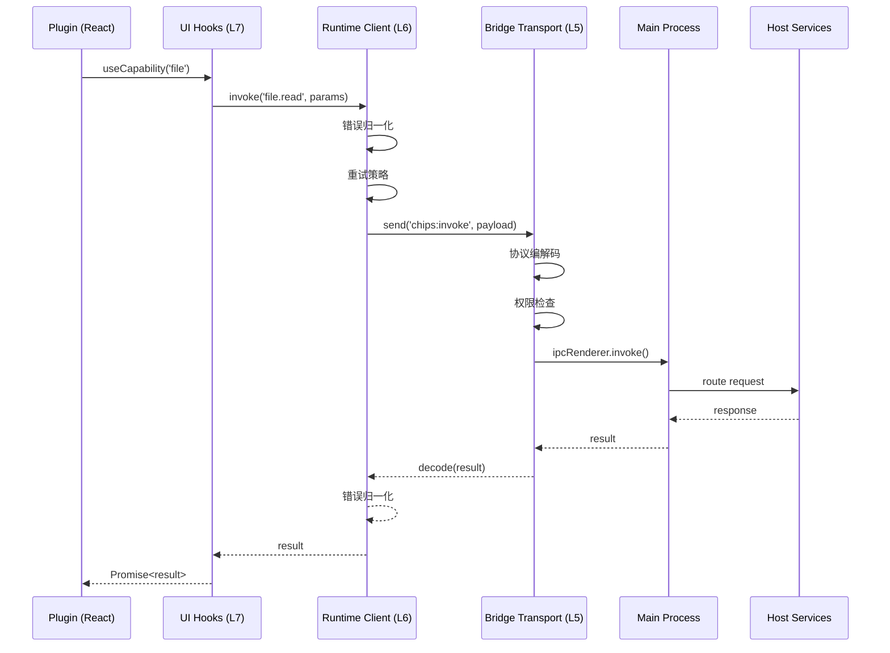

# Bridge 三层设计

> **版本**：v1.0.0
> **日期**：2026-09-19
> **适用范围**：薯片生态 Bridge 设计与实现

---

## 一、概述

Bridge 是插件访问 Host 能力的唯一通道，采用三层架构设计：

| 层级 | 名称 | 职责 |
|------|------|------|
| L5 | Bridge Transport | IPC 传输、消息编解码、安全检查 |
| L6 | Runtime Client | 能力封装、错误归一、重试策略 |
| L7 | UI Hooks | 面向页面的调用接口、状态管理 |

## 二、架构概览

### 2.1 整体架构图



### 2.2 层级职责

```
┌─────────────────────────────────────────────────────────────┐
│                      Plugin Layer                            │
│              React Component / Hook Consumer                   │
└─────────────────────────────────────────────────────────────┘
                              │
                              ▼
┌─────────────────────────────────────────────────────────────┐
│                    UI Hooks (L7)                             │
│  • useCapability()                                           │
│  • useFile() / useCard() / useWindow()                      │
│  • 状态管理、订阅管理                                        │
└─────────────────────────────────────────────────────────────┘
                              │
                              ▼
┌─────────────────────────────────────────────────────────────┐
│                  Runtime Client (L6)                         │
│  • 能力封装                                                  │
│  • 错误归一化                                                │
│  • 重试策略                                                  │
│  • 类型安全                                                  │
└─────────────────────────────────────────────────────────────┘
                              │
                              ▼
┌─────────────────────────────────────────────────────────────┐
│                  Bridge Transport (L5)                        │
│  • IPC 消息封装                                              │
│  • 协议编解码                                                │
│  • 权限校验                                                  │
│  • window.chips.*                                           │
└─────────────────────────────────────────────────────────────┘
                              │
                         IPC Bridge
                              │
                              ▼
┌─────────────────────────────────────────────────────────────┐
│                     Main Process                              │
│                 Kernel / Services                            │
└─────────────────────────────────────────────────────────────┘
```

## 三、Bridge Transport (L5)

### 3.1 消息格式

```typescript
// 请求消息
interface BridgeRequest {
  id: string;              // 请求唯一标识 (UUID)
  capability: string;      // 能力名称
  action: string;          // 动作名称
  params: unknown;         // 参数
  timeout?: number;        // 超时时间 (ms)
  requestId?: string;      // 幂等去重 ID
  timestamp: number;        // 发送时间戳
}

// 响应消息
interface BridgeResponse {
  id: string;              // 对应请求 ID
  result?: unknown;         // 成功结果
  error?: BridgeError;      // 错误信息
  duration: number;         // 处理时长 (ms)
}

// 错误消息
interface BridgeError {
  code: string;            // 错误码
  message: string;          // 人类可读消息
  details?: unknown;        // 详细信息
  retryable?: boolean;     // 是否可重试
}
```

### 3.2 IPC 通道定义

```typescript
// 主通道：通用调用
const CHANNELS = {
  // 通用调用通道
  INVOKE: 'chips:invoke',
  
  // 能力特定通道
  FILE: {
    READ: 'chips:file:read',
    WRITE: 'chips:file:write',
    LIST: 'chips:file:list',
  },
  
  CARD: {
    PARSE: 'chips:card:parse',
    RENDER: 'chips:card:render',
    VALIDATE: 'chips:card:validate',
  },
  
  // 事件通道
  EVENT: 'chips:event',
  
  // 窗口通道
  WINDOW: 'chips:window',
} as const;
```

### 3.3 Preload 脚本

```typescript
// preload/index.ts
import { contextBridge, ipcRenderer } from 'electron';

// 公开 API
contextBridge.exposeInMainWorld('chips', {
  // 通用调用
  invoke: async (capability: string, action: string, params: unknown): Promise<unknown> => {
    return ipcRenderer.invoke('chips:invoke', {
      id: generateUUID(),
      capability,
      action,
      params,
      timestamp: Date.now(),
    });
  },
  
  // 事件订阅
  on: (channel: string, handler: (...args: unknown[]) => void): (() => void) => {
    const subscription = (_event: Electron.IpcRendererEvent, ...args: unknown[]) => {
      handler(...args);
    };
    ipcRenderer.on(channel, subscription);
    
    // 返回取消订阅函数
    return () => {
      ipcRenderer.removeListener(channel, subscription);
    };
  },
  
  // 一次性事件
  once: (channel: string, handler: (...args: unknown[]) => void): void => {
    ipcRenderer.once(channel, (_event, ...args) => handler(...args));
  },
  
  // 发送事件
  emit: (channel: string, ...args: unknown[]): void => {
    ipcRenderer.send('chips:event', { channel, args });
  },
  
  // 能力 API
  capabilities: {
    file: createFileCapability(),
    card: createCardCapability(),
    box: createBoxCapability(),
    window: createWindowCapability(),
    // ...
  },
});
```

### 3.4 类型定义

```typescript
// chips.d.ts
interface Window {
  chips: ChipsAPI;
}

interface ChipsAPI {
  // 通用调用
  invoke<T = unknown>(capability: string, action: string, params?: unknown): Promise<T>;
  
  // 事件
  on(channel: string, handler: (...args: unknown[]) => void): () => void;
  once(channel: string, handler: (...args: unknown[]) => void): void;
  emit(channel: string, ...args: unknown[]): void;
  
  // 能力 API
  capabilities: Capabilities;
}

interface Capabilities {
  file: FileCapability;
  card: CardCapability;
  box: BoxCapability;
  window: WindowCapability;
  config: ConfigCapability;
  plugin: PluginCapability;
  dialog: DialogCapability;
  clipboard: ClipboardCapability;
  shell: ShellCapability;
  // ...
}
```

## 四、Runtime Client (L6)

### 4.1 能力封装

```typescript
// 能力客户端
export class CapabilityClient<T extends CapabilityDefinition> {
  constructor(
    private capability: T,
    private transport: BridgeTransport
  ) {}
  
  // 生成动作方法
  createAction<K extends keyof T['actions']>(
    actionName: K
  ): (params: ActionParams<T['actions'][K]>) => Promise<ActionResult<T['actions'][K]>> {
    return async (params) => {
      const action = this.capability.actions[actionName];
      
      // 1. 参数验证
      validateParams(params, action.schemaIn);
      
      // 2. 发送请求
      const result = await this.transport.invoke({
        capability: this.capability.name,
        action: actionName as string,
        params,
        timeout: action.timeoutMs,
      });
      
      // 3. 结果验证
      validateResult(result, action.schemaOut);
      
      return result as ActionResult<T['actions'][K]>;
    };
  }
}

// 文件能力定义
interface FileCapabilityDefinition extends CapabilityDefinition {
  name: 'file';
  actions: {
    read: {
      params: {
        path: string;
        encoding?: 'utf-8' | 'base64' | 'binary';
        start?: number;
        end?: number;
      };
      result: {
        content: string | ArrayBuffer;
        metadata: FileMetadata;
      };
      timeoutMs: 30000;
      permissions: ['file.read'];
      idempotent: true;
    };
    
    write: {
      params: {
        path: string;
        content: string | ArrayBuffer;
        mode?: 'create' | 'overwrite' | 'append';
      };
      result: {
        bytesWritten: number;
      };
      timeoutMs: 60000;
      permissions: ['file.write'];
      idempotent: false;
    };
    
    list: {
      params: {
        path: string;
        recursive?: boolean;
        filter?: string[];
      };
      result: {
        entries: FileEntry[];
      };
      timeoutMs: 10000;
      permissions: ['file.read'];
      idempotent: true;
    };
  };
}
```

### 4.2 错误归一化

```typescript
// 错误归一化
export class ErrorNormalizer {
  private errorMap: Map<string, NormalizedError> = new Map();
  
  normalize(error: unknown, context: ErrorContext): NormalizedError {
    // 1. 如果已经是标准错误，直接返回
    if (isStandardError(error)) {
      return error;
    }
    
    // 2. 分类处理
    if (error instanceof IPCError) {
      return this.normalizeIPCError(error);
    }
    
    if (error instanceof ServiceError) {
      return this.normalizeServiceError(error);
    }
    
    if (error instanceof TimeoutError) {
      return {
        code: 'RUNTIME_TIMEOUT',
        message: `操作超时: ${context.action}`,
        retryable: true,
        source: 'runtime',
      };
    }
    
    // 3. 未知错误
    return {
      code: 'UNKNOWN_ERROR',
      message: error instanceof Error ? error.message : '未知错误',
      details: error,
      retryable: false,
      source: 'unknown',
    };
  }
  
  private normalizeIPCError(error: IPCError): NormalizedError {
    const codeMap: Record<string, string> = {
      'IPC_CHANNEL_NOT_FOUND': 'BRIDGE_CHANNEL_NOT_FOUND',
      'IPC_TIMEOUT': 'BRIDGE_TIMEOUT',
      'IPC_PERMISSION_DENIED': 'BRIDGE_PERMISSION_DENIED',
    };
    
    return {
      code: codeMap[error.code] || 'BRIDGE_ERROR',
      message: error.message,
      details: error,
      retryable: error.code === 'IPC_TIMEOUT',
      source: 'bridge',
    };
  }
  
  private normalizeServiceError(error: ServiceError): NormalizedError {
    return {
      code: `SERVICE_${error.service.toUpperCase()}_${error.code}`,
      message: error.message,
      details: error.details,
      retryable: error.retryable,
      source: 'service',
    };
  }
}

// 标准错误格式
interface NormalizedError {
  code: string;
  message: string;
  details?: unknown;
  retryable?: boolean;
  source: 'bridge' | 'service' | 'runtime' | 'unknown';
}
```

### 4.3 重试策略

```typescript
// 重试配置
interface RetryConfig {
  maxRetries: number;          // 最大重试次数
  initialDelay: number;        // 初始延迟 (ms)
  maxDelay: number;            // 最大延迟 (ms)
  backoffMultiplier: number;   // 退避乘数
  retryableErrors: string[];   // 可重试的错误码
}

// 默认重试配置
const DEFAULT_RETRY_CONFIG: RetryConfig = {
  maxRetries: 3,
  initialDelay: 200,
  maxDelay: 5000,
  backoffMultiplier: 2,
  retryableErrors: [
    'RUNTIME_TIMEOUT',
    'SERVICE_TEMPORARILY_UNAVAILABLE',
    'BRIDGE_TIMEOUT',
  ],
};

// 重试包装器
export async function withRetry<T>(
  operation: () => Promise<T>,
  config: Partial<RetryConfig> = {}
): Promise<T> {
  const finalConfig = { ...DEFAULT_RETRY_CONFIG, ...config };
  let lastError: unknown;
  let delay = finalConfig.initialDelay;
  
  for (let attempt = 0; attempt <= finalConfig.maxRetries; attempt++) {
    try {
      return await operation();
    } catch (error) {
      lastError = error;
      
      // 检查是否可重试
      if (!isRetryable(error, finalConfig.retryableErrors)) {
        throw error;
      }
      
      // 检查是否还有重试次数
      if (attempt < finalConfig.maxRetries) {
        await sleep(delay);
        delay = Math.min(delay * finalConfig.backoffMultiplier, finalConfig.maxDelay);
      }
    }
  }
  
  throw lastError;
}

// 检查是否可重试
function isRetryable(error: unknown, retryableCodes: string[]): boolean {
  if (error instanceof NormalizedError) {
    return error.retryable && retryableCodes.includes(error.code);
  }
  return false;
}
```

## 五、UI Hooks (L7)

### 5.1 useCapability Hook

```typescript
// useCapability Hook
export function useCapability<C extends CapabilityDefinition>(
  capabilityName: string
): UseCapabilityResult<C> {
  // 1. 创建能力客户端
  const client = useMemo(() => {
    return createCapabilityClient(capabilityName);
  }, [capabilityName]);
  
  // 2. 状态管理
  const [state, setState] = useState<AsyncState>({
    loading: false,
    data: null,
    error: null,
  });
  
  // 3. 创建调用函数
  const invoke = useCallback(async <A extends keyof C['actions']>(
    action: A,
    params: ActionParams<C['actions'][A]>
  ): Promise<ActionResult<C['actions'][A]>> => {
    setState({ loading: true, data: null, error: null });
    
    try {
      const result = await client.invoke(action, params);
      setState({ loading: false, data: result, error: null });
      return result;
    } catch (error) {
      const normalizedError = errorNormalizer.normalize(error, {
        capability: capabilityName,
        action: action as string,
      });
      setState({ loading: false, data: null, error: normalizedError });
      throw normalizedError;
    }
  }, [client]);
  
  return {
    invoke,
    loading: state.loading,
    data: state.data,
    error: state.error,
  };
}
```

### 5.2 专用 Hooks

```typescript
// useFile Hook
export function useFile() {
  return useCapability('file') as FileCapabilityHook;
}

// useCard Hook
export function useCard() {
  return useCapability('card') as CardCapabilityHook;
}

// useBox Hook
export function useBox() {
  return useCapability('box') as BoxCapabilityHook;
}

// useWindow Hook
export function useWindow() {
  const [windows, setWindows] = useState<WindowInfo[]>([]);
  
  // 订阅窗口变化事件
  useEffect(() => {
    const unsubscribe = window.chips.on('window.changed', (windows: WindowInfo[]) => {
      setWindows(windows);
    });
    
    return unsubscribe;
  }, []);
  
  const { invoke } = useCapability('window');
  
  return {
    windows,
    open: (config: WindowConfig) => invoke('open', config),
    close: (windowId: string) => invoke('close', { windowId }),
    focus: (windowId: string) => invoke('focus', { windowId }),
    minimize: (windowId: string) => invoke('minimize', { windowId }),
    maximize: (windowId: string) => invoke('maximize', { windowId }),
  };
}
```

### 5.3 订阅 Hook

```typescript
// useSubscription Hook
export function useSubscription(
  channel: string,
  handler: (...args: unknown[]) => void,
  deps: DependencyList = []
) {
  useEffect(() => {
    const unsubscribe = window.chips.on(channel, handler);
    return unsubscribe;
  }, [channel, ...deps]);
}

// 使用示例
function MyComponent() {
  const [cardChanges, setCardChanges] = useState<CardChange[]>([]);
  
  useSubscription('card.changed', (change: CardChange) => {
    setCardChanges(prev => [...prev, change]);
  }, []);
  
  return <CardHistory changes={cardChanges} />;
}
```

## 六、能力清单

### 6.1 能力定义总表

| 能力名称 | 描述 | 核心动作 |
|----------|------|----------|
| `file` | 文件系统操作 | read, write, list, stat, watch |
| `resource` | 统一资源管理 | resolve, readMetadata, readBinary |
| `config` | 配置管理 | get, set, batchSet, reset |
| `window` | 窗口管理 | open, close, focus, resize, setTitle |
| `plugin` | 插件管理 | install, uninstall, enable, disable, query |
| `module` | 模块调用 | listProviders, invoke, jobGet, jobCancel |
| `platform` | 平台能力 | getInfo, openExternal, getClipboard |
| `log` | 日志系统 | write, query, export |
| `credential` | 凭证管理 | get, set, delete, rotate |
| `card` | 卡片解析 | parse, validate, render, renderEditor |
| `box` | 箱子操作 | pack, unpack, listEntries, openView |
| `dialog` | 对话框 | openFile, saveFile, message, confirm |
| `clipboard` | 剪贴板 | read, write |
| `shell` | 系统命令 | execute |

### 6.2 能力使用示例

```typescript
// 文件操作示例
import { useFile } from '@chips/sdk';

function FileList({ path }) {
  const { invoke, loading, error } = useFile();
  const [entries, setEntries] = useState([]);
  
  useEffect(() => {
    invoke('list', { path })
      .then(result => setEntries(result.entries))
      .catch(err => console.error(err));
  }, [path]);
  
  if (loading) return <Spin />;
  if (error) return <Alert type="error" message={error.message} />;
  
  return (
    <List>
      {entries.map(entry => (
        <List.Item key={entry.path}>
          <Icon type={entry.isDirectory ? 'folder' : 'file'} />
          <span>{entry.name}</span>
        </List.Item>
      ))}
    </List>
  );
}

// 卡片操作示例
import { useCard } from '@chips/sdk';

function CardViewer({ cardPath }) {
  const { invoke, loading, error } = useCard();
  const [html, setHtml] = useState('');
  
  useEffect(() => {
    invoke('render', { path: cardPath })
      .then(result => setHtml(result.html))
      .catch(err => console.error(err));
  }, [cardPath]);
  
  if (loading) return <Spin />;
  if (error) return <Alert type="error" message={error.message} />;
  
  return <div dangerouslySetInnerHTML={{ __html: html }} />;
}
```

## 七、安全考虑

### 7.1 权限校验

```typescript
// Preload 中的权限检查
contextBridge.exposeInMainWorld('chips', {
  invoke: async (capability, action, params) => {
    // 1. 获取当前插件的权限
    const pluginPermissions = getCurrentPluginPermissions();
    
    // 2. 检查所需权限
    const requiredPermission = `${capability}.${action}`;
    if (!pluginPermissions.includes(requiredPermission) && 
        !pluginPermissions.includes(`${capability}.*`)) {
      throw new Error(`Permission denied: ${requiredPermission}`);
    }
    
    // 3. 发送 IPC 请求
    return ipcRenderer.invoke('chips:invoke', {
      capability,
      action,
      params,
    });
  },
});
```

### 7.2 参数校验

```typescript
// 参数校验
export function validateParams(params: unknown, schema: Schema): void {
  const result = schema.validate(params);
  
  if (!result.success) {
    throw new Error(`Invalid params: ${result.errors.join(', ')}`);
  }
}

// 在 Runtime Client 中自动校验
const invoke = async (capability, action, params) => {
  const schema = getSchema(capability, action);
  validateParams(params, schema);
  // 继续处理...
};
```

## 八、最佳实践

### 8.1 错误处理

```typescript
// 统一错误处理
function handleError(error: NormalizedError) {
  switch (error.source) {
    case 'bridge':
      // Bridge 层错误
      if (error.code === 'BRIDGE_TIMEOUT') {
        showToast('网络连接超时，请重试');
      }
      break;
      
    case 'service':
      // 服务层错误
      if (error.code === 'FILE_NOT_FOUND') {
        showToast('文件不存在');
      }
      break;
      
    case 'runtime':
      // 运行时错误
      showToast('操作失败，请重试');
      break;
  }
}
```

### 8.2 性能优化

```typescript
// 1. 避免不必要的调用
const { invoke } = useFile();

// 错误：每次渲染都调用
useEffect(() => {
  invoke('stat', { path });
}, [invoke, path]);

// 正确：只在路径变化时调用
useEffect(() => {
  invoke('stat', { path });
}, [path]); // eslint-disable-line react-hooks/exhaustive-deps

// 2. 使用 useMemo 缓存结果
const fileClient = useMemo(() => createFileClient(), []);

// 3. 使用 AbortController 取消请求
useEffect(() => {
  const controller = new AbortController();
  
  invoke('read', { path, signal: controller.signal })
    .then(/* ... */);
  
  return () => controller.abort();
}, [path]);
```

## 九、总结

Bridge 三层设计的关键要点：

1. **Bridge Transport (L5)**：IPC 通道、消息编解码、权限检查
2. **Runtime Client (L6)**：能力封装、错误归一化、重试策略
3. **UI Hooks (L7)**：面向组件的调用接口、状态管理

三层各司其职，插件开发者只需关注 UI Hooks 层，无需关心底层 IPC 细节。
