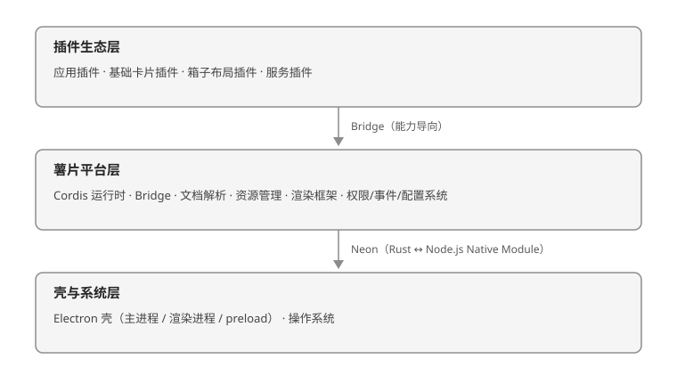

# 文档编写规范

> 版本：v1.0.0  
> 日期：2026-09-19  
> 状态：正式版  
> 适用范围：薯片生态文档库全部文档的分类、结构、文档头、代码示例、链接、审查与更新规则

---

## 七、图片

### 7.1 插入图片

```markdown

```

### 7.2 图片说明

```markdown
  
*图 1: 薯片生态整体架构*
```

---

**文档结束**
