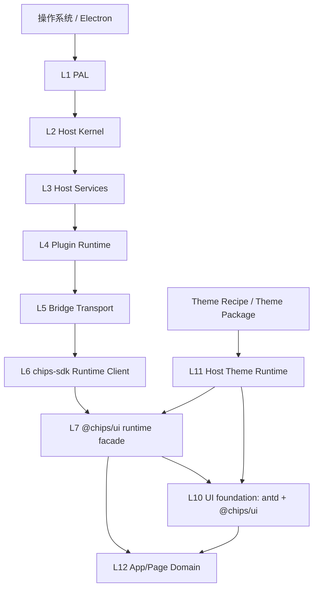

# 02 目标全链路与职责矩阵

## 1. 目标链路



图中 L8/L9 仍属于 Host 的声明式 UI/统一渲染能力；当前 antd 应用不直接消费它们。需要使用卡片、布局或 Host 托管文档的链路时，仍必须经过 Host 正式 surface/document 协议，不能在应用里绕过 Bridge 直接调用内部渲染器。

## 2. 每层唯一职责

| 层 | 负责 | 对外输出 | 不负责 |
|---|---|---|---|
| L1 PAL | OS/Electron 差异适配 | 平台无关原语 | 插件业务、React 组件 |
| L2 Kernel | route、registry、event、lifecycle、权限入口 | 标准 route 调度 | 页面状态和视觉 |
| L3 Services | file/resource/config/theme/i18n/platform 等领域服务 | schema 化 action/event | 组件渲染、业务组合 |
| L4 Plugin Runtime | 安装、加载、隔离、会话、权限和 surface 生命周期 | plugin session、launch context | 应用业务逻辑 |
| L5 Bridge | `window.chips.*` transport、安全暴露和事件订阅 | invoke/on/once/emit | 领域规则的第二份实现 |
| L6 SDK | 类型化 API、错误归一、CLI、测试辅助 | `Client`、testing、chipsdev | Host runtime、React Provider |
| L7 `@chips/ui` runtime | 将 SDK client 注入 React、统一 Browser/Host 接线、应用壳 | `mountChipsApp`、`useChips`、命令 UI | 直接实现文件/主题/权限服务 |
| L10 antd / `@chips/ui` UI | 稳定 UI 行为、视觉配置、生态组合 | 控件、布局、壳、a11y 入口 | 业务状态和 Host route |
| L11 Theme Runtime | 解析 themeId、作用域、CSS/token 注入、回退 | `themeCss`、token snapshot、诊断 | 组件逻辑和业务权限 |
| Theme Package | 配方输入、生成 token/CSS/资源/Manifest | 可安装主题产物 | Host runtime、业务 API |
| L12 App/Page | 领域状态、流程、页面结构和具体文案资源 | 可运行应用 UI | PAL、Kernel、Bridge 细节、私有基础控件 |

## 3. 允许依赖图

```text
App/Page
 ├─ @chips/ui/app
 ├─ @chips/ui/components
 ├─ antd（只允许稳定叶子组件，按门面规则）
 └─ chips-sdk（原则上只通过 @chips/ui 注入的 Client 使用）

@chips/ui
 ├─ chips-sdk 类型/Client
 ├─ antd
 └─ React 18

chips-sdk
 ├─ Bridge 类型和 transport
 └─ schema / testing / CLI

Host
 ├─ PAL
 ├─ Kernel
 ├─ Services
 └─ Plugin Runtime / Bridge / Theme Runtime
```

禁止：

- 应用直接 import `Chips-Host/src/*`；
- 应用直接读写 `window.chips.invoke` 以外的内部对象；
- `chips-sdk` 复制 Host route 或在 SDK 中启动 Electron/主题运行时；
- `@chips/ui` 直接访问文件系统、Node API 或 Host 私有服务；
- Theme Package import React 应用代码，或将业务组件打包进主题；
- 任何应用重复定义 `Button/Input/Dialog` 基础行为和全局 token。

## 4. 一次启动的标准数据流

1. Host 读取插件 `manifest.yaml`，校验 `type/appId/entry/runtime.targets/permissions/ui.surface`。
2. Plugin Runtime 建立 session，生成 `PlatformLaunchContext`，绑定 `pluginId/sessionId/surfaceId/sceneId`。
3. preload 根据权限安装 Bridge；页面侧 `createClient({ environment: "auto" })` 只由运行时门面创建一次。
4. `mountChipsApp` 建立 `ChipsProvider`、antd `ConfigProvider`、命令上下文、错误/加载边界和 AppChrome。
5. `@chips/ui` 读取已注入的主题快照；如果应用没有 `theme.read`，使用共享默认主题，不向 Host 发起无权限请求。
6. 应用通过 hooks 请求 SDK domain API；SDK 负责 action 编解码、超时、重试和错误归一。
7. 命令先生成结构化定义，再由运行时门面注册到本地 UI 和 Host command registry；实际业务 handler 只在插件页面侧执行。
8. surface 关闭或插件卸载时，统一门面取消事件、注销命令、释放资源和清理临时 URL。

## 5. 责任矩阵

| 能力 | Host | SDK | `@chips/ui` | 应用 | 主题包 |
|---|---|---|---|---|---|
| Bridge transport | 实现/安全暴露 | 类型化调用 | 不实现 | 不直连 | 不接触 |
| 文件/资源 | 服务与权限 | `client.file/resource` | 不实现 | 调用正式 API | 不接触 |
| Surface/窗口 | 创建、焦点、状态、生命周期 | `client.surface` | launch context/壳适配 | 声明需求、响应事件 | 不接触 |
| command | registry、权限、事件 | 类型化 API | UI 目录、快捷键和 handler 适配 | 声明 command 与业务处理 | 不接触 |
| 默认视觉 | Theme Runtime 可选注入 | 只读 theme API | Apple 默认 ThemeConfig/CSS | 消费 token，不覆盖 | 提供 recipe 产物 |
| 自定义主题 | 安装、解析、回退、作用域 | CLI/inspect/validate | 读取解析结果并转 ConfigProvider | 不读取包文件 | 只提供静态产物 |
| 国际化 | 系统 locale（若启用） | `client.i18n` | 组件内置 locale/应用资源装载辅助 | 文案资源与 key | 不能写业务文案 |
| 组件行为 | 不实现 React 控件 | 测试 mock | antd 门面/生态特有组合 | 组合与业务状态 | CSS/token |
| 质量门禁 | route/权限/Host 集成/性能 | schema/SDK/CLI | 组件和适配器 | 应用单元/e2e | 构建/契约/视觉 |

## 6. 单一事实源

必须分别确定以下真相，禁止一份配置复制成两份可独立修改的文本：

| 对象 | 权威来源 | 生成/消费方 |
|---|---|---|
| 插件身份、权限、入口 | `manifest.yaml` | Host、SDK validate、脚手架生成类型 |
| Bridge action schema | Host route manifest + SDK 类型 | Host、SDK、mock Host、文档 |
| 应用运行时接线 | `@chips/ui/app` | 脚手架和应用入口 |
| 默认视觉 token | `Chips-Ui/src/theme` 或主题 Recipe 源 | antd ConfigProvider、CSS、预览 |
| 主题包元数据 | theme `manifest.yaml` | Host Theme Runtime、CLI |
| command 语义 | SDK command schema | Host registry、应用 UI、测试 |
| 业务状态 | 应用领域模块 | 页面、业务测试 |

## 7. 发生缺口时的流程

发现 Host/SDK/`@chips/ui`/脚手架/文档之间不一致时：

1. 先写入 `项目日志与笔记/问题工单.md`，创建独立中文工单目录；
2. 在方案和实现中标记该能力为“未收口”，不创建私有替代 API；
3. 由对应维护方完成契约、实现、测试和文档同步；
4. 重新执行真实生成和正式运行链路后，才能把能力移入稳定门面。

